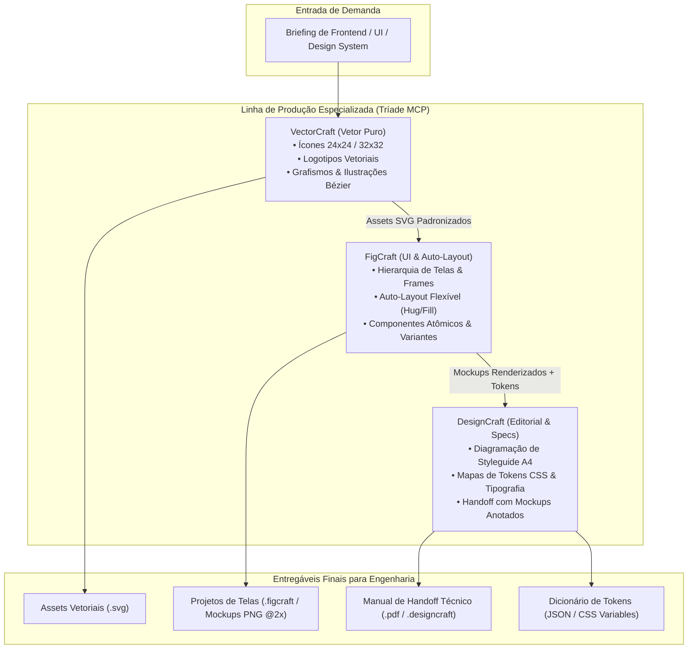
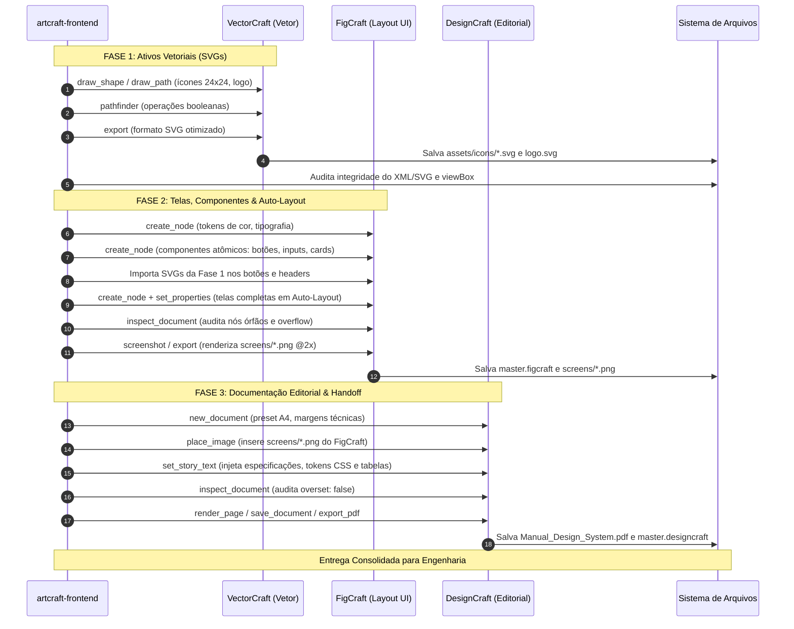
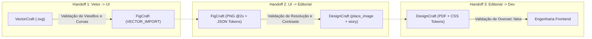
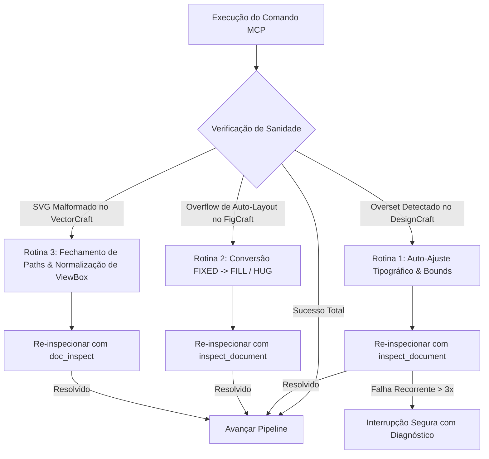

# ArtCraft Frontend UI — Manual Técnico & Operacional Canônico
### Arquitetura de Design de Interface, Prototipagem Atômica e Documentação Técnica via Tríade MCP (VectorCraft, FigCraft & DesignCraft)

---

## Sumário Executivo

1. [Visão Geral, Papel da Skill e Filosofia da Tríade](#1-visão-geral-papel-da-skill-e-filosofia-da-tríade)
   - 1.1 O que é a Skill ArtCraft Frontend UI?
   - 1.2 A Divisão Tripartite de Responsabilidades: VectorCraft, FigCraft e DesignCraft
   - 1.3 As Fronteiras Rígidas e Proibições Inegociáveis
   - 1.4 Quadro Comparativo dos Três Motores (Equivalências, Formatos, Unidades e Modos de Execução)
2. [Fundamentos Técnicos, Sistemas de Coordenadas e Modelos de Layout](#2-fundamentos-técnicos-sistemas-de-coordenadas-e-modelos-de-layout)
   - 2.1 VectorCraft: Espaço Vetorial, Curvas de Bézier e Grid de Construção de Ícones ($24 \times 24$, $32 \times 32$)
   - 2.2 FigCraft: Sistema de Coordenadas em Pixels Virtuais ($px$), Árvore de Nós e Hierarquia Relativa
   - 2.3 FigCraft: Mecânica Profunda do Auto-Layout (Eixo Primário, Contraeixo, Hug, Fill, Fixed, Gaps e Paddings)
   - 2.4 DesignCraft: Espaço de Espalhamento Editorial em Pontos ($pt$), Grid Tipográfico e Gestão de Histórias (`stories`)
   - 2.5 Acessibilidade Digital (WCAG 2.1 AA/AAA) e Relações de Contraste Cromático
3. [Roadmap Detalhado de Implementação por Aplicativo](#3-roadmap-detalhado-de-implementação-por-aplicativo)
   - 3.1 Fase 1 (VectorCraft): Arquitetura de Ativos Vetoriais, Ícones e Logomarcas
   - 3.2 Fase 2 (FigCraft): Fundação de Tokens, Componentização Atômica e Montagem de Telas Responsivas
   - 3.3 Fase 3 (DesignCraft): Diagramação Editorial do Styleguide, Handoff e Tokens CSS
   - 3.4 Matriz de Dependência e Ordem de Execução Sequencial do Pipeline
4. [Como a Skill Passa Instruções Para Cada App (Protocolos MCP & Payloads)](#4-como-a-skill-passa-instruções-para-cada-app-protocolos-mcp--payloads)
   - 4.1 Princípios de Comunicação via MCP (Atomicidade, Idempotência e Caminhos Canônicos)
   - 4.2 Protocolo de Instrução para VectorCraft (Ferramentas, Esquemas, Comandos em Lote e Exemplos)
   - 4.3 Protocolo de Instrução para FigCraft (Ferramentas, Criação de Nós, Auto-Layout e Exemplos)
   - 4.4 Protocolo de Instrução para DesignCraft (Ferramentas, Documentos, Caixas de Texto e Exemplos)
5. [Contratos Formais de Handoff Inter-App](#5-contratos-formais-de-handoff-inter-app)
   - 5.1 Handoff 1: VectorCraft $\rightarrow$ FigCraft (Especificação de SVG, Nomenclatura e Importação)
   - 5.2 Handoff 2: FigCraft $\rightarrow$ DesignCraft (Mockups PNG @2x, Extração de Tokens e Metadados)
   - 5.3 Handoff 3: DesignCraft $\rightarrow$ Engenharia Frontend (Especificação W3C Design Tokens, CSS Variables e PDF Master)
6. [Casos Práticos de Execução Ponta a Ponta](#6-casos-práticos-de-execução-ponta-a-ponta)
   - 6.1 Caso 1: Design System Completo e Landing Page para Plataforma SaaS B2B
   - 6.2 Caso 2: Fluxo Mobile de Onboarding e Dashboard para Aplicativo Fintech iOS/Android
   - 6.3 Caso 3: Interface de E-Commerce com Catálogo de Produtos e Manual de Marca
7. [Protocolos de Tratamento de Erros, Fallbacks e Auto-Recuperação (Self-Healing)](#7-protocolos-de-tratamento-de-erros-fallbacks-e-auto-recuperação-self-healing)
   - 7.1 Tratamento de Overset Text e Truncamento de Tipografia no DesignCraft
   - 7.2 Correção de Quebra de Auto-Layout e Overflow de Componentes no FigCraft
   - 7.3 Resolução de SVGs Malformados, ViewBox Incorreto e Contornos Abertos no VectorCraft
   - 7.4 Matriz de Resolução de Problemas (Troubleshooting Exaustivo)
8. [Matriz de Ferramentas MCP, Slash Commands e Quality Gates](#8-matriz-de-ferramentas-mcp-slash-commands-e-quality-gates)
   - 8.1 Catálogo Completo de Ferramentas MCP dos Três Servidores
   - 8.2 Checklist de Aceitação Técnica Final (Quality Gate)
   - 8.3 Guia de Boas Práticas e Recomendações para Agentes Autônomos

---

## 1. Visão Geral, Papel da Skill e Filosofia da Tríade

### 1.1 O que é a Skill ArtCraft Frontend UI?

A skill **`artcraft-frontend`** é a autoridade técnica suprema da suíte ArtCraft para a concepção, prototipagem, padronização e documentação de interfaces digitais contemporâneas (Web, Desktop, iOS e Android). Seu propósito é substituir a criação empírica e desordenada de telas por um **processo industrial algorítmico**, onde o design de uma interface segue a mesma solidez arquitetural de um software corporativo.

A skill opera como um maestro especializado sobre três motores de renderização vetorial e diagramação, cada um projetado especificamente para um nível de abstração do design digital:
1. **VectorCraft:** Responsável pela micronatureza geométrica dos vetores e glifos.
2. **FigCraft:** Responsável pela macronatureza estrutural, espacial e relacional das telas e componentes.
3. **DesignCraft:** Responsável pela natureza normativa, editorial e documental dos manuais técnicos de handoff.



### 1.2 A Divisão Tripartite de Responsabilidades: VectorCraft, FigCraft e DesignCraft

A separação estrita de atribuições impede que ferramentas tentem exercer funções para as quais não possuem os algoritmos adequados:

1. **VectorCraft (O Geômetra):**
   - **Competência Exclusiva:** Desenho matemático de contornos em curvas de Bézier cúbicas e quadráticas, operações booleanas de cálculo de caminho (Pathfinder: *Unite*, *Subtract*, *Intersect*, *Exclude*), criação de cantos suavizados (*fillets* e chanfros) e exportação de código SVG 1.1 enxuto.
   - **Por que é insubstituível:** O desenho de ícones de interface exige fechamento de caminhos em subpixel, otimização de nós e remoção de pontos redundantes. Fazer isso dentro de um editor de telas gera código SVG inchado e com nós degenerados.

2. **FigCraft (O Arquiteto de Layout):**
   - **Competência Exclusiva:** Gestão de árvores de nós relacionais (DOM Virtual de UI), implementação de sistemas de auto-layout flexíveis equivalentes ao Flexbox (`layoutMode`, `itemSpacing`, `padding`, `primaryAxisAlignItems`, `counterAxisAlignItems`, `sizingH`, `sizingV`), gerenciamento de variantes de componentes (`Default`, `Hover`, `Pressed`, `Disabled`) e geração de renderizações de tela em alta fidelidade.
   - **Por que é insubstituível:** É o único motor capaz de computar o comportamento elástico e responsivo de componentes quando os textos internos variam de tamanho ou quando a largura da tela transiciona de Mobile ($390\text{ px}$) para Desktop ($1440\text{ px}$).

3. **DesignCraft (O Publicador Editorial):**
   - **Competência Exclusiva:** Diagramação tipográfica de altíssima precisão baseada em pontos ($pt$), cálculo de fluxo de texto contínuo em caixas encadeadas (*stories*), detecção e prevenção de estouro de texto (*overset text*), distribuição harmônica de mockups visuais em grades de publicação e fechamento de manuais técnicos de handoff em PDF vetorial.
   - **Por que é insubstituível:** Ferramentas de UI não possuem o rigor tipográfico necessário para criar catálogos de especificações técnicas legíveis, com controle de entrelinha, kerning, viúvas e órfãs, necessários para que equipes de engenharia implementem o design sem ambiguidades.

### 1.3 As Fronteiras Rígidas e Proibições Inegociáveis

Para erradicar conflitos de escopo, a skill impõe as seguintes **fronteiras negativas absolutas**:

| Ferramenta | O que DEVE Fazer com Perfeição | Proibição Estrita (O que NUNCA Deve Fazer) |
| :--- | :--- | :--- |
| **VectorCraft** | - Desenhar ícones individuais em grids $24 \times 24$ ou $32 \times 32\text{ pt}$.<br>- Construir logotipos vetoriais institucionais.<br>- Executar operações booleanas em traçados Bézier.<br>- Exportar arquivos `.svg` limpos e sem metadados redundantes. | - **PROIBIDO montar telas completas de aplicativos ou sites.**<br>- PROIBIDO criar fluxos navegáveis ou protótipos de interface.<br>- PROIBIDO formatar longos blocos de texto ou parágrafos editoriais.<br>- PROIBIDO definir propriedades de flexbox ou auto-layout de UI. |
| **FigCraft** | - Criar frames de tela (Desktop, Tablet, Mobile).<br>- Aplicar sistemas de Auto-Layout (horizontal, vertical, wrap).<br>- Configurar propriedades de dimensionamento (`HUG`, `FILL`, `FIXED`).<br>- Montar componentes com propriedades variantes.<br>- Importar SVGs e instanciá-los como nós na interface. | - **PROIBIDO desenhar ícones complexos do zero via manipulação bruta de nós.**<br>- PROIBIDO tentar diagramar manuais multipáginas impressos em formato A4/Letter.<br>- PROIBIDO realizar recortes destrutivos de imagens raster ou tratamento de cor.<br>- PROIBIDO gerar arquivos PDF de manuais editoriais densos. |
| **DesignCraft** | - Criar documentos editoriais (A4, Letter) em pontos ($pt$).<br>- Diagramar o Manual de Identidade Visual e Design System.<br>- Organizar tabelas de tokens CSS e guidelines de engenharia.<br>- Inserir os mockups exportados pelo FigCraft em grids elegantes.<br>- Auditar e erradicar *overset text* em caixas de especificação. | - **PROIBIDO construir botões ou telas atômicas de UI interativas.**<br>- PROIBIDO simular o comportamento de flexbox ou auto-layout de páginas web.<br>- PROIBIDO desenhar vetores livres como logos ou pacotes de ícones.<br>- PROIBIDO exportar assets individuais para uso em pacotes NPM de frontend. |

### 1.4 Quadro Comparativo dos Três Motores

| Parâmetro Técnico | VectorCraft (`vectorcraft`) | FigCraft (`figcraft`) | DesignCraft (`designcraft`) |
| :--- | :--- | :--- | :--- |
| **Metáfora Central** | Mesa de Ilustração Vetorial | Prancheta de Design de Telas e Nós | Página de Editoração Eletrônica (DTP) |
| **Unidade Base de Medida** | Pontos PostScript ($1\text{ pt} = 1/72\text{ in}$) | Pixels Virtuais de Tela ($1\text{ unit} = 1\text{ px}$ a 100%) | Pontos Tipográficos ($1\text{ pt} = 1/72\text{ in}$) |
| **Origem das Coordenadas** | `(0, 0)` no canto superior esquerdo do artboard; $Y$ para baixo | `(0, 0)` relativo ao nó pai (ou tela global se na raiz); $Y$ para baixo | `(0, 0)` no canto superior esquerdo do spread; $Y$ para baixo |
| **Modelo de Posicionamento** | Absoluto Cartesiano | Híbrido: Absoluto (solto) ou Relacional (Auto-Layout) | Absoluto baseado em caixas delimitadoras (*frames*) |
| **Padrão de Cor** | Hexadecimal (`#RRGGBB` / `#RRGGBBAA`), RGB, CMYK | Hexadecimal estrito (`"#RRGGBB"` / `"#RRGGBBAA"`) | Hexadecimal, RGB, CMYK, Cores Especiais (Spot) |
| **Formatos Nativos** | `.vectorcraft` / `.ai` / `.eps` | `.figcraft` | `.designcraft` / `.indd` |
| **Formatos de Exportação** | `.svg`, `.pdf`, `.png`, `.eps` | `.figcraft`, `.svg`, `.png`, `.jpg`, `.pdf` | `.pdf`, `.designcraft`, `.png` |
| **Equivalente de Mercado** | Adobe Illustrator / CorelDraw | Figma / Sketch / Penpot | Adobe InDesign / QuarkXPress |
| **Modo de Operação MCP** | Headless (Motor vetorial in-process) | Headless (Motor de nós em sessão isolada) | Headless (Motor editorial in-process) |

---

## 2. Fundamentos Técnicos, Sistemas de Coordenadas e Modelos de Layout

### 2.1 VectorCraft: Espaço Vetorial, Curvas de Bézier e Grid de Construção de Ícones

O VectorCraft opera em um plano cartesiano bidimensional contínuo. As coordenadas são expressas em números de ponto flutuante de precisão dupla. 

#### Grid Canônico de Ícones:
Todos os ícones para frontend projetados pelo VectorCraft devem respeitar estritamente um grid base quadrado:
- **Tamanho Padrão de Ícone Mobile/Desktop:** $24 \times 24\text{ pt}$ (área de visualização nominal).
- **Tamanho Expandido / Touch Target:** $32 \times 32\text{ pt}$ ou $48 \times 48\text{ pt}$.
- **Área Ativa Segura (*Live Area / Safe Zone*):** $20 \times 20\text{ pt}$ centralizada, com margem de segurança de $2\text{ pt}$ em cada extremidade para evitar cortes em renderizações subpixel.
- **Espessura de Linha Padrão (*Stroke Weight*):** $1.5\text{ pt}$ ou $2.0\text{ pt}$ constante em toda a biblioteca.
- **Terminações e Junções (*Caps & Joins*):** Obrigatório o uso consistente de `stroke-linecap: round` e `stroke-linejoin: round` para garantir renderização suave em telas de baixa densidade (1x DPI).

```text
+-----------------------------+ (0, 0)
|  Margem de Segurança (2pt)  |
|   +---------------------+   | (2, 2)
|   |                     |   |
|   |   ÁREA VETORIAL     |   |
|   |   ÚTIL (20x20 pt)   |   |
|   |                     |   |
|   +---------------------+   | (22, 22)
|                             |
+-----------------------------+ (24, 24)
```

#### Definição Matemática de Curvas:
Uma curva Bézier cúbica no VectorCraft é governada pela equação paramétrica clássica:
$$B(t) = (1-t)^3 P_0 + 3(1-t)^2 t P_1 + 3(1-t) t^2 P_2 + t^3 P_3, \quad t \in [0, 1]$$
Onde $P_0$ e $P_3$ representam os pontos de ancoragem (*anchors*), e $P_1$ e $P_2$ são os pontos de controle tangenciais (*handles*). O VectorCraft proíbe pontos de ancoragem sobrepostos e exige que tangências colineares tenham comprimento mínimo de $0.5\text{ pt}$ para evitar distorções de arco.

---

### 2.2 FigCraft: Sistema de Coordenadas em Pixels Virtuais ($px$), Árvore de Nós e Hierarquia Relativa

No FigCraft, a tela não é uma imagem achatada, mas uma **árvore hierárquica acíclica de nós** (DOM de interface).

#### A Regra de Ouro das Coordenadas Relativas:
- **Nó na Raiz da Página:** Suas coordenadas `(x, y)` são absolutas no canvas infinito.
- **Nó Filho de um Frame:** Suas coordenadas `(x, y)` são **sempre relativas ao canto superior esquerdo do nó pai** `(0, 0)`.
- **Nó dentro de Auto-Layout:** Suas coordenadas `(x, y)` manuais são ignoradas pelo motor de renderização; a posição física é determinada inteiramente pela ordem na lista de filhos e pelas regras de alinhamento e fluxo do pai.

#### Estrutura Semântica da Árvore de Nós de uma Tela Completa:
```text
Page: "Main"
└── Frame: "Screen/Dashboard_Desktop" (1440 x 900)
    ├── Frame: "Navbar" [Auto-Layout: Horizontal, Fill Container]
    │   ├── VectorImport: "BrandLogo" (32 x 32)
    │   ├── Frame: "NavLinks" [Auto-Layout: Horizontal, Hug]
    │   │   ├── Text: "Features"
    │   │   ├── Text: "Pricing"
    │   │   └── Text: "Docs"
    │   └── Frame: "UserActions" [Auto-Layout: Horizontal, Hug]
    │       └── ComponentInstance: "Button/Primary/Medium"
    ├── Frame: "HeroSection" [Auto-Layout: Vertical, Fill Container]
    │   ├── Text: "DisplayHeadline"
    │   ├── Text: "BodySubtext"
    │   └── Frame: "CTA_Group" [Auto-Layout: Horizontal]
    │       ├── ComponentInstance: "Button/Primary/Large"
    │       └── ComponentInstance: "Button/Secondary/Large"
    └── Frame: "Footer" [Auto-Layout: Horizontal, Fill Container]
```

---

### 2.3 FigCraft: Mecânica Profunda do Auto-Layout

O motor de Auto-Layout do FigCraft implementa o padrão W3C CSS Flexible Box Layout (Flexbox) com propriedades estritamente mapeadas:

#### Modos de Layout (`layoutMode`):
- `NONE`: Posicionamento absoluto livre.
- `HORIZONTAL`: Os filhos são dispostos lado a lado da esquerda para a direita (análogo a `flex-direction: row`).
- `VERTICAL`: Os filhos são dispostos empilhados de cima para baixo (análogo a `flex-direction: column`).

#### Dimensões Relacionais (`sizingH` e `sizingV`):
- `FIXED`: O container ou nó filho mantém uma largura ou altura estática em pixels, indiferente ao tamanho do conteúdo interno ou do pai.
- `HUG`: O container se contrai ou expande exatamente para abraçar o tamanho combinado de todos os seus filhos mais os paddings internos (análogo a `width: max-content` ou `fit-content`).
- `FILL`: O nó filho se expande para preencher todo o espaço restante disponível dentro do eixo do container pai (análogo a `flex-grow: 1; width: 100%`).

#### Espaçamentos e Preenchimentos:
- `itemSpacing` ($gap$): Distância estrita em pixels entre nós filhos adjacentes.
- `padding`: Quádrupla ordenada `[top, right, bottom, left]` que delimita a distância entre as bordas do container pai e os filhos internos.

#### Alinhamento em Eixos:
- `primaryAxisAlignItems` ($justify-content$):
  - `MIN`: Alinha ao início (esquerda no horizontal, topo no vertical).
  - `CENTER`: Centraliza os elementos no eixo principal.
  - `MAX`: Alinha ao fim (direita no horizontal, fundo no vertical).
  - `SPACE_BETWEEN`: Distribui os filhos uniformemente, empurrando o primeiro e o último para as extremidades.
- `counterAxisAlignItems` ($align-items$):
  - `MIN`: Alinha ao topo (se horizontal) ou esquerda (se vertical).
  - `CENTER`: Centraliza no contraeixo.
  - `MAX`: Alinha ao fundo (se horizontal) ou direita (se vertical).

---

### 2.4 DesignCraft: Espaço de Espalhamento Editorial em Pontos ($pt$), Grid Tipográfico e Gestão de Histórias (`stories`)

O DesignCraft trabalha com a física dos materiais gráficos e da diagramação editorial tradicional de livros e revistas técnicas.

#### Padrões Dimensionais:
- **Unidade:** Ponto tipográfico PostScript ($1\text{ pt} = 1/72\text{ in} = 0.3527\text{ mm}$).
- **Preset Padrão A4:** $595.28 \times 841.89\text{ pt}$ (largura $\times$ altura).
- **Preset Padrão Carta (Letter):** $612.0 \times 792.0\text{ pt}$.
- **Margens Técnicas Canônicas para Manuais:**
  - `top`: $48\text{ pt}$ ($16.9\text{ mm}$)
  - `bottom`: $48\text{ pt}$ ($16.9\text{ mm}$)
  - `inside` / `left`: $54\text{ pt}$ ($19.0\text{ mm}$)
  - `outside` / `right`: $40\text{ pt}$ ($14.1\text{ mm}$)

#### Gestão de Fluxo de Texto (*Stories*) e Erradicação de *Overset*:
No DesignCraft, o texto reside dentro de entidades chamadas *Stories*. Uma story pode fluir através de uma ou mais molduras de texto (*frames*).
- **Overset Text:** Ocorre quando o volume do conteúdo textual inserido supera a área geométrica tridimensional da caixa de texto, fazendo com que caracteres, palavras ou parágrafos inteiros fiquem ocultos.
- **Auditoria Obrigatória:** É proibido finalizar qualquer manual de handoff com o atributo `overset: true`. A skill implementa cálculo dinâmico de área para ajustar a entrelinha (*leading*), reduzir sutilmente o corpo da fonte (*font size*) ou estender a altura vertical do frame antes da aprovação da entrega.

---

### 2.5 Acessibilidade Digital (WCAG 2.1 AA/AAA) e Relações de Contraste Cromático

Toda paleta cromática e interface projetada pela skill `artcraft-frontend` deve cumprir compulsoriamente os critérios de acessibilidade do W3C Web Content Accessibility Guidelines (WCAG 2.1).

#### Fórmula da Luminância Relativa ($L$):
Para um canal de cor sRGB normalizado $C \in \{R_{sRGB}, G_{sRGB}, B_{sRGB}\} \subset [0, 1]$:
$$C_{linear} = \begin{cases} \frac{C}{12.92}, & \text{se } C \le 0.04045 \\ \left(\frac{C + 0.055}{1.055}\right)^{2.4}, & \text{se } C > 0.04045 \end{cases}$$
A luminância relativa global do pixel é:
$$L = 0.2126 \cdot R_{linear} + 0.7152 \cdot G_{linear} + 0.0722 \cdot B_{linear}$$

#### Razão de Contraste ($CR$):
Dadas duas cores com luminâncias $L_1$ e $L_2$ (onde $L_1 > L_2$):
$$CR = \frac{L_1 + 0.05}{L_2 + 0.05}$$

#### Regras Mínimas de Aceitação:
- **Texto Normal ($< 18\text{ pt}$ ou $< 14\text{ pt}$ Bold):** Exige $CR \ge 4.5:1$ (Nível AA) ou $CR \ge 7.0:1$ (Nível AAA).
- **Texto Grande ($\ge 18\text{ pt}$ ou $\ge 14\text{ pt}$ Bold) e Elementos de UI/Ícones:** Exige $CR \ge 3.0:1$ (Nível AA).
- Se uma combinação de cores proposta violar esses índices, o componente é sumariamente rejeitado pelo Quality Gate.

---

## 3. Roadmap Detalhado de Implementação por Aplicativo

A execução da skill segue um fluxo rigoroso dividido em três fases operacionais consecutivas. Nenhuma fase é iniciada sem que o artefato da fase anterior tenha sido persistido e aprovado pelo contrato de handoff correspondente.



---

### 3.1 Fase 1 (VectorCraft): Arquitetura de Ativos Vetoriais, Ícones e Logomarcas

#### Objetivo Técnico:
Construir com precisão matemática todos os elementos gráficos que não dependem de contexto de tela: a logomarca da aplicação e o pacote de ícones semânticos da interface.

#### Pré-requisitos:
- Briefing contendo a lista exata de ícones necessários (ex.: `home`, `search`, `bell`, `user`, `chevron-right`, `cart`, `settings`).
- Definição da espessura de traço institucional ($1.5\text{ pt}$ ou $2.0\text{ pt}$) e da paleta hexadecimal de linha e preenchimento.

#### Passos de Execução no VectorCraft:
1. **Inicialização do Documento:**
   - Criar ou limpar o documento vetorial com artboard dimensionado exatamente para o grid do ícone ($24 \times 24\text{ pt}$).
2. **Construção dos Traçados Primários:**
   - Executar `draw_shape` para formas geométricas puras (círculos, retângulos com cantos arredondados).
   - Executar `draw_path` com sequências explícitas de comandos de caminho (`M`, `L`, `C`, `Z`) para grafismos complexos.
3. **Operações Booleanas de Refinamento:**
   - Acionar `pathfinder` com comandos `unite` ou `minus-front` para fundir formas compostas (ex.: subtrair o orifício interno de uma engrenagem ou de um cadeado).
4. **Aplicação de Tintas e Propriedades:**
   - Disparar `set_paint` configurando `fill: "none"` e `stroke: "#0F172A"`, `stroke_width: 2.0`, `stroke_linecap: "round"`, `stroke_linejoin: "round"`.
5. **Inspeção e Otimização:**
   - Executar `doc_inspect` para garantir que o número de nós é mínimo e que não existem traçados abertos ou sem propriedades visíveis.
6. **Exportação Padronizada:**
   - Executar `export` no formato `SVG`, ativando otimização, remoção de metadados XML proprietários e preservação de IDs semânticos legíveis.

#### Quality Gate 1:
- O arquivo `.svg` gerado possui atributo `viewBox="0 0 24 24"`.
- Não contém nós órfãos, tags `<text>` soltas ou imagens bitmap embutidas (`<image>`).
- O peso total do arquivo SVG não excede $4\text{ KB}$.

---

### 3.2 Fase 2 (FigCraft): Fundação de Tokens, Componentização Atômica e Montagem de Telas Responsivas

#### Objetivo Técnico:
Transformar os assets vetoriais da Fase 1 e as diretrizes do projeto em componentes interativos reutilizáveis e telas completas orientadas a Auto-Layout.

#### Passos de Execução no FigCraft:
1. **Definição da Camada de Tokens Globais:**
   - Criar frame de referência de design tokens contendo a escala semântica:
     - Superfícies: `surface/background` (`#FFFFFF`), `surface/card` (`#F8FAFC`), `surface/elevated` (`#FFFFFF`).
     - Ações: `brand/primary` (`#2563EB`), `brand/primary-hover` (`#1D4ED8`), `brand/secondary` (`#64748B`).
     - Tipografia: `text/primary` (`#0F172A`), `text/secondary` (`#475569`), `text/muted` (`#94A3B8`).
     - Bordas e Divisores: `border/subtle` (`#E2E8F0`), `border/focus` (`#2563EB`).
2. **Criação dos Componentes Atômicos:**
   - **Botões (`Button`):** Frame horizontal, `padding: [12, 20, 12, 20]`, `gap: 8`, `radius: 8`, contendo nó de texto (`font: "Inter SemiBold"`, `size: 14`) e container para receber o ícone SVG vindo do VectorCraft.
   - **Campos de Texto (`Input`):** Frame horizontal, `height: 48` (fixa para área de toque ergonômica), `padding: [0, 16, 0, 16]`, borda sutil de $1\text{ px}$, texto de placeholder com contraste controlado.
   - **Cards de Conteúdo (`Card`):** Frame vertical, `padding: [24, 24, 24, 24]`, `gap: 16`, `radius: 12`, sombra suave ou borda divisora.
3. **Montagem da Estrutura das Telas:**
   - Instanciar frame raiz com resolução exata da plataforma:
     - **Web Desktop:** $1440 \times 900\text{ px}$ (com auto-layout vertical para fluxo de página longa).
     - **Mobile iOS:** $390 \times 844\text{ px}$ (iPhone 14/15 base).
     - **Mobile Android:** $360 \times 800\text{ px}$.
   - Estruturar a árvore de seções:
     - `Section/Header_Navbar`: Largura `FILL`, altura fixa ou `HUG`, distribuição `SPACE_BETWEEN`.
     - `Section/Hero`: Largura `FILL`, alinhamento vertical, paddings laterais generosos ($80\text{ px}$ a $120\text{ px}$ em desktop, $20\text{ px}$ em mobile).
     - `Section/Content_Grid`: Largura `FILL`, auto-layout horizontal com quebra ou colunas proporcionais.
     - `Section/Footer`: Largura `FILL`, agrupamento de links institucionais e direitos autorais.
4. **Injeção dos SVGs do VectorCraft:**
   - Criar nós do tipo `VECTOR_IMPORT` dentro dos containers preparados, vinculando os caminhos físicos dos arquivos SVG exportados.
5. **Auditoria Estrutural:**
   - Executar `inspect_document` para garantir que nenhum elemento ultrapassa as margens do frame raiz sem propriedade deliberada de *scroll* ou *clip*.
6. **Geração de Mockups Visuais:**
   - Acionar `screenshot` ou `export` nos frames principais das telas com fator de escala `@2x` e formato PNG de 24 bits, salvando os artefatos para consumo pelo DesignCraft.

#### Quality Gate 2:
- $100\%$ dos containers de tela possuem `layoutMode` ativo (`HORIZONTAL` ou `VERTICAL`); não há nós flutuantes órfãos com coordenadas manuais estáticas.
- Todas as caixas de texto possuem `sizingH` configurado como `FILL` ou `HUG`, eliminando truncamento de rótulos.
- Imagens PNG `@2x` renderizadas sem serrilhamento ou distorções de proporção.

---

### 3.3 Fase 3 (DesignCraft): Diagramação Editorial do Styleguide, Handoff e Tokens CSS

#### Objetivo Técnico:
Produzir a documentação definitiva do Design System e das especificações de handoff em formato editorial elegante, integrando os mockups renderizados pelo FigCraft, tabelas de variáveis CSS e diretrizes normativas de engenharia.

#### Passos de Execução no DesignCraft:
1. **Criação do Documento Mestre:**
   - Chamar `new_document` configurando preset `A4` ($595.28 \times 841.89\text{ pt}$), orientação `PORTRAIT`, margens simétricas de $40\text{ pt}$ e número inicial de páginas planejado (ex.: 4 páginas).
2. **Diagramação da Página 1 (Capa Institucional & Metadados do Sistema):**
   - Inserir moldura de cabeçalho com nome do produto, número da versão do sistema (ex.: `v1.0.0`), data e carimbo de aprovação técnica.
   - Inserir resumo executivo das decisões de design.
3. **Diagramação da Página 2 (Design Tokens & Sistema Cromático):**
   - Criar grade editorial com amostras visuais de cores (*swatches*).
   - Diagramar caixas de texto contendo os nomes das variáveis CSS, valores hexadecimais, valores RGB e proporções de contraste calculadas contra fundo branco e preto.
   - Especificar a escala tipográfica harmônica com famílias de fontes, pesos, tamanhos em pixels e entrelinhas em pixels.
4. **Diagramação das Páginas 3 e 4 (Especificação de Telas e Handoff de Componentes):**
   - Criar molduras gráficas com `frame.create` e invocar `place_image` posicionando os mockups PNG `@2x` gerados pelo FigCraft.
   - Ao lado ou abaixo de cada mockup, posicionar caixas de texto com anotações de layout (*callouts*):
     - Breakpoints responsivos aplicáveis.
     - Espaçamentos em pixels ($gap$, $padding$, margens de grade).
     - Comportamentos interativos de botões e links (`hover`, `active`, `focus-visible`).
5. **Auditoria de Estouro de Texto (*Overset Check*):**
   - Disparar `inspect_document` inspecionando o campo `overset` de todas as histórias.
   - Se qualquer história retornar `overset: true`, executar rotina de correção imediata (reduzir corpo da tipografia em $0.5\text{ pt}$ ou aumentar a altura da moldura).
6. **Fechamento e Exportação:**
   - Renderizar visualizações com `render_page` para verificação estética.
   - Salvar o projeto nativo `.designcraft` e exportar o arquivo PDF final consolidado de alta resolução.

#### Quality Gate 3:
- O relatório do `inspect_document` atesta `overset: false` em absolutamente todas as caixas de texto.
- Todos os mockups de tela vinculados estão perfeitamente dimensionados e sem distorção anamórfica de escala ($X/Y$ proporcional).
- O PDF gerado está pronto para consumo por engenheiros de frontend, com fontes legíveis e referências completas de tokens.

---

### 3.4 Matriz de Dependência e Ordem de Execução Sequencial do Pipeline

A tabela a seguir consolida a dependência unívoca das etapas:

| Ordem | Etapa | Ferramenta Ativa | Dependência Imediata | Artefato de Entrada | Artefato Produzido |
| :---: | :--- | :--- | :--- | :--- | :--- |
| **01** | Desenho Vetorial de Ícones & Logos | **VectorCraft** | Nenhuma (Início) | Especificações do Briefing | `assets/icons/*.svg`, `assets/brand/logo.svg` |
| **02** | Auditoria e Validação de SVGs | **artcraft-frontend** | Etapa 01 | Arquivos SVG em disco | Relatório de Conformidade SVG (Quality Gate 1) |
| **03** | Instanciação de Tokens e Componentes | **FigCraft** | Etapa 02 | Tokens do Briefing | Biblioteca de Componentes (`.figcraft`) |
| **04** | Montagem das Telas em Auto-Layout | **FigCraft** | Etapa 03 | SVGs da Etapa 01 + Componentes | Telas Estruturadas (`master.figcraft`) |
| **05** | Exportação de Renders e Mockups | **FigCraft** | Etapa 04 | Telas montadas | `assets/screens/*.png` (@2x) |
| **06** | Inicialização do Documento Editorial | **DesignCraft** | Etapa 05 | Preset A4 | Documento em branco (`manual.designcraft`) |
| **07** | Inserção de Mockups e Textos de Spec | **DesignCraft** | Etapa 06 | `assets/screens/*.png` + Tokens | Páginas diagramadas |
| **08** | Auditoria de Overset e Fechamento PDF | **DesignCraft** | Etapa 07 | Documento populado | `Manual_Design_System.pdf` (Quality Gate 3) |

---

## 4. Como a Skill Passa Instruções Para Cada App (Protocolos MCP & Payloads)

### 4.1 Princípios de Comunicação via MCP (Atomicidade, Idempotência e Caminhos Canônicos)

Toda interação entre a skill e as três ferramentas obedece aos seguintes princípios inegociáveis:
1. **Atomicidade via Lotes (`batch` ou `command_batch`):** Operações encadeadas (como criar um retângulo, definir cantos arredondados e preencher com gradiente) devem ser transmitidas em uma única carga atômica de lote. Isso impede estados intermediários corrompidos e reduz a sobrecarga de round-trips IPC.
2. **Idempotência Operacional:** Os comandos são construídos de forma que, se executados repetidamente com os mesmos parâmetros, produzirão o mesmo estado final no documento, sem duplicação de camadas ou nós órfãos.
3. **Caminhos Canônicos Absolutos:** Todas as referências a arquivos no sistema operacional utilizam caminhos absolutos formatados com barras normatizadas (`/`), eliminando ambiguidades em sistemas Windows/POSIX.

---

### 4.2 Protocolo de Instrução para VectorCraft (Ferramentas, Esquemas, Comandos em Lote e Exemplos)

O VectorCraft é acionado através de suas ferramentas MCP nativas: `draw_shape`, `draw_path`, `set_paint`, `pathfinder`, `command_run`, `command_batch`, `doc_inspect` e `export`.

#### Exemplo 1: Desenho Atômico de um Ícone de "Escudo Seguro" com Operações Combinadas em Grid $24 \times 24\text{ pt}$

O payload abaixo desenha o contorno do escudo e a marca interna de checagem (*check mark*) em lote:

```json
{
  "ServerName": "vectorcraft",
  "ToolName": "command_batch",
  "Arguments": {
    "commands": [
      {
        "action": "create_artboard",
        "name": "icon-shield-check",
        "bounds": {"x": 0, "y": 0, "width": 24, "height": 24}
      },
      {
        "action": "draw_path",
        "id": "shield_perimeter",
        "d": "M 12 2 L 4 5 L 4 11 C 4 16.5 7.5 21.3 12 22.5 C 16.5 21.3 20 16.5 20 11 L 20 5 Z",
        "closed": true
      },
      {
        "action": "set_paint",
        "target_id": "shield_perimeter",
        "fill": "#EFF6FF",
        "stroke": "#2563EB",
        "stroke_width": 1.75,
        "stroke_linecap": "round",
        "stroke_linejoin": "round"
      },
      {
        "action": "draw_path",
        "id": "check_glyph",
        "d": "M 8.5 12 L 10.8 14.3 L 15.5 9.5",
        "closed": false
      },
      {
        "action": "set_paint",
        "target_id": "check_glyph",
        "fill": "none",
        "stroke": "#2563EB",
        "stroke_width": 2.0,
        "stroke_linecap": "round",
        "stroke_linejoin": "round"
      }
    ]
  }
}
```

#### Exemplo 2: Operação de Pathfinder Booleano (Criação de Ícone de Bateria com Terminal Subtraído)

```json
{
  "ServerName": "vectorcraft",
  "ToolName": "pathfinder",
  "Arguments": {
    "operation": "unite",
    "target_ids": ["battery_body_rect", "battery_terminal_cap"],
    "result_id": "battery_solid_container"
  }
}
```

#### Exemplo 3: Exportação Otimizada do SVG com Parâmetros de Produção

```json
{
  "ServerName": "vectorcraft",
  "ToolName": "export",
  "Arguments": {
    "format": "SVG",
    "artboard_name": "icon-shield-check",
    "output_path": "C:/Users/berna/Music/skills_02/assets/icons/icon_shield_check.svg",
    "options": {
      "minify": true,
      "strip_xml_declaration": true,
      "strip_comments": true,
      "preserve_ids": true,
      "decimal_precision": 2
    }
  }
}
```

---

### 4.3 Protocolo de Instrução para FigCraft (Ferramentas, Criação de Nós, Auto-Layout e Exemplos)

O FigCraft é comandado via: `create_node`, `set_properties`, `get_node`, `inspect_document`, `batch`, `screenshot` e `export`.

#### Exemplo 1: Criação de um Componente de Botão com Auto-Layout Horizontal e Importação de Ícone SVG

```json
{
  "ServerName": "figcraft",
  "ToolName": "create_node",
  "Arguments": {
    "parent_id": "root_page",
    "type": "FRAME",
    "name": "Component/Button/Primary",
    "x": 100,
    "y": 100,
    "width": 160,
    "height": 48,
    "properties": {
      "layoutMode": "HORIZONTAL",
      "primaryAxisAlignItems": "CENTER",
      "counterAxisAlignItems": "CENTER",
      "itemSpacing": 8,
      "paddingTop": 12,
      "paddingBottom": 12,
      "paddingLeft": 20,
      "paddingRight": 20,
      "sizingH": "HUG",
      "sizingV": "FIXED",
      "cornerRadius": 8,
      "fills": [
        {"type": "SOLID", "color": "#2563EB"}
      ]
    }
  }
}
```

Em seguida, o texto interno do botão e o ícone SVG desenhado no VectorCraft são inseridos como filhos:

```json
{
  "ServerName": "figcraft",
  "ToolName": "batch",
  "Arguments": {
    "actions": [
      {
        "command": "create_node",
        "params": {
          "parent_id": "Component/Button/Primary",
          "type": "VECTOR_IMPORT",
          "name": "Icon/Left",
          "source_file": "C:/Users/berna/Music/skills_02/assets/icons/icon_shield_check.svg",
          "width": 18,
          "height": 18
        }
      },
      {
        "command": "create_node",
        "params": {
          "parent_id": "Component/Button/Primary",
          "type": "TEXT",
          "name": "Label",
          "characters": "Acessar Plataforma",
          "style": {
            "fontFamily": "Inter",
            "fontWeight": "600",
            "fontSize": 14,
            "lineHeight": 20,
            "color": "#FFFFFF"
          }
        }
      }
    ]
  }
}
```

#### Exemplo 2: Construção da Estrutura de uma Tela Desktop Inteira ($1440 \times 900\text{ px}$)

```json
{
  "ServerName": "figcraft",
  "ToolName": "create_node",
  "Arguments": {
    "parent_id": "root_page",
    "type": "FRAME",
    "name": "Screen/Desktop_Landing",
    "x": 0,
    "y": 0,
    "width": 1440,
    "height": 900,
    "properties": {
      "layoutMode": "VERTICAL",
      "itemSpacing": 0,
      "paddingTop": 0,
      "paddingBottom": 0,
      "paddingLeft": 0,
      "paddingRight": 0,
      "primaryAxisAlignItems": "MIN",
      "counterAxisAlignItems": "CENTER",
      "sizingH": "FIXED",
      "sizingV": "HUG",
      "fills": [
        {"type": "SOLID", "color": "#F8FAFC"}
      ]
    }
  }
}
```

#### Exemplo 3: Exportação do Mockup de Tela em Alta Fidelidade (@2x)

```json
{
  "ServerName": "figcraft",
  "ToolName": "screenshot",
  "Arguments": {
    "node_id": "Screen/Desktop_Landing",
    "scale": 2.0,
    "format": "PNG",
    "output_path": "C:/Users/berna/Music/skills_02/assets/screens/screen_landing_2x.png"
  }
}
```

---

### 4.4 Protocolo de Instrução para DesignCraft (Ferramentas, Documentos, Caixas de Texto e Exemplos)

O DesignCraft é comandado via: `new_document`, `save_document`, `execute` (`frame.create`, `style.paragraph.apply`, `type.char`), `place_image`, `set_story_text`, `inspect_document` e `render_page`.

#### Exemplo 1: Inicialização do Manual de Design System em A4

```json
{
  "ServerName": "designcraft",
  "ToolName": "new_document",
  "Arguments": {
    "preset": "A4",
    "orientation": "PORTRAIT",
    "facingPages": false,
    "pages": 4,
    "margins": {
      "top": 40.0,
      "bottom": 40.0,
      "left": 45.0,
      "right": 45.0
    }
  }
}
```

#### Exemplo 2: Criação de Moldura Gráfica e Posicionamento do Mockup do FigCraft

```json
{
  "ServerName": "designcraft",
  "ToolName": "execute",
  "Arguments": {
    "command": "frame.create",
    "params": {
      "pageIndex": 2,
      "rect": [45.0, 80.0, 550.0, 420.0],
      "content": "graphic",
      "id": "frame_mockup_landing"
    }
  }
}
```

Em seguida, o mockup gerado pelo FigCraft é inserido com ajuste de proporção:

```json
{
  "ServerName": "designcraft",
  "ToolName": "place_image",
  "Arguments": {
    "frameId": "frame_mockup_landing",
    "filePath": "C:/Users/berna/Music/skills_02/assets/screens/screen_landing_2x.png",
    "fitMode": "PROPORTIONAL_FIT"
  }
}
```

#### Exemplo 3: Injeção de Especificações Técnicas de Handoff com Estilos Tipográficos

```json
{
  "ServerName": "designcraft",
  "ToolName": "set_story_text",
  "Arguments": {
    "pageIndex": 2,
    "frame_coordinates": {
      "x": 45.0,
      "y": 520.0,
      "width": 505.0,
      "height": 240.0
    },
    "story_content": {
      "headline": "Especificações Técnicas de Implementação: Hero Section",
      "headline_style": {
        "font_family": "Inter Tight Bold",
        "font_size": 18,
        "line_height": 22,
        "color": "#0F172A"
      },
      "paragraphs": [
        {
          "text": "• Container Raiz: Largura máxima de 1440px, centralizado na viewport via margin: 0 auto.",
          "font_family": "JetBrains Mono",
          "font_size": 9.5,
          "line_height": 14,
          "color": "#334155"
        },
        {
          "text": "• Auto-Layout: Flexbox vertical, gap de 24px entre títulos e botões de chamada para ação (CTA).",
          "font_family": "JetBrains Mono",
          "font_size": 9.5,
          "line_height": 14,
          "color": "#334155"
        },
        {
          "text": "• Botão Primário: Utiliza a variável CSS var(--brand-primary, #2563EB) com padding de 12px 20px.",
          "font_family": "JetBrains Mono",
          "font_size": 9.5,
          "line_height": 14,
          "color": "#334155"
        }
      ]
    }
  }
}
```

#### Exemplo 4: Auditoria de Sanidade e Verificação de Overset

```json
{
  "ServerName": "designcraft",
  "ToolName": "inspect_document",
  "Arguments": {
    "check_fields": ["overset", "broken_links", "missing_fonts"]
  }
}
```

---

## 5. Contratos Formais de Handoff Inter-App

O funcionamento confiável da skill apoia-se em **três contratos inquebráveis de transferência de dados**:



### 5.1 Handoff 1: VectorCraft $\rightarrow$ FigCraft (Especificação de SVG, Nomenclatura e Importação)

#### Regras Mandatórias do Contrato:
1. **Estrutura XML Válida:** O arquivo `.svg` deve ser estritamente compatível com SVG 1.1 W3C, codificado em UTF-8 sem BOM.
2. **ViewBox Canônico:** O atributo `viewBox` é obrigatório, delimitando as coordenadas mínimas e dimensões reais (ex.: `viewBox="0 0 24 24"`). Atributos `width` e `height` devem ser expressos em unidades numéricas sem sufixos arbitrários.
3. **Nomenclatura Semântica de IDs:** Todos os caminhos essenciais devem conter identificadores em notação `kebab-case` explicativa (ex.: `<path id="icon-search-handle" ... />`).
4. **Higiene do Traçado:** É expressamente proibida a presença de tags `<script>`, estilos CSS externos dependentes de rede, filtros de bitmap embutidos ou tags `<image>`.
5. **Caminhos Fechados:** Formas que representam sólidos geométricos devem possuir comando de fechamento `Z` explícito no atributo `d`.

---

### 5.2 Handoff 2: FigCraft $\rightarrow$ DesignCraft (Mockups PNG @2x, Extração de Tokens e Metadados)

#### Regras Mandatórias do Contrato:
1. **Fator de Escala Visual:** Mockups de telas e componentes exportados pelo FigCraft para compor o manual editorial devem ser gerados com resolução mínima de **fator 2x** (`@2x`, $144\text{ DPI}$ efetivo), garantindo nitidez visual quando impressos ou exibidos em monitores Retina/4K.
2. **Formato Gráfico Intermediário:** Formato PNG de 24 bits com canal de transparência de 8 bits preservado, ou WebP sem perdas (*lossless*).
3. **Estrutura de Metadados de Tokens (`layout_tokens.json`):** Juntamente com a imagem gráfica, o FigCraft exporta o dicionário estruturado das dimensões e propriedades calculadas:

```json
{
  "component": "Screen/Desktop_Landing",
  "rendered_bounds": {"width": 1440, "height": 900},
  "tokens": {
    "spacing": {
      "header_padding_x": "80px",
      "hero_gap": "24px",
      "card_padding": "24px"
    },
    "colors": {
      "--bg-canvas": "#F8FAFC",
      "--brand-primary": "#2563EB",
      "--text-headline": "#0F172A"
    },
    "typography": {
      "headline_font": "Inter Tight, 48px, Bold, Line-Height: 56px",
      "body_font": "Inter, 16px, Regular, Line-Height: 24px"
    }
  }
}
```

---

### 5.3 Handoff 3: DesignCraft $\rightarrow$ Engenharia Frontend (Especificação W3C Design Tokens, CSS Variables e PDF Master)

#### Regras Mandatórias do Contrato:
1. **Ausência Absoluta de Truncamento:** O documento final exportado em PDF deve possuir `overset: false` em $100\%$ das molduras de texto.
2. **Dicionário Exportável de Tokens CSS:** O DesignCraft gera em conjunto com o PDF o arquivo `design-tokens.css` com variáveis prontas para injeção no `:root` do frontend:

```css
:root {
  /* Design Tokens — Gerados por ArtCraft Frontend UI */
  --color-brand-primary: #2563EB;
  --color-brand-primary-hover: #1D4ED8;
  --color-surface-background: #F8FAFC;
  --color-surface-card: #FFFFFF;
  --color-text-primary: #0F172A;
  --color-text-secondary: #475569;
  --color-text-muted: #94A3B8;
  --color-border-subtle: #E2E8F0;

  --spacing-xs: 4px;
  --spacing-sm: 8px;
  --spacing-md: 16px;
  --spacing-lg: 24px;
  --spacing-xl: 32px;
  --spacing-2xl: 48px;

  --radius-sm: 4px;
  --radius-md: 8px;
  --radius-lg: 12px;
  --radius-full: 9999px;

  --font-family-display: "Inter Tight", sans-serif;
  --font-family-body: "Inter", sans-serif;
  --font-family-code: "JetBrains Mono", monospace;
}
```

---

## 6. Casos Práticos de Execução Ponta a Ponta

### 6.1 Caso 1: Design System Completo e Landing Page para Plataforma SaaS B2B

#### Briefing do Usuário:
> *"Crie a interface e o manual de design system para nossa nova plataforma de automação de cloud 'NovaOps'. Precisamos do logo em SVG, um pacote de 4 ícones (Cluster, Servidor, Cadeado e Relatório), a tela da landing page desktop com cabeçalho, hero banner com botão duplo e grid com 3 cards de produto, além do manual técnico em PDF de 3 páginas documentando as variáveis de CSS e os tamanhos de fonte."*

#### Grafo de Execução da Skill:

```text
[Briefing NovaOps]
       │
       ├──► VectorCraft: Desenha logo 'NovaOps' e os 4 ícones em SVG 24x24 pt.
       │         │
       │         ▼
       │    FigCraft: Constrói os tokens, componentes de botão e cards.
       │         │    Monta a Landing Page Desktop (1440x900 px) em Auto-Layout.
       │         │    Exporta mockup 'landing_novaops_2x.png'.
       │         │
       │         ▼
       └──► DesignCraft: Instancia manual A4 de 3 páginas.
                 │       Pág 1: Capa e Identidade Visual.
                 │       Pág 2: Tabela de Tokens CSS e Ícones.
                 │       Pág 3: Mockup da Landing com especificações técnicas.
                 ▼
          [Entrega Consolidada: SVGs + master.figcraft + Manual_NovaOps.pdf + tokens.css]
```

#### Execução Detalhada dos Comandos:
1. **Passo 1 (VectorCraft):** Desenha a logomarca combinando um símbolo hexagonal estilizado com a tipografia do logotipo. Desenha os ícones `icon-cluster.svg`, `icon-server.svg`, `icon-lock.svg`, `icon-chart.svg`. Todos são salvos em `assets/icons/`.
2. **Passo 2 (FigCraft):** Cria o frame raiz da Landing Page. Adiciona a barra de navegação com o logo importado à esquerda e botões de ação à direita com auto-layout `SPACE_BETWEEN`. Adiciona a Hero Section com manchete de $48\text{ px}$ e os botões primário e secundário. Insere a grade de 3 colunas onde cada card incorpora um dos ícones da Fase 1.
3. **Passo 3 (DesignCraft):** Cria o documento editorial A4. Na página 3, insere o mockup gerado pelo FigCraft na metade superior e na metade inferior diagrama três colunas de especificações com fontes monoespaçadas, detalhando cada padding e margin. O `inspect_document` confirma `overset: false`.

---

### 6.2 Caso 2: Fluxo Mobile de Onboarding e Dashboard para Aplicativo Fintech iOS/Android

#### Briefing do Usuário:
> *"Precisamos das telas de um aplicativo fintech mobile: tela de Boas-Vindas com ilustração geométrica de segurança, tela de Autenticação com campo de senha e botão biométrico, e tela inicial de Extrato Financeiro com saldo e lista de transações recentes. Todas com auto-layout pronto para iPhone 15 (390x844 px) e manual de handoff para desenvolvedores React Native."*

#### Execução Orquestrada:
1. **VectorCraft:** Desenha os ícones mobile específicos em grid $24 \times 24\text{ pt}$: `icon-fingerprint.svg`, `icon-credit-card.svg`, `icon-arrow-up-right.svg` (transferência enviada), `icon-arrow-down-left.svg` (depósito recebido).
2. **FigCraft:**
   - Cria frames mobile padrão $390 \times 844\text{ px}$.
   - Constrói o componente `TransactionRow` com auto-layout horizontal: ícone à esquerda em círculo com fundo suave, bloco vertical central com nome da transação e categoria (`sizingH: FILL`), e bloco vertical à direita com valor em moeda e status.
   - Aplica a safe area do iOS ($47\text{ px}$ de topo para Dynamic Island e $34\text{ px}$ de margem inferior).
   - Exporta os 3 mockups em `screens/mobile/*.png`.
3. **DesignCraft:**
   - Monta manual de especificações com orientação retrato, posicionando os três mockups mobile lado a lado em escala harmônica.
   - Detalha as regras de toque mínimo ($48 \times 48\text{ px}$), comportamento de rolagem e tokens de formatação numérica.

---

### 6.3 Caso 3: Interface de E-Commerce com Catálogo de Produtos e Manual de Marca

#### Briefing do Usuário:
> *"Desenvolver o catálogo de produtos de um e-commerce de moda sustentável. Inclui ícones de carrinho, sacola, filtro e coração de favoritos, card de produto responsivo com imagem, etiqueta de preço e botão de adicionar, e um guia de estilo de 2 páginas em PDF com a tabela de cores e tipografia da marca."*

#### Execução Orquestrada:
1. **VectorCraft:** Cria os ícones vetoriais de comércio eletrônico com traço orgânico arredondado de $1.5\text{ pt}$.
2. **FigCraft:** Monta o componente `ProductCard` com largura elástica `sizingH: FILL` (min $280\text{ px}$, max $360\text{ px}$), contendo moldura para imagem de produto em proporção $4:5$, selo de sustentabilidade no canto superior, título do produto e botão de compra rápida.
3. **DesignCraft:** Diagrama o manual de estilo com foco na identidade visual, apresentando a paleta de cores terrosas com suas variáveis CSS e o grid de 12 colunas para desktop e 4 colunas para mobile.

---

## 7. Protocolos de Tratamento de Erros, Fallbacks e Auto-Recuperação (Self-Healing)

A skill `artcraft-frontend` é dotada de algoritmos de **auto-recuperação autônoma** que detectam desvios técnicos e aplicam correções paramétricas sem necessitar de intervenção humana desnecessária.



---

### 7.1 Tratamento de Overset Text e Truncamento de Tipografia no DesignCraft

#### Causa Raiz:
O texto descritivo injetado em uma caixa de anotação de handoff possui volume de linhas superior à altura permitida pela moldura gráfica (`rect`).

#### Algoritmo de Auto-Recuperação:
1. O comando `inspect_document` sinaliza `overset: true` no frame `frame_spec_03`.
2. A skill lê as propriedades atuais da moldura via `get_story`.
3. Se a fonte do parágrafo for $\ge 10\text{ pt}$:
   - Executa `style.paragraph.apply` reduzindo o `font_size` em $0.5\text{ pt}$ e o `line_height` em $1.0\text{ pt}$.
4. Se a fonte já estiver no limite mínimo de legibilidade ($8.5\text{ pt}$):
   - Aumenta a coordenada $Y_2$ da moldura (altura física) em $15\%$ usando `execute: frame.set_bounds`, empurrando os elementos inferiores proporcionalmente.
5. Dispara nova checagem. O loop é encerrado quando `overset == false`.

---

### 7.2 Correção de Quebra de Auto-Layout e Overflow de Componentes no FigCraft

#### Causa Raiz:
Um nó filho foi configurado com largura estática `sizingH: "FIXED"` com valor superior à largura disponível dentro do frame pai, ou o container pai possui auto-layout desativado enquanto os filhos usam propriedades de flexbox.

#### Algoritmo de Auto-Recuperação:
1. A inspeção identifica que as coordenadas absolutas calculadas do filho ultrapassam a largura do pai (`child.x + child.width > parent.width`).
2. A skill envia instrução corretiva via `figcraft.set_properties`:
   - Altera `sizingH` de `"FIXED"` para `"FILL"`.
   - Define `layoutAlign` como `"STRETCH"`.
   - Ajusta o `itemSpacing` do container pai para valor modular menor (ex.: de $32\text{ px}$ para $16\text{ px}$) se houver saturação de elementos.
3. Re-inspeciona a árvore de nós até que nenhum elemento extravase a caixa delimitadora do container.

---

### 7.3 Resolução de SVGs Malformados, ViewBox Incorreto e Contornos Abertos no VectorCraft

#### Causa Raiz:
Um path gerado possui extremidades soltas gerando preenchimento irregular, ou o artboard não possui proporção quadrada $1:1$.

#### Algoritmo de Auto-Recuperação:
1. O validador de handoff detecta ausência do comando `Z` em traçado marcado como sólido ou detecta dimensões assimétricas (ex.: $24 \times 31\text{ pt}$).
2. A skill despacha comando corretivo ao VectorCraft:
   - Aciona `command_run` com ação `path.close` no traçado correspondente.
   - Redefine os limites do artboard para $24 \times 24\text{ pt}$ com centralização do centróide geométrico do desenho.
   - Re-exporta o arquivo `.svg` e valida a árvore XML resultante.

---

### 7.4 Matriz de Resolução de Problemas (Troubleshooting Exaustivo)

| Erro / Código MCP | Causa Fundamental | Ação Autônoma da Skill | Limite de Retentativas |
| :--- | :--- | :--- | :--- |
| `overset: true` no DesignCraft | Texto excede as dimensões físicas da moldura. | Reduzir fonte em até $1.5\text{ pt}$ ou estender altura da moldura em até $25\%$. | 3 iterações |
| `Child bounds exceed parent` no FigCraft | Nó com dimensão fixa maior que o container. | Aplicar `sizingH: "FILL"` e `sizingV: "HUG"` no nó filho. | 2 iterações |
| `Missing viewBox attribute` no SVG | Exportação vetorial sem normalização de viewport. | Re-exportar via VectorCraft forçando `viewBox: "0 0 24 24"`. | 1 iteração |
| `Contrast ratio < 4.5:1` no Quality Gate | Cor de texto e fundo sem contraste suficiente. | Escurecer a cor de texto para a próxima parada da escala semântica. | 1 iteração |
| `Path refused` no MCP | Tentativa de gravar em pasta fora das raízes autorizadas. | Normalizar caminho para o diretório canônico concedido no workspace. | 1 iteração |
| `Broken image link` no DesignCraft | Mockup do FigCraft ainda não foi gravado em disco. | Aguardar evento de flush de disco e revalidar existência do arquivo antes de `place_image`. | 2 iterações |

---

## 8. Matriz de Ferramentas MCP, Slash Commands e Quality Gates

### 8.1 Catálogo Completo de Ferramentas MCP dos Três Servidores

#### 1. Servidor VectorCraft (`vectorcraft`):
- `draw_shape`: Cria primitivas geométricas (retângulo, elipse, polígono, estrela, linha).
- `draw_path`: Cria traçados vetoriais Bézier através de coordenadas de nó e strings de caminho W3C SVG (`d`).
- `set_paint`: Define cores e espessuras de contorno (`stroke`, `stroke_width`) e preenchimento (`fill`).
- `pathfinder`: Executa operações booleanas (`unite`, `minus-front`, `intersect`, `exclude`, `divide`).
- `transform`: Aplica transformações afins (translação, escala, rotação e cisalhamento).
- `command_run` / `run_command`: Dispara comandos de menu do motor vetorial.
- `command_batch` / `batch`: Agrupa múltiplos comandos vetoriais em uma única transação atômica com rollback.
- `command_list` / `list_commands`: Lista todos os comandos disponíveis no motor com suporte a filtros.
- `doc_inspect` / `inspect_document`: Retorna a árvore completa de objetos vetoriais e coordenadas.
- `render_preview` / `screenshot`: Gera visualização gráfica do artboard em PNG.
- `export`: Salva o documento ou nós nos formatos `.svg`, `.pdf`, `.png` ou `.eps`.

#### 2. Servidor FigCraft (`figcraft`):
- `create_node`: Instancia novos nós (`FRAME`, `RECTANGLE`, `TEXT`, `VECTOR_IMPORT`).
- `set_properties`: Altera propriedades de nós existentes (auto-layout, paddings, gaps, fills, strokes, radius).
- `get_node`: Retorna metadados detalhados de um nó específico por ID.
- `inspect_document`: Inspeciona a hierarquia de nós da página, bounds absolutos e propriedades de auto-layout.
- `batch`: Executa sequência de criações e edições de nós em uma transação atômica.
- `run_command`: Dispara comando nativo do motor com parâmetros específicos.
- `list_commands`: Consulta o catálogo de comandos disponíveis no motor.
- `select`: Seleciona nós específicos no contexto da sessão.
- `screenshot`: Gera renderização rasterizada em alta resolução (1x, 2x, 3x) de qualquer frame ou tela.
- `export`: Exporta nós ou pranchetas em formatos de arte final.
- `save_file` / `open_file`: Persiste ou carrega o arquivo de projeto mestre `.figcraft`.

#### 3. Servidor DesignCraft (`designcraft`):
- `new_document`: Cria um novo projeto editorial com presets padrão (A4, Letter) ou dimensões personalizadas.
- `open_document` / `save_document`: Gerencia a persistência de arquivos `.designcraft`.
- `execute`: Executa comandos editoriais de baixo nível (`frame.create`, `style.paragraph.apply`, `type.char`).
- `batch`: Executa comandos editoriais múltiplos em lote atômico.
- `place_image`: Posiciona e redimensiona arquivos gráficos dentro de molduras existentes.
- `set_story_text`: Injeta ou substitui conteúdo textual formatado dentro de caixas encadeadas (*stories*).
- `get_story`: Extrai o conteúdo textual bruto e estilos de uma história existente.
- `inspect_document`: Audita páginas, itens, estilos e a presença de texto oculto (*overset*).
- `render_page`: Renderiza uma página do documento para inspeção visual gráfica em formato raster.
- `export_png`: Exporta páginas individuais ou spreads para imagem.

---

### 8.2 Checklist de Aceitação Técnica Final (Quality Gate)

Antes de considerar qualquer entrega concluída e liberar os links de acesso para o usuário ou engenheiro frontend, a skill audita compulsoriamente os seguintes pontos:

#### Checklist 1: Domínio Vetorial (VectorCraft):
- [ ] Todos os ícones foram concebidos e salvos no formato `.svg` limpo, sem tags `<script>` ou estilos CSS embutidos.
- [ ] O `viewBox` de todos os ícones está padronizado em base quadrada ($24 \times 24\text{ pt}$ ou $32 \times 32\text{ pt}$).
- [ ] As espessuras de linha (*strokes*) são consistentes em toda a biblioteca e utilizam terminações arredondadas (`round`).
- [ ] Não há nós de controle redundantes ou pontos de ancoragem sobrepostos.

#### Checklist 2: Domínio de Telas & UI (FigCraft):
- [ ] Todas as telas foram criadas com resoluções de padrão internacional (Desktop: $1440\text{ px}$; Mobile: $390\text{ px}$ ou $360\text{ px}$).
- [ ] $100\%$ dos blocos estruturais utilizam o sistema de Auto-Layout (`HORIZONTAL` ou `VERTICAL`).
- [ ] Nenhum elemento de texto possui largura estática que cause estouro ou truncamento quando o idioma ou tamanho de fonte varia.
- [ ] Todos os componentes possuem nomenclatura semântica padronizada com barras (`Category/Name/Variant`).
- [ ] As taxas de contraste de todas as combinações de cor e texto atendem ao padrão WCAG AA ($CR \ge 4.5:1$).

#### Checklist 3: Domínio Editorial & Handoff (DesignCraft):
- [ ] O manual de especificações possui layout editorial harmônico em formato A4 com margens consistentes.
- [ ] A auditoria via `inspect_document` confirma formalmente `overset: false` em todas as molduras de texto.
- [ ] Todos os mockups de tela inseridos foram gerados com fator de escala `@2x` e mantêm sua proporção de aspecto intacta.
- [ ] A tabela de tokens CSS contém referências completas de variáveis hexadecimais, espaçamentos e escalas de tipografia.
- [ ] O arquivo final `Manual_Design_System.pdf` e o arquivo `design-tokens.css` foram gravados com sucesso no diretório de saída.

---

### 8.3 Guia de Boas Práticas e Recomendações para Agentes Autônomos

1. **Nunca suponha: confirme com `inspect_document` antes de avançar.** Sempre execute a inspeção pós-comando para certificar-se de que o motor realmente executou a alteração esperada.
2. **Preserve sempre os arquivos de projeto abertos.** O desenvolvedor ou designer precisa receber tanto os assets finais (`.svg`, `.png`, `.pdf`) quanto os arquivos-fonte editáveis (`.vectorcraft`, `.figcraft`, `.designcraft`).
3. **Links Clicáveis em Markdown:** Sempre que concluir a execução de uma etapa ou do projeto completo, forneça caminhos absolutos formatados com o protocolo `file:///`:
   - Exemplo: `[Manual de Design System PDF](file:///C:/Users/berna/Music/skills_02/deliverables/Manual_Design_System.pdf)`
4. **Respeite a Autonomia Silenciosa:** Resolva pequenos ajustes de entrelinha, alinhamentos e ajustes de auto-layout silenciosamente através dos algoritmos de auto-recuperação, consultando o usuário apenas em decisões de negócio ou escopo macro.

---

*Fim da Especificação Técnica da Skill ArtCraft Frontend UI — Documento Canônico da Suíte.*
