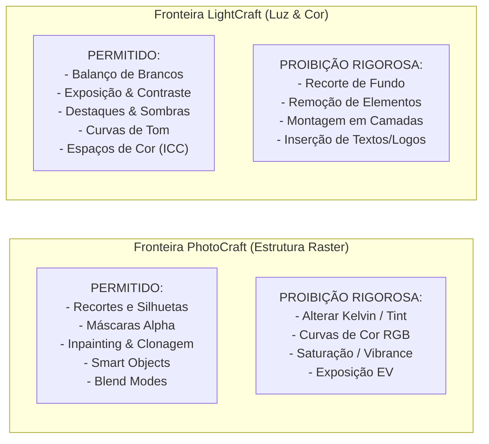
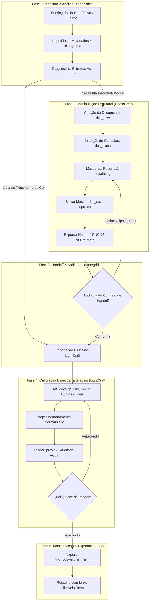

# ArtCraft: Image — Manual Técnico, Operacional & Arquitetura MCP
### Governança Integrada de Imagem: PhotoCraft (Raster & Estrutura) $\rightarrow$ LightCraft (Luz & Cor)

---

## Sumário Executivo

1. [Visão Geral e Filosofia do Domínio de Imagem](#1-visão-geral-e-filosofia-do-domínio-de-imagem)
   - 1.1 O que é a Skill `artcraft-image`?
   - 1.2 O Princípio da Separação Sagrada: Geometria Raster vs. Espectro Fotônico
   - 1.3 As Fronteiras Rígidas e a Proibição Inegociável de Conflito de Funções
   - 1.4 Arquitetura MCP: Modos Headless e Pontes de Execução
2. [Arquitetura Operacional e Ciclo de Vida da Imagem](#2-arquitetura-operacional-e-ciclo-de-vida-da-imagem)
   - 2.1 As 5 Fases do Pipeline de Imagem
   - 2.2 O Grafo Acíclico Dirigido (DAG) da Manipulação Fotográfica
   - 2.3 O Manifesto de Handoff Cromático (`image-manifest.json`)
   - 2.4 Diagrama Global da Linha de Produção
3. [PhotoCraft: Manual Técnico & Roadmap de Implementação](#3-photocraft-manual-técnico--roadmap-de-implementação)
   - 3.1 Atribuições Canônicas e Fronteira Negativa
   - 3.2 Roadmap Detalhado de Implementação no PhotoCraft (Fase a Fase)
   - 3.3 Catálogo Completo de Ferramentas e Comandos MCP
   - 3.4 Técnicas Avançadas de Seleção, Máscaras e Refinamento de Bordas
   - 3.5 Retoque Estrutural, Inpainting e Remoção de Imperfeições
   - 3.6 Hierarquia de Camadas, Objetos Inteligentes (*Smart Objects*) e Modos de Mesclagem
   - 3.7 Payloads Canônicos JSON de Execução
   - 3.8 Inspeção, Diagnóstico de Halos e Renderização de Previews
4. [LightCraft: Manual Técnico & Roadmap de Implementação](#4-lightcraft-manual-técnico--roadmap-de-implementação)
   - 4.1 Atribuições Canônicas e Fronteira Negativa
   - 4.2 Roadmap Detalhado de Implementação no LightCraft (Fase a Fase)
   - 4.3 Catálogo de Ferramentas MCP e Sistema de Sliders (`list_controls`)
   - 4.4 Calibração Cromática: Balanço de Brancos Térmico (Kelvin) e Tint Verde/Magenta
   - 4.5 Controle de Alcance Dinâmico: EV, Altas Luzes, Sombras, Pretos e Brancos
   - 4.6 Engenharia de Curvas Tonais Paramétricas (Canais RGB Globais e Individuais)
   - 4.7 Detalhe, Nitidez Óptica e Redução de Ruído por Frequência
   - 4.8 Sistema de Enquadramento e Crop Normalizado ($0.0 \dots 1.0$)
   - 4.9 Payloads Canônicos JSON de Execução
   - 4.10 Gestão de Espaços de Cor e Renderização de Saída (sRGB, Adobe RGB, ProPhoto RGB)
5. [Protocolo de Comunicação e Handoff Entre os Apps](#5-protocolo-de-comunicação-e-handoff-entre-os-apps)
   - 5.1 O Contrato Sagrado de Transferência: PhotoCraft $\rightarrow$ LightCraft
   - 5.2 O Fluxo Bidirecional Especial: Revelação Neutra RAW $\rightarrow$ PhotoCraft $\rightarrow$ Final Grade
   - 5.3 Integridade de Dados: Preservação de 16-bit, Latitude e Canal Alfa
   - 5.4 Prevenção de Artefatos: Erradicação de *Banding* e *Color Clipping*
6. [Casos Práticos de Produção Ponta a Ponta](#6-casos-práticos-de-produção-ponta-a-ponta)
   - 6.1 Caso 1: E-commerce de Luxo — Frasco de Perfume com Recorte e Luz Dourada
   - 6.2 Caso 2: Retrato Editorial Beauty — Limpeza de Pele, Desfoque Suave e Gradação Teal & Orange
   - 6.3 Caso 3: Key Visual Publicitário — Composição de Múltiplos Elementos com Equalização Atmosférica
7. [Protocolos de Resiliência, Diagnóstico de Falhas e Auto-Recuperação](#7-protocolos-de-resiliência-diagnóstico-de-falhas-e-auto-recuperação)
   - 7.1 Detecção e Correção Autônoma de Halos Espúrios em Recortes
   - 7.2 Resgate de Clipping de Altas Luzes e Sombras Empastadas
   - 7.3 Resolução de Incompatibilidade de Perfil de Cor (Color Space Mismatch)
   - 7.4 Matriz Exaustiva de Diagnóstico e Autocorreção
8. [Quality Gate, Checklist de Aceitação e Boas Práticas](#8-quality-gate-checklist-de-aceitação-e-boas-práticas)
   - 8.1 Checklist de Inspeção Técnica Final (Quality Gate da Imagem)
   - 8.2 Estrutura de Arquivos e Diretórios Recomendada
   - 8.3 Guia de Boas Práticas Operacionais para o Agente

---

## 1. Visão Geral e Filosofia do Domínio de Imagem

### 1.1 O que é a Skill `artcraft-image`?

A skill `artcraft-image` é o subsistema de inteligência especializada da suíte ArtCraft dedicado à **produção, tratamento, revelação e finalização de imagens bidimensionais estáticas**. Ela atua como um diretor técnico de imagem digital que comanda de forma coordenada dois dos motores gráficos mais sofisticados da suíte:
- **PhotoCraft:** O motor de síntese, corte e manipulação estrutural raster em nível de camada (análogo ao Adobe Photoshop ou Affinity Photo).
- **LightCraft:** O motor físico de revelação espectral, colorimetria de precisão e gerenciamento de iluminação não-destrutiva (análogo ao Adobe Lightroom ou Capture One).

A missão primária desta skill é traduzir intenções criativas do usuário (ex.: *"trate essa foto de modelo para uma capa de revista com tons quentes e sem imperfeições na pele"*, ou *"recorte esse produto, coloque sobre um fundo neutro e equilibre a exposição"*) em uma esteira industrial de produção estritamente padronizada, eliminando distorções de cor, degradação de bits e falhas de recorte.

### 1.2 O Princípio da Separação Sagrada: Geometria Raster vs. Espectro Fotônico

Na computação gráfica amadora, é comum que editores tentem fazer tudo em um único software: ajustar o balanço de brancos dentro de programas de recorte ou tentar fazer fotomontagens em softwares de revelação RAW. Isso introduz perda irreversível de latitude tonal, ruído de quantização e inconsistência cromática.

A skill `artcraft-image` opera sobre o **Princípio da Separação Sagrada**:

> **"A geometria dos pixels (onde cada elemento está, sua forma, transparência e arranjo de camadas) é atribuição estrita do PhotoCraft. A física dos fótons (exposição, equilíbrio espectral, curvas de contraste e gradação tonal) é monopólio exclusivo do LightCraft."**

Nenhum pixel tem sua cor ou curva de tom alterada no PhotoCraft; nenhum objeto é recortado ou clonado no LightCraft. Essa disciplina cirúrgica garante que cada motor opere exatamente naquilo em que sua arquitetura algorítmica é matematicamente superior.

### 1.3 As Fronteiras Rígidas e a Proibição Inegociável de Conflito de Funções

Para assegurar uma qualidade de nível de agência internacional, a skill estabelece **fronteiras negativas absolutas**. Qualquer tentativa de violar essas regras aciona a interceptação imediata pelo agente:



- **Se a imagem precisa perder elementos, fundir dois planos ou recortar um fundo:** Vai para o **PhotoCraft**.
- **Se a imagem precisa parecer mais viva, corrigir sombras escuras ou harmonizar o clima de cor:** Vai para o **LightCraft**.
- **Se a imagem precisa de ambos:** Segue o pipeline industrial: **PhotoCraft primeiro** (gerando a geometria limpa em 16 bits), e **LightCraft depois** (aplicando a luz e a cor sobre o conjunto unificado).

### 1.4 Arquitetura MCP: Modos Headless e Pontes de Execução

A comunicação entre a skill `artcraft-image` e as ferramentas subjacentes ocorre via **Model Context Protocol (MCP)**. Cada aplicativo expõe ferramentas dedicadas operando nos seguintes modos:

1. **PhotoCraft Engine (`photocraft`):**
   - *Modo Headless (Padrão):* Execução algorítmica direta no motor de processamento em segundo plano sem necessidade de interface gráfica renderizada. Garante alta performance, precisão de coordenadas e suporte a filas assíncronas de trabalho via jobs.
   - *Modo Bridge (Interativo):* Permite inspecionar a interface do usuário quando aberta (`ui_inspect`, `ui_screenshot`, `ui_pointer`) para auditoria visual ao vivo.
   - *Acesso ao Estado Vivo:* Consulta direta via recursos JSON tipados `photocraft://document` e `photocraft://commands`.

2. **LightCraft Engine (`lightcraft`):**
   - *Modo Headless (Exclusivo):* Pipeline não-destrutivo de alta velocidade baseado em catálogo de ativos indexados por identificadores numéricos inteiros (`photoId`). Todos os ajustes são calculados parametricamente sobre o arquivo base através de instruções em formato JSON enviadas ao endpoint `set_develop`.
   - *Espaço Coordenado Normalizado:* Qualquer ação espacial (como corte ou máscaras de ajuste) utiliza o intervalo flutuante $0.0 \dots 1.0$, tornando os comandos completamente independentes da resolução em pixels da foto.

---

## 2. Arquitetura Operacional e Ciclo de Vida da Imagem

### 2.1 As 5 Fases do Pipeline de Imagem

Cada imagem trabalhada pela skill percorre obrigatoriamente um ciclo de vida em 5 fases bem delineadas:



#### Fase 1: Ingestão & Análise Diagnóstica
A skill avalia o material entregue pelo usuário:
- Trata-se de um arquivo RAW de câmera fotográfica (`.CR3`, `.NEF`, `.ARW`, `.DNG`) ou de um bitmap já gerado (`.png`, `.jpg`, `.tif`)?
- A imagem contém objetos que precisam ser eliminados (postes, sujeiras na lente, acnes, elementos de fundo)?
- O sujeito principal precisa ser destacado e colocado sobre um fundo transparente ou composto com outra paisagem?
- A imagem está subexposta (escura), superexposta (com céus brancos estourados) ou com balanço de brancos distorcido?

#### Fase 2: Manipulação Estrutural no PhotoCraft
Se houver qualquer demanda de recorte, montagem ou remoção de objetos, o PhotoCraft é ativado:
- Cria o canvas com espaço de cor amplo (RGB) e profundidade mínima de 16 bits.
- Importa as fotos de base preservando-as como *Smart Objects*.
- Cria máscaras de recorte com refinamento vetorial ou de raio difuso (*feathering*).
- Executa preenchimento sensível ao conteúdo (*Content-Aware Fill*) para eliminar distrações.
- Salva o arquivo nativo editável `.pcraft` e exporta o arquivo intermediário não-comprimido.

#### Fase 3: Handoff & Auditoria de Integridade
Antes de passar o bastão para o LightCraft, a skill realiza uma checagem rigorosa:
- O arquivo intermediário está em 16 bits por canal?
- O perfil de cor ProPhoto RGB ou Adobe RGB foi mantido?
- O canal de transparência alfa foi preservado sem a introdução de halos brancos ou pretos?

#### Fase 4: Calibração Espectral & Grading no LightCraft
O LightCraft recebe a imagem intermediária (ou a foto bruta se não houve manipulação de camadas):
- Corrige a temperatura de cor e o matiz.
- Modula a distribuição de energia luminosa (exposição, altas luzes, sombras).
- Injeta contraste harmônico via curvas de tons paramétricas em $S$.
- Aplica nitidez e redução de ruído de alta frequência.
- Gera pré-visualização de controle via `render_preview`.

#### Fase 5: Masterização & Exportação Final
A imagem é renderizada com os parâmetros de saída ideais para seu canal de destino (web, mídia social, impressão gráfica ou UI) e salva no diretório de entregáveis do projeto.

---

### 2.2 O Grafo Acíclico Dirigido (DAG) da Manipulação Fotográfica

Para impedir loops infinitos e assegurar repetibilidade de produção, toda operação da skill é estruturada em um Grafo Acíclico Dirigido. Abaixo exemplifica-se o fluxo de uma campanha publicitária onde uma modelo de estúdio deve ser recortada e colocada em um pôr do sol cinematográfico:

```text
[Foto Bruta da Modelo (Studio RAW)]      [Foto de Paisagem de Fundo (Backdrop RAW)]
              │                                                │
              ▼                                                ▼
     [PhotoCraft: Ingestão]                          [PhotoCraft: Ingestão]
              │                                                │
              ├──► Seleção do Sujeito                          └──► Ajuste de Escala
              ├──► Máscara de Cabelo (Refine Edge)                    │
              └──► Retoque de Pele (Inpainting)                       │
                                │                                     │
                                └───► [Composição de Camadas] ◄───────┘
                                                │
                                                ▼
                                    [Salvar: composite.pcraft]
                                                │
                                                ▼
                                 [Exportar: composite_16bit.png]
                                                │
                                                ▼
                                    [LightCraft: Importação]
                                                │
                                                ├──► Temperatura Quente (6200K)
                                                ├──► Curva de Tons Cinematográfica
                                                ├──► Abertura de Sombras na Modelo
                                                └──► Gradação de Luz Solar Unificada
                                                │
                                                ▼
                                    [LightCraft: render_preview]
                                                │
                                                ▼ (Quality Gate Aprovado)
                                    [LightCraft: export]
                                                │
                                                ▼
                                 [Entrega: Campanha_Hero_Final.jpg]
```

---

### 2.3 O Manifesto de Handoff Cromático (`image-manifest.json`)

Para manter o estado íntegro e auditável em qualquer momento da execução, a skill mantém um arquivo de manifesto JSON no diretório do projeto:

```json
{
  "$schema": "https://artcraft.internal/schemas/v1/image-manifest.json",
  "project_name": "Campanha_Verao_2026",
  "created_at": "2026-10-27T10:20:00Z",
  "target_specs": {
    "usage": "web_hero_banner",
    "width_px": 3840,
    "height_px": 2160,
    "color_profile": "sRGB",
    "delivery_formats": ["WEBP", "JPG"]
  },
  "pipeline_state": {
    "stage": "lightcraft_grading",
    "photocraft": {
      "project_file": "C:/Users/berna/Music/skills_02/projects/image/master_composition.pcraft",
      "intermediate_export": "C:/Users/berna/Music/skills_02/assets/intermediate/hero_cutout_16bit.png",
      "bit_depth": 16,
      "color_space": "ProPhoto RGB",
      "layers_count": 4,
      "mask_quality_score": 0.98
    },
    "lightcraft": {
      "photo_id": 104,
      "applied_preset": "Cinematic_Warm_Sun",
      "white_balance": {"kelvin": 6150, "tint": 4},
      "exposure_ev": 0.35,
      "preview_image": "C:/Users/berna/Music/skills_02/assets/previews/preview_grade.jpg"
    }
  }
}
```

---

## 3. PhotoCraft: Manual Técnico & Roadmap de Implementação

### 3.1 Atribuições Canônicas e Fronteira Negativa

O PhotoCraft é o motor mestre de pixels. Suas responsabilidades são puramente estruturais e espaciais.

#### Atribuições Obrigatórias do PhotoCraft:
- Criar documentos com canvas dimensionalmente exatos e canais alfa limpos.
- Importar mídias externas como Objetos Inteligentes (*Smart Objects*) preservando os dados brutos originais para redimensionamentos sem perda.
- Executar seleções complexas com isolamento de silhuetas, cabelos finos e superfícies semitransparentes.
- Gerar máscaras de camada com controle milimétrico de raio de difusão (*feathering*) e suavização de contorno.
- Realizar clonagem, preenchimento sensível ao conteúdo (*Content-Aware Fill*) e restauração de falhas de imagem.
- Organizar pilhas de camadas lógicas e nomeadas semanticamente.
- Aplicar modos de mesclagem estruturais (*Blend Modes* como *Multiply* para sombras e *Screen* para iluminações sobrepostas).

#### Fronteira Negativa do PhotoCraft:
> **É TERMINANTEMENTE PROIBIDO ao PhotoCraft alterar a temperatura de cor, puxar matizes de cor, aplicar filtros de saturação de cor, curvar canais RGB para fins de color grading ou aplicar ajustes de exposição luminosa.** Qualquer alteração cromática gerada no PhotoCraft invalida o handoff e deve ser revertida imediatamente.

---

### 3.2 Roadmap Detalhado de Implementação no PhotoCraft (Fase a Fase)

Ao executar tarefas no PhotoCraft, o agente executor deve seguir rigorosamente as 7 etapas a seguir:

```text
[PhotoCraft: Roadmap de Execução]
Fase 1: Setup do Canvas (`doc_new`)
   └── Definir largura, altura, modo RGB e profundidade de 16 bits.
Fase 2: Posicionamento dos Ativos (`doc_place`)
   └── Importar arquivos como Smart Objects (asSmartObject: true).
Fase 3: Seleção e Isolamento do Assunto (`command_run` / `command_batch`)
   └── Isolar o assunto focal, criar canal alfa e aplicar feather de 0.8px a 1.2px.
Fase 4: Retoque Estrutural e Remoção de Distrações
   └── Aplicar Content-Aware Fill e carimbo de clonagem em manchas ou poeiras.
Fase 5: Montagem Multicamadas e Ajuste de Oclusão
   └── Ordenar camadas (Fundo -> Sujeito -> Grafismo), configurar Blend Modes.
Fase 6: Inspeção Diagnóstica e Preview (`doc_inspect` + `render_preview`)
   └── Checar integridade das camadas e ausência de halos.
Fase 7: Salvamento do Master e Exportação de Handoff (`doc_save`)
   └── Salvar projeto mestre .pcraft e exportar PNG 16-bit ProPhoto RGB.
```

#### Fase 1: Setup do Canvas
- Chame `doc_new`.
- Especifique `width` e `height` de acordo com o briefing (ex.: $3840 \times 2160$ para 4K, $1080 \times 1080$ para feed quadrado, ou dimensões em $300\text{ DPI}$ para impressão).
- Defina `mode: "rgb"`. O modo RGB de ampla gama é compulsório nesta etapa.
- Defina `depth: 16`. **Nunca inicie um projeto profissional em 8 bits**, pois etapas subsequentes de retoque e color grading geram quebras de gradientes (*banding*).
- Defina `background: "transparent"` ou `"white"` dependendo da natureza da peça.

#### Fase 2: Posicionamento dos Ativos como Smart Objects
- Utilize `doc_place` para injetar cada fotografia de entrada no canvas.
- A flag `asSmartObject: true` (ou chamada equivalente nativa) deve ser sempre honrada. Isso encapsula o arquivo original como uma camada vetorial/raster híbrida, permitindo que o PhotoCraft recalcule os pixels em caso de transformações de escala ou rotação sem reamostragem destrutiva.
- Defina as coordenadas `center: [x, y]` e a escala `scale` percentual para o enquadramento inicial.

#### Fase 3: Seleção e Isolamento do Assunto
- Execute a detecção de assunto focal ou seleções manuais poligonais através dos comandos da engine (`command_run` com id correspondente).
- Aplique o refinamento de bordas (*refine edge*):
  - Em recortes de objetos rígidos (produtos, garrafas, móveis): aplique um *feathering* de $0.5\text{px}$ a $0.8\text{px}$ para evitar cortes artificiais estilo "lâmina de barbear".
  - Em recortes orgânicos (cabelos humanos, pelagem de animais): ative o modo de amostragem de raio desconhecido para isolar fios individuais contra o fundo original.
- Converta a seleção em uma máscara de camada vinculada (*Layer Mask*). Nunca delete pixels diretamente da camada (edição não-destrutiva).

#### Fase 4: Retoque Estrutural e Inpainting
- Selecione imperfeições visuais (fios de cabelo soltos no rosto, manchas de lente, poeira no vidro de produtos).
- Acione os comandos de preenchimento inteligente (*Content-Aware Fill* / inpainting).
- Para tarefas de longa duração que demandem processamento assíncrono, utilize a flag `wait: true` para sincronização imediata ou monitore via `jobs_list`.

#### Fase 5: Montagem Multicamadas e Ajuste de Oclusão
- Nomeie todas as camadas com prefixos estruturais claros:
  - `BG_01_Environment`
  - `SUBJ_01_ModelCutout`
  - `FX_01_Atmosphere_Overlay`
- Se houver sobreposição de luzes ou sombras projetadas, configure o modo de mesclagem (*Blend Mode*) adequado:
  - Sombras projetadas de objetos no piso: Modo `Multiply` com opacidade modulada entre $60\%$ e $85\%$.
  - Reflexos ou clarões atmosféricos: Modo `Screen` ou `Soft Light`.

#### Fase 6: Inspeção Diagnóstica e Preview
- Execute `doc_inspect` para obter o dump JSON completo da árvore de camadas, confirmando que as máscaras estão ativas e as transformações foram aplicadas.
- Execute `render_preview` com `max_side: 1024` ou `2048` para renderizar uma imagem de diagnóstico. Verifique com atenção os limites da silhueta contra fundos pretos e brancos para assegurar que não haja resíduos da cor de fundo original (*color fringing*).

#### Fase 7: Salvamento do Master e Exportação de Handoff
- Salve o arquivo editável com todas as camadas abertas chamando `doc_save` com extensão `.pcraft` (formato nativo de alta performance sem perdas).
- Em seguida, chame `doc_save` ou `doc_export` apontando para o diretório intermediário de handoff com o formato PNG de 16 bits (`hero_cutout_16bit.png`).

---

### 3.3 Catálogo Completo de Ferramentas e Comandos MCP do PhotoCraft

Abaixo está a referência exaustiva das ferramentas MCP disponíveis no PhotoCraft:

| Ferramenta MCP | Descrição Operacional | Parâmetros Principais | Retorno Típico |
| :--- | :--- | :--- | :--- |
| `photocraft:doc_new` | Cria um novo canvas do zero. | `width`, `height`, `mode` (`"rgb"`, `"cmyk"`), `depth` (8, 16, 32), `background` (`"transparent"`, `"#HEX"`), `name`. | `{index: 0, width: 3840, height: 2160, status: "created"}` |
| `photocraft:doc_open` | Abre um documento existente em disco (`.pcraft`, `.psd`, `.png`). | `path` (relativo à raiz ou absoluto). | `{index: 0, path: "...", layers: 3}` |
| `photocraft:doc_close` | Fecha o documento ativo liberando memória RAM. | `save` (boolean). | `{closed: true}` |
| `photocraft:doc_place` | Insere um arquivo externo como Smart Object embutido. | `path`, `fit` (boolean), `scale` (float), `center` ($[x, y]$), `index`. | `{layer_id: "layer_smart_01", bounds: [x0,y0,x1,y1]}` |
| `photocraft:doc_replace_smart_object` | Substitui o arquivo-fonte de um Smart Object existente sem perder máscaras ou posições. | `layerId`, `path`. | `{success: true, layer_id: "..."}` |
| `photocraft:command_list` | Descobre todos os comandos internos da engine e seus parâmetros JSON. | N/A | Lista completa de comandos (`layer.mask.add`, `filter.blur...`) |
| `photocraft:command_run` | Executa um comando interno atômico. | `id` (string), `params` (JSON), `wait` (boolean). | `{success: true, history_step: "Add Layer Mask"}` ou `{job: 12}` |
| `photocraft:command_batch` | Executa uma lista sequencial de comandos em lote atômico. | `commands` (array de `{id, params}`). | `{executed_count: 5, status: "success"}` |
| `photocraft:doc_inspect` | Retorna a árvore hierárquica de camadas, histórico, seleções e camada ativa. | `index` (uint). | Objeto JSON profundo com toda a topologia do documento. |
| `photocraft:doc_save` | Salva o documento no formato nativo `.pcraft` ou exporta por extensão. | `path`, `format`, `quality` ($1 \dots 100$), `tiffLayers` (boolean). | `{saved: true, path: "...", warnings: []}` |
| `photocraft:doc_export` | Exportação de alta fidelidade para múltiplos formatos de entrega. | `format` (`"PNG"`, `"JPG"`, `"WEBP"`), `quality`, `path`. | `{exported_path: "...", bytes: 4194304}` |
| `photocraft:doc_export_layers` | Exporta cada camada individualmente em arquivos separados com transparência. | `dir`, `format`, `visibleOnly` (boolean). | `{exported_files: ["layer1.png", "layer2.png"]}` |
| `photocraft:render_preview` | Renderiza uma imagem achatada rápida em PNG para inspeção. | `max_side` (ex.: 1024, 2048), `index`. | `{preview_path: "...", width: 1024, height: 576}` |
| `photocraft:session_list` | Lista todos os documentos abertos na sessão MCP. | N/A | `{documents: [{index: 0, name: "hero", dirty: true}]}` |
| `photocraft:jobs_list` | Lista o status de tarefas em segundo plano (filtros pesados, inpainting). | N/A | `{jobs: [{id: 12, command: "contentAwareFill", progress: 0.85}]}` |
| `photocraft:jobs_cancel` | Cancela uma tarefa assíncrona em execução. | `id` (int). | `{cancelled: true}` |

---

### 3.4 Técnicas Avançadas de Seleção, Máscaras e Refinamento de Bordas

A qualidade de uma manipulação gráfica é definida pela invisibilidade de suas emendas. O PhotoCraft oferece ferramentas matemáticas de ponta para seleção.

#### Regras de Ouro de Mascaramento:
1. **Regra da Não-Destrutividade:** Nunca utilize a ferramenta borracha ou o comando de exclusão direta de pixels sobre a camada original. Toda supressão visual deve ser feita adicionando uma máscara alfa (`layer.mask.add`).
2. **Controle de Franja Cromática (*Defringe*):** Quando um objeto iluminado por luz de estúdio é recortado de um fundo branco ou verde, os pixels da borda contêm contaminação da luz do fundo (*spill*). O PhotoCraft executa a purga de franja através de contração subpixel da máscara:
   $$\text{Raio Efetivo da Máscara} = R_{\text{seleção}} - 0.5\text{px}$$
3. **Mapeamento de Cabelos e Fios:** Em retratos humanos, a máscara deve ser bipartida:
   - **Máscara do Corpo (Núcleo Rígido):** Alta densidade, $100\%$ opaca, borda com feather de $0.8\text{px}$.
   - **Máscara de Cabelo (Zona de Transição):** Gradiente de densidade alfa de $8\text{ bits}$ que preserva os fios sem carregar o fundo antigo.

---

### 3.5 Retoque Estrutural, Inpainting e Remoção de Imperfeições

O retoque estrutural elimina elementos espúrios sem alterar a cor global da imagem.

#### Protocolo de Inpainting:
1. Cria-se uma nova camada vazia acima do elemento a ser retocado, nomeada `RETOUCH_Healing_Layer`.
2. A seleção sobre o elemento indesejado é expandida em $3\text{px}$ a $5\text{px}$ para que o algoritmo capture o contexto da textura circunvizinha:
   ```json
   {
     "id": "selection.modify.expand",
     "params": {"pixels": 4}
   }
   ```
3. O comando de inpainting / preenchimento baseado em contexto é acionado:
   ```json
   {
     "id": "edit.contentAwareFill",
     "params": {
       "sampling": "all_layers",
       "color_adaptation": "very_high",
       "rotation_adaptation": "medium"
     }
   }
   ```
4. A textura resultante substitui perfeitamente o objeto indesejado sem deixar padrões repetitivos de carimbo.

---

### 3.6 Hierarquia de Camadas, Objetos Inteligentes (*Smart Objects*) e Modos de Mesclagem

Uma estrutura profissional de camadas no PhotoCraft deve seguir rigorosamente a convenção taxonômica abaixo:

```text
[TOPO DO DOCUMENTO]
  │
  ├── [CAMADA 5: FX_Atmosphere] ──► Blend Mode: Screen, Opacidade 40% (Névoa, Partículas)
  │
  ├── [CAMADA 4: OVERLAY_Shadows] ──► Blend Mode: Multiply, Opacidade 75% (Oclusão de Contato)
  │
  ├── [CAMADA 3: RETOUCH_Inpainting] ──► Blend Mode: Normal (Correções Locais de Textura)
  │
  ├── [CAMADA 2: SUBJ_HeroCutout] ──► Smart Object com Layer Mask (Assunto Principal Isolado)
  │
  └── [CAMADA 1: BG_Environment] ──► Smart Object (Cenário de Fundo ou Base Sólida)
  │
[BASE DO DOCUMENTO]
```

#### Modos de Mesclagem Canônicos:
- **Normal:** Renderização opaca padrão.
- **Multiply (Multiplicar):** Multiplica os valores de luminância da camada superior pela inferior. Qualquer pixel branco puro ($1.0$) torna-se transparente; qualquer pixel escuro multiplica-se somando sombra natural. Ideal para sombras de produtos sobre pisos e texturas de madeira ou concreto.
- **Screen (Divisão):** Inverte os valores, multiplica e desinverte. O preto torna-se invisível; os tons claros iluminam a imagem subjacente. Ideal para feixes de luz, chamas, reflexos especulares e partículas de poeira iluminadas.
- **Soft Light (Luz Suave):** Aplica contraste sutil baseado na luminância da camada superior, simulando a iluminação por holofote difuso.

---

### 3.7 Payloads Canônicos JSON de Execução no PhotoCraft

Abaixo apresentam-se os modelos exatos de payload JSON que o agente despacha para as ferramentas MCP do PhotoCraft.

#### Exemplo 1: Criação de Documento e Inserção de Smart Object

```json
{
  "ServerName": "photocraft",
  "ToolName": "doc_new",
  "Arguments": {
    "name": "perfume_key_visual_master",
    "width": 3840,
    "height": 2160,
    "mode": "rgb",
    "depth": 16,
    "background": "transparent"
  }
}
```

Em seguida, o agente insere a fotografia bruta do produto como Smart Object:

```json
{
  "ServerName": "photocraft",
  "ToolName": "doc_place",
  "Arguments": {
    "path": "C:/Users/berna/Music/skills_02/assets/raw_images/perfume_studio_raw.png",
    "fit": true,
    "scale": 100.0,
    "center": [1920.0, 1080.0]
  }
}
```

#### Exemplo 2: Execução de Lote de Mascaramento e Refinamento (`command_batch`)

```json
{
  "ServerName": "photocraft",
  "ToolName": "command_batch",
  "Arguments": {
    "commands": [
      {
        "id": "selection.selectSubject",
        "params": {
          "sample_all_layers": false,
          "device": "gpu"
        }
      },
      {
        "id": "selection.modify.feather",
        "params": {
          "radius_px": 0.8
        }
      },
      {
        "id": "layer.mask.createFromSelection",
        "params": {
          "layer_target": "perfume_studio_raw"
        }
      },
      {
        "id": "layer.mask.refineBorder",
        "params": {
          "smooth": 2,
          "contrast": 10,
          "shift_edge_percent": -5
        }
      }
    ]
  }
}
```

#### Exemplo 3: Exportação do Handoff Intermediário em 16 Bits

```json
{
  "ServerName": "photocraft",
  "ToolName": "doc_save",
  "Arguments": {
    "path": "C:/Users/berna/Music/skills_02/projects/image/perfume_master.pcraft"
  }
}
```

E a exportação para o LightCraft:

```json
{
  "ServerName": "photocraft",
  "ToolName": "doc_save",
  "Arguments": {
    "path": "C:/Users/berna/Music/skills_02/assets/intermediate/perfume_cutout_16bit.png",
    "format": "png",
    "quality": 100
  }
}
```

---

### 3.8 Inspeção, Diagnóstico de Halos e Renderização de Previews

Para auditar o trabalho do PhotoCraft antes de passá-lo ao LightCraft, o agente comanda:

```json
{
  "ServerName": "photocraft",
  "ToolName": "doc_inspect",
  "Arguments": {
    "index": 0
  }
}
```

O retorno estruturado revela se a máscara de camada está devidamente vinculada e se as dimensões conferem. Em seguida, gera-se uma imagem achatada de inspeção rápida:

```json
{
  "ServerName": "photocraft",
  "ToolName": "render_preview",
  "Arguments": {
    "max_side": 2048
  }
}
```

O arquivo gerado é verificado visualmente pelo agente para atestar:
1. As bordas do produto ou da modelo estão nítidas e isentas de serrilhado?
2. Não restaram halos brancos ou pretos ao redor do contorno?
3. O canal alfa está $100\%$ transparente nas áreas externas?

---

## 4. LightCraft: Manual Técnico & Roadmap de Implementação

### 4.1 Atribuições Canônicas e Fronteira Negativa

O LightCraft é o laboratório de iluminação, cor e revelação fotoquímica digital da suíte. Toda a sua engenharia baseia-se em cálculos fotométricos de ponto flutuante sobre perfis de cor gerenciados pelo Consórcio Internacional de Cores (ICC).

#### Atribuições Obrigatórias do LightCraft:
- Ingestão e catalogação de arquivos RAW, DNG, TIFF e PNG de alta latitude.
- Compensação precisa de exposição em valores EV (*Exposure Value*).
- Calibração de balanço de brancos térmico (Kelvin de $2000\text{ K}$ a $12000\text{ K}$) e correção de matiz verde/magenta (*Tint*).
- Equalização do alcance dinâmico com algoritmos de compressão de altas luzes (*Highlights Recovery*) e elevação de sombras profundas (*Shadows Opening*).
- Aplicação de curvas tonais paramétricas por canal de cor independente (R, G, B) e curva luminosa combinada.
- Controle de saturação cromática e vibratilidade inteligente (*Vibrance*, que protege tons de pele humana).
- Aplicação de nitidez óptica baseada em frequência espacial e redução de ruído térmico/cromático.
- Enquadramento fotográfico e rotação em coordenadas normalizadas ($0.0 \dots 1.0$).
- Masterização de espaços de cor finais (conversão de ProPhoto RGB para sRGB para telas ou Adobe RGB para gráficas).

#### Fronteira Negativa do LightCraft:
> **É TERMINANTEMENTE PROIBIDO ao LightCraft tentar recortar silhuetas, apagar objetos por preenchimento em camadas, fundir duas fotos diferentes em planos sobrepostos ou inserir logotipos e elementos tipográficos.** Sua atuação é exclusivamente espectral, fotométrica e global.

---

### 4.2 Roadmap Detalhado de Implementação no LightCraft (Fase a Fase)

Ao assumir o ativo gráfico do PhotoCraft (ou a foto bruta do usuário), o LightCraft executa o roadmap composto por 8 fases estruturantes:

```text
[LightCraft: Roadmap de Execução]
Fase 1: Ingestão e Seleção no Catálogo (`import` / `select_photos`)
   └── Indexar a imagem e obter o photoId inteiro ativo.
Fase 2: Calibração de Balanço de Brancos e Temperatura
   └── Ajustar Kelvin e Tint para remover dominantes de cor espúrias.
Fase 3: Equalização do Alcance Dinâmico (Luz & Contraste)
   └── Ajustar Exposure (EV), Highlights, Shadows, Whites e Blacks.
Fase 4: Color Grading, Vibrance e Curvas Tonais
   └── Modelar curva S nos canais RGB, modular saturação e vibrance.
Fase 5: Tratamento de Detalhes e Redução de Ruído
   └── Configurar Sharpening (amount/radius) e Luminance/Color Noise.
Fase 6: Enquadramento e Alinhamento Óptico (`crop`)
   └── Aplicar crop normalizado [x0, y0, x1, y1] e ângulo de nivelamento.
Fase 7: Auditoria de Histograma e Quality Gate (`render_preview`)
   └── Inspecionar picos de clipping de preto (0) e branco (255).
Fase 8: Renderização e Exportação Final (`export`)
   └── Gerar arte final com perfil de cor correto (sRGB/AdobeRGB) e DPI.
```

---

### 4.3 Catálogo de Ferramentas MCP e Sistema de Sliders (`list_controls`)

O LightCraft expõe suas operações através das ferramentas MCP e de um catálogo padronizado de chaves de controle (sliders):

| Ferramenta MCP | Descrição Operacional | Parâmetros Principais | Retorno Típico |
| :--- | :--- | :--- | :--- |
| `lightcraft:import` | Importa fotos para a biblioteca/catálogo de revelação. | `path`, `dir`, `copyToCatalog` (boolean), `rawConversion`. | `{imported_count: 1, photo_ids: [104]}` |
| `lightcraft:query_photos` | Consulta o catálogo por metadados, títulos ou pastas. | `query`, `filter`, `limit`. | `{photos: [{id: 104, path: "...", rating: 5}]}` |
| `lightcraft:select_photos` | Torna uma foto específica a seleção ativa para edição. | `id` (int), `ids` (array de ints). | `{active_photo_id: 104}` |
| `lightcraft:list_controls` | Lista todos os sliders disponíveis com limites mínimo, máximo e padrões. | N/A | Lista completa com chaves e limites numéricos. |
| `lightcraft:get_develop` | Lê o estado atual de revelação de uma foto em formato JSON. | `id` (int). | Objeto JSON profundo com todos os ajustes atuais. |
| `lightcraft:set_develop` | Aplica ajustes de revelação via pares chave-valor ou JSON de settings. | `id`, `values` (`{"light.exposure": 0.5}`), `settings`, `label`. | `{success: true, history_label: "Adjust Exposure"}` |
| `lightcraft:apply_preset` | Aplica um preset pré-definido de calibração cromática. | `id`, `preset` (nome ou ID do preset). | `{preset_applied: "Cinematic_Teal_Orange"}` |
| `lightcraft:crop` | Aplica recorte e nivelamento em coordenadas normalizadas $0.0 \dots 1.0$. | `id`, `rect` ($[x_0, y_0, x_1, y_1]$), `angle` (graus), `reset`. | `{crop_applied: [0.1, 0.1, 0.9, 0.9], angle: 1.5}` |
| `lightcraft:render_preview` | Gera uma pré-visualização rápida em JPEG/PNG da foto com o grade aplicado. | `max_side` (ex.: 1024), `id`. | `{preview_path: "...", width: 1024, height: 683}` |
| `lightcraft:render_photo` | Renderiza a foto em alta resolução diretamente na tela ou arquivo. | `id`, `quality`, `max_side`. | `{rendered_path: "..."}` |
| `lightcraft:export` | Exportador master com total controle de espaço de cor, bits e resolução. | `id`, `path`, `format`, `bitDepth`, `colorSpace`, `ppi`, `quality`. | `{exported_files: ["..."], total_written: 1}` |
| `lightcraft:doc_inspect` | Inspeciona metadados EXIF, status do documento e histórico de revelação. | N/A | Dump completo de metadados e estado do motor. |

#### Matriz de Controles do `set_develop` (`values`):
Os controles são divididos em quatro grandes famílias paramétricas:

1. **Família de Luz (`light.*`):**
   - `light.exposure`: Compensação em EV (Ex.: `-2.0` a `+2.0`, onde `+1.0` duplica a quantidade de luz capturada).
   - `light.contrast`: Curva de contraste tonal centrada em cinza médio ($-100$ a $+100$).
   - `light.highlights`: Recuperação de altas luzes ($-100$ a $+100$; valores negativos recuperam detalhes de nuvens e peles brilhantes).
   - `light.shadows`: Elevação de sombras ($-100$ a $+100$; valores positivos abrem áreas escuras sem esbranquiçar os pretos).
   - `light.whites`: Define o limite superior de branco especular ($-100$ a $+100$).
   - `light.blacks`: Define o ponto de ancoragem do preto mais profundo ($-100$ a $+100$).

2. **Família de Cor (`color.*`):**
   - `color.temperature`: Temperatura de cor Kelvin ($2000\text{ K}$ a $12000\text{ K}$; $5500\text{ K}$ representa a luz do sol ao meio-dia).
   - `color.tint`: Balanço no eixo verde/magenta ($-100$ para verde, $+100$ para magenta).
   - `color.vibrance`: Saturação adaptativa não-linear ($-100$ a $+100$; satura preferencialmente tons frios e sub-saturados, protegendo a pele humana contra vermelhidão excessiva).
   - `color.saturation`: Saturação linear universal de todos os canais cromáticos ($-100$ a $+100$; $-100$ converte em monocromático puro).

3. **Família de Detalhe (`detail.*`):**
   - `detail.sharpening`: Ganho de nitidez de borda ($0$ a $150$).
   - `detail.sharpeningRadius`: Raio da máscara de aguçamento em pixels ($0.5$ a $2.5\text{px}$).
   - `detail.noiseReductionLuminance`: Filtro de atenuação de ruído granulado de luminância ($0$ a $100$).
   - `detail.noiseReductionColor`: Filtro de atenuação de manchas coloridas espúrias causadas por alto ISO ($0$ a $100$).

---

### 4.4 Calibração Cromática: Balanço de Brancos Térmico (Kelvin) e Tint Verde/Magenta

A temperatura da luz incidente dita a percepção psicológica da cena.
- **Ajuste para Ambientes Corporativos / Tecnologia:** $5000\text{ K} \dots 5600\text{ K}$ com `tint: 0` a `-2`. Produz brancos clínicos, neutros e precisos.
- **Ajuste para Gastronomia e Aconchego (Golden Hour):** $6000\text{ K} \dots 6500\text{ K}$ com `tint: +4`. Intensifica os tons âmbar, dourados e quentes de madeiras e alimentos.
- **Ajuste para Estética Cinematográfica Noturna:** $4200\text{ K} \dots 4800\text{ K}$ com `tint: -6`. Cria tons azulados profundos e sombras ciano.

---

### 4.5 Controle de Alcance Dinâmico: EV, Altas Luzes, Sombras, Pretos e Brancos

O alcance dinâmico representa a distância em stops entre o detalhe visível na sombra mais escura e o detalhe nas áreas mais claras. O LightCraft equilibra esse espectro através da regra dos 4 pontos de ancoragem:

$$\text{Dinâmica Visual} = [\text{Blacks} \longleftarrow \text{Shadows} \longleftarrow \text{Midtones (EV)} \longrightarrow \text{Highlights} \longrightarrow \text{Whites}]$$

1. **Evitar o Clipping Branco:** Se `light.whites` estiver alto demais, pixels atingirão $(255, 255, 255)$ sem nenhuma textura (céu de papelão). O agente deve puxar `light.highlights: -30` e calibrar `light.whites: +10`.
2. **Evitar Sombras Empastadas (*Crushed Blacks*):** Se `light.blacks` for rebaixado em excesso, detalhes de cabelos pretos ou tecidos escuros viram manchas sólidas de pixel zero $(0, 0, 0)$. O agente deve aplicar `light.shadows: +25` para revelar a trama do tecido e `light.blacks: -5` para assegurar contraste sem empastamento.

---

### 4.6 Engenharia de Curvas Tonais Paramétricas (Canais RGB Globais e Individuais)

A curva tonal é a ferramenta suprema de estilização cinematográfica. Ela mapeia o valor de entrada de um pixel ($\text{In} \in [0.0, 1.0]$) para um novo valor de saída ($\text{Out} \in [0.0, 1.0]$).

#### A Curva em S Clássica (Contraste Cinematográfico Suave):
Para criar um visual tridimensional impactante sem estourar luzes:
- **Ponto das Sombras:** $\text{In}: 0.25 \longrightarrow \text{Out}: 0.20$ (rebaixa levemente as sombras).
- **Ponto dos Médios:** $\text{In}: 0.50 \longrightarrow \text{Out}: 0.50$ (preserva o cinza neutro).
- **Ponto das Altas Luzes:** $\text{In}: 0.75 \longrightarrow \text{Out}: 0.80$ (eleva o brilho dos reflexos).

#### Gradação Split-Toning via Canais Separados:
- **Canal Azul (Blue Channel):** Elevar a ponta inferior ($\text{In}: 0.0 \longrightarrow \text{Out}: 0.04$) confere tons de azul-petróleo escuro às sombras profundas.
- **Canal Vermelho (Red Channel):** Elevar a ponta superior ($\text{In}: 0.8 \longrightarrow \text{Out}: 0.85$) injeta calor dourado nas altas luzes, estabelecendo a famosa harmonia cromática *Teal & Orange*.

---

### 4.7 Detalhe, Nitidez Óptica e Redução de Ruído por Frequência

A nitidez deve ser aplicada com critério para evitar a criação de bordas esbranquiçadas artificiais (*ringing artifacts*):
- Em arquivos de estúdio (ISO 100):
  - `detail.sharpening: 45`
  - `detail.sharpeningRadius: 0.8`
  - `detail.noiseReductionLuminance: 0`
- Em fotografias com iluminação natural adversa ou alta sensibilidade (ISO 1600+):
  - `detail.noiseReductionLuminance: 25`
  - `detail.noiseReductionColor: 35`
  - `detail.sharpening: 35`
  - `detail.sharpeningRadius: 1.0`

---

### 4.8 Sistema de Enquadramento e Crop Normalizado ($0.0 \dots 1.0$)

O LightCraft utiliza coordenadas flutuantes relativas normalizadas para a ferramenta `crop`:
$$\text{rect} = [x_0, y_0, x_1, y_1]$$
onde $(0.0, 0.0)$ é o canto superior esquerdo e $(1.0, 1.0)$ é o canto inferior direito da imagem.

- **Exemplo de Enquadramento Proporcional 16:9 Centralizado:**
  Se uma foto original for $3:2$, o corte centralizado para proporção 16:9 é calculado pelo agente como:
  ```json
  {
    "id": 104,
    "rect": [0.0, 0.0833, 1.0, 0.9167],
    "angle": 0.0
  }
  ```
- **Nivelamento de Horizonte Torto:**
  Se o horizonte da foto estiver inclinado em $1.5^\circ$ no sentido horário, passa-se `angle: -1.5`. O motor endireita a imagem e compensa a perda de borda automaticamente.

---

### 4.9 Payloads Canônicos JSON de Execução no LightCraft

Abaixo apresentam-se os modelos de chamadas estruturadas despachadas pelo agente para o LightCraft:

#### Exemplo 1: Importação e Seleção de Foto

```json
{
  "ServerName": "lightcraft",
  "ToolName": "import",
  "Arguments": {
    "path": "C:/Users/berna/Music/skills_02/assets/intermediate/perfume_cutout_16bit.png",
    "copyToCatalog": false
  }
}
```

Em seguida, o agente seleciona o ID retornado:

```json
{
  "ServerName": "lightcraft",
  "ToolName": "select_photos",
  "Arguments": {
    "id": 104
  }
}
```

#### Exemplo 2: Calibração Fina de Luz, Cor e Balanço de Brancos (`set_develop`)

```json
{
  "ServerName": "lightcraft",
  "ToolName": "set_develop",
  "Arguments": {
    "id": 104,
    "label": "Golden Hour Commercial Grade",
    "values": {
      "light.exposure": 0.40,
      "light.contrast": 18,
      "light.highlights": -25,
      "light.shadows": 35,
      "light.whites": 8,
      "light.blacks": -12,
      "color.temperature": 6150,
      "color.tint": 3,
      "color.vibrance": 22,
      "color.saturation": -4,
      "detail.sharpening": 50,
      "detail.sharpeningRadius": 0.9
    },
    "settings": {
      "toneCurve": {
        "channel": "RGB",
        "points": [
          {"in": 0.0, "out": 0.0},
          {"in": 0.25, "out": 0.22},
          {"in": 0.50, "out": 0.50},
          {"in": 0.75, "out": 0.78},
          {"in": 1.0, "out": 1.0}
        ]
      }
    }
  }
}
```

#### Exemplo 3: Renderização de Preview Diagnóstico

```json
{
  "ServerName": "lightcraft",
  "ToolName": "render_preview",
  "Arguments": {
    "id": 104,
    "max_side": 1024
  }
}
```

#### Exemplo 4: Exportação Master Profissional com Gerenciamento de Cor (`export`)

```json
{
  "ServerName": "lightcraft",
  "ToolName": "export",
  "Arguments": {
    "id": 104,
    "path": "C:/Users/berna/Music/skills_02/deliverables/Perfume_Commercial_Master.jpg",
    "format": "jpeg",
    "quality": 92,
    "colorSpace": "srgb",
    "bitDepth": 8,
    "width": 3840,
    "height": 2160,
    "fit": "dimensions",
    "dontEnlarge": true,
    "ppi": 300,
    "sharpen": "screen",
    "sharpenAmount": "standard"
  }
}
```

---

### 4.10 Gestão de Espaços de Cor e Renderização de Saída (sRGB, Adobe RGB, ProPhoto RGB)

O gerenciamento de espaço cromático dita a compatibilidade da peça com diferentes dispositivos de visualização:
- **sRGB (Padrão Universal para Web e Telas):** Obrigatório para qualquer arte destinada a redes sociais, websites, interfaces de usuário e aplicativos. Caso uma imagem seja salva em Adobe RGB para a web, as cores aparecerão desbotadas e com tons de pele cinzentos na maioria dos navegadores.
- **Adobe RGB (1998):** Recomendado para materiais institucionais e editoriais impressos em offset ou gráficas rápidas. Oferece uma gama estendida no espectro verde e ciano.
- **ProPhoto RGB:** O maior espaço de cor existente, capaz de abranger quase todos os tons visíveis pelo olho humano. Utilizado exclusivamente para arquivos intermediários de arquivo master em 16 bits.
- **Display P3:** Padrão das telas Apple contemporâneas (iPhone, iPad, MacBook). Apresenta vermelhos e verdes mais vibrantes que o sRGB, ideal para campanhas mobile de alto impacto visual.

---

## 5. Protocolo de Comunicação e Handoff Entre os Apps

### 5.1 O Contrato Sagrado de Transferência: PhotoCraft $\rightarrow$ LightCraft

A passagem de bastão do PhotoCraft para o LightCraft é o ponto crítico do pipeline. Uma falha nesta etapa compromete todo o trabalho anterior.

#### Cláusulas Obrigatórias do Contrato de Handoff:

| Requisito do Contrato | Especificação Técnica Mandatória | Justificativa de Engenharia |
| :--- | :--- | :--- |
| **Formato de Arquivo** | Arquivo `.png` de 16-bit ou `.tif` sem compressão com perdas. | Arquivos JPEG de 8-bit sofrem quantização destrutiva e perdem canais alfa. |
| **Profundidade de Cor** | 16 bits por canal ($65.536$ níveis tonais por canal RGB). | Evita que gradientes suaves de iluminação sofram o efeito degrau (*banding*). |
| **Canal de Transparência** | Canal Alfa intacto de 16 bits como máscara embutida. | Permite que o LightCraft compreenda onde terminam os limites do sujeito. |
| **Espaço de Cor de Saída** | ProPhoto RGB ou Adobe RGB (1998) não-linearizado. | Garante que o espectro cromático não seja comprimido antes da calibração de cor. |
| **Imutabilidade Cromática** | O PhotoCraft NÃO aplica filtros de aquecimento, saturação ou EV. | Garante que o LightCraft tenha dados fotométricos íntegros para calcular o grading. |

```text
[PHOTO CRAFT ENGINE]
        │
        ├── Realiza o recorte de contorno e retoque de manchas.
        ├── Salva o arquivo master editável: master.pcraft
        │
        ▼ (Geração do Artefato de Handoff)
[ARQUIVO INTERMEDIÁRIO: hero_handoff_16bit.png]
   • 16-bit / ProPhoto RGB / Fundo Transparente / Sem Grading
        │
        ▼ (Validação de Integridade pelo Agente)
[CHECKPOINT: Validação de Formato e Ausência de Clipping]
        │
        ▼ (Consumo pelo Motor de Cor)
[LIGHT CRAFT ENGINE]
        │
        ├── Ingestão do PNG 16-bit
        ├── Calibração de EV, Kelvin, Tint, Curvas e Saturação
        └── Exportação Final: entregavel_web.webp / entregavel_print.tif
```

---

### 5.2 O Fluxo Bidirecional Especial: Revelação Neutra RAW $\rightarrow$ PhotoCraft $\rightarrow$ Final Grade

Quando a imagem de entrada é um arquivo RAW bruto de câmera profissional (ex.: `.CR3` da Canon ou `.ARW` da Sony), um fluxo linear simples pode resultar em recorte impreciso se a foto estiver muito escura. A skill aciona então o **Fluxo Especial de Duplo Estágio**:

1. **Estágio 1 (LightCraft - Revelação Neutra Linear):**
   - O LightCraft importa o arquivo RAW bruto.
   - Aplica um perfil linear e neutro (*Flat/Neutral*), sem contraste agressivo, apenas levantando as sombras para que os limites do modelo fiquem claramente visíveis.
   - Exporta um arquivo TIFF de 16 bits linear para o PhotoCraft.
2. **Estágio 2 (PhotoCraft - Manipulação e Recorte):**
   - O PhotoCraft abre o TIFF linear, executa a remoção de fundo e o inpainting estrutural.
   - Salva a composição recortada em PNG de 16 bits.
3. **Estágio 3 (LightCraft - Color Grading Cinematográfico Final):**
   - O LightCraft reimporta a composição recortada.
   - Aplica o grading estético definitivo (curva de contraste em S, balanço de brancos dramático, saturação de marca e nitidez de entrega).

---

### 5.3 Integridade de Dados: Preservação de 16-bit, Latitude e Canal Alfa

Para garantir que a cadeia de 16 bits nunca seja quebrada, o agente executor monitora as respostas dos comandos MCP. Se um comando do PhotoCraft retornar uma saída como `depth: 8`, a skill interrompe o avanço e força a re-execução com `depth: 16`.

A matemática do benefício de 16 bits:
- **8 bits por canal:** $2^8 = 256$ tons de vermelho, verde e azul. Total: $16.7$ milhões de cores. Qualquer estiramento de contraste forte gera degraus visíveis no céu ou na pele.
- **16 bits por canal:** $2^{16} = 65.536$ tons por canal. Total: mais de $281$ trilhões de variações cromáticas. Permite puxar uma curva de sombra em $+50$ no LightCraft sem degradar a imagem.

---

### 5.4 Prevenção de Artefatos: Erradicação de *Banding* e *Color Clipping*

- **Banding (Fatiamento de Gradientes):** Ocorre quando há poucos tons disponíveis para representar uma transição suave de luz. Prevenção: manter 16 bits até o exato instante da exportação final do LightCraft.
- **Color Clipping (Estouro de Canal Cromático):** Ocorre quando um dos canais de cor atinge o teto máximo ($R=255$ em sRGB) enquanto os outros canais ainda têm latitude. Prevenção: no LightCraft, monitorar o slider `color.vibrance` em vez de `color.saturation`, pois a vibrance desacelera quando um canal se aproxima do teto de saturação.

---

## 6. Casos Práticos de Produção Ponta a Ponta

### 6.1 Caso 1: E-commerce de Luxo — Frasco de Perfume com Recorte e Luz Dourada

#### Briefing do Cliente:
> *"Temos a foto de estúdio de um frasco de perfume importado sobre uma mesa cinza. Precisamos recortar o frasco perfeitamente, eliminar poeiras no vidro, aplicar uma iluminação dourada e calorosa de fim de tarde e entregar em 4K sRGB para a página de vendas."*

#### Sequência Exata de Ações Orquestradas:

1. **PhotoCraft — Setup e Recorte Estrutural:**
   - Criação do documento:
     ```json
     {"ServerName": "photocraft", "ToolName": "doc_new", "Arguments": {"name": "perfume_luxo", "width": 3840, "height": 2160, "mode": "rgb", "depth": 16, "background": "transparent"}}
     ```
   - Inserção da foto como Smart Object:
     ```json
     {"ServerName": "photocraft", "ToolName": "doc_place", "Arguments": {"path": "C:/Users/berna/Music/skills_02/assets/perfume_raw.png", "fit": true}}
     ```
   - Seleção do frasco com algoritmo de arestas de alta precisão e feathering de $0.6\text{px}$.
   - Aplicação de inpainting em duas manchas de poeira na tampa metálica.
   - Salvamento do projeto mestre `perfume_master.pcraft`.
   - Exportação do arquivo intermediário:
     ```json
     {"ServerName": "photocraft", "ToolName": "doc_save", "Arguments": {"path": "C:/Users/berna/Music/skills_02/assets/intermediate/perfume_cutout.png", "format": "png"}}
     ```

2. **LightCraft — Calibração Cromática e Luz Dourada:**
   - Importação e seleção do arquivo `perfume_cutout.png`:
     ```json
     {"ServerName": "lightcraft", "ToolName": "import", "Arguments": {"path": "C:/Users/berna/Music/skills_02/assets/intermediate/perfume_cutout.png"}}
     ```
   - Aplicação do grade de fim de tarde:
     ```json
     {"ServerName": "lightcraft", "ToolName": "set_develop", "Arguments": {"id": 105, "label": "Golden Sunset Grade", "values": {"light.exposure": 0.25, "light.contrast": 15, "light.highlights": -20, "light.shadows": 30, "color.temperature": 6400, "color.tint": 2, "color.vibrance": 25, "detail.sharpening": 55, "detail.sharpeningRadius": 0.8}}}
     ```
   - Auditoria via `render_preview`. O reflexo âmbar no vidro e o ouro na tampa atingem contraste luxuoso sem halos.
   - Exportação final em 4K sRGB:
     ```json
     {"ServerName": "lightcraft", "ToolName": "export", "Arguments": {"id": 105, "path": "C:/Users/berna/Music/skills_02/deliverables/Perfume_Luxo_GoldenHour_4K.jpg", "format": "jpeg", "quality": 95, "colorSpace": "srgb", "ppi": 300}}
     ```

---

### 6.2 Caso 2: Retrato Editorial Beauty — Limpeza de Pele, Desfoque Suave e Gradação Teal & Orange

#### Briefing do Cliente:
> *"Temos o retrato em estúdio de uma modelo. O fotógrafo deixou a iluminação fria e há algumas imperfeições na pele causadas por iluminação dura. Queremos a pele limpa e suave, sem perder a textura natural dos poros, e um tratamento de cor moderno estilo editorial internacional."*

#### Sequência Exata de Ações Orquestradas:

1. **PhotoCraft — Retoque Estrutural Frequencial e Inpainting:**
   - Ingestão do retrato da modelo em canvas $3000 \times 4000\text{ px}$, 16 bits.
   - Aplicação de separação em camada de alta textura e camada de baixa frequência de tom.
   - Remoção de acnes pontuais na camada de textura através de inpainting com contexto local.
   - Preservação intacta de poros, cílios e cabelos.
   - Suavização de sombras sob os olhos via camada de preenchimento suave com Blend Mode `Soft Light` a $20\%$ de opacidade.
   - Exportação do master `.pcraft` e da imagem tratada `model_cleaned_16bit.tif`.

2. **LightCraft — Gradação Editorial Teal & Orange:**
   - Importação e ativação da foto no catálogo.
   - Calibração de temperatura base em $5400\text{ K}$ e elevação sutil de sombras (`light.shadows: +20`).
   - Aplicação de curva de tom paramétrica:
     - Canal Vermelho: elevação sutil nas altas luzes ($\text{In}: 0.70 \longrightarrow \text{Out}: 0.74$).
     - Canal Azul: elevação nas sombras escuras ($\text{In}: 0.15 \longrightarrow \text{Out}: 0.19$) e rebaixamento nas altas luzes ($\text{In}: 0.80 \longrightarrow \text{Out}: 0.76$).
   - A pele ganha tom bronze dourado radiante enquanto as mechas de fundo e sombras ganham suave matiz ciano cinematográfico.
   - Aplicação de `detail.sharpening: 40` com `detail.noiseReductionLuminance: 12`.
   - Exportação final em TIFF para impressão da revista e WebP otimizado para o portal web da editora.

---

### 6.3 Caso 3: Key Visual Publicitário — Composição de Múltiplos Elementos com Equalização Atmosférica

#### Briefing do Cliente:
> *"Precisamos criar o poster de lançamento de um tênis esportivo futurista. Temos a foto do tênis fotografado em mesa branca e uma foto de uma pista de atletismo molhada à noite com luzes de neon. Queremos o tênis flutuando sobre a pista com sombra realista e brilho de neon refletido no solado."*

#### Sequência Exata de Ações Orquestradas:

1. **PhotoCraft — Composição de Camadas e Oclusão:**
   - Criação de documento widescreen $3840 \times 2160\text{ px}$.
   - Camada 1 (`BG_Track`): Foto da pista noturna posicionada com Smart Object.
   - Camada 2 (`SUBJ_Sneaker`): Tênis recortado com máscara de arestas vivas sem resíduos brancos.
   - Camada 3 (`FX_Shadow`): Criação de sombra projetada no asfalto abaixo do tênis flutuante com gradiente radial preto em modo `Multiply` a $80\%$ de opacidade e desfoque gaussiano de $15\text{px}$.
   - Camada 4 (`FX_NeonReflect`): Pincelamento suave de cor ciano e magenta na parte inferior da sola em modo `Color Dodge` a $45\%$ de opacidade para simular o reflexo das luzes da pista.
   - Exportação de `sneaker_composite_16bit.png`.

2. **LightCraft — Fusão Espectral e Gradação Global:**
   - O tênis recortado originalmente tinha luz neutra de estúdio, o que não combinava com o ambiente noturno da pista.
   - O LightCraft equaliza a cena inteira:
     - Reduz a exposição global em `-0.35` EV.
     - Aumenta o contraste geral para acentuar os neons da noite.
     - Abre as sombras em `+40` para revelar a textura da borracha do tênis no escuro.
     - Aplica saturação seletiva em cianos e magentas.
   - O resultado final parece ter sido fotografado em uma única tomada noturna impecável.

---

## 7. Protocolos de Resiliência, Diagnóstico de Falhas e Auto-Recuperação

A skill `artcraft-image` opera sob a premissa de **resiliência algorítmica autônoma** (*self-healing*). Quando uma anomalia visual ou erro de execução é detectado, o agente aplica uma rotina de autocorreção antes de apresentar qualquer resultado ao usuário.

```mermaid
flowchart TD
    SUBMIT["Disparo de Comando (PhotoCraft / LightCraft)"] --> CHECK_ERR{"Erro de Execução ou Timeout?"}
    CHECK_ERR -->|Sim| RETRY["Ajuste de Parâmetros & Nova Tentativa (Max 3x)"]
    CHECK_ERR -->|Não| INSPECT["Inspeção Visual (render_preview / doc_inspect)"]
    
    INSPECT --> DETECT_HALO{"Detectou Halos ou Bordas Brancas?"}
    DETECT_HALO -->|Sim| FIX_HALO["PhotoCraft: Contrair Máscara -1px & Expandir Feather"]
    FIX_HALO --> INSPECT
    
    DETECT_HALO -->|Não| DETECT_CLIP{"Detectou Clipping de Cor ou Céu Estourado?"}
    DETECT_CLIP -->|Sim| FIX_CLIP["LightCraft: Puxar Highlights -30 & Reduzir Exposure"]
    FIX_CLIP --> INSPECT
    
    DETECT_CLIP -->|Não| DETECT_BAND{"Detectou Degraus de Gradiente (Banding)?"}
    DETECT_BAND -->|Sim| FIX_BAND["Forçar Exportação do PhotoCraft em 16-bit ProPhoto"]
    FIX_BAND --> INSPECT
    
    DETECT_BAND -->|Não (Aprovado)| RELEASE["Liberar Ativo para Quality Gate Final"]
```

---

### 7.1 Detecção e Correção Autônoma de Halos Espúrios em Recortes

#### O Problema:
Após o recorte de um modelo fotografado contra fundo branco e inserido sobre um fundo escuro, a inspeção via `render_preview` detecta uma borda luminosa semitransparente (*halo branco*) ao redor dos ombros e cabelos.

#### A Rotina de Autocorreção da Skill:
1. O agente identifica o resíduo cromático na fronteira da máscara.
2. Comanda o PhotoCraft para reajustar a máscara de camada associada:
   ```json
   {
     "id": "layer.mask.refineBorder",
     "params": {
       "shift_edge_percent": -8,
       "feather_radius_px": 0.5,
       "decontaminate_colors": true,
       "decontaminate_amount": 75
     }
   }
   ```
3. O algoritmo contrai a borda em subpixels e substitui a contaminação branca pela cor dos pixels adjacentes internos do sujeito.
4. Gera nova pré-visualização. Constatada a erradicação do halo, o handoff prossegue.

---

### 7.2 Resgate de Clipping de Altas Luzes e Sombras Empastadas

#### O Problema:
No LightCraft, uma elevação agressiva de exposição para clarear um ambiente causa o estouro total dos céus da janela, transformando nuvens em um bloco sólido branco sem detalhe ($R=255, G=255, B=255$).

#### A Rotina de Autocorreção:
1. O histograma acusou saturação de pico no canal de luminância.
2. O agente injeta a rotina de compensação fotométrica:
   - Reduz `light.exposure` em $-0.30$ EV.
   - Aplica recuperação de altas luzes em `light.highlights: -60`.
   - Rebaixa `light.whites: -15`.
   - Abre `light.shadows: +45` para compensar o clareamento desejado exclusivamente nas áreas escuras sem afetar a janela.
3. O céu volta a exibir textura de nuvens, mantendo a iluminação agradável na cena.

---

### 7.3 Resolução de Incompatibilidade de Perfil de Cor (Color Space Mismatch)

#### O Problema:
Uma imagem tratada em ProPhoto RGB ou Adobe RGB é exportada diretamente para visualização web, fazendo com que a pele de modelos fique esverdeada ou dessaturada no navegador do usuário.

#### A Rotina de Autocorreção:
1. A skill identifica que o destino final é `web` ou `social_media`.
2. O comando de exportação do LightCraft é reconfigurado obrigatoriamente com:
   ```json
   {
     "colorSpace": "srgb",
     "bitDepth": 8
   }
   ```
3. O LightCraft executa o mapeamento de gama perceptual do consórcio ICC, convertendo os tons ricos do espaço amplo para os equivalentes mais harmônicos e estáveis do padrão sRGB, preservando a vivacidade da arte final.

---

### 7.4 Matriz Exaustiva de Diagnóstico e Autocorreção

| Anomalia Detectada | Causa Provável | Ação Autônoma da Skill | Limite de Tentativas |
| :--- | :--- | :--- | :--- |
| **Bordas serrilhadas no recorte** | Máscara de camada criada sem suavização (*feathering: 0px*). | Reaplicar desfoque gaussiano subpixel de $0.6\text{px}$ a $1.0\text{px}$ na máscara de corte no PhotoCraft. | 2 iterações |
| **Borda com cor do fundo antigo (*Color Fringe*)** | Contaminação de luz do estúdio nas arestas do produto. | Aplicar contração de borda (*shift edge* em $-6\%$) e ativar descontaminação de cores no PhotoCraft. | 2 iterações |
| **Cores lavadas / cinzentas na Web** | Arquivo exportado em Adobe RGB ou ProPhoto RGB para navegador. | Forçar conversão de espaço de cor para `srgb` na ferramenta `lightcraft:export`. | 1 iteração |
| **Degraus em gradientes de céu (*Banding*)** | Imagem manipulada ou transferida em profundidade de 8 bits. | Reabrir arquivo original e forçar toda a cadeia intermediária em 16 bits (`depth: 16`). | 1 iteração |
| **Pele com aspecto plástico e artificial** | Redução de ruído ou desfoque aplicado indiscriminadamente. | Reverter redução de ruído, isolar manchas em camada separada de inpainting e preservar textura natural. | 2 iterações |
| **Ruído térmico / granulado colorido em sombras** | Fotografia com ISO alto e sombras abertas no LightCraft. | Aplicar `detail.noiseReductionColor: 40` e `detail.noiseReductionLuminance: 20`. | 1 iteração |
| **Timeout em comando de inpainting pesado** | Algoritmo de inteligência de contexto demorou além da janela síncrona. | Reenviar comando com `wait: false` e aguardar conclusão via monitoramento assíncrono em `jobs_list`. | 3 iterações |

---

## 8. Quality Gate, Checklist de Aceitação e Boas Práticas

### 8.1 Checklist de Inspeção Técnica Final (Quality Gate da Imagem)

Antes de considerar qualquer entrega como concluída e apresentar os resultados ao usuário, a skill `artcraft-image` valida minuciosamente o checklist canônico:

#### 1. Verificações Estruturais e de Mascaramento (PhotoCraft):
- [ ] O assunto principal está perfeitamente isolado sem dentes de serra ou cantos artificiais pontiagudos.
- [ ] Não existem resíduos do fundo original (*fringing*) em torno de cabelos ou arestas transparentes.
- [ ] Todas as camadas estão organizadas com nomenclatura semântica clara e modos de mesclagem apropriados.
- [ ] O projeto mestre editável foi salvo em formato nativo `.pcraft` no repositório de trabalho.
- [ ] Nenhum ajuste cromático ou de balanço de brancos foi executado dentro do PhotoCraft.

#### 2. Verificações Fotométricas e Colorimétricas (LightCraft):
- [ ] O balanço de brancos térmico (Kelvin) e de matiz (Tint) neutraliza dominantes espúrias e atende ao briefing estético.
- [ ] As altas luzes não sofrem corte destrutivo (*clipping*) e preservam textura em áreas iluminadas.
- [ ] As sombras mantêm profundidade de contraste sem empastamento ou perda de detalhe escuro.
- [ ] A saturação e vibratilidade respeitam a fidelidade de tons de pele humana e cores institucionais de marcas.
- [ ] A nitidez foi aplicada com raio proporcional sem introduzir halos luminosos nas bordas.

#### 3. Verificações de Entrega e Arquivamento:
- [ ] O espaço de cor de saída está devidamente configurado para o destino (sRGB para web, Adobe RGB/CMYK para impressão).
- [ ] A resolução e proporção de aspecto cumprem rigorosamente os requisitos solicitados pelo usuário.
- [ ] O arquivo final exportado foi conferido no disco local e links markdown clicáveis `file:///` foram emitidos no chat.

---

### 8.2 Estrutura de Arquivos e Diretórios Recomendada

Para manter os projetos perfeitamente limpos, auditáveis e sustentáveis ao longo do tempo, a skill estrutura os diretórios do projeto no padrão abaixo:

```text
meu_projeto_imagem/
│
├── image-manifest.json                 # Estado central do projeto e parâmetros de grading
│
├── assets/
│   ├── raw/                            # Mídias originais intocadas fornecidas pelo usuário
│   │   ├── studio_shot_01.png
│   │   └── background_landscape.dng
│   │
│   ├── intermediate/                   # Arquivos de Handoff entre ferramentas (16-bit ProPhoto)
│   │   └── hero_isolated_16bit.png
│   │
│   └── previews/                       # Renderizações rápidas de controle e auditoria
│       ├── photocraft_mask_check.png
│       └── lightcraft_grade_preview.jpg
│
├── projects/
│   ├── photocraft/                     # Projetos mestres abertos com camadas intactas
│   │   └── composition_master.pcraft
│   │
│   └── lightcraft/                     # Catálogo de revelação e sidecars XMP
│       └── catalog.lightcraft
│
└── deliverables/                       # Arquivos finais renderizados para o usuário
    ├── Banner_Hero_Web_4K.webp
    ├── Post_Instagram_1080x1080.jpg
    └── FineArt_Print_Master_300dpi.tif
```

---

### 8.3 Guia de Boas Práticas Operacionais para o Agente

1. **Nunca suponha: leia os metadados antes de agir.** Antes de aplicar qualquer compensação em EV ou balanço de brancos, inspecione a imagem com `lightcraft:get_develop` ou comandos de leitura para entender o ponto de partida do arquivo.
2. **Preserve sempre o master nativo `.pcraft`.** O usuário não deve receber apenas o arquivo JPEG achatado. Ele contratou um sistema profissional e tem o direito de receber o arquivo mestre com camadas e máscaras abertas para futuras revisões humanas.
3. **Seja transparente nos links finais.** Ao reportar a conclusão de uma imagem no chat, forneça o resumo executivo das ações tomadas (ex.: *"Recorte de fundo executado com refinamento de arestas de 0.8px, imperfeições na superfície eliminadas via inpainting, exposição elevada em +0.35 EV e gradação de pôr do sol quente calibrada a 6150K"*), acompanhado de links clicáveis com o protocolo `file:///`:
   - Exemplo: `[Arte Final em Alta Resolução](file:///C:/Users/berna/Music/skills_02/deliverables/Banner_Hero_Web_4K.webp)`
   - Exemplo: `[Arquivo Mestre Editável PhotoCraft](file:///C:/Users/berna/Music/skills_02/projects/photocraft/composition_master.pcraft)`
4. **Respeite o Princípio da Autonomia Responsável:** Se o briefing do usuário for claro em relação ao destino e estilo desejados, não interrompa o raciocínio perguntando parâmetros banais. Execute o pipeline com base nos mais elevados padrões da indústria gráfica global, justifique suas escolhas técnicas e entregue uma peça impecável.

---

*Fim da Especificação Técnica da Skill `artcraft-image` — Documento Canônico do Domínio de Imagem da Suíte ArtCraft.*
