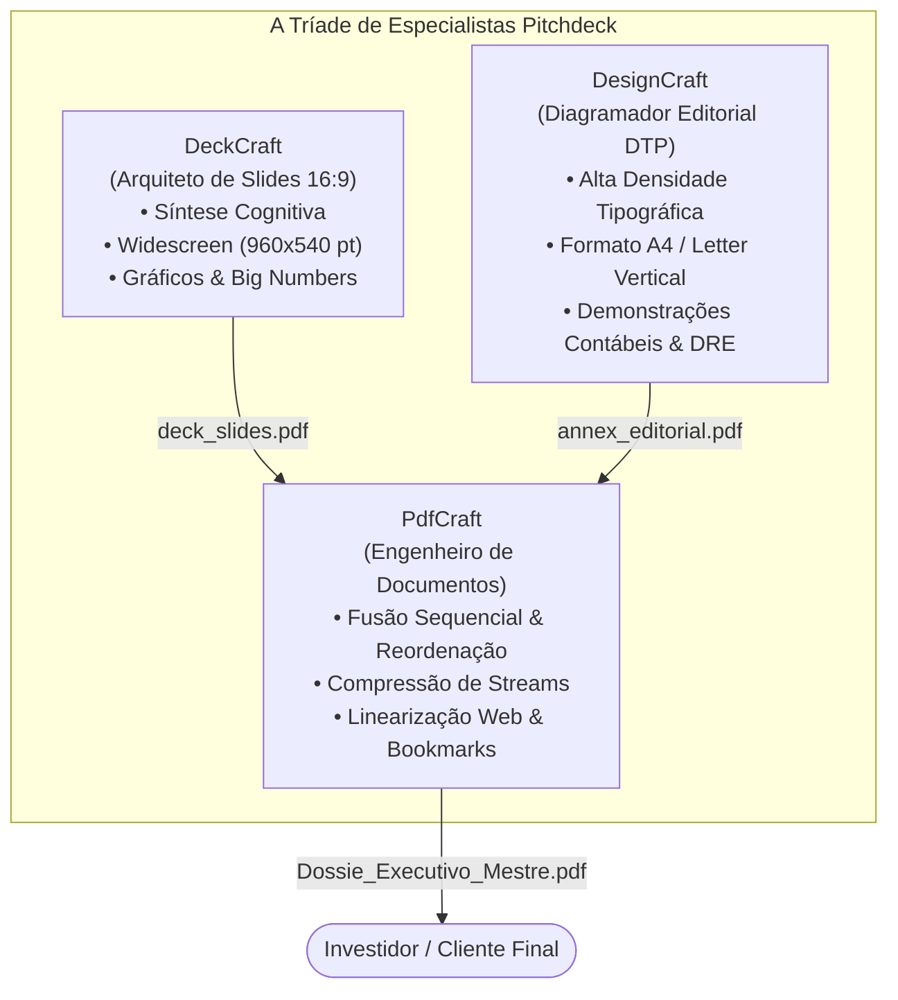
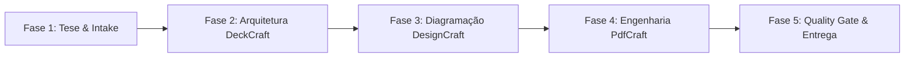
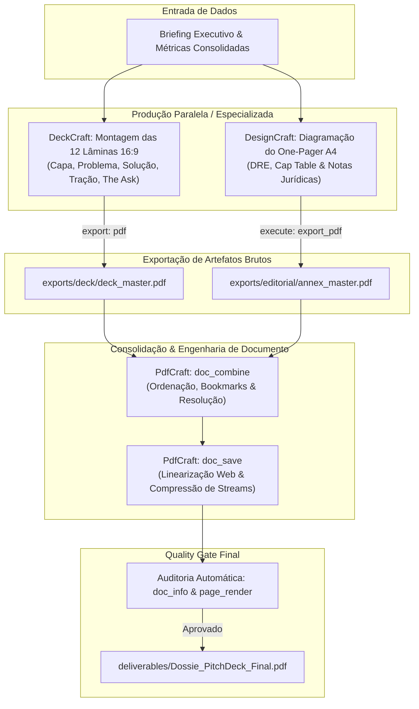
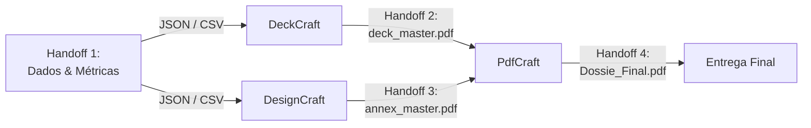
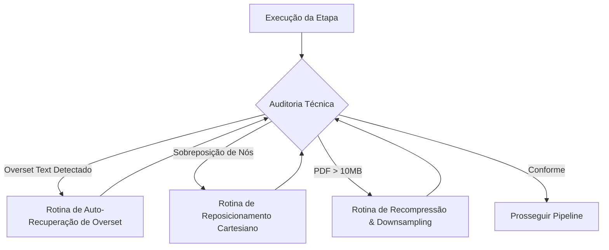

# ArtCraft Pitchdeck Specialist — Manual Técnico e Operacional
### Automação de Apresentações Estratégicas, Documentos Editoriais e Consolidação PDF via MCP

---

## Sumário Executivo

1. [O que essa Skill Faz?](#1-o-que-essa-skill-faz)
   - 1.1 Missão, Escopo e Filosofia Operacional
   - 1.2 A Tríade Pitchdeck: DeckCraft, DesignCraft e PdfCraft
   - 1.3 Fronteiras Rígidas e Proibições Estritas por Aplicativo
   - 1.4 Os Quatro Arquétipos Canônicos de Apresentação
2. [Ciclo de Vida do Pipeline Pitchdeck & Gestão de Estado](#2-ciclo-de-vida-do-pipeline-pitchdeck--gestão-de-estado)
   - 2.1 As Cinco Fases Operacionais do Pipeline
   - 2.2 O Manifesto de Projeto Centralizado (`pitchdeck-manifest.json`)
   - 2.3 Grafo de Dependências (DAG) e Fluxo Visual de Handoff
3. [Roadmap de Implementação Detalhado por Aplicativo](#3-roadmap-de-implementação-detalhado-por-aplicativo)
   - 3.1 Roadmap do DeckCraft (Slides 16:9 de Alto Impacto)
     - 3.1.1 Configuração de Canvas Widescreen e Temas Visuais
     - 3.1.2 Arquitetura Narrativa Canônica de 12 Lâminas
     - 3.1.3 Posicionamento Cartesiano, Hierarquia Tipográfica e Regra 6x6
     - 3.1.4 Injeção de Cartões de Métricas e Gráficos Estatísticos Nativos
     - 3.1.5 Inspeção de Nós e Renderização de Prova Visual
     - 3.1.6 Exportação Mestre para PDF e Formato Nativo
   - 3.2 Roadmap do DesignCraft (Anexos Editoriais & One-Pagers)
     - 3.2.1 Configuração de Grids Editoriais A4/Letter e Margens
     - 3.2.2 Diagramação de Sumários Executivos e Demonstrativos Contábeis (DRE)
     - 3.2.3 Tipografia Fina, Kerning, Entrelinha e Tratamento de Caixas
     - 3.2.4 Auditoria Estrita de Overset Text
     - 3.2.5 Exportação Editorial em Alta Definição
   - 3.3 Roadmap do PdfCraft (Montagem, Otimização e Fechamento)
     - 3.3.1 Abertura e Análise Estrutural de Metadados
     - 3.3.2 Orquestração de Fusão de Documentos (`doc_combine`)
     - 3.3.3 Tratamento de Conflitos de Campos e Normalização de Páginas
     - 3.3.4 Otimização de Peso, Downsampling e Linearização Web
     - 3.3.5 Salvamento Transacional e Validação de Conformidade
4. [Como a Skill Passa Instruções Para Cada App? (Protocolos MCP)](#4-como-a-skill-passa-instruções-para-cada-app-protocolos-mcp)
   - 4.1 Princípios de Chamada Segura: Idempotência, Atomicidade e Verificação Imediata
   - 4.2 Protocolo MCP para DeckCraft (Catálogo Completo de Payloads JSON)
     - 4.2.1 `new_presentation`
     - 4.2.2 `add_slide`
     - 4.2.3 `add_text_box`
     - 4.2.4 `add_shape`
     - 4.2.5 `insert_chart`
     - 4.2.6 `insert_table`
     - 4.2.7 `insert_picture`
     - 4.2.8 `inspect_slide` & `render_slide`
     - 4.2.9 `export` & `save_presentation`
     - 4.2.10 Lotes de Comandos via `batch` e `run_command`
   - 4.3 Protocolo MCP para DesignCraft (Catálogo Completo de Payloads JSON)
     - 4.3.1 `new_document`
     - 4.3.2 Criação de Frames via `execute frame.create`
     - 4.3.3 `set_story_text` e Formatação Parágrafo a Parágrafo
     - 4.3.4 `place_image`
     - 4.3.5 `inspect_document` (Verificação de Overset)
     - 4.3.6 `render_page` & `export_png` / PDF
   - 4.4 Protocolo MCP para PdfCraft (Catálogo Completo de Payloads JSON)
     - 4.4.1 `doc_open` & `doc_info`
     - 4.4.2 `doc_combine` com Ranges de Páginas e Resolução de Conflitos
     - 4.4.3 `doc_split`
     - 4.4.4 `page_render` (Auditoria Visual de Folhas)
     - 4.4.5 `doc_save` com Otimização e Linearização
5. [Contratos Formais de Handoff e Transferência de Dados](#5-contratos-formais-de-handoff-e-transferência-de-dados)
   - 5.1 Handoff 1: Origem de Dados (GridCraft/Briefing) $\rightarrow$ DeckCraft & DesignCraft
   - 5.2 Handoff 2: DeckCraft $\rightarrow$ PdfCraft (`deck_master.pdf`)
   - 5.3 Handoff 3: DesignCraft $\rightarrow$ PdfCraft (`annex_editorial.pdf`)
   - 5.4 Handoff 4: PdfCraft $\rightarrow$ Entrega Final ao Usuário
6. [Casos Práticos de Execução Ponta a Ponta](#6-casos-práticos-de-execução-ponta-a-ponta)
   - 6.1 Caso Prático 1: Pitch Deck de Captação Seed ($1.5M) para SaaS B2B
   - 6.2 Caso Prático 2: Proposta Comercial Corporativa com Acordo de Nível de Serviço (SLA)
   - 6.3 Caso Prático 3: Relatório Trimestral para Conselho de Administração (Board Deck)
7. [Protocolos de Tratamento de Falhas, Resiliência e Auto-Recuperação](#7-protocolos-de-tratamento-de-falhas-resiliência-e-auto-recuperação)
   - 7.1 Algoritmo de Resolução de Overset Text no DesignCraft
   - 7.2 Correção de Sobreposição Cartesiana no DeckCraft
   - 7.3 Recuperação de Arquivos PDF Acima do Limite de Envio (> 10MB)
   - 7.4 Harmonização de Páginas com Orientações Mistas (Paisagem vs. Retrato)
   - 7.5 Matriz de Contingência e Diagnóstico de Falhas
8. [Estrutura Completa de Arquivos e Funcionamento da Skill](#8-estrutura-completa-de-arquivos-e-funcionamento-da-skill)
   - 8.1 Organização do Diretório e Árvore de Arquivos
   - 8.2 Matriz de Comandos e Parâmetros
   - 8.3 Quality Gates e Checklist de Aceitação Técnica Final
   - 8.4 Guia de Boas Práticas e Recomendações aos Agentes

---

## 1. O que essa Skill Faz?

### 1.1 Missão, Escopo e Filosofia Operacional

A skill **`artcraft-pitchdeck`** é o centro de inteligência executiva, estratégia persuasiva e engenharia documental do ecossistema ArtCraft. Sua missão precípua é **converter teses de negócios complexas, métricas financeiras brutas e propostas de valor em narrativas visuais arrebatadoras, estruturadas com perfeição matemática e compiladas em documentos executivos prontos para fundos de investimento (Venture Capital, Private Equity, Investidores Anjo), conselhos de administração e clientes corporativos Tier-1.**

Criar um Pitch Deck de nível institucional não é um exercício de decoração de lâminas. Trata-se de um equilíbrio multidisciplinar entre:
1. **Storytelling Estratégico:** Guiar a cognição do leitor de forma irresistível pelo arco clássico de captação (Problema $\rightarrow$ Solução $\rightarrow$ Mercado $\rightarrow$ Tração $\rightarrow$ Moat $\rightarrow$ Equipe $\rightarrow$ The Ask).
2. **Ergonomia Visual em 16:9:** Projetar lâminas horizontais limpas, onde a mensagem principal seja absorvida em menos de 3 segundos, respeitando zonas de respiro e carga cognitiva mínima.
3. **Densidade Analítica em Anexos:** Fornecer aos analistas de diligência documentos verticais detalhados (DREs, Cap Tables, unit economics granulares, termos contratuais) diagramados com padrão editorial de livro.
4. **Excelência de Empacotamento PDF:** Entregar um documento único, sem inconsistências de orientação, perfeitamente comprimido para envio por e-mail, linearizado para abertura instantânea na web e com fontes e vetores intactos.

### 1.2 A Tríade Pitchdeck: DeckCraft, DesignCraft e PdfCraft

Para atingir a perfeição operacional sem comprometer nenhuma etapa, a skill rege uma tríade de ferramentas especializadas, operando em harmonia cirúrgica via Model Context Protocol (MCP):



- **DeckCraft (O Arquiteto de Slides 16:9):** Responsável exclusivo pela apresentação visual principal. Trabalha no espaço euclidiano padrão de $960 \times 540\text{ pt}$. Garante tipografia arrojada, regras estritas de legibilidade (regra 6x6), cartões de métricas de alto impacto e gráficos corporativos nativos (colunas, barras, linhas).
- **DesignCraft (O Diagramador Editorial DTP):** Responsável exclusivo pelos documentos de alta densidade textual e tabular que acompanham o deck (One-Pagers, memorandos de investimento, notas de rodapé jurídicas, demonstrativos financeiros completos com dezenas de linhas). Opera com grids editoriais milimétricos, caixas de texto com encadeamento (*text stories*) e controle rigoroso de *overset*.
- **PdfCraft (O Engenheiro de Documentos e Fechamento):** Responsável exclusivo pela física do documento final. Ele não cria layouts nem inventa textos; ele recebe os arquivos exportados pelo DeckCraft e DesignCraft, mescla-os em uma ordem lógica precisa, padroniza marcadores de navegação, remove redundâncias, comprime fluxos de imagem sem perda de vetores e salva o entregável institucional definitivo.

### 1.3 Fronteiras Rígidas e Proibições Estritas por Aplicativo

A estabilidade do ecossistema reside na aplicação implacável do **Princípio da Especialização Estanque**. Nenhuma ferramenta é solicitada a realizar uma tarefa que viole seu escopo nativo:

| Ferramenta | Papel Canônico Inegociável | Proibições Absolutas (Fronteiras Negativas) |
| :--- | :--- | :--- |
| **DeckCraft** | - Estruturar apresentações widescreen 16:9 ($960 \times 540\text{ pt}$).<br>- Inserir blocos sintéticos de texto (máximo 6 linhas por slide).<br>- Gerar cartões com métricas em números gigantes ($40\text{--}56\text{ pt}$).<br>- Plotar gráficos estatísticos estruturados de barras, colunas e linhas.<br>- Exportar slides limpos para apresentação ao vivo ou leitura horizontal. | - **NUNCA diagramar memorandos densos em formato vertical A4/Letter.**<br>- **NUNCA unir múltiplos PDFs em um único documento.**<br>- **NUNCA inserir blocos de parágrafos de mais de 8 linhas corridas.**<br>- **NUNCA tentar recortar fotos ou manipular canais alfa.** |
| **DesignCraft** | - Diagramar páginas editoriais de alta densidade em formato A4 ou Carta.<br>- Organizar tabelas contábeis com 20 a 60 linhas com precisão decimal.<br>- Controlar hifenização, kerning, entrelinhas e grids colunares.<br>- Assegurar que nenhum caractere seja ocultado por truncamento (`overset: false`). | - **NUNCA criar slides 16:9 para projeção em reunião.**<br>- **NUNCA fazer fusão ou compressão física de múltiplos arquivos PDF externos.**<br>- **NUNCA desenhar logomarcas ou ícones vetoriais complexos do zero.** |
| **PdfCraft** | - Inspecionar metadados, número de páginas, rotações e dimensões de PDFs.<br>- Mesclar documentos PDF gerados por diferentes motores (`doc_combine`).<br>- Dividir páginas, extrair intervalos e gerenciar marcadores estruturais.<br>- Otimizar pesos de arquivo, comprimir streams e linearizar para web. | - **NUNCA desenhar qualquer elemento visual ou forma geométrica na página.**<br>- **NUNCA reescrever parágrafos ou alterar a tipografia interna de um PDF.**<br>- **NUNCA alterar a posição física dos elementos criados no slide ou na página.** |

### 1.4 Os Quatro Arquétipos Canônicos de Apresentação

A skill reconhece quatro modalidades padrão de documentos no ambiente de negócios corporativo:

1. **Pitch Deck de Captação (Venture Capital / Seed / Series A):**
   - *Foco:* Crescimento exponencial, tamanho de oportunidade (TAM/SAM/SOM), tração acelerada, defensabilidade técnica (*moat*) e valor da rodada (*The Ask*).
   - *Composição:* 10 a 14 slides 16:9 no DeckCraft + 1 One-Pager síntese no DesignCraft + compilação consolidada no PdfCraft.
2. **Proposta Comercial Corporativa B2B (Enterprise Sales):**
   - *Foco:* Resolução de dores operacionais do cliente corporativo, arquitetura da solução, cronograma de implantação, matriz de ROI financeiro e Acordo de Nível de Serviço (SLA).
   - *Composição:* 8 a 10 slides de vendas no DeckCraft + 2 páginas de termos de SLA e tabela de precificação no DesignCraft + PDF mestre compilado.
3. **Relatório Executivo de Diretoria / Reunião de Conselho (Board Deck):**
   - *Foco:* Comparativo Realizado vs. Orçado (Budget vs. Actual), métricas de eficiência de capital (Burn Rate, Runway, Rule of 40, LTV/CAC) e direcionamento estratégico.
   - *Composição:* 6 slides de destaques de alto nível no DeckCraft + Anexo financeiro detalhado de 3 páginas (DRE, Fluxo de Caixa, Balanço) no DesignCraft.
4. **Dossiê Técnico & Memorando de Diligência (Investment Memo):**
   - *Foco:* Análise profunda de risco, conformidade regulatória, arquitetura técnica de software e auditoria de propriedade intelectual.
   - *Composição:* 1 slide de capa no DeckCraft + Documento editorial completo de 6 a 12 páginas no DesignCraft + compilação e bookmarks no PdfCraft.

---

## 2. Ciclo de Vida do Pipeline Pitchdeck & Gestão de Estado

### 2.1 As Cinco Fases Operacionais do Pipeline

Todo projeto executado pela skill percorre obrigatoriamente um fluxo sequencial orquestrado em cinco fases:



1. **Fase 1: Tese, Briefing & Intake Semântico:**
   - Extração da tese central da empresa, modelo de receita e números de tração.
   - Definição do arquétipo de apresentação (VC, Vendas, Board, Memo).
   - Criação da árvore de diretórios do projeto e instanciação do manifesto `pitchdeck-manifest.json`.
2. **Fase 2: Arquitetura de Slides no DeckCraft:**
   - Criação da apresentação no espaço $960 \times 540\text{ pt}$.
   - Estruturação dos slides canônicos com títulos de ação, frases nominais e cards de dados.
   - Inserção dos gráficos estatísticos com os dados consolidados.
   - Inspeção de nós via `inspect_slide` e renderização de provas em PNG via `render_slide`.
   - Exportação do arquivo mestre `deck_master.pdf` e do arquivo-fonte `.deckcraft` / `.pptx`.
3. **Fase 3: Diagramação Editorial no DesignCraft (se houver anexo executivo):**
   - Criação do documento A4/Letter com margens de $36\text{--}54\text{ pt}$ e grid colunar.
   - Diagramação de demonstrativos detalhados, tabelas com alinhamento numérico à direita e notas legais.
   - Verificação mandatória de ausência de truncamento (`overset: false`).
   - Exportação de `annex_editorial.pdf` e do arquivo-fonte `.designcraft`.
4. **Fase 4: Engenharia de Documento no PdfCraft:**
   - Inspeção dos PDFs intermediários (`doc_open` e `doc_info`).
   - Fusão orquestrada via `doc_combine` na sequência lógica planejada.
   - Injeção de metadados, bookmarks e resolução de conflitos de formulário.
   - Otimização de streams, controle de resolução raster (downsampling a 200/300 DPI) e linearização para visualização web instantânea.
   - Salvamento do arquivo final unificado `Dossie_Executivo_Consolidado.pdf`.
5. **Fase 5: Quality Gate & Auditoria Final:**
   - Renderização da primeira e última folha via `page_render` para validação visual.
   - Conferência de tamanho do arquivo (< 10MB para distribuição irrestrita por e-mail).
   - Geração de links clicáveis absolutos com protocolo `file:///` e emissão do sumário executivo.

### 2.2 O Manifesto de Projeto Centralizado (`pitchdeck-manifest.json`)

Para que o pipeline mantenha a consistência de estado e suporte execuções parciais, reentrância ou recuperação de falhas sem alucinação, a skill gera e audita o arquivo `pitchdeck-manifest.json` na raiz da pasta do projeto:

```json
{
  "$schema": "https://artcraft.internal/schemas/v1/pitchdeck-manifest.json",
  "project_id": "deck_fintech_series_a_2026",
  "created_at": "2026-10-27T10:30:00Z",
  "archetype": "venture_capital_series_a",
  "company_profile": {
    "name": "AuraPay",
    "tagline": "Infraestrutura de liquidação transfronteiriça instantânea para a América Latina",
    "vertical": "Fintech / B2B Payments",
    "round_target_usd": 5000000,
    "allocation": {
      "engineering": 0.45,
      "sales_expansion": 0.35,
      "regulatory_compliance": 0.20
    }
  },
  "design_tokens": {
    "palette": {
      "primary": "#0F172A",
      "secondary": "#1E293B",
      "accent": "#0EA5E9",
      "accent_positive": "#10B981",
      "surface": "#FFFFFF",
      "surface_subtle": "#F8FAFC",
      "text_muted": "#64748B"
    },
    "typography": {
      "heading_font": "Inter Tight Bold",
      "body_font": "Inter Regular",
      "data_font": "JetBrains Mono Medium"
    }
  },
  "artifacts": {
    "deckcraft": {
      "source_file": "projects/deckcraft/aurapay_pitch.deckcraft",
      "pdf_export": "exports/deck/aurapay_slides.pdf",
      "slides_count": 12,
      "status": "completed"
    },
    "designcraft": {
      "source_file": "projects/designcraft/aurapay_annex.designcraft",
      "pdf_export": "exports/editorial/aurapay_financial_annex.pdf",
      "pages_count": 2,
      "status": "completed"
    },
    "pdfcraft": {
      "final_deliverable": "deliverables/AuraPay_Series_A_Dossie_Completo.pdf",
      "total_pages": 14,
      "file_size_bytes": 4829104,
      "linearized": true,
      "status": "completed"
    }
  }
}
```

### 2.3 Grafo de Dependências (DAG) e Fluxo Visual de Handoff



---

## 3. Roadmap de Implementação Detalhado por Aplicativo

### 3.1 Roadmap do DeckCraft (Slides 16:9 de Alto Impacto)

O DeckCraft opera como uma estação de trabalho sem interface gráfica (*headless engine*) de altíssima precisão cartesiana. Seu objetivo é estruturar o deck para projeção e visualização widescreen.

#### 3.1.1 Configuração de Canvas Widescreen e Temas Visuais
- **Sistema de Coordenadas:** Origem $(0, 0)$ no canto superior esquerdo do slide. Dimensão total do slide widescreen: largura $X = 960\text{ pt}$ e altura $Y = 540\text{ pt}$.
- **Margens de Segurança (Safe Areas):** Margem externa de $60\text{ pt}$ nas laterais e $45\text{ pt}$ no topo/rodapé. Nenhum elemento crítico deve ultrapassar o retângulo delimitador $[60, 45, 900, 495]$.
- **Temas Nativos:** Iniciação rápida com `new_presentation` suportando os temas nativos: `DeckCraft`, `Harbor` (azul marítimo corporativo), `Ember` (terracota vibrante), `Meadow` (verde esmeralda sustentável), `Nocturne` (dark mode institucional de alto contraste), `Paper` (minimalista editorial), `Coral Reef` e `Slate`.

#### 3.1.2 Arquitetura Narrativa Canônica de 12 Lâminas
A skill aplica a consagrada estrutura de captação institucional:
1. **Slide 1: Capa & Tese de Abertura:** Nome da Startup, Logotipo institucional, Tagline de 1 linha e identificação de confidencialidade (*Strictly Confidential*).
2. **Slide 2: O Problema Real:** A dor aguda, ineficiência de custos ou gargalo regulatório enfrentado pelo cliente no mercado atual.
3. **Slide 3: A Solução & Proposta de Valor:** Como a solução erradica a dor de forma $10\times$ mais eficiente, escalável ou econômica.
4. **Slide 4: Demonstração do Produto:** Capturas de tela organizadas em mockup limpo, destacando os 3 diferenciais funcionais de maior impacto.
5. **Slide 5: Tamanho de Mercado (TAM, SAM, SOM):**
   - **TAM:** O universo global total da indústria (ex.: US$ 120B).
   - **SAM:** O mercado endereçável operacional que a empresa atende (ex.: US$ 18B).
   - **SOM:** O objetivo factível de captura em 36 meses (ex.: US$ 450M).
6. **Slide 6: Modelo de Negócios & Monetização:** Mecanismo de geração de receita (SaaS por assento, taxa percentual por transação, plano corporativo com setup fee).
7. **Slide 7: Tração & Métricas de Aceleração:** Gráfico estatístico nativo evidenciando crescimento acelerado de receita (ARR/MRR) ou volume bruto de mercadorias (GMV).
8. **Slide 8: Economia Unitária (Unit Economics):** Cards de métricas com CAC (Custo de Aquisição), LTV (Lifetime Value), Razão LTV/CAC ($> 3\times$), Período de Payback e Churn Mensal.
9. **Slide 9: Estratégia de Go-to-Market (GTM):** Motores de aquisição escaláveis (vendas diretas Outbound, parcerias de canal, Product-Led Growth).
10. **Slide 10: Matriz de Paisagem Competitiva:** Posicionamento em eixos $X/Y$ ou tabela comparativa de funcionalidades demonstrando vantagem estrutural intransponível (*unfair advantage*).
11. **Slide 11: Equipe Fundadora & Liderança:** Sócios-fundadores, históricos prévios em unicórnios ou grandes consultorias, formação técnica e executiva.
12. **Slide 12: The Ask (Captação & Uso dos Recursos):** Valor pretendido da rodada, distribuição percentual planejada do capital e marcos tangíveis a atingir nos próximos 18 a 24 meses.

#### 3.1.3 Posicionamento Cartesiano, Hierarquia Tipográfica e Regra 6x6
- **Regra de Ouro 6x6:** No máximo 6 tópicos por lâmina; no máximo 6 palavras por linha de tópico. Frases nominais diretas, proibição absoluta de parágrafos densos que causem fadiga cognitiva.
- **Hierarquia de Tamanhos:**
  - *Título de Ação do Slide:* $28\text{--}34\text{ pt}$ em negrito (ex.: `Crescimento de Receita Triplicou em 12 Meses`).
  - *Subtítulo de Contexto:* $14\text{--}16\text{ pt}$ em tom suavizado (`#64748B`).
  - *Corpo de Tópicos:* $14\text{--}18\text{ pt}$ com espaçamento confortável entre linhas.
  - *Rótulos de Rodapé / Numeração:* $10\text{--}11\text{ pt}$.

#### 3.1.4 Injeção de Cartões de Métricas e Gráficos Estatísticos Nativos
- **Cartões de Números Gigantes (Big Numbers):**
  - Caixa de valor numérico em tipografia monumental: $48\text{--}56\text{ pt}$ em negrito com a cor primária ou de acento.
  - Caixa de rótulo explicativo logo abaixo: $12\text{--}14\text{ pt}$ em caixa alta ou tom neutro (ex.: `CRESCIMENTO YoY` ou `TAXA DE RETENÇÃO LÍQUIDA`).
- **Gráficos Corporativos (`insert_chart`):**
  - Gráficos devem ser nativos e vetoriais, nunca capturas de tela pixeladas de planilhas.
  - Tipos suportados: `column`, `bar`, `line`, `pie`, `doughnut`, `area`, `stackedColumn`.
  - Inserção de dados estruturados com categorias textuais e séries numéricas tipadas.

#### 3.1.5 Inspeção de Nós e Renderização de Prova Visual
- A cada slide construído, o agente dispara `inspect_slide` para auditar a lista de identificadores (`ids`), coordenadas e limites de caixas.
- Dispara `render_slide` em slides-chave para gerar PNGs de prova visual, auditando se houve sobreposições entre caixas de texto e gráficos.

#### 3.1.6 Exportação Mestre para PDF e Formato Nativo
- Exportação em formato de apresentação executiva: `export` com parâmetro `format: "pdf"`, resolução de rasterização de imagens a $200\text{--}300\text{ DPI}$ e flag `textLayer: true` para manter o texto pesquisável, indexável e copiável.
- Salvamento do projeto editável via `save_presentation` em extensão `.deckcraft` ou `.pptx` para permitir futuras revisões manuais pelo cliente.

---

### 3.2 Roadmap do DesignCraft (Anexos Editoriais & One-Pagers)

O DesignCraft é acionado sempre que a apresentação exigir material de suporte analítico de alta densidade tipográfica que arruinaria a limpeza de um slide 16:9.

#### 3.2.1 Configuração de Grids Editoriais A4/Letter e Margens
- **Formatos de Página:** Padrão internacional A4 ($595 \times 842\text{ pt}$) ou Carta / Letter ($612 \times 792\text{ pt}$).
- **Estruturação de Margens:**
  - Margem superior: $40\text{--}50\text{ pt}$ (espaço para cabeçalho institucional e número do anexo).
  - Margem inferior: $40\text{--}50\text{ pt}$ (espaço para carimbo de confidencialidade e paginação).
  - Margens laterais (esquerda/direita): $45\text{--}55\text{ pt}$.
- **Grid de Colunas:** Divisão em 2 ou 3 colunas com calha (*gutter*) de $14\text{--}18\text{ pt}$ para garantir leitura ágil e confortável de relatórios técnicos.

#### 3.2.2 Diagramação de Sumários Executivos e Demonstrativos Contábeis (DRE)
- **One-Pager Executivo:** Uma única folha consolidando:
  - Cabeçalho com logo e dados da rodada.
  - Coluna Esquerda: Resumo da oportunidade, tese de investimento e modelo de negócio.
  - Coluna Direita: Tração histórica, tabela simplificada de unit economics e alocação do capital.
- **Demonstrativo de Resultados (DRE / P&L):**
  - Tabela financeira com linhas de Receita Bruta, Deduções, Receita Líquida, Custo das Mercadorias Vendidas (COGS), Lucro Bruto, Despesas Operacionais (OPEX) e EBITDA.
  - Alinhamento numérico obrigatório à direita com tipografia de largura fixa (*monospace* ou fonte proporcional com algarismos tabulares).

#### 3.2.3 Tipografia Fina, Kerning, Entrelinha e Tratamento de Caixas
- **Controle Tipográfico Rigoroso:**
  - *Títulos de Seção:* $16\text{--}20\text{ pt}$, entrelinha de $22\text{--}26\text{ pt}$.
  - *Corpo do Texto de Relatório:* $9.5\text{--}11\text{ pt}$, entrelinha proporcional de $14\text{--}15.5\text{ pt}$ ($140\%$ a $150\%$ do corpo).
  - *Notas Financeiras e Legais de Rodapé:* $7.5\text{--}8.5\text{ pt}$, entrelinha de $10.5\text{--}11.5\text{ pt}$.
- **Evitar Órfãs e Viúvas:** Bloquear palavras isoladas na última linha de parágrafos através de quebras de linha manuais estilizadas.

#### 3.2.4 Auditoria Estrita de Overset Text
- **A Regra Inegociável:** No DesignCraft, uma caixa de texto que recebe mais conteúdo do que sua altura física comporta gera truncamento silencioso de dados (*overset*).
- **Protocolo de Verificação:** A cada injeção de texto via `set_story_text`, o agente executa `inspect_document` e verifica o atributo `overset` de cada história (*story*). Se `overset == true`, o agente aciona o protocolo de auto-recuperação (redução de entrelinha, ajuste do corpo da fonte ou expansão da caixa) antes de exportar.

#### 3.2.5 Exportação Editorial em Alta Definição
- O documento é renderizado em página de prova via `render_page`.
- Exportação em PDF vetorial fechado, mantendo a fidelidade das linhas de tabela e dos textos em curvas ou fontes incorporadas.

---

### 3.3 Roadmap do PdfCraft (Montagem, Otimização e Fechamento)

O PdfCraft atua como o mestre de obras da entrega documental, manipulando o binário do PDF com integridade garantida.

#### 3.3.1 Abertura e Análise Estrutural de Metadados
- Dispara `doc_open` sobre os PDFs brutos oriundos do DeckCraft e DesignCraft para capturar seus identificadores de sessão (`doc`).
- Dispara `doc_info` para inspecionar dimensões físicas das folhas, orientação (retrato ou paisagem), contagem total de páginas e conformidade das fontes embutidas.

#### 3.3.2 Orquestração de Fusão de Documentos (`doc_combine`)
- Executa a combinação sequencial estrita:
  - Bloco Primário: Páginas 1 a $N$ da Apresentação de Slides (formato paisagem 16:9).
  - Bloco Secundário: Páginas 1 a $M$ dos Anexos Editoriais e DREs (formato retrato A4/Letter).
- Injeção de marcadores estruturais (*bookmarks*) permitindo ao analista de investimentos saltar com um clique diretamente para "Tração", "Demonstrativos Contábeis" ou "Cap Table".

#### 3.3.3 Tratamento de Conflitos de Campos e Normalização de Páginas
- Ao mesclar documentos que possam conter formulários interativos ou metadados idênticos, define `field_conflicts: "rename"` para evitar corrupção de variáveis.
- Garante que folhas acidentalmente rotacionadas em digitalizações sejam normalizadas para $0^\circ$.

#### 3.3.4 Otimização de Peso, Downsampling e Linearização Web
- Arquivos de Pitch Deck enviados a fundos de investimento não podem ultrapassar $10\text{ MB}$ (sob risco de serem bloqueados por servidores corporativos de e-mail).
- O PdfCraft executa compressão interna de fluxos (*deflate stream compression*), remove objetos duplicados ou desreferenciados (*garbage collection*) e aplica a **linearização para web** (*Fast Web View*), permitindo que a primeira lâmina do deck carregue instantaneamente antes que o arquivo inteiro tenha sido baixado.

#### 3.3.5 Salvamento Transacional e Validação de Conformidade
- Grava o arquivo definitivo via `doc_save` com os parâmetros de otimização acionados.
- Executa `page_render` na primeira página (capa) e na página de anexo financeiro para auditoria final antes da entrega ao usuário.

---

## 4. Como a Skill Passa Instruções Para Cada App? (Protocolos MCP)

### 4.1 Princípios de Chamada Segura: Idempotência, Atomicidade e Verificação Imediata

A interação entre o agente e os servidores MCP deve seguir quatro diretrizes estritas:
1. **Idempotência Operacional:** Parâmetros de criação devem especificar caminhos e propriedades completas para que uma eventual reexecução produza o mesmo resultado limpo sem duplicar nós.
2. **Caminhos Canônicos Absolutos:** Proibição de caminhos relativos em argumentos de arquivo. Sempre fornecer `C:/Users/berna/Music/skills_02/...`.
3. **Composição em Lotes (`batch`):** Operações sequenciais de layout devem ser agrupadas via comandos de lote (`batch` no DeckCraft/DesignCraft ou `command_batch` no PdfCraft) para diminuir overhead de comunicação e garantir atomicidade.
4. **Verificação Imediata pós-Execução:** Nunca assumir que um comando teve sucesso apenas pelo retorno HTTP 200. Sempre inspecionar o documento imediatamente após a alteração.

---

### 4.2 Protocolo MCP para DeckCraft (Catálogo Completo de Payloads JSON)

O DeckCraft recebe comandos diretos via ferramenta lazy MCP `call_mcp_tool(ServerName="deckcraft", ToolName=..., Arguments=...)`.

#### 4.2.1 `new_presentation`
Cria uma nova apresentação em branco ou com tema corporativo:
```json
{
  "ServerName": "deckcraft",
  "ToolName": "new_presentation",
  "Arguments": {
    "blank": true,
    "theme": "Harbor"
  }
}
```

#### 4.2.2 `add_slide`
Adiciona um slide após o atual com layout definido e conteúdo textual primário:
```json
{
  "ServerName": "deckcraft",
  "ToolName": "add_slide",
  "Arguments": {
    "layout": "titleAndContent",
    "title": "A Dor Estrutural dos Pagamentos Transfronteiriços",
    "body": "Taxas predatórias de até 7.5% por remessa internacional.\nLiquidação lenta demorando entre 3 a 5 dias úteis.\nFalta absoluta de rastreabilidade para tesourarias corporativas."
  }
}
```

#### 4.2.3 `add_text_box`
Insere uma caixa de texto com coordenadas precisas, permitindo controle milimétrico de tamanho e alinhamento:
```json
{
  "ServerName": "deckcraft",
  "ToolName": "add_text_box",
  "Arguments": {
    "x": 60,
    "y": 120,
    "w": 380,
    "h": 140,
    "text": "$12.4M ARR\nCrescimento sustentado de 3.2x ano contra ano.",
    "size": 36,
    "color": "#0F172A",
    "align": "left"
  }
}
```

#### 4.2.4 `add_shape`
Insere cartões de fundo para destacar grupos de métricas ou divisões de seção:
```json
{
  "ServerName": "deckcraft",
  "ToolName": "add_shape",
  "Arguments": {
    "type": "roundRect",
    "x": 50,
    "y": 100,
    "w": 400,
    "h": 360,
    "fill": "#F8FAFC",
    "stroke": "#E2E8F0",
    "strokeWidth": 1
  }
}
```

#### 4.2.5 `insert_chart`
Plota gráficos nativos de alto impacto com dados vetoriais:
```json
{
  "ServerName": "deckcraft",
  "ToolName": "insert_chart",
  "Arguments": {
    "type": "column",
    "title": "Evolução de Receita Recorrente Anual (ARR em USD)",
    "categories": ["2023", "2024", "2025", "2026E"],
    "series": [
      {
        "name": "ARR Base",
        "values": [1200000, 3800000, 8400000, 18500000]
      }
    ]
  }
}
```

#### 4.2.6 `insert_table`
Gera tabelas de precificação ou matriz comparativa diretamente no slide:
```json
{
  "ServerName": "deckcraft",
  "ToolName": "insert_table",
  "Arguments": {
    "rows": 4,
    "cols": 3,
    "x": 60,
    "y": 160,
    "w": 840,
    "h": 260,
    "data": [
      ["Funcionalidade", "AuraPay (Nossa Solução)", "Bancos Tradicionais"],
      ["Tempo de Liquidação", "Instantâneo (T+0 em segundos)", "3 a 5 dias úteis (T+4)"],
      ["Custo Médio por Transação", "0.45% fixo", "3.8% a 6.2% + spread FX"],
      ["API Pronta para Desenvolvedores", "Sim (REST / Webhooks modernos)", "Não (arquivos batch legados)"]
    ]
  }
}
```

#### 4.2.7 `insert_picture`
Posiciona logotipos e ilustrações:
```json
{
  "ServerName": "deckcraft",
  "ToolName": "insert_picture",
  "Arguments": {
    "path": "C:/Users/berna/Music/skills_02/assets/brand/aurapay_logo.png",
    "x": 60,
    "y": 45,
    "w": 160,
    "h": 40
  }
}
```

#### 4.2.8 `inspect_slide` & `render_slide`
Auditoria de elementos e prova visual:
```json
// Inspecionar nós do slide ativo
{
  "ServerName": "deckcraft",
  "ToolName": "inspect_slide",
  "Arguments": {
    "slideIndex": 2
  }
}

// Renderizar PNG para verificação visual da composição
{
  "ServerName": "deckcraft",
  "ToolName": "render_slide",
  "Arguments": {
    "slideIndex": 2,
    "scale": 2,
    "path": "C:/Users/berna/Music/skills_02/exports/previews/slide_2_preview.png"
  }
}
```

#### 4.2.9 `export` & `save_presentation`
Gera o PDF vetorial final da apresentação e salva o arquivo de projeto:
```json
// Exportar PDF completo
{
  "ServerName": "deckcraft",
  "ToolName": "export",
  "Arguments": {
    "format": "pdf",
    "path": "C:/Users/berna/Music/skills_02/exports/deck/aurapay_pitch_deck.pdf",
    "layout": "slides",
    "dpi": 200,
    "textLayer": true
  }
}

// Salvar fonte editável
{
  "ServerName": "deckcraft",
  "ToolName": "save_presentation",
  "Arguments": {
    "path": "C:/Users/berna/Music/skills_02/projects/deckcraft/aurapay_pitch_master.deckcraft"
  }
}
```

---

### 4.3 Protocolo MCP para DesignCraft (Catálogo Completo de Payloads JSON)

O DesignCraft recebe instruções tipográficas e de montagem editorial através das ferramentas `new_document`, `execute`, `set_story_text`, `place_image`, `inspect_document` e `render_page`.

#### 4.3.1 `new_document`
Instancia o documento editorial em formato padrão A4:
```json
{
  "ServerName": "designcraft",
  "ToolName": "new_document",
  "Arguments": {
    "preset": "A4",
    "intent": "print",
    "pages": 2,
    "facingPages": false,
    "columns": 2,
    "gutter": 16,
    "margins": {
      "top": 45,
      "bottom": 45,
      "inside": 50,
      "outside": 50
    }
  }
}
```

#### 4.3.2 Criação de Frames via `execute frame.create`
Desenha a caixa delimitadora onde o texto da demonstração financeira fluirá:
```json
{
  "ServerName": "designcraft",
  "ToolName": "execute",
  "Arguments": {
    "command": "frame.create",
    "params": {
      "page": 1,
      "rect": [50, 60, 545, 780],
      "content": "text"
    }
  }
}
```

#### 4.3.3 `set_story_text` e Formatação Parágrafo a Parágrafo
Injeta o texto estruturado da demonstração com quebras de parágrafo nominais:
```json
{
  "ServerName": "designcraft",
  "ToolName": "set_story_text",
  "Arguments": {
    "frame": 1,
    "text": "DEMONSTRATIVO DE RESULTADOS PROJETADO (DRE 2024-2026)\n\n1. Receita Operacional Bruta: US$ 14.850.000\n2. Custo Direto de Transação (COGS): (US$ 2.970.000)\n3. Lucro Bruto Consolidado: US$ 11.880.000 (Margem Bruta: 80%)\n4. Despesas Operacionais (OPEX): (US$ 6.400.000)\n   - Engenharia e Produto: US$ 3.500.000\n   - Vendas e Marketing (GTM): US$ 2.100.000\n   - Governança e Jurídico: US$ 800.000\n5. EBITDA Ajustado: US$ 5.480.000 (Margem EBITDA: 36.9%)\n\nNota Explicativa: Todas as projeções consideram taxa de retenção líquida (NDR) conservadora de 128% e período de payback médio de 7 meses."
  }
}
```

#### 4.3.4 `place_image`
Insere o logotipo institucional ou selos de conformidade no topo da página editorial:
```json
{
  "ServerName": "designcraft",
  "ToolName": "place_image",
  "Arguments": {
    "path": "C:/Users/berna/Music/skills_02/assets/brand/aurapay_logo.png",
    "page": 1,
    "x": 50,
    "y": 45,
    "width": 120,
    "height": 30
  }
}
```

#### 4.3.5 `inspect_document` (Verificação Mandatória de Overset)
Garante que nenhuma linha de notas financeiras tenha ficado oculta por estouro de caixa:
```json
{
  "ServerName": "designcraft",
  "ToolName": "inspect_document",
  "Arguments": {}
}
```
*Critério de Aceitação:* O campo `overset` em todas as `stories` inspecionadas deve reportar estritamente `false`.

#### 4.3.6 `render_page` & `export_png` / PDF
Renderiza a prova da folha e salva o PDF mestre editorial:
```json
// Prova visual
{
  "ServerName": "designcraft",
  "ToolName": "render_page",
  "Arguments": {
    "page": 1,
    "scale": 2,
    "path": "C:/Users/berna/Music/skills_02/exports/previews/annex_page_1.png"
  }
}

// Salvar documento editorial
{
  "ServerName": "designcraft",
  "ToolName": "save_document",
  "Arguments": {
    "path": "C:/Users/berna/Music/skills_02/projects/designcraft/financial_annex.designcraft"
  }
}
```

---

### 4.4 Protocolo MCP para PdfCraft (Catálogo Completo de Payloads JSON)

O PdfCraft recebe instruções diretas de manipulação física de arquivos PDF através de ferramentas lazy MCP.

#### 4.4.1 `doc_open` & `doc_info`
Abre os arquivos intermediários gerados e extrai informações essenciais para a montagem:
```json
// Abrir documento e obter document id
{
  "ServerName": "pdfcraft",
  "ToolName": "doc_open",
  "Arguments": {
    "path": "C:/Users/berna/Music/skills_02/exports/deck/aurapay_pitch_deck.pdf"
  }
}

// Inspecionar metadados estruturais usando o id retornado
{
  "ServerName": "pdfcraft",
  "ToolName": "doc_info",
  "Arguments": {
    "doc": 1
  }
}
```

#### 4.4.2 `doc_combine` com Ranges de Páginas e Resolução de Conflitos
O comando primordial de consolidação. Recebe a lista de arquivos de entrada, os intervalos de folhas desejados e gera o PDF combinado:
```json
{
  "ServerName": "pdfcraft",
  "ToolName": "doc_combine",
  "Arguments": {
    "paths": [
      "C:/Users/berna/Music/skills_02/exports/deck/aurapay_pitch_deck.pdf",
      "C:/Users/berna/Music/skills_02/exports/editorial/financial_annex.pdf"
    ],
    "pages": [
      "1-12",
      "1-2"
    ],
    "field_conflicts": "rename",
    "out": "C:/Users/berna/Music/skills_02/deliverables/AuraPay_Series_A_Dossie_Mestre.pdf"
  }
}
```

#### 4.4.3 `doc_split`
Utilizado quando o usuário solicita separar uma versão "Teaser" sem as lâminas financeiras confidenciais:
```json
{
  "ServerName": "pdfcraft",
  "ToolName": "doc_split",
  "Arguments": {
    "doc": 1,
    "pages": ["1-5"],
    "out_pattern": "C:/Users/berna/Music/skills_02/deliverables/AuraPay_Public_Teaser.pdf"
  }
}
```

#### 4.4.4 `page_render` (Auditoria Visual de Folhas)
Inspeciona uma página específica diretamente a partir do binário do PDF para auditoria de fidelidade de renderização:
```json
{
  "ServerName": "pdfcraft",
  "ToolName": "page_render",
  "Arguments": {
    "doc": 1,
    "page": 1,
    "dpi": 150,
    "output_path": "C:/Users/berna/Music/skills_02/exports/previews/final_cover_check.png"
  }
}
```

#### 4.4.5 `doc_save` com Otimização e Linearização
Salva o documento com reprocessamento de streams, eliminação de lixo binário e linearização para abertura instantânea na web (*Fast Web View*):
```json
{
  "ServerName": "pdfcraft",
  "ToolName": "doc_save",
  "Arguments": {
    "doc": 1,
    "path": "C:/Users/berna/Music/skills_02/deliverables/AuraPay_Series_A_Dossie_Mestre.pdf",
    "garbage": 3,
    "deflate": true,
    "linearize": true
  }
}
```

---

## 5. Contratos Formais de Handoff e Transferência de Dados

A solidez do pipeline é assegurada pelo cumprimento rigoroso de quatro contratos formais de handoff entre as estações de trabalho:



### 5.1 Handoff 1: Origem de Dados (GridCraft/Briefing) $\rightarrow$ DeckCraft & DesignCraft
- **Formato:** Arquivo `metrics_handoff.json` gerado pelo GridCraft ou compilado da triagem inicial.
- **Estrutura Requerida:**
  - Valores consolidados de faturamento, crescimento percentual e múltiplos.
  - Séries temporais em arrays homogêneos de números de ponto flutuante.
- **Validação de Entrada:** DeckCraft consome apenas dados com no máximo 8 pontos no eixo horizontal (para evitar sobreposição de colunas). Séries com mais de 8 colunas são direcionadas para o anexo tabular do DesignCraft.

### 5.2 Handoff 2: DeckCraft $\rightarrow$ PdfCraft (`deck_master.pdf`)
- **Proporção Obrigatória:** Widescreen 16:9 estrito ($960 \times 540\text{ pt}$).
- **Resolução de Raster:** Imagens embutidas compactadas a $200\text{ DPI}$.
- **Camada de Texto:** `textLayer: true` para manter texto pesquisável e selecionável.
- **Validação pelo PdfCraft:** `doc_info` deve certificar que a orientação de 100% das páginas deste bloco seja paisagem (*landscape*).

### 5.3 Handoff 3: DesignCraft $\rightarrow$ PdfCraft (`annex_editorial.pdf`)
- **Formato Obrigatório:** Padrão internacional A4 ($595 \times 842\text{ pt}$) ou Letter ($612 \times 792\text{ pt}$).
- **Integridade de Conteúdo:** O log de inspeção `inspect_document` deve comprovar `overset: false` em todas as caixas de texto.
- **Validação pelo PdfCraft:** `doc_info` certifica que as páginas estejam com proporção vertical adequada e fontes embutidas como subconjunto (*subset*).

### 5.4 Handoff 4: PdfCraft $\rightarrow$ Entrega Final ao Usuário
- **Peso do Arquivo:** Menor que $10\text{ MB}$ para tráfego seguro por e-mail corporativo.
- **Linearização:** Flag de Fast Web View ativa para abertura instantânea em navegadores.
- **Links de Saída:** Caminho do arquivo apresentado no chat com protocolo `file:///` clicável.

---

## 6. Casos Práticos de Execução Ponta a Ponta

### 6.1 Caso Prático 1: Pitch Deck de Captação Seed ($1.5M) para SaaS B2B

#### Briefing do Usuário:
> *"Somos a CloudMesh, uma plataforma de orquestração de microsserviços com IA. Faturamos US$ 45.000 de MRR, crescendo 25% mês a mês nos últimos 6 meses. Estamos captando US$ 1.5M para acelerar nosso time de engenharia e contratar 3 executivos de Enterprise Sales. Monte nosso deck de captação e um anexo de uma página com a tabela de clientes e modelo financeiro simplificado."*

#### Plano de Ação da Skill:
1. **Fase 1 (Intake):** Arquétipo identificado: *Venture Capital Seed*. Geração do manifesto `projects/cloudmesh/pitchdeck-manifest.json`. Cores: Azul escuro industrial (`#0F172A`), Ciano tecnológico (`#06B6D4`) e Branco puro (`#FFFFFF`).
2. **Fase 2 (DeckCraft):**
   - Cria apresentação com tema `Harbor` no DeckCraft.
   - Constrói 10 slides: Capa, Problema (Complexidade de Kubernetes), Solução (IA Autônoma de Infra), Demonstração (Painel com latência em tempo real), TAM/SAM/SOM ($45B mercado de nuvem), Modelo de Negócio (SaaS baseado em nós monitorados), Tração (Gráfico de barras de MRR $10k $\rightarrow$ $45k), Métricas Unitárias (CAC $1.200, LTV $18.400, Churn 0.4%), Equipe Fundadora (Ex-engenheiros AWS) e The Ask ($1.5M por 15% de equity).
   - Exporta `exports/deck/cloudmesh_slides.pdf`.
3. **Fase 3 (DesignCraft):**
   - Cria documento A4 com grid de 2 colunas.
   - Insere resumo executivo com lista dos 14 clientes pilotos e projeção de faturamento trimestral para os próximos 18 meses.
   - Inspeciona ausência de overset e salva `exports/editorial/cloudmesh_onepager.pdf`.
4. **Fase 4 (PdfCraft):**
   - Executa `doc_combine` unindo os 10 slides horizontais ao One-Pager vertical.
   - Aplica compressão e linearização web via `doc_save`.
   - Gera `deliverables/CloudMesh_Seed_PitchDeck_Consolidado.pdf`.

---

### 6.2 Caso Prático 2: Proposta Comercial Corporativa com Acordo de Nível de Serviço (SLA)

#### Briefing do Usuário:
> *"Preciso enviar uma proposta comercial para o Banco Safira. A solução é a plataforma de prevenção a fraudes SentinelAI. Quero 6 slides apresentando a proposta, tecnologia, casos de sucesso e cronograma de onboarding, mais 2 páginas em PDF com os termos contratuais de SLA (99.95% de disponibilidade) e a tabela de preços por volume."*

#### Plano de Ação da Skill:
1. **Fase 1 (Intake):** Arquétipo: *Enterprise Sales Proposal*. Foco em conformidade, segurança, tempo de resposta a incidentes e ROI.
2. **Fase 2 (DeckCraft):**
   - Monta 6 slides widescreen: Capa Corporativa personalizada para o Banco Safira, Diagnóstico de Fraude no Setor Bancário, A Solução SentinelAI (Detecção em < 15ms), Arquitetura de Integração Segura (On-Premise / Nuvem Privada), Histórico de Sucesso em Bancos Análogos e Cronograma de Implantação em 4 Semanas.
   - Exporta `exports/deck/sentinelai_proposal.pdf`.
3. **Fase 3 (DesignCraft):**
   - Diagrama 2 páginas A4 com formatação jurídica e técnica:
     - Página 1: Cláusulas de Acordo de Nível de Serviço (SLA), tempos de atendimento por severidade de chamado (Severidade 1: 15 minutos) e créditos contratuais.
     - Página 2: Matriz detalhada de preços por faixas de volume de requisições mensais.
   - Exporta `exports/editorial/sentinelai_sla_terms.pdf`.
4. **Fase 4 (PdfCraft):**
   - Executa `doc_combine` com marcadores estruturados: "1. Apresentação Executiva", "2. Acordo de Nível de Serviço (SLA)" e "3. Tabela de Preços".
   - Salva o arquivo final otimizado `deliverables/SentinelAI_Proposta_Banco_Safira.pdf`.

---

### 6.3 Caso Prático 3: Relatório Trimestral para Conselho de Administração (Board Deck)

#### Briefing do Usuário:
> *"Fechamos o Q3 de 2026. Preciso do deck de reunião para o conselho da BioHealth. 5 slides de alta liderança (Visão Geral, Principais Vitórias, Gargalos & Riscos, Atualização de Runway/Caixa, Metas para Q4) acompanhados do DRE completo de 40 linhas e balanço patrimonial detalhado."*

#### Plano de Ação da Skill:
1. **Fase 1 (Intake):** Arquétipo: *Board of Directors Deck*. Tom sóbrio, transparente, sem floreios promocionais.
2. **Fase 2 (DeckCraft):**
   - Cria os 5 slides no DeckCraft: Slide de Abertura do Trimestre, Vitórias Operacionais em 3 tópicos, Gargalos e Ações de Mitigação, Gráfico de Queima de Caixa e Runway restante (18 meses a US$ 120k/mês de burn líquido), e OKRs prioritários para Q4.
   - Exporta `exports/deck/biohealth_q3_board.pdf`.
3. **Fase 3 (DesignCraft):**
   - Diagrama o relatório contábil em formato Carta / Letter com 3 colunas de números tabulares (Q1, Q2, Q3 Realizado vs. Orçado).
   - Insere notas explicativas de auditoria em corpo $8.5\text{ pt}$ no rodapé.
   - Exporta `exports/editorial/biohealth_q3_financial_statements.pdf`.
4. **Fase 4 (PdfCraft):**
   - Combina os dois artefatos em `deliverables/BioHealth_Q3_2026_Board_Pack.pdf`.

---

## 7. Protocolos de Tratamento de Falhas, Resiliência e Auto-Recuperação

A skill implementa rotinas autônomas de resolução de anomalias (*self-healing*) para que incidentes comuns de diagramação e compilação sejam corrigidos sem necessidade de intervenção manual do usuário:



### 7.1 Algoritmo de Resolução de Overset Text no DesignCraft

Quando `inspect_document` acusa `overset: true` em uma caixa de texto, o agente executa a seguinte sequência de correção em até 3 iterações:
1. **Iteração 1 (Ajuste de Tracking e Entrelinha):** Reduz o valor de entrelinha (*leading*) em $8\%$ e aplica leve compressão de kerning (*tracking* de $-10$).
2. **Iteração 2 (Redução de Tamanho de Fonte):** Se o overset persistir e a fonte do corpo for $\ge 9.5\text{ pt}$, reduz o tamanho do corpo em $0.5\text{ pt}$.
3. **Iteração 3 (Expansão Física do Frame):** Se a redução da fonte for insuficiente ou atingir o piso de legibilidade ($8.5\text{ pt}$), o agente recalcula a geometria da caixa e aumenta a coordenada de altura `height` em $15\%$, deslocando os elementos inferiores se necessário.

### 7.2 Correção de Sobreposição Cartesiana no DeckCraft

Se a inspeção de limites (`inspect_slide`) acusar intersecção entre o retângulo de um cartão de métrica e o retângulo do gráfico estatístico:
1. O agente calcula o ponto final $Y_{\text{max}}$ do primeiro elemento: $Y_1 + H_1$.
2. Aplica um espaçamento de segurança fixo de $\Delta Y = 24\text{ pt}$.
3. Desloca a coordenada $Y_2$ do elemento subsequente para $Y_1 + H_1 + \Delta Y$.
4. Reexecuta `inspect_slide` para confirmar que a colisão foi sanada.

### 7.3 Recuperação de Arquivos PDF Acima do Limite de Envio (> 10MB)

Se o tamanho final do documento compilado exceder $10\text{ MB}$:
1. O agente reabre o documento no PdfCraft via `doc_open`.
2. Executa uma rotina de salvamento com nível máximo de descarte de redundâncias: `doc_save` com `garbage: 4` e `deflate: true`.
3. Se o peso continuar acima de $10\text{ MB}$, o agente aciona o DeckCraft para reexportar a apresentação com o parâmetro `dpi: 150` (em vez de 300 DPI) e reexecuta o `doc_combine`.

### 7.4 Harmonização de Páginas com Orientações Mistas (Paisagem vs. Retrato)

Um Pitch Deck institucional frequentemente une lâminas horizontais (16:9) com anexos verticais (A4):
- **Comportamento Padrão:** O PdfCraft preserva a geometria nativa de cada página. Leitores modernos de PDF ajustam automaticamente a rotação da visualização por página sem distorção.
- **Caso o Usuário Exija Orientação 100% Horizontal:** O agente instrui o DesignCraft a criar o anexo editorial diretamente em formato A4 Paisagem ($842 \times 595\text{ pt}$) com 3 ou 4 colunas horizontais antes de exportar.

### 7.5 Matriz de Contingência e Diagnóstico de Falhas

| Sintoma de Erro | Causa Técnica | Ação Autônoma da Skill |
| :--- | :--- | :--- |
| `overset: true` | Texto longo para o frame editorial. | Reduzir entrelinha $\rightarrow$ reduzir corpo em $0.5\text{ pt}$ $\rightarrow$ expandir frame. |
| Colisão de caixas no slide | Coordenadas $X/Y$ conflitantes. | Recalcular bounding boxes e aplicar espaçamento vertical de $24\text{ pt}$. |
| PDF final $> 10\text{ MB}$ | Imagens raster não otimizadas. | Reexportar com DPI 150 e acionar `doc_save` com compressão máxima. |
| Conflito de campos de formulário | Nomes idênticos de form fields nos PDFs. | Passar `field_conflicts: "rename"` no payload do `doc_combine`. |
| Falha na renderização de fontes | Fonte institucional ausente no sistema. | Fallback para família aberta de alta fidelidade: Inter, Roboto ou Helvetica. |

---

## 8. Estrutura Completa de Arquivos e Funcionamento da Skill

### 8.1 Organização do Diretório e Árvore de Arquivos

A skill reside na estrutura padronizada do sistema de extensões Antigravity, operando em harmonia com o orquestrador geral:

```text
skills/artcraft-pitchdeck/
├── SKILL.md                                 # Este manual canônico e lógica de controle
├── references/
│   ├── deck-structures.md                   # Modelos de roteiro (VC Seed, Series A, B2B, Board)
│   ├── pitchdeck-manifest-schema.json       # Esquema JSON de validação de estado
│   └── quality-checklist.md                 # Checklist de aceitação técnica do Quality Gate
└── templates/
    ├── template_metrics_card.json           # Template de cartão de destaque numérico
    └── template_financial_table.json        # Template de tabela de DRE para DesignCraft
```

### 8.2 Matriz de Comandos e Parâmetros

A skill é ativada nativamente no chat através do slash command dedicado:

```text
/artcraft-pitchdeck [briefing ou parâmetros]
```

#### Flags e Argumentos Suportados no Prompt:
- `--archetype <vc_seed|vc_series_a|b2b_sales|board_report>`: Define o modelo de roteiro e linguagem.
- `--slides <número>`: Define a quantidade exata de lâminas planejadas (padrão: 10 a 12).
- `--with-annex`: Força a criação de anexo editorial detalhado no DesignCraft.
- `--theme <nome>`: Escolhe o tema de cores (`Harbor`, `Ember`, `Meadow`, `Nocturne`, `Paper`, `Slate`).
- `--max-size <megabytes>`: Limite estrito de peso para o PDF final (padrão: 10MB).

### 8.3 Quality Gates e Checklist de Aceitação Técnica Final

Antes de emitir o relatório de conclusão para o usuário, o agente deve auditar item a item a conformidade da entrega:

#### 1. Verificações do DeckCraft (Slides 16:9):
- [ ] O documento está rigorosamente no formato 16:9 ($960 \times 540\text{ pt}$).
- [ ] A regra 6x6 foi respeitada em todas as lâminas (sem parágrafos densos que causem poluição visual).
- [ ] As métricas principais estão realçadas com cartões de números gigantes ($48\text{--}56\text{ pt}$).
- [ ] Todos os gráficos corporativos foram inseridos com dados vetoriais nativos via `insert_chart`.
- [ ] Não há colisões ou sobreposições entre caixas de texto e figuras na inspeção `inspect_slide`.

#### 2. Verificações do DesignCraft (Anexos Editoriais):
- [ ] O documento está formatado em padrão internacional A4 ou Carta.
- [ ] A inspeção `inspect_document` acusa expressamente `overset: false` em 100% das histórias de texto.
- [ ] As tabelas financeiras possuem valores numéricos estritamente alinhados à direita.
- [ ] As notas legais de rodapé estão legíveis e formatadas com tipografia proporcional.

#### 3. Verificações do PdfCraft (Consolidação & Entrega):
- [ ] O arquivo consolidado foi gerado na sequência exata planejada (slides primeiro, anexos depois).
- [ ] O tamanho do arquivo está abaixo de $10\text{ MB}$, permitindo envio irrestrito por e-mail.
- [ ] A otimização de fluxos (*deflate stream*) e a linearização para web (*Fast Web View*) foram aplicadas.
- [ ] O documento abre perfeitamente e a capa foi validada visualmente via `page_render`.

### 8.4 Guia de Boas Práticas e Recomendações aos Agentes

1. **Nunca suponha dados numéricos:** Se o briefing do usuário não fornecer o valor de MRR, tamanho de rodada ou modelo de monetização, pergunte ou aplique valores provisórios explicitamente marcados como `[PROJEÇÃO ESTIMADA - REVISAR COM O FUNDADOR]`.
2. **Preserve sempre os arquivos de projeto abertos:** O usuário deve receber tanto o entregável fechado (`.pdf`) quanto os arquivos-fonte editáveis (`.deckcraft`, `.pptx`, `.designcraft`), assegurando total autonomia para edições posteriores.
3. **Links Clicáveis Obrigatórios:** Apresente sempre links markdown clicáveis no protocolo `file:///` no sumário final, facilitando a abertura imediata do arquivo pelo usuário no ambiente operacional local:
   - Exemplo: `[Dossiê Pitch Deck Consolidado](file:///C:/Users/berna/Music/skills_02/deliverables/AuraPay_Series_A_Dossie_Mestre.pdf)`
4. **Respeite o Silêncio da Autonomia:** Execute todo o encadeamento de ferramentas MCP, validação de contratos de handoff e rotinas de autocorreção em background, reportando ao usuário um resultado refinado, institucional e impecável.

---

*Fim da Especificação Técnica da Skill ArtCraft Pitchdeck — Documento Canônico do Domínio de Apresentações.*
