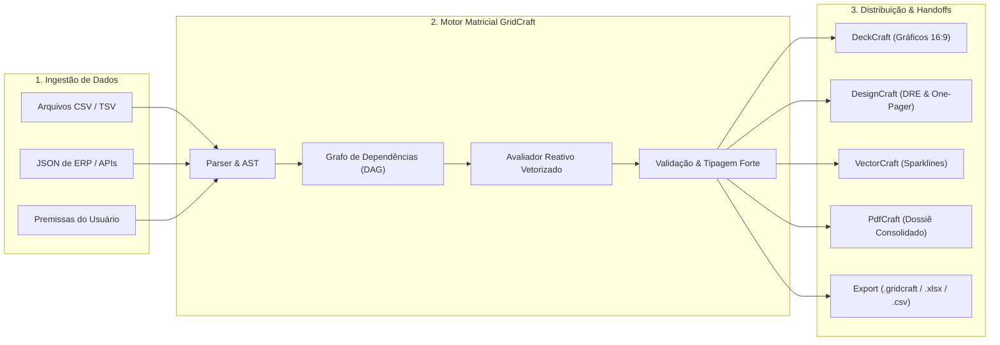
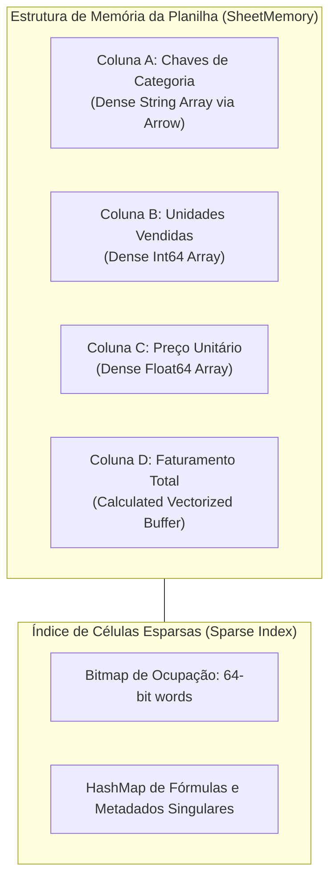
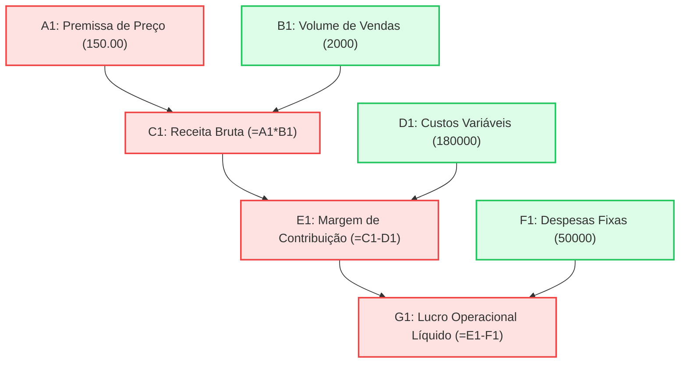
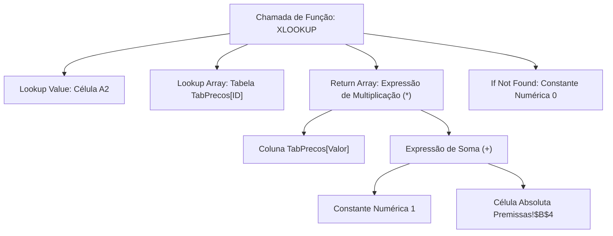
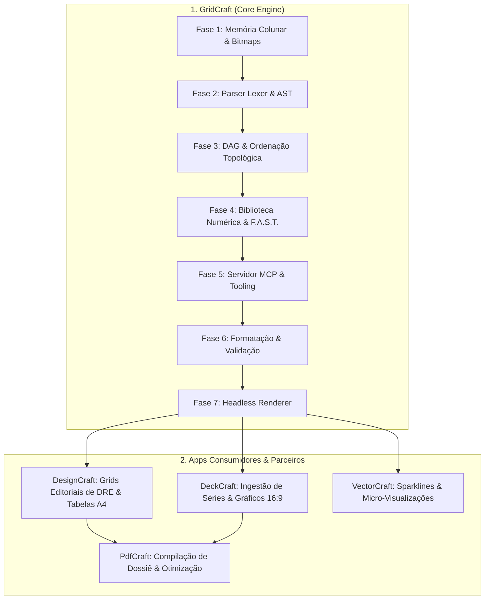
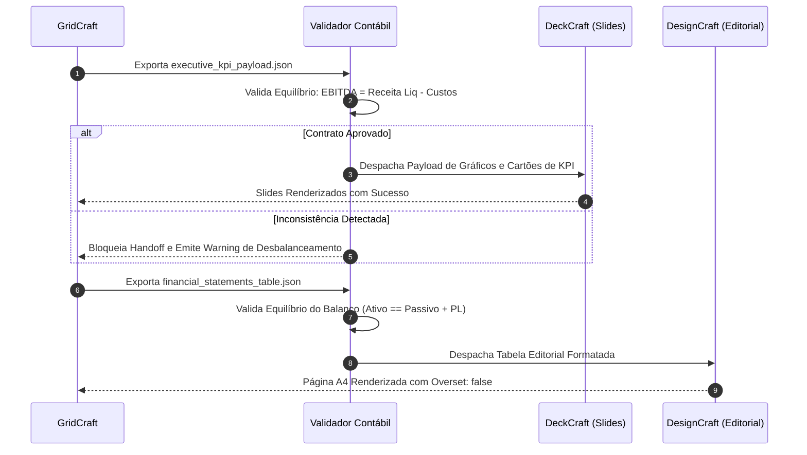
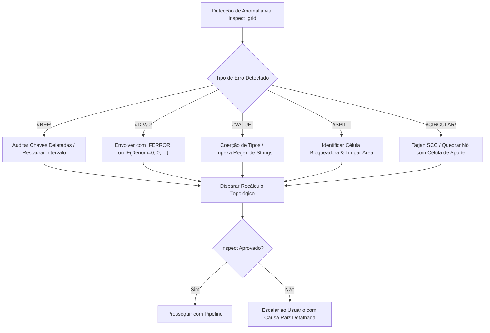

# ArtCraft: Sheet & Engenharia de Dados Tabulares — GridCraft
### Manual Técnico Canônico, Arquitetura do Motor Matricial Reativo & Protocolos de Handoff Multi-App

---

## Sumário Executivo

1. [Visão Geral e Filosofia do GridCraft & artcraft-sheet](#1-visão-geral-e-filosofia-do-gridcraft--artcraft-sheet)
   - 1.1 O que é a Skill artcraft-sheet e o Motor GridCraft?
   - 1.2 A Filosofia da Modelagem Limpa: Os Princípios F.A.S.T.
   - 1.3 Fronteiras Operacionais Rígidas e Proibições Inegociáveis
   - 1.4 O Sistema de Tipos Fortemente Tipado do GridCraft
   - 1.5 Formatos Nativos, Suportados e Interoperabilidade
2. [Arquitetura Interna do Motor GridCraft](#2-arquitetura-interna-do-motor-gridcraft)
   - 2.1 Armazenamento Colunar Contíguo e Esparsidade Celular
   - 2.2 O Grafo Acíclico Dirigido Celular (Cellular DAG)
   - 2.3 Algoritmo de Recálculo Reativo e Ordenação Topológica
   - 2.4 O Parser e Compilador de Fórmulas: Lexer, AST e Avaliador Vetorizado
   - 2.5 Catálogo Canônico de Fórmulas Essenciais
   - 2.6 Motor de Formatação Condicional e Estilização Numérica Contábil
   - 2.7 Sistema de Validação de Dados e Integridade Relacional
3. [Roadmap de Implementação de Cada App no Pipeline de Dados](#3-roadmap-de-implementação-de-cada-app-no-pipeline-de-dados)
   - 3.1 Roadmap de Implementação do GridCraft (App Core / Motor Matricial)
   - 3.2 Roadmap de Implementação e Integração do DeckCraft (Slides & KPIs Executivos)
   - 3.3 Roadmap de Implementação e Integração do DesignCraft (Editorial DRE / Balanços / One-Pagers)
   - 3.4 Roadmap de Implementação e Integração do PdfCraft (Compilação & Auditoria Documental)
   - 3.5 Roadmap de Implementação e Integração do VectorCraft (Sparklines & Visualização Vetorial)
4. [Como a Skill Passa Instruções Para Cada App? (Protocolos MCP Exaustivos)](#4-como-a-skill-passa-instruções-para-cada-app-protocolos-mcp-exaustivos)
   - 4.1 Princípios Gerais de Comunicação MCP para Dados
   - 4.2 Especificação Completa de Ferramentas MCP do GridCraft
   - 4.3 Protocolo de Instrução para DeckCraft (Injeção de Gráficos e Cartões de Métricas)
   - 4.4 Protocolo de Instrução para DesignCraft (Injeção de Tabelas Editoriais de Alta Densidade)
   - 4.5 Protocolo de Instrução para PdfCraft (Compilação do Dossiê Financeiro)
   - 4.6 Protocolo de Instrução para VectorCraft (Geração de Sparklines e Indicadores)
5. [Contratos Formais de Handoff e Schemas de Dados](#5-contratos-formais-de-handoff-e-schemas-de-dados)
   - 5.1 Handoff GridCraft $\rightarrow$ DeckCraft (`executive_kpi_payload.json`)
   - 5.2 Handoff GridCraft $\rightarrow$ DesignCraft (`financial_statements_table.json`)
   - 5.3 Handoff GridCraft $\rightarrow$ VectorCraft (`sparklines_series.json`)
   - 5.4 Regras de Validação de Equilíbrio Contábil (Quality Gate Financeiro)
6. [Casos Práticos de Execução Ponta a Ponta](#6-casos-práticos-de-execução-ponta-a-ponta)
   - 6.1 Caso 1: Modelo Financeiro SaaS Completo (MRR Waterfall, Cohorts, CAC/LTV & Projeção 36 Meses)
   - 6.2 Caso 2: Simulação de Cap Table, Diluição de Rodada Seed e Waterfall de Liquidação
   - 6.3 Caso 3: DRE Orçado vs. Realizado com Análise de Variância e Fechamento Executivo
7. [Protocolos de Tratamento de Falhas, Resiliência e Auto-Recuperação](#7-protocolos-de-tratamento-de-falhas-resiliência-e-auto-recuperação)
   - 7.1 Tratamento Autônomo de Erros de Fórmulas (`#REF!`, `#DIV/0!`, `#VALUE!`, `#NAME?`, `#N/A`, `#NUM!`)
   - 7.2 Diagnóstico e Quebra Algorítmica de Referências Circulares (`#CIRCULAR!`)
   - 7.3 Tratamento de Estouro de Matriz Dinâmica (`#SPILL!`)
   - 7.4 Normalização de Tipos de Dados e Desambiguação Regional de Delimitadores
   - 7.5 Matriz de Auto-Recuperação de Falhas em Lote
8. [Matriz de Comandos, Slash Commands e Quality Gates](#8-matriz-de-comandos-slash-commands-e-quality-gates)
   - 8.1 Slash Commands Nativos (`/artcraft-sheet`)
   - 8.2 Checklist de Aceitação Técnica e Contábil (Audit Gate)
   - 8.3 Guia de Boas Práticas de Modelagem e Governança de Dados

---

## 1. Visão Geral e Filosofia do GridCraft & artcraft-sheet

### 1.1 O que é a Skill artcraft-sheet e o Motor GridCraft?

A skill **`artcraft-sheet`** é a inteligência especializada do ecossistema ArtCraft dedicada à engenharia de dados tabulares, modelagem financeira de alta precisão, cálculos matriciais reativos, consolidação contábil e estruturação de dados analíticos. No coração desta skill opera o **GridCraft**, um motor computacional de planilhas de alta performance, desenhado desde a sua raiz para operar tanto em modo de execução autônomo sem interface gráfica (*headless execution engine*) quanto via ponte interativa em tempo real (*live UI bridge*) através do Model Context Protocol (MCP).

Enquanto suites tradicionais de escritório tratam planilhas como simples folhas de cálculo visuais com tipagem fraca e propensas a erros de digitação humana, o GridCraft trata cada pasta de trabalho como um **Grafo Computacional Orientado a Dados (Dataflow Graph)**. Nele, cada célula é um nó computacional tipado, as dependências são auditadas matematicamente e cada transformação numérica pode ser inspecionada, testada e serializada para abastecer os demais pipelines criativos e executivos da suíte ArtCraft.



### 1.2 A Filosofia da Modelagem Limpa: Os Princípios F.A.S.T.

Para assegurar que qualquer modelo financeiro ou estrutura analítica gerada pelo GridCraft atinja o mais rigoroso nível de auditoria corporativa (compatível com os padrões de Big Four e bancos de investimento globais), a skill adota compulsoriamente os princípios **F.A.S.T.** (*Flexible, Appropriate, Structured, Transparent*):

1. **Flexível (*Flexible*):** Os modelos devem ser parametrizados através de variáveis globais e intervalos nomeados (*Named Ranges*). Nenhuma constante arbitrária (*hardcoded value*) pode ser embutida diretamente dentro de uma fórmula de cálculo. Se a taxa de juros ou a taxa de desconto mudar, toda a planilha deve recalcular instantaneamente alterando apenas uma célula de premissa.
2. **Apropriado (*Appropriate*):** A complexidade do modelo deve refletir exatamente a demanda do usuário. Não se utilizam macros obscuras ou matrizes dinâmicas de 5 dimensões quando uma projeção linear de 12 meses com `SUMIFS` e `XLOOKUP` atende ao escopo com maior clareza.
3. **Estruturado (*Structured*):** Toda pasta de trabalho segue uma separação rigorosa de camadas em abas distintas:
   - `00_Metadata`: Versão, autor, data de criação, hash de integridade e glossário.
   - `01_Assumptions`: Parâmetros de entrada, taxas macroeconômicas, preços unitários e premissas.
   - `02_Calculations`: Mecanismo bruto de cálculo intermediário e transformações matriciais.
   - `03_Outputs_DRE`: Demonstrativo de Resultados do Exercício e Fluxo de Caixa.
   - `04_Outputs_Handoff`: Visões normalizadas e limpas para consumo pelo DeckCraft e DesignCraft.
4. **Transparente (*Transparent*):** Fórmulas devem ser simples, lineares e autoexplicativas. Cadeias de aninhamento excessivo são decompostas utilizando a função canônica `LET()` para nomear passos intermediários, eliminando redundâncias de processamento e facilitando a auditoria.

### 1.3 Fronteiras Operacionais Rígidas e Proibições Inegociáveis

Em estrita consonância com a governança do Orquestrador Mestre ArtCraft, o GridCraft opera sob fronteiras negativas absolutas. Se a solicitação do usuário violar o domínio analítico, a skill bloqueia a tentativa e repassa a responsabilidade ao especialista correspondente:

| Atribuição Canônica do GridCraft | O que o GridCraft NUNCA Faz | Especialista Designado |
| :--- | :--- | :--- |
| Modelagem financeira, DRE, Balanço, Fluxo de Caixa, DCF, LTV/CAC e Cap Tables. | Diagramação de relatórios editoriais impressos ou páginas A4 estilizadas. | **DesignCraft** |
| Consolidação de dados em matrizes e geração de séries numéricas para gráficos. | Criação de slides corporativos horizontais 16:9 widescreen para reuniões. | **DeckCraft** |
| Cálculo de tendências numéricas, deltas e vetores de dados para sparklines. | Desenho de curvas vetoriais Bezier livres, logomarcas ou ícones. | **VectorCraft** |
| Exportação de tabelas paginadas limpas em formato PDF estruturado. | Mesclagem, ordenação, renumeração ou compressão de múltiplos PDFs heterogêneos. | **PdfCraft** |
| Aplicação de regras lógicas de formatação condicional numérica baseadas em dados. | Tratamento de fotografias, aplicação de máscaras raster ou retoque de pixels. | **PhotoCraft** |
| Processamento estatístico matricial e limpeza de strings numéricas em lote. | Montagem de timelines de áudio/vídeo, cortes ou sincronia de mídias. | **FilmCraft** |

### 1.4 O Sistema de Tipos Fortemente Tipado do GridCraft

Diferente de motores legados onde qualquer célula pode sofrer coerção arbitrária, o GridCraft opera sobre um sistema de tipos atômicos estritos representados internamente:

```text
               ┌───────────────────┐
               │   GridCraftType   │
               └─────────┬─────────┘
                         │
      ┌──────────────────┼──────────────────┐
      │                  │                  │
┌─────┴─────┐      ┌─────┴─────┐      ┌─────┴─────┐
│ Primitivo │      │ Estrutura │      │   Erro    │
└─────┬─────┘      └─────┬─────┘      └─────┬─────┘
      │                  │                  │
      ├─ NUMBER (Float64)├─ ARRAY (Dinâmico)├─ #REF!
      ├─ CURRENCY (ISO)  └─ RECORD (Chave/V) ├─ #DIV/0!
      ├─ PERCENTAGE                         ├─ #VALUE!
      ├─ DATE (ISO-8601)                    ├─ #NAME?
      ├─ TEXT (UTF-8)                       ├─ #N/A
      └─ BOOLEAN                            ├─ #NUM!
                                            ├─ #CIRCULAR!
                                            └─ #SPILL!
```

- **`NUMBER` (Float64):** Números reais em ponto flutuante de precisão dupla conforme padrão IEEE 754.
- **`CURRENCY`:** Valor escalar associado a um código alfanumérico ISO-4217 (ex.: `BRL`, `USD`, `EUR`) e precisão fixa de casas decimais (padrão 2 casas).
- **`PERCENTAGE`:** Valor escalar puro onde $1.00 = 100\%$, armazenado com precisão de ponto flutuante e formatado para apresentação.
- **`DATE`:** Representação temporal em conformidade com ISO-8601 (`YYYY-MM-DD` ou `YYYY-MM-DDTHH:mm:ssZ`), garantindo suporte matemático a cálculos de prazos sem ambiguidades regionais.
- **`TEXT`:** Cadeia de caracteres codificada estritamente em UTF-8 com suporte completo a internacionalização.
- **`BOOLEAN`:** Valor lógico binário `TRUE` ou `FALSE`.
- **`ARRAY`:** Matriz dinâmica bidimensional de valores primitivos, permitindo expansão contígua (*spilling*).
- **`ERROR`:** Enumeração estrita de falhas de avaliação com metadados detalhando a célula originária e a causa raiz do erro.

### 1.5 Formatos Nativos, Suportados e Interoperabilidade

O GridCraft possui um motor de I/O altamente otimizado capaz de ler e gerar múltiplos formatos industriais:

1. **`.gridcraft` (Formato Canônico do Ecossistema):** Arquivo empacotado contendo o grafo serializado de dependências, definições de estilos contábeis, metadados de auditoria e cache de valores calculados em JSON comprimido via Zstandard (zstd).
2. **`.xlsx` (Microsoft Excel OpenXML):** Total compatibilidade bidirecional com fórmulas modernas, tabelas dinâmicas, estilos de células e abas múltiplas.
3. **`.csv` / `.tsv` (RFC 4180):** Exportação e ingestão de tabelas planas com controle rigoroso de delimitadores, proteção de aspas e escape de quebras de linha.
4. **`.json` (ArtCraft Handoff Standard):** Estrutura hierárquica normalizada contendo esquemas, colunas tipadas e matrizes de valores para consumo imediato pelos demais servidores MCP da suíte.

---

## 2. Arquitetura Interna do Motor GridCraft

### 2.1 Armazenamento Colunar Contíguo e Esparsidade Celular

Para viabilizar recálculos instantâneos mesmo em planilhas com centenas de milhares de linhas, o GridCraft abandona o modelo ingênuo de matriz bidimensional densa de ponteiros. Ele implementa uma arquitetura híbrida de **Armazenamento Colunar Contíguo (*Columnar Store*)** combinada com **Indexação Esparsa por Bitmaps**:



- **Alinhamento em Memória:** Dados homogêneos da mesma coluna (ex.: valores monetários de transações) são armazenados em buffers contíguos de memória, viabilizando otimizações via instruções SIMD (AVX-512 / NEON) durante agregações em lote (`SUM`, `AVERAGE`, `MIN`, `MAX`).
- **Eficiência de Espaço:** Células vazias em intervalos esparsos não consomem alocação de memória física; sua existência é gerenciada por um mapa de bits de ocupação (*roaring bitmap*).

### 2.2 O Grafo Acíclico Dirigido Celular (Cellular DAG)

Toda célula contendo uma fórmula no GridCraft é mapeada como um vértice em um **Grafo Acíclico Dirigido (DAG)**. As arestas representam a direção do fluxo de dados:

$$A1 \rightarrow C1 \quad \text{e} \quad B1 \rightarrow C1 \implies C1 = f(A1, B1)$$

Quando o valor de $A1$ é modificado, o motor não recalcula a planilha inteira de forma cega. Ele realiza uma travessia no grafo a partir de $A1$, marcando exclusivamente os nós descendentes diretos e indiretos como "sujos" (*dirty propagation*).



### 2.3 Algoritmo de Recálculo Reativo e Ordenação Topológica

O processo de recálculo segue o algoritmo formal de **Ordenação Topológica (*Topological Sort*) via Algoritmo de Kahn**, assegurando que nenhuma fórmula seja avaliada antes que todas as suas dependências tenham seus valores finais consolidados:

```python
def recalcular_planilha(grafo, nos_modificados):
    # 1. Propagação de estado 'sujo' (Dirty Marking)
    nos_sujos = set()
    fila = list(nos_modificados)
    while fila:
        atual = fila.pop(0)
        nos_sujos.add(atual)
        for dependente in grafo.obter_dependentes(atual):
            if dependente not in nos_sujos:
                fila.append(dependente)

    # 2. Construção do subgrafo de nós sujos e cálculo de graus de entrada (in-degree)
    grau_entrada = {no: 0 for no in nos_sujos}
    for no in nos_sujos:
        for dep in grafo.obter_dependentes(no):
            if dep in grau_entrada:
                grau_entrada[dep] += 1

    # 3. Fila de nós prontos (in-degree == 0)
    prontos = [no for no, grau in grau_entrada.items() if grau == 0]
    ordem_execucao = []

    while prontos:
        no_atual = prontos.pop(0)
        ordem_execucao.append(no_atual)
        for dep in grafo.obter_dependentes(no_atual):
            if dep in grau_entrada:
                grau_entrada[dep] -= 1
                if grau_entrada[dep] == 0:
                    prontos.append(dep)

    # 4. Detecção de Referência Circular
    if len(ordem_execucao) != len(nos_sujos):
        ciclo = nos_sujos - set(ordem_execucao)
        raise CircularReferenceError(f"Ciclo detectado nas células: {ciclo}")

    # 5. Avaliação sequencial estrita na ordem topológica
    for no in ordem_execucao:
        no.avaliar_formula()
```

### 2.4 O Parser e Compilador de Fórmulas: Lexer, AST e Avaliador Vetorizado

Quando uma fórmula como `=XLOOKUP(A2, TabPrecos[ID], TabPrecos[Valor] * (1 + Premissas!$B$4), 0)` é inserida em uma célula, o compilador do GridCraft executa três fases canônicas:

1. **Análise Léxica (*Tokenizer / Lexer*):** A string de texto é quebrada em um fluxo de tokens discretos: identificadores de função (`FUNC:XLOOKUP`), referências a células (`REF:A2`), referências estruturadas (`STRUCT_REF:TabPrecos[ID]`), operadores aritméticos (`OP_ADD`, `OP_MUL`), parênteses e delimitadores de argumentos.
2. **Análise Sintática (*Parser de Precedência de Operadores / Pratt Parser*):** Os tokens são organizados em uma Árvore de Sintaxe Abstrata (*Abstract Syntax Tree* - AST).
3. **Compilação em Bytecode e Avaliação Vetorizada:** A AST é compilada em uma sequência linear de instruções executáveis em uma máquina de pilha virtual (*stack machine*), que avalia intervalos inteiros de células simultaneamente.



### 2.5 Catálogo Canônico de Fórmulas Essenciais

O GridCraft possui uma biblioteca matemática e financeira de precisão estrita, implementada com rotinas numéricas de alta estabilidade:

#### 1. Funções Financeiras e de Avaliação de Investimentos:
- **`XNPV(taxa, valores, datas)`:** Valor Presente Líquido para fluxos de caixa que não ocorrem em intervalos periódicos regulares, utilizando contagem de dias reais.
- **`XIRR(valores, datas, [estimativa])`:** Taxa Interna de Retorno exata baseada em datas específicas via método numérico de Newton-Raphson com fallback para bissecção.
- **`PMT(taxa, nper, va, [vf], [tipo])`:** Cálculo da parcela periódica de amortização de dívida com juros compostos.
- **`IPMT` / `PPMT`:** Decomposição da parcela em juros e amortização de principal.
- **`CUMIPMT(taxa, nper, va, periodo_inicial, periodo_final, tipo)`:** Juros acumulados pagos entre dois períodos fiscais.

#### 2. Funções Lógicas, de Controle e Escopo Local:
- **`LET(nome1, valor1, [nome2, valor2, ...], calculo_final)`:** Permite declarar variáveis locais nomeadas para valores intermediários, aumentando drasticamente a legibilidade e a performance.
- **`IFS(condicao1, valor1, condicao2, valor2, ...)`:** Avaliação ordenada de múltiplos predicados lógicos sem aninhamento excessivo de `IF`.
- **`SWITCH(expressao, caso1, resultado1, [caso2, resultado2, ...], [padrao])`:** Seleção direta de ramos de execução.

#### 3. Funções Modernas de Busca e Matrizes Dinâmicas:
- **`XLOOKUP(chave, vetor_busca, vetor_retorno, [se_nao_encontrado], [modo_correspondencia], [modo_busca])`:** Busca bidirecional exata ou aproximada, sem restrição de coluna à esquerda.
- **`FILTER(intervalo, criterio_inclusao, [se_vazio])`:** Filtra dinamicamente uma matriz de dados, expandindo o resultado contíguo nas células adjacentes (*spill*).
- **`UNIQUE(intervalo, [por_coluna], [ocorrencia_unica])`:** Extrai elementos distintos de um intervalo.
- **`SORT(intervalo, [indice_classificacao], [ordem], [por_coluna])`:** Ordena dados matriciais de forma reativa.
- **`CHOOSECOLS(matriz, col_idx1, [col_idx2, ...])` / `CHOOSEROWS`:** Seleciona colunas ou linhas específicas de uma matriz para composição de payloads de handoff.

#### 4. Agregações Condicionais Multicritério:
- **`SUMIFS(intervalo_soma, intervalo_criterio1, criterio1, ...)`:** Soma condicionada a múltiplos predicados lógicos simultâneos.
- **`COUNTIFS` / `AVERAGEIFS`:** Contagem e média sob filtros combinados.

### 2.6 Motor de Formatação Condicional e Estilização Numérica Contábil

O GridCraft implementa um motor de estilização declarativo, assegurando que os dados sejam legíveis, autoexplicativos e visualmente profissionais:

- **Formatos Numéricos Padronizados:**
  - Moeda Padrão: `R$ #,##0.00;[Red](R$ #,##0.00);"-"` (Valores positivos com símbolo, negativos em vermelho entre parênteses e zeros representados por hífen).
  - Percentual com Uma Casa Decimal: `0.0%`.
  - Múltiplos e Índices: `0.0"x"`.
  - Notação Contábil Internacional: `$#,##0;($#,##0);"-"`.
- **Regras de Formatação Condicional:**
  - *Color Scales (Gradientes Cromáticos):* Gradiente de 3 pontos para análise de calor em cohorts de retenção (Verde para alta retenção $\rightarrow$ Amarelo $\rightarrow$ Vermelho para churn elevado).
  - *Highlight Rules (Realce Crítico):* Destacar automaticamente em fundo carmesim claro (`#FEE2E2`) qualquer célula onde a Margem EBITDA projetada fique abaixo de $15\%$, ou onde o Runway caia para menos de 6 meses.
  - *Data Bars (Barras de Progresso Embutidas):* Mini-barras horizontais renderizadas dentro da célula para comparar faturamento entre produtos concorrentes.

### 2.7 Sistema de Validação de Dados e Integridade Relacional

Para evitar que erros humanos ou dados externos corrompam os cálculos, o GridCraft estabelece regras estritas de integridade na camada celular:
- **Listas de Validação (*Drop-down constraints*):** Limitar a célula a uma lista canônica (ex.: `["Pessimista", "Base", "Otimista"]`).
- **Limites Numéricos Rígidos:** Impor que taxas percentuais residam estritamente no intervalo $[0.0, 1.0]$.
- **Validação Cruzada de Integridade:** Impedir que a data de vencimento seja anterior à data de emissão através de fórmula booleana de validação `=B2 >= A2`.

---

## 3. Roadmap de Implementação de Cada App no Pipeline de Dados

O ecossistema ArtCraft funciona como uma linha de montagem técnica orquestrada. A seguir, apresenta-se o roadmap exaustivo de desenvolvimento e operação para cada aplicativo que atua no ciclo de vida de dados:



### 3.1 Roadmap de Implementação do GridCraft (App Core / Motor Matricial)

A construção do GridCraft é dividida em sete fases progressivas, indo da representação pura de bytes em baixo nível até a interface com o ecossistema multiagente:

#### Fase 1: Arquitetura de Memória e Estruturas de Dados Primitivas
- Implementação de buffers contíguos de memória colunar baseados na especificação Apache Arrow para primitivos escalares (`Float64`, `Int64`).
- Criação de dicionários de strings para desduplicação de rótulos de texto repetidos.
- Sistema de indexação por bitmaps para gerenciar células vazias sem desperdício de RAM.
- Suporte nativo a coordenadas bidimensionais $R1C1$ e notação canônica $A1$.

#### Fase 2: Mecanismo de Parsing, Gramática e Compilação de Fórmulas
- Desenvolvimento do analisador léxico com suporte a literais, intervalos contínuos (`A1:B10`), intervalos nomeados e referências externas (`Aba!A1`).
- Construção do parser de expressões com tratamento de precedência matemática padrão e associatividade de operadores.
- Geração da Árvore de Sintaxe Abstrata (AST) e geração de bytecode intermediário para avaliação rápida.

#### Fase 3: Grafo de Dependências Reativo e Algoritmo de Ciclo
- Mapeamento dinâmico de arestas de dependência no nível de células individuais e blocos de intervalos.
- Implementação do algoritmo de ordenação topológica para isolamento estrito de nós sujos (*dirty tracking*).
- Mecanismo de detecção instantânea de referências circulares (`#CIRCULAR!`) com emissão da pilha exata de nós conflitantes.

#### Fase 4: Implementação da Biblioteca Canônica de Funções
- Codificação de rotinas matemáticas vetorizadas para matrizes dinâmicas (`FILTER`, `UNIQUE`, `SORT`, `SEQUENCE`).
- Implementação robusta de funções financeiras com resolução numérica precisa (`XIRR`, `XNPV`, amortização contábil).
- Inclusão das funções de escopo léxico moderno (`LET`, `LAMBDA`).

#### Fase 5: Interface do Servidor MCP (Model Context Protocol)
- Exposição das ferramentas fundamentais de manipulação remota via payloads JSON estruturados.
- Suporte a comandos transacionais em lote (`command_batch`) com rollback automático em caso de falha de parsing.
- Implementação do comando `inspect_grid` para leitura estruturada de metadados, valores e diagnósticos de erros.

#### Fase 6: Sistema de Formatação Declarativa e Validação de Dados
- Motor de regras de apresentação numérica (formato de moedas globais, percentuais, datas ISO).
- Avaliador de formatação condicional reativa (escalas de cores, alertas de limites e barras de dados).
- Validação de entrada celular com listas dinâmicas e rejeição de tipos inconsistentes.

#### Fase 7: Renderizador Visual Headless e Exportadores de Interoperabilidade
- Renderizador de grade para geração de capturas em alta fidelidade (`render_preview`) em PNG/SVG para inspeção rápida de layout.
- Conversores de alta velocidade para `.xlsx` e serializadores JSON estritos para consumo multiagente.

---

### 3.2 Roadmap de Implementação e Integração do DeckCraft (Slides & KPIs Executivos)

O DeckCraft é a ferramenta responsável por apresentar os dados refinados em slides widescreen 16:9 para investidores e executivos de diretoria.

#### Fase 1: Padronização do Esquema de Ingestão de Métricas
- O DeckCraft implementa suporte para consumir diretamente o artefato `executive_kpi_payload.json` gerado pelo GridCraft.
- Mapeamento automático dos campos de métricas (`ARR`, `MRR`, `Net_Retention_Rate`, `LTV_CAC_Ratio`) para caixas de destaque com números gigantes (*stat callouts*).

#### Fase 2: Mapeamento de Séries Temporais para Componentes de Gráficos Nativos
- Criação do pipeline de conversão de matrizes numéricas do GridCraft em gráficos de barras, colunas empilhadas, linhas e áreas no DeckCraft (`insert_chart`).
- Aplicação automática de paletas corporativas contrastantes e rotulagem inteligente de eixos, eliminando poluição visual.

#### Fase 3: Validação de Coerência e Auditoria de Layout
- Inspeção pós-inserção via `deckcraft: inspect_slide` para confirmar que legendas e rótulos de dados não se sobrepõem às margens de segurança do slide ($960 \times 540\text{ pt}$).

---

### 3.3 Roadmap de Implementação e Integração do DesignCraft (Editorial DRE / Balanços / One-Pagers)

O DesignCraft é o encarregado da publicação editorial de alta densidade tipográfica (Demonstrativos de Resultados completos, Notas Explicativas e Balanços Patrimoniais em formato Carta ou A4).

#### Fase 1: Motor de Importação de Estruturas Tabulares Rígidas
- Implementação do comando de criação de tabelas editoriais baseadas no artefato `financial_statements_table.json` oriundo do GridCraft.
- Configuração de colunas proporcionais com suporte a alinhamento decimal monetário estrito (todos os centavos perfeitamente alinhados verticalmente).

#### Fase 2: Aplicação de Grids Tipográficos e Linhas de Apoio
- Aplicação de regras editoriais de design corporativo: alternância sutil de fundo de linha (*zebra striping* com opacidade de $3\%$), bordas de subtotal finas ($0.5\text{ pt}$) e bordas de totalização duplas ($1.5\text{ pt}$).
- Cabeçalhos de tabela com repetição automática em quebras de página em relatórios com múltiplos spreads.

#### Fase 3: Auditoria de Truncamento de Células (Zero Overset)
- Execução obrigatória de `designcraft: inspect_document` verificando se os valores numéricos ou descrições fiscais sofreram truncamento (*overset text*). Se positivo, a ferramenta expande automaticamente o espaçamento entrelinhas ou a altura da célula da tabela.

---

### 3.4 Roadmap de Implementação e Integração do PdfCraft (Compilação & Auditoria Documental)

O PdfCraft encerra o ciclo documental corporativo, agrupando artefatos gerados por múltiplos apps.

#### Fase 1: Protocolo de Unificação de Formatos Misto
- Ingestão sequencial da apresentação horizontal do DeckCraft ($16:9$), do anexo de DRE vertical do DesignCraft ($A4$) e da exportação vetorial de memória de cálculo do GridCraft.
- Execução de `pdfcraft: doc_combine` com normalização de metadados institucionais (Título, Autor, Data, Confidencialidade).

#### Fase 2: Numeração Global e Sumário Executivo
- Injeção de marcadores internos (*PDF bookmarks*) para navegação rápida entre a capa, os slides e o anexo contábil detalhado.
- Estampagem de numeração contínua de páginas (*Bates stamping* ou paginação harmonizada).

#### Fase 3: Otimização e Certificação
- Compressão de fluxos de dados sem perda de definição vetorial de fontes e números.
- Emissão de relatório de integridade (`doc_info`) validando o número final de páginas.

---

### 3.5 Roadmap de Implementação e Integração do VectorCraft (Sparklines & Visualização Vetorial)

O VectorCraft fornece micro-elementos visuais matemáticos escaláveis para enriquecer as tabelas do GridCraft e do DesignCraft.

#### Fase 1: Algoritmo de Geração de Sparklines Matemáticas
- Ingestão de séries de dados unidimensionais do GridCraft (ex.: faturamento dos últimos 12 meses: `[120, 140, 135, 160, 190, 210, ...]`).
- Normalização matemática da série para um viewBox fixo de $100 \times 24\text{ pt}$.
- Geração da curva Bezier suave ou polilinha vetorial SVG limpa com ponto focal no último valor da série.

#### Fase 2: Indicadores de Status e Gráficos de Cascata (Waterfall SVGs)
- Construção de gráficos de variação de caixa (*cash flow bridges*) em curvas vetoriais fechadas com IDs semânticos para cada barra de receita, custo e imposto.
- Exportação de SVGs ultraleves sem metadados redundantes para inserção direta nas células ou relatórios.

---

## 4. Como a Skill Passa Instruções Para Cada App? (Protocolos MCP Exaustivos)

### 4.1 Princípios Gerais de Comunicação MCP para Dados

A troca de mensagens entre o agente analista da skill `artcraft-sheet` e os servidores MCP baseia-se em quatro pilares estritos:
1. **Tipagem Semântica Estrita:** Valores numéricos são passados como primitivos JSON (`number`), nunca como strings formatadas (ex.: enviar `1500000.50`, e nunca `"R$ 1.500.000,50"`), garantindo que o motor de formatação gerencie a máscara de exibição.
2. **Operações em Lote Atômicas (`command_batch`):** Todas as mutações de um mesmo bloco de trabalho são agrupadas em uma única chamada MCP, minimizando a latência e assegurando integridade transacional.
3. **Caminhos Absolutos de Arquivos:** Todo comando que referencia arquivos locais utiliza caminhos completos normalizados no formato do sistema operacional hospedeiro.
4. **Inspeção de Retorno Imediata:** Toda mutação é seguida pela execução de uma chamada de inspeção (`inspect_grid`, `inspect_slide`, `inspect_document`) para certificar conformidade antes do avanço para a etapa seguinte.

---

### 4.2 Especificação Completa de Ferramentas MCP do GridCraft

Abaixo são detalhadas as chamadas canônicas do servidor MCP `gridcraft`:

#### 1. Criação de Pasta de Trabalho (`sheet_new`)
Inicializa uma nova pasta de trabalho com parametrização de localidade e moeda padrão:

```json
{
  "ServerName": "gridcraft",
  "ToolName": "sheet_new",
  "Arguments": {
    "workbook_path": "C:/Users/berna/Music/skills_02/data/SaaS_Financial_Model.gridcraft",
    "metadata": {
      "project_name": "SaaS Enterprise Projections",
      "author": "Antigravity Agent (artcraft-sheet)",
      "base_currency": "USD",
      "locale": "en-US",
      "date_format": "YYYY-MM-DD"
    },
    "initial_sheets": ["01_Assumptions", "02_Projections", "03_DRE_Executive", "04_Handoff"]
  }
}
```

#### 2. Inserção de Dados e Cabeçalhos em Bloco (`range_set_values`)
Popula uma matriz contígua de dados estáticos com tipos primitivos validados:

```json
{
  "ServerName": "gridcraft",
  "ToolName": "range_set_values",
  "Arguments": {
    "workbook_path": "C:/Users/berna/Music/skills_02/data/SaaS_Financial_Model.gridcraft",
    "sheet_name": "01_Assumptions",
    "start_cell": "A1",
    "values": [
      ["Categoria", "Parâmetro", "Valor Base", "Unidade", "Notas de Auditoria"],
      ["Receita", "Ticket Médio Mensal (ARPU)", 250.00, "USD", "Baseado no plano Pro vigente"],
      ["Receita", "Crescimento de Novos Clientes MoM", 0.085, "PERCENT", "Taxa composta conservadora"],
      ["Churn", "Taxa Mensal de Cancelamento (Churn)", 0.018, "PERCENT", "Histórico dos últimos 6 meses"],
      ["Custos", "Custo de Aquisição de Clientes (CAC)", 1200.00, "USD", "Blend de tráfego pago e comercial"],
      ["Impostos", "Alíquota Tributária Efetiva", 0.150, "PERCENT", "Projeção sob regime de Lucro Real"]
    ]
  }
}
```

#### 3. Injeção de Fórmulas e Relacionamentos Matriciais (`range_set_formulas`)
Insere fórmulas dinâmicas que referenciam células de outras abas ou intervalos estruturados:

```json
{
  "ServerName": "gridcraft",
  "ToolName": "range_set_formulas",
  "Arguments": {
    "workbook_path": "C:/Users/berna/Music/skills_02/data/SaaS_Financial_Model.gridcraft",
    "sheet_name": "02_Projections",
    "formulas": [
      {
        "cell": "B2",
        "formula": "=LET(arpu, '01_Assumptions'!$C$2, clientes, B$1, arpu * clientes)"
      },
      {
        "cell": "B3",
        "formula": "=B2 * (1 - '01_Assumptions'!$C$4)"
      },
      {
        "cell": "B4",
        "formula": "=B2 - B3"
      },
      {
        "cell": "B10",
        "formula": "=SUM(B2:B9)"
      }
    ]
  }
}
```

#### 4. Aplicação de Estilos Numéricos e Formatação (`range_format`)
Aplica máscaras contábeis, tipografia, preenchimentos e bordas:

```json
{
  "ServerName": "gridcraft",
  "ToolName": "range_format",
  "Arguments": {
    "workbook_path": "C:/Users/berna/Music/skills_02/data/SaaS_Financial_Model.gridcraft",
    "sheet_name": "01_Assumptions",
    "ranges": [
      {
        "range": "A1:E1",
        "style": {
          "font_family": "Inter Tight",
          "font_size": 11,
          "font_weight": "BOLD",
          "font_color": "#FFFFFF",
          "background_color": "#0F172A",
          "alignment_horizontal": "CENTER",
          "border_bottom": {"width": 1.5, "color": "#38BDF8"}
        }
      },
      {
        "range": "C2",
        "style": {"number_format": "$#,##0.00;($#,##0.00);\"-\""}
      },
      {
        "range": "C3:C4",
        "style": {"number_format": "0.0%"}
      },
      {
        "range": "C5",
        "style": {"number_format": "$#,##0.00;($#,##0.00);\"-\""}
      },
      {
        "range": "C6",
        "style": {"number_format": "0.0%"}
      }
    ]
  }
}
```

#### 5. Regras de Formatação Condicional (`conditional_formatting_add`)
Adiciona regras dinâmicas que alteram o aspecto visual com base no valor computado:

```json
{
  "ServerName": "gridcraft",
  "ToolName": "conditional_formatting_add",
  "Arguments": {
    "workbook_path": "C:/Users/berna/Music/skills_02/data/SaaS_Financial_Model.gridcraft",
    "sheet_name": "02_Projections",
    "range": "D2:D13",
    "rule": {
      "type": "NUMERIC_THRESHOLD",
      "operator": "LESS_THAN",
      "threshold_value": 0.20,
      "style": {
        "background_color": "#FEE2E2",
        "font_color": "#991B1B",
        "font_weight": "BOLD"
      }
    }
  }
}
```

#### 6. Auditoria e Inspeção Estrutural (`inspect_grid`)
Permite inspecionar a sanidade computacional de uma aba, detectando valores nulos, células de erro ou referências circulares:

```json
{
  "ServerName": "gridcraft",
  "ToolName": "inspect_grid",
  "Arguments": {
    "workbook_path": "C:/Users/berna/Music/skills_02/data/SaaS_Financial_Model.gridcraft",
    "sheet_name": "02_Projections",
    "check_errors": true,
    "inspect_cells": ["B10", "C10", "D10", "E10"]
  }
}
```

*Exemplo de Resposta de Inspeção Aprovada:*
```json
{
  "status": "success",
  "circular_references_detected": false,
  "dirty_nodes_pending": 0,
  "evaluated_cells": {
    "B10": {"calculated_value": 245000.00, "formula": "=SUM(B2:B9)", "type": "CURRENCY", "error": null},
    "C10": {"calculated_value": 285400.00, "formula": "=SUM(C2:C9)", "type": "CURRENCY", "error": null},
    "D10": {"calculated_value": 332800.00, "formula": "=SUM(D2:D9)", "type": "CURRENCY", "error": null},
    "E10": {"calculated_value": 388100.00, "formula": "=SUM(E2:E9)", "type": "CURRENCY", "error": null}
  }
}
```

#### 7. Exportação Estruturada para Handoff (`export_data`)
Exporta os dados consolidados em JSON ou CSV para alimentação das demais ferramentas:

```json
{
  "ServerName": "gridcraft",
  "ToolName": "export_data",
  "Arguments": {
    "workbook_path": "C:/Users/berna/Music/skills_02/data/SaaS_Financial_Model.gridcraft",
    "source_sheet": "04_Handoff",
    "range": "A1:G15",
    "export_format": "JSON_OBJECT_ARRAY",
    "output_file_path": "C:/Users/berna/Music/skills_02/data/exports/executive_kpi_payload.json"
  }
}
```

---

### 4.3 Protocolo de Instrução para DeckCraft (Injeção de Gráficos e Cartões de Métricas)

Após consolidar as projeções no GridCraft, a skill formata e despacha instruções MCP para o **DeckCraft**, gerando os slides visuais correspondentes:

```json
{
  "ServerName": "deckcraft",
  "ToolName": "insert_chart",
  "Arguments": {
    "slide_index": 4,
    "chart_type": "COLUMN_CLUSTERED",
    "x": 60,
    "y": 140,
    "width": 840,
    "height": 330,
    "title": "Projeção de Receita Recorrente Anual (ARR) e EBITDA - 2026",
    "data": {
      "categories": ["Q1 2026", "Q2 2026", "Q3 2026", "Q4 2026"],
      "series": [
        {
          "name": "ARR Base (USD)",
          "values": [980000, 1450000, 2200000, 3400000],
          "color": "#38BDF8"
        },
        {
          "name": "EBITDA Operacional (USD)",
          "values": [120000, 290000, 580000, 1020000],
          "color": "#10B981"
        }
      ]
    },
    "options": {
      "show_legend": true,
      "show_data_labels": true,
      "number_format": "$#,##0"
    }
  }
}
```

Em seguida, o agente injeta os cartões numéricos de destaque (*KPI Stat Cards*):

```json
{
  "ServerName": "deckcraft",
  "ToolName": "add_text_box",
  "Arguments": {
    "slide_index": 4,
    "x": 60,
    "y": 60,
    "width": 260,
    "height": 70,
    "text": "ARR Projetado Q4\n$3.4M (+247% YoY)",
    "font_family": "Inter Tight",
    "font_size": 20,
    "font_weight": "BOLD",
    "font_color": "#38BDF8",
    "background_color": "#1E293B",
    "border_radius": 8,
    "padding": 12
  }
}
```

---

### 4.4 Protocolo de Instrução para DesignCraft (Injeção de Tabelas Editoriais de Alta Densidade)

Para a montagem do anexo de DRE detalhado em folha vertical A4, a skill instrui o **DesignCraft** a gerar a tabela com alinhamento tipográfico de precisão:

```json
{
  "ServerName": "designcraft",
  "ToolName": "execute",
  "Arguments": {
    "command": "table.create_from_json",
    "params": {
      "page_index": 2,
      "frame_coordinates": {"x": 40, "y": 80, "width": 515, "height": 680},
      "source_json_path": "C:/Users/berna/Music/skills_02/data/exports/financial_statements_table.json",
      "style": {
        "header_row": {
          "background_color": "#0F172A",
          "font_family": "Inter Tight Bold",
          "font_size": 9.5,
          "font_color": "#FFFFFF",
          "height": 24
        },
        "body_rows": {
          "font_family": "Inter",
          "font_size": 8.5,
          "row_height": 18,
          "zebra_background": "#F8FAFC",
          "alignments": ["LEFT", "RIGHT", "RIGHT", "RIGHT", "RIGHT", "RIGHT"]
        },
        "total_rows": {
          "font_family": "Inter Tight Bold",
          "font_size": 9.0,
          "border_top": "0.5pt solid #94A3B8",
          "border_bottom": "1.5pt double #0F172A"
        }
      }
    }
  }
}
```

Imediatamente após a injeção, a skill audita a inexistência de truncamento:

```json
{
  "ServerName": "designcraft",
  "ToolName": "inspect_document",
  "Arguments": {
    "check_fields": ["overflow", "fonts"]
  }
}
```

---

### 4.5 Protocolo de Instrução para PdfCraft (Compilação do Dossiê Financeiro)

Com os slides e o relatório editorial renderizados, a skill aciona o **PdfCraft** para unificação dos artefatos:

```json
{
  "ServerName": "pdfcraft",
  "ToolName": "doc_combine",
  "Arguments": {
    "input_documents": [
      {
        "file_path": "C:/Users/berna/Music/skills_02/exports/deck/pitch_financial_slides.pdf",
        "page_range": "1-5"
      },
      {
        "file_path": "C:/Users/berna/Music/skills_02/exports/editorial/dre_annual_report.pdf",
        "page_range": "1-3"
      }
    ],
    "output_path": "C:/Users/berna/Music/skills_02/deliverables/Dossie_Financeiro_Executivo_Consolidado.pdf",
    "metadata": {
      "title": "Relatório e Projeções Financeiras 2026",
      "subject": "Demonstrativo Contábil e Pitch Deck de Tração",
      "keywords": ["Financeiro", "DRE", "SaaS", "EBITDA", "CapTable"]
    },
    "optimization": {
      "compress_streams": true,
      "linearize_for_web": true
    }
  }
}
```

---

### 4.6 Protocolo de Instrução para VectorCraft (Geração de Sparklines e Indicadores)

Para gerar mini-gráficos vetoriais de linha que representam a evolução de métricas mês a mês:

```json
{
  "ServerName": "vectorcraft",
  "ToolName": "run_command",
  "Arguments": {
    "command": "generate_sparkline",
    "params": {
      "values": [45000, 52000, 61000, 58000, 72000, 89000, 94000, 115000, 130000, 142000, 168000, 195000],
      "width": 120,
      "height": 28,
      "line_color": "#10B981",
      "stroke_width": 2.0,
      "show_endpoint_circle": true,
      "endpoint_color": "#047857",
      "output_svg_path": "C:/Users/berna/Music/skills_02/assets/vector/sparkline_mrr_growth.svg"
    }
  }
}
```

---

## 5. Contratos Formais de Handoff e Schemas de Dados

A consistência de dados em um ambiente automatizado exige que nenhuma informação seja transferida sem esquema rígido e validação de invariantes contábeis.



### 5.1 Handoff GridCraft $\rightarrow$ DeckCraft (`executive_kpi_payload.json`)

Esquema JSON Schema estruturado para abastecimento do DeckCraft:

```json
{
  "$schema": "https://json-schema.org/draft/2020-12/schema",
  "title": "ExecutiveKPIPayload",
  "type": "object",
  "required": ["company_name", "reporting_period", "currency", "kpi_summary", "charts_data"],
  "properties": {
    "company_name": {"type": "string"},
    "reporting_period": {"type": "string"},
    "currency": {"type": "string", "enum": ["USD", "BRL", "EUR"]},
    "kpi_summary": {
      "type": "array",
      "items": {
        "type": "object",
        "required": ["label", "value", "formatted_value", "trend_percentage"],
        "properties": {
          "label": {"type": "string"},
          "value": {"type": "number"},
          "formatted_value": {"type": "string"},
          "trend_percentage": {"type": "number"},
          "status": {"type": "string", "enum": ["positive", "neutral", "negative"]}
        }
      }
    },
    "charts_data": {
      "type": "object",
      "required": ["time_series"],
      "properties": {
        "time_series": {
          "type": "array",
          "items": {
            "type": "object",
            "required": ["period", "metrics"],
            "properties": {
              "period": {"type": "string"},
              "metrics": {
                "type": "object",
                "additionalProperties": {"type": "number"}
              }
            }
          }
        }
      }
    }
  }
}
```

### 5.2 Handoff GridCraft $\rightarrow$ DesignCraft (`financial_statements_table.json`)

Contrato para a diagramação editorial de demonstrativos:

```json
{
  "$schema": "https://json-schema.org/draft/2020-12/schema",
  "title": "FinancialStatementsTable",
  "type": "object",
  "required": ["statement_type", "columns", "rows"],
  "properties": {
    "statement_type": {"type": "string", "enum": ["DRE", "BALANCE_SHEET", "CASH_FLOW"]},
    "columns": {
      "type": "array",
      "items": {
        "type": "object",
        "required": ["id", "title", "alignment"],
        "properties": {
          "id": {"type": "string"},
          "title": {"type": "string"},
          "alignment": {"type": "string", "enum": ["LEFT", "RIGHT", "CENTER"]}
        }
      }
    },
    "rows": {
      "type": "array",
      "items": {
        "type": "object",
        "required": ["row_type", "description", "values"],
        "properties": {
          "row_type": {
            "type": "string",
            "enum": ["HEADER", "DATA", "SUBTOTAL", "TOTAL", "SPACER"]
          },
          "description": {"type": "string"},
          "values": {
            "type": "array",
            "items": {
              "type": "object",
              "required": ["raw_value", "formatted_string"],
              "properties": {
                "raw_value": {"type": ["number", "null"]},
                "formatted_string": {"type": "string"}
              }
            }
          }
        }
      }
    }
  }
}
```

### 5.3 Handoff GridCraft $\rightarrow$ VectorCraft (`sparklines_series.json`)

Payload para solicitação de grafismos vetoriais de série:

```json
{
  "series_id": "sparkline_ltv_cac",
  "target_dimensions": {"width_pt": 120, "height_pt": 24},
  "stroke_properties": {
    "color": "#38BDF8",
    "width": 1.75,
    "line_cap": "round"
  },
  "data_points": [3.2, 3.4, 3.1, 3.8, 4.2, 4.0, 4.5, 4.9, 5.1, 5.4, 5.8, 6.2]
}
```

### 5.4 Regras de Validação de Equilíbrio Contábil (Quality Gate Financeiro)

Antes de qualquer arquivo de handoff ser liberado para consumo visual, o validador algorítmico do GridCraft submete os dados a testes de integridade contábil inegociáveis:

1. **Equação Fundamental do Balanço Patrimonial:**
   $$\text{Ativo Total} \equiv \text{Passivo Circulante} + \text{Passivo Não Circulante} + \text{Patrimônio Líquido}$$
   *Tolerância aceita:* Erro de arredondamento máximo de $|\epsilon| < 0.01$ na moeda local. Se a diferença exceder $0.01$, a skill cancela o handoff e gera alerta de desbalanceamento patrimonial.

2. **Integridade da Cascata de Demonstração de Resultados (DRE):**
   $$\text{Receita Líquida} = \text{Receita Bruta} - \text{Impostos e Deduções}$$
   $$\text{Lucro Bruto} = \text{Receita Líquida} - \text{Custos dos Produtos / Serviços Vendidos (CPV/CSV)}$$
   $$\text{EBITDA} = \text{Lucro Bruto} - \text{Despesas Operacionais (OPEX)} + \text{Depreciação} + \text{Amortização}$$
   $$\text{Lucro Líquido} = \text{EBT} - \text{Imposto de Renda (IRPJ/CSLL)}$$

3. **Invariância de Reconciliação do Fluxo de Caixa:**
   $$\text{Saldo Final de Caixa} \equiv \text{Saldo Inicial de Caixa} + \Delta\text{ Operacional} + \Delta\text{ Investimentos} + \Delta\text{ Financiamento}$$

---

## 6. Casos Práticos de Execução Ponta a Ponta

### 6.1 Caso 1: Modelo Financeiro SaaS Completo (MRR Waterfall, Cohorts, CAC/LTV & Projeção 36 Meses)

#### Briefing do Usuário:
> *"Construa uma modelagem financeira completa para um SaaS B2B com faturamento atual de R$ 80.000 MRR, 160 clientes (ARPU de R$ 500/mês). Considere uma aquisição líquida de 15 novos clientes no mês 1 crescendo 5% ao mês, churn mensal constante de 1.8%, expansão de receita de clientes existentes (upgrade) de 1.2% ao mês e CAC de R$ 1.800. Projete os próximos 36 meses com DRE completa, cálculo de LTV, LTV/CAC e gere os arquivos de handoff para a montagem de um pitch deck."*

#### Execução Passo a Passo pela Skill:

1. **Estruturação da Pasta de Trabalho e Abas:**
   - Cria o arquivo `SaaS_B2B_Model_36M.gridcraft` com as abas `01_Assumptions`, `02_Cohort_Engine`, `03_MRR_Waterfall`, `04_Financial_Statements` e `05_Handoff_Deck`.

2. **Configuração de Premissas em `01_Assumptions`:**
   - `B2`: `500.00` (ARPU Base em BRL).
   - `B3`: `15` (Novos Clientes Mês 1).
   - `B4`: `0.05` (Taxa Crescimento Aquisição MoM).
   - `B5`: `0.018` (Churn Rate Mensal).
   - `B6`: `0.012` (Expansion Rate Mensal).
   - `B7`: `1800.00` (CAC Unitário em BRL).
   - `B8`: `0.82` (Margem Bruta Percentual).

3. **Injeção de Fórmulas Dinâmicas na Waterfall de MRR (`03_MRR_Waterfall`):**
   - Para o Mês $t$ (colunas `C` em diante, onde $B$ é o Mês 0):
     - *MRR Inicial:* `=B10` (MRR Final do mês anterior).
     - *Novo MRR (New):* `='01_Assumptions'!$B$2 * ('01_Assumptions'!$B$3 * (1 + '01_Assumptions'!$B$4)^(COLUNA()-3))`
     - *MRR de Expansão (Expansion):* `=B10 * '01_Assumptions'!$B$6`
     - *MRR de Cancelamento (Churn):* `=-1 * (B10 * '01_Assumptions'!$B$5)`
     - *MRR Final:* `=SUM(C6:C9)`
     - *Net New MRR:* `=C7 + C8 + C9`

4. **Cálculo de Métricas Analíticas de Eficiência (Unit Economics):**
   - *LTV (Lifetime Value):*
     $$\text{LTV} = \frac{\text{ARPU} \times \text{Margem Bruta}}{\text{Churn Rate}} = \frac{500.00 \times 0.82}{0.018} = \text{R\$} \, 22.777,78$$
   - *Relação LTV / CAC:*
     $$\frac{\text{LTV}}{\text{CAC}} = \frac{22.777,78}{1800.00} = 12.65\text{x}$$
   - *Payback do CAC:*
     $$\text{Payback} = \frac{\text{CAC}}{\text{ARPU} \times \text{Margem Bruta}} = \frac{1800.00}{500.00 \times 0.82} = 4.39\text{ meses}$$

5. **Auditoria de Qualidade e Geração do Handoff:**
   - O validador confirma ausência de erros (`#REF!`, `#VALUE!`).
   - Exporta `executive_kpi_payload.json` contendo a série de 36 meses agrupada por trimestres para alimentação do DeckCraft.

---

### 6.2 Caso 2: Simulação de Cap Table, Diluição de Rodada Seed e Waterfall de Liquidação

#### Briefing do Usuário:
> *"Estruture uma tabela de capitalização (Cap Table) para uma startup com 2 fundadores que possuem atualmente 60% e 40% das 1.000.000 de ações ordinárias. Modele uma rodada Seed de R$ 2.500.000 com valuation Post-Money de R$ 12.500.000 e a criação de uma Option Pool (SOP) de 10% para funcionários não-diluível pelos fundadores na entrada (criada unallocated no Pre-Money). Em seguida, calcule a tabela de distribuição de retorno em 3 cenários de venda (Exit por R$ 10M, R$ 25M e R$ 60M) considerando direitos de preferência 1x Não-Participante para os investidores Seed."*

#### Execução Passo a Passo pela Skill:

1. **Equacionamento Matemático da Diluição Pré e Pós-Money:**
   - *Investment Amount ($I$):* R\$ 2.500.000,00.
   - *Post-Money Valuation ($V_{\text{post}}$):* R\$ 12.500.000,00.
   - *Pre-Money Valuation ($V_{\text{pre}}$):* $V_{\text{post}} - I = \text{R\$} \, 10.000.000,00$.
   - *Participação do Investidor Seed:*
     $$P_{\text{seed}} = \frac{I}{V_{\text{post}}} = \frac{2.500.000}{12.500.000} = 20.0\%$$
   - *Participação da Option Pool ($P_{\text{pool}}$):* $10.0\%$.
   - *Participação Restante dos Fundadores:* $100\% - (20\% + 10\%) = 70.0\%$.
     - Fundador 1 ($60\%$ de $70\%$): $42.0\%$.
     - Fundador 2 ($40\%$ de $70\%$): $28.0\%$.

2. **Cálculo da Emissão de Ações e Preço por Ação (*Share Price*):**
   - Número de ações dos fundadores: $1.000.000$ ações.
   - Como os fundadores retêm $70\%$, a contagem total de ações Pós-Rodada ($S_{\text{total}}$) é:
     $$S_{\text{total}} = \frac{1.000.000}{0.70} = 1.428.571\text{ ações}$$
   - Ações emitidas para o Investidor Seed ($20\%$): $285.714\text{ ações}$.
   - Ações reservadas para a Option Pool ($10\%$): $142.857\text{ ações}$.
   - *Preço por Ação:*
     $$\text{Preço} = \frac{\text{R\$} \, 2.500.000,00}{285.714\text{ ações}} = \text{R\$} \, 8,75\text{ por ação}$$

3. **Modelagem da Waterfall de Liquidação (1x Non-Participating Preferred):**
   - O investidor Seed pode escolher entre receber sua preferência de capital (R\$ 2.500.000) ou converter suas ações preferenciais em ordinárias e receber $20\%$ do valor total de venda.
   - O ponto de indiferença (*conversion threshold*) ocorre em:
     $$\text{Exit} \times 20\% = \text{R\$} \, 2.500.000 \implies \text{Exit} = \text{R\$} \, 12.500.000$$
   - **Cenário 1 (Exit R\$ 10.000.000):**
     - O Investidor exerce a preferência de 1x e recebe R\$ 2.500.000.
     - Sobram R\$ 7.500.000 para as ações ordinárias dos fundadores (Fundador 1: R\$ 4.5M, Fundador 2: R\$ 3.0M).
   - **Cenário 2 (Exit R\$ 25.000.000):**
     - Investidor converte para ordinárias e recebe $20\% = \text{R\$} \, 5.000.000$.
     - Option Pool absorve $10\% = \text{R\$} \, 2.500.000$.
     - Fundador 1 recebe $42\% = \text{R\$} \, 10.500.000$.
     - Fundador 2 recebe $28\% = \text{R\$} \, 7.000.000$.
   - **Cenário 3 (Exit R\$ 60.000.000):**
     - Investidor converte e recebe $20\% = \text{R\$} \, 12.000.000$.
     - Fundador 1: R\$ 25.200.000; Fundador 2: R\$ 16.800.000; Pool: R\$ 6.000.000.

4. **Saída Estruturada:**
   - Gera tabela comparativa formatada em `.gridcraft` e exporta a matriz de retorno consolidada para anexo do contrato de investimento.

---

### 6.3 Caso 3: DRE Orçado vs. Realizado com Análise de Variância e Fechamento Executivo

#### Briefing do Usuário:
> *"Temos uma tabela com os números orçados (Budget) e realizados (Actual) do primeiro trimestre de 2026. Preciso calcular a variância nominal e percentual para todas as linhas da DRE (Receita Bruta, Deduções, CPV, Despesas com Pessoal, Marketing, G&A e EBITDA), aplicar formatação condicional automática onde a variância desfavorável de custo for superior a 5%, e preparar a tabela final para diagramação editorial A4 no DesignCraft."*

#### Execução Passo a Passo pela Skill:

1. **Engenharia de Fórmulas de Variância:**
   - *Variância Nominal de Receita:*
     $$\text{Var}_{\text{nominal}} = \text{Realizado} - \text{Orçado}$$
     (Valores positivos representam performance favorável).
   - *Variância Nominal de Custo / Despesa:*
     $$\text{Var}_{\text{custo}} = \text{Orçado} - \text{Realizado}$$
     (Se o orçado era R\$ 100k e o realizado foi R\$ 110k, a variação é $-10k$, indicando estouro de despesa desfavorável).
   - *Variância Percentual:*
     $$\text{Var}_{\%} = \frac{\text{Realizado} - \text{Orçado}}{|\text{Orçado}|}$$

2. **Aplicação de Regras de Formatação Condicional no GridCraft:**
   - Colunas de variância percentual recebem regras lógicas:
     - Despesa com estouro $> +5.0\%$ recebe máscara de fundo vermelho (`#FEE2E2`) e fonte vermelha escura (`#991B1B`).
     - Economia de despesa $> 5.0\%$ recebe fundo verde claro (`#DCFCE7`) e fonte verde escura (`#166534`).

3. **Disparo do Handoff para o DesignCraft:**
   - A skill converte a DRE auditada no payload `financial_statements_table.json`.
   - Comanda o DesignCraft via MCP para gerar a lâmina editorial de duas páginas, auditando a ausência de `overset`.

---

## 7. Protocolos de Tratamento de Falhas, Resiliência e Auto-Recuperação

O GridCraft opera de forma autônoma sob o princípio de tolerância a falhas estruturadas. Se uma fórmula, tipo de dado ou referência falhar durante o processamento, a skill não interrompe a sessão de forma abrupta; ela ativa procedimentos algorítmicos de autocorreção.



### 7.1 Tratamento Autônomo de Erros de Fórmulas

Abaixo são detalhados os protocolos de resolução autônoma para cada erro matemático:

#### 1. Resolução de `#DIV/0!` (Divisão por Zero):
- **Causa Típica:** Períodos iniciais onde o faturamento ou a base de usuários é zero e uma taxa de margem percentual tenta dividir por esse denominador.
- **Ação Autônoma da Skill:** Recompilar a fórmula envolvendo o denominador em proteção lógica defensiva:
  ```excel
  =IF(Denominador = 0, 0, Numerador / Denominador)
  ```
  ou utilizando a sintaxe moderna:
  ```excel
  =IFERROR(Numerador / Denominador, 0)
  ```

#### 2. Resolução de `#VALUE!` (Incompatibilidade de Tipos):
- **Causa Típica:** Uma operação aritmética tenta somar um valor numérico com uma string contendo símbolos monetários não-higienizados (ex.: `"R$ 1.500,00" + 200`).
- **Ação Autônoma da Skill:** O motor dispara uma rotina de normalização via regex, expurga caracteres não-numéricos, converte vírgulas em pontos de acordo com o locale e re-grava o valor como `NUMBER` puro.

#### 3. Resolução de `#REF!` (Referência Inválida):
- **Causa Típica:** Linha ou coluna excluída que constava na lista de argumentos de um cálculo.
- **Ação Autônoma da Skill:** O analisador inspeciona o log histórico de mutações da planilha, identifica a coordenada anterior e reconstrói o intervalo através de referências dinâmicas utilizando `INDEX` e `MATCH`.

---

### 7.2 Diagnóstico e Quebra Algorítmica de Referências Circulares (`#CIRCULAR!`)

Uma referência circular ocorre quando uma célula depende de seu próprio valor calculado, diretamente ou através de um ciclo fechado:

$$A1 \rightarrow B1 \rightarrow C1 \rightarrow A1$$

Quando o recálculo topológico detecta um ciclo:
1. O GridCraft executa o **Algoritmo de Componentes Fortemente Conexos de Tarjan (Tarjan's Strongly Connected Components)** para isolar o laço exato de dependência.
2. Em modelos financeiros, ciclos ocorrem frequentemente no cálculo de juros sobre o saldo médio de caixa (onde o caixa depende dos juros, e os juros dependem do caixa final).
3. **Autocorreção Inteligente:** A skill desativa a dependência direta instantânea e injeta uma célula de atraso temporal (*lag variable*) baseada no saldo de fechamento do período anterior ($t-1$), ou ativa o modo de **Cálculo Iterativo Controlado** com limite rígido de 100 iterações e tolerância de convergência de $\Delta < 0.001$.

---

### 7.3 Tratamento de Estouro de Matriz Dinâmica (`#SPILL!`)

Fórmulas matriciais modernas (`FILTER`, `UNIQUE`, `SORT`) tentam projetar múltiplos valores em células vizinhas:
- **Causa do Erro:** Uma célula adjacente que deveria receber o resultado expandido já contém um valor digitado ou um espaço em branco residual, bloqueando o preenchimento.
- **Ação Autônoma da Skill:**
  1. A ferramenta `inspect_grid` identifica as coordenadas exatas da colisão retornadas pelo motor (ex.: `"spill_blocker": "C14"`).
  2. Verifica se o conteúdo da célula bloqueadora é nulo, lixo ou não-intencional.
  3. Se for um caractere residual, limpa a célula com `range_set_values(range="C14", values=[[null]])` e dispara novamente o recálculo da matriz.

---

### 7.4 Normalização de Tipos de Dados e Desambiguação Regional de Delimitadores

A ingestão de arquivos CSV internacionais frequentemente colide com padrões regionais (vírgula como decimal no Brasil vs. ponto nos Estados Unidos):

| Formato de Origem | Exemplo Bruto | Tratamento de Normalização do GridCraft | Tipo Final Atribuído |
| :--- | :--- | :--- | :--- |
| **BR / Europa Continental** | `"1.250.450,75"` | Substitui pontos por vazio e vírgula por ponto $\rightarrow$ `1250450.75` | `NUMBER` (Float64) |
| **US / Internacional** | `"1,250,450.75"` | Remove vírgulas de milhar $\rightarrow$ `1250450.75` | `NUMBER` (Float64) |
| **Data Brasileira** | `"27/10/2026"` | Inverte para padrão canônico ISO $\rightarrow$ `"2026-10-27"` | `DATE` (ISO-8601) |
| **Moeda Formatada** | `"R$ 84.500,00"` | Isola o código alfanumérico `BRL` e o escalar numérico `84500.00` | `CURRENCY (BRL)` |

---

### 7.5 Matriz de Auto-Recuperação de Falhas em Lote

| Sintoma Detectado | Causa Provável | Ação Autônoma da Skill | Limite de Tentativas |
| :--- | :--- | :--- | :--- |
| `#SPILL!` em matriz dinâmica | Célula vizinha ocupada impedindo a expansão dos dados. | Mapear célula de colisão e mover o obstáculo ou limpar célula residual. | 2 tentativas |
| `#REF!` após inserção de linha | Intervalo fixado não acompanhou o deslocamento relativo. | Converter intervalo rígido em referência estruturada de tabela. | 1 tentativa |
| `#VALUE!` em agregação `SUM` | Intervalo contém strings de texto não-coercíveis misturadas. | Substituir soma aritmética manual (`+`) pela função `SUM` vetorizada, que ignora textos automaticamente. | 1 tentativa |
| Balanço Patrimonial Desbalanceado | Depreciação acumulada não refletida no Ativo Imobilizado Líquido. | Reconciliar linha de depreciação com a contrapartida da DRE. | 2 iterações |
| Timeout em Recálculo Topológico | Complexidade excessiva em matrizes aninhadas. | Vetorizar passos intermediários utilizando tabelas temporárias contíguas. | 1 tentativa |

---

## 8. Matriz de Comandos, Slash Commands e Quality Gates

### 8.1 Slash Commands Nativos (`/artcraft-sheet`)

A skill disponibiliza acionadores diretos para os diferentes níveis de complexidade analítica:

| Comando | Escopo Operacional | Entregáveis Gerados |
| :--- | :--- | :--- |
| **`/artcraft-sheet`** | **Ativação Geral do Especialista em Planilhas.** Análise, modelagem, consolidação e criação de pastas de trabalho completas. | `.gridcraft`, `.xlsx`, `.csv`, `.json` |
| **`/artcraft-sheet dcf`** | **Modelagem de Fluxo de Caixa Descontado.** Projeção de WACC, fluxo de caixa livre da firma (FCFF), valor residual (*terminal value*) e cálculo de valuation intrínseco. | Aba `DCF_Valuation`, tabelas de sensibilidade de WACC vs. Taxa de Crescimento Perpétuo. |
| **`/artcraft-sheet saas`** | **Engenharia de Métricas SaaS & Cohorts.** Matriz completa de evolução de MRR, retenção líquida de receita (NDR), churn de logo vs. churn de receita, CAC e LTV. | Aba `MRR_Waterfall`, mapa de calor condicional de cohorts e payload para DeckCraft. |
| **`/artcraft-sheet dre`** | **Demonstrativo de Resultados do Exercício.** Estruturação contábil clássica com cálculo de margens brutas, EBITDA e lucro líquido trimestral ou anual. | Aba `DRE_Statement` com regras de handoff para o DesignCraft. |
| **`/artcraft-sheet captable`** | **Tabela de Capitalização e Diluição.** Simulação de rodadas de investimento (Pre-seed, Seed, Series A), pools de opções e liquidação em cascata (*waterfall*). | Aba `CapTable_Dynamic` com cenários de saída e distribuição de retorno aos sócios. |

---

### 8.2 Checklist de Aceitação Técnica e Contábil (Audit Gate)

Nenhuma entrega da skill `artcraft-sheet` é considerada concluída antes da aprovação integral dos 15 itens do Quality Gate:

#### 1. Verificações de Integridade Matemática e Fórmulas:
- [ ] O comando `inspect_grid` retorna zero células com erros (`#REF!`, `#DIV/0!`, `#VALUE!`, `#NAME?`, `#N/A`, `#NUM!`).
- [ ] Não há referências circulares (`#CIRCULAR!`) não-tratadas na pasta de trabalho.
- [ ] Nenhuma fórmula matricial dinâmica acusa estouro bloqueado (`#SPILL!`).
- [ ] Todas as fórmulas que realizam divisões financeiras contam com proteção lógica contra denominadores nulos.

#### 2. Governança e Aderência aos Princípios F.A.S.T.:
- [ ] Nenhuma constante arbitrária (*hardcoded value*) reside oculta dentro de fórmulas de cálculo; todas as premissas estão centralizadas na aba de premissas.
- [ ] Todas as células de entrada de dados estão identificadas visualmente com estilo consistente de preenchimento.
- [ ] Cadeias complexas de cálculo utilizam a função `LET()` para nomear passos intermediários.
- [ ] As abas do arquivo seguem a nomenclatura padronizada (`01_Assumptions`, `02_Calculations`, `03_Outputs`).

#### 3. Conformidade Contábil e Financeira:
- [ ] O Balanço Patrimonial atende à identidade inegociável: $\text{Ativo} = \text{Passivo} + \text{Patrimônio Líquido}$.
- [ ] O Saldo Final de Caixa reconcilia com a soma do saldo inicial e das variações de atividades operacionais, de investimento e de financiamento.
- [ ] As deduções tributárias e alíquotas efetivas estão fundamentadas na legislação ou premissas fiscais do projeto.
- [ ] Valores monetários estão formatados com códigos de moeda explícitos ou máscaras contábeis com alinhamento de decimais.

#### 4. Handoff e Interoperabilidade:
- [ ] Os arquivos de handoff (`executive_kpi_payload.json`, `financial_statements_table.json`) foram validados contra seus respectivos schemas JSON.
- [ ] As exportações em `.xlsx` abrem sem avisos de corrupção ou perda de dados em softwares de planilha padrão de mercado.
- [ ] Todos os caminhos de entrega estão disponíveis no workspace com links clicáveis no protocolo `file:///`.

---

### 8.3 Guia de Boas Práticas de Modelagem e Governança de Dados

1. **Separe Input, Processamento e Output:** Nunca misture na mesma coluna células de premissa digitadas com células de fórmulas agregadoras. Mantenha os dados de entrada isolados para permitir simulações rápidas de cenários (*Stress Testing* e *What-If Analysis*).
2. **Adote Rótulos Semânticos em Linhas e Colunas:** Evite cabeçalhos genéricos como *"Dado 1"* ou *"Coluna B"*. Utilize descrições precisas com indicação expressa da unidade de medida (ex.: `"Receita Operacional Bruta (R$ mil)"`, `"Volume Transacionado (GMV - USD)"`, `"Headcount Médio (FTE)"`).
3. **Consistência de Sentido Aritmético:** Defina claramente a convenção de sinais da planilha. A convenção padrão do GridCraft estabelece:
   - Receitas e Entradas de Caixa: Valores Positivos ($+$).
   - Custos, Despesas e Saídas de Caixa: Valores Negativos ($-$) ou Valores Positivos subtraídos explicitamente nas fórmulas de subtotal. Seja rigorosamente homogêneo em toda a pasta de trabalho.
4. **Preserve a Memória de Cálculo Aberta:** Sempre disponibilize o arquivo editável `.gridcraft` ou `.xlsx` para que o usuário ou sua equipe de auditoria possam inspecionar a trilha de cálculo e testar novas premissas livremente.
5. **Transparência Absoluta:** Ao apresentar conclusões analíticas no chat, indique sempre a célula de origem do número e o racional matemático adotado:
   - Exemplo: *"Conforme demonstrado na célula `03_Outputs_DRE!D15`, o EBITDA projetado para o ano fiscal atinge R$ 1.840.000,00, representando uma expansão de margem de 4.2 pontos percentuais impulsionada pela diluição do CAC."*

---

*Fim da Especificação Técnica Canônica da Skill Sheet: GridCraft — Sistema ArtCraft.*
