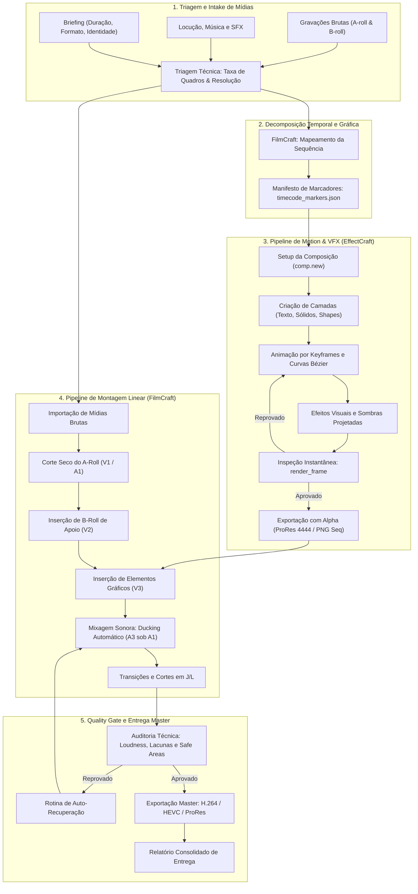
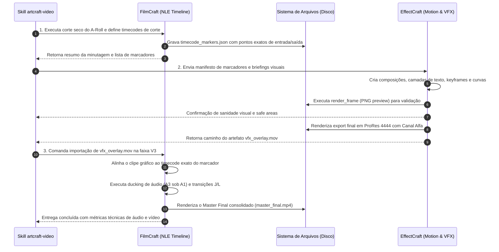
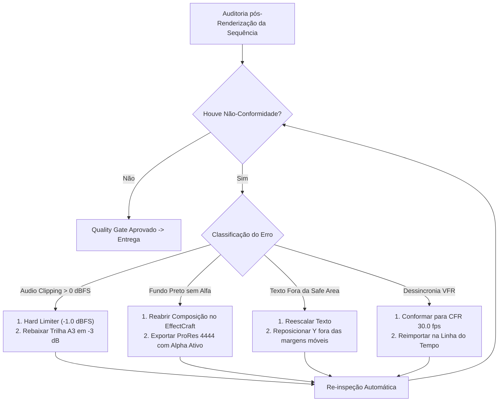

# ArtCraft Video Engine — Manual Técnico, Operacional e de Orquestração Audiovisual
### Arquitetura de Produção Não-Linear & Composição por Camadas (FilmCraft & EffectCraft via MCP)

---

## Sumário Executivo

1. [O Que Esta Skill Faz? Visão Geral, Arquitetura e Filosofia](#1-o-que-esta-skill-faz-visão-geral-arquitetura-e-filosofia)
   - 1.1 Missão e Escopo Primário da Skill
   - 1.2 A Divisão Sagrada de Papéis: NLE vs. Motion & VFX
   - 1.3 As Fronteiras Operacionais Rígidas e Proibições Estritas
   - 1.4 Princípios Fundamentais de Engenharia de Vídeo e Áudio
   - 1.5 Diagrama Geral da Linha de Produção Audiovisual
2. [Roadmap de Implementação de Cada App](#2-roadmap-de-implementação-de-cada-app)
   - 2.1 Roadmap Completo do FilmCraft (Do Ingest ao Master)
     - Fase FC-1: Ingestão de Mídias, Catalogação e Verificação de Codecs
     - Fase FC-2: Criação e Parametrização da Sequência / Timeline
     - Fase FC-3: Organização Estrutural de Faixas (Tracks)
     - Fase FC-4: Decupagem e Corte Bruto (*Rough Cut*)
     - Fase FC-5: Refinamento Narrativo e Ritmo (*Fine Cut*)
     - Fase FC-6: Engenharia de Áudio, Curvas de Ducking e Masterização Sonora
     - Fase FC-7: Conformação, Verificação de Lacunas e Exportação
   - 2.2 Roadmap Completo do EffectCraft (Da Composição ao Render com Alfa)
     - Fase EC-1: Planejamento Matemático e Setup da Composição
     - Fase EC-2: Estruturação Hierárquica de Camadas
     - Fase EC-3: Design Tipográfico e Margens de Segurança (*Safe Areas*)
     - Fase EC-4: Motor de Animação, Interpolação e Curvas Bézier
     - Fase EC-5: Aplicação de Efeitos, Sombras e Shaders
     - Fase EC-6: Máscaras e Modos de Mesclagem (*Track Mattes*)
     - Fase EC-7: Render de Teste e Inspeção Instantânea de Quadros
     - Fase EC-8: Exportação Gráfica com Canal Alfa Transparente
   - 2.3 Roadmap de Integração Híbrida (FilmCraft $\leftrightarrow$ EffectCraft)
3. [Como a Skill Passa Instruções Para Cada App? (Protocolos MCP Exaustivos)](#3-como-a-skill-passa-instruções-para-cada-app-protocolos-mcp-exaustivos)
   - 3.1 Fundamentos da Comunicação MCP no Domínio Audiovisual
   - 3.2 Protocolo de Instrução para EffectCraft
     - Catálogo de Ferramentas Nativas MCP do EffectCraft
     - Dicionário de Propriedades Endereçáveis (*Property Paths*)
     - Esquemas e Exemplos de Payloads JSON para Composição, Camadas e Keyframes
     - Injeção de Expressões Javascript Matemáticas
     - Renderização de Frame Estático para Inspeção de Canal Alfa
   - 3.3 Protocolo de Instrução para FilmCraft
     - Arquitetura de Controle da Timeline Não-Linear
     - Payload de Criação e Configuração da Sequência
     - Payload de Decupagem e Posicionamento de Clipes em Faixas V1-V3 e A1-A3
     - Parâmetros Numéricos de Ducking Sonoro e Normalização Acústica
     - Aplicação de Transições, Cortes em J e Cortes em L
     - Comandos de Exportação e Conformação Master
   - 3.4 Contratos Formais de Handoff Audiovisual
     - Contrato FilmCraft $\rightarrow$ EffectCraft (`timecode_markers.json`)
     - Contrato EffectCraft $\rightarrow$ FilmCraft (`alpha_delivery_spec.json`)
4. [Casos Práticos de Execução Ponta a Ponta](#4-casos-práticos-de-execução-ponta-a-ponta)
   - 4.1 Caso A: Vídeo Institucional Corporativo Widescreen 16:9
   - 4.2 Caso B: Vídeo Curto para Redes Sociais no Formato Vertical 9:16 (Reels/TikTok)
   - 4.3 Caso C: Tutorial Técnico com Captura de Tela e Picture-in-Picture (60 fps)
5. [Tratamento de Falhas, Resiliência e Auto-Recuperação (Troubleshooting)](#5-tratamento-de-falhas-resiliência-e-auto-recuperação-troubleshooting)
   - 5.1 Matriz de Erros Críticos no Domínio Audiovisual
   - 5.2 Recuperação de Mídia Offline e Falhas de Indexação
   - 5.3 Resolução de Estouro Acústico e Distorção Digital (*Clipping*)
   - 5.4 Correção de Falhas de Canal Alfa e Fundo Preto Espúrio
   - 5.5 Tratamento de Letreiros Fora da Área Segura (*Action/Title Safe*)
   - 5.6 Dessincronização Labial por Variação de Taxa de Quadros (VFR vs. CFR)
   - 5.7 Diagrama do Loop de Auto-Recuperação Audiovisual
6. [Quality Gates e Critérios de Aceitação Técnica Final](#6-quality-gates-e-critérios-de-aceitação-técnica-final)
   - 6.1 Checkpoint 1: Roteiro, Minutagem e Storyboard
   - 6.2 Checkpoint 2: Sanidade Visual de Motion Graphics no EffectCraft
   - 6.3 Checkpoint 3: Fluidez do Corte Narrativo no FilmCraft
   - 6.4 Checkpoint 4: Masterização Acústica e Padrão de Loudness
   - 6.5 Checkpoint 5: Auditoria dos Metadados do Arquivo Renderizado Final
   - 6.6 Checklist Completo de Aceitação Técnica em Markdown
7. [Estrutura de Diretórios, Nomenclatura e Boas Práticas](#7-estrutura-de-diretórios-nomenclatura-e-boas-práticas)
   - 7.1 Árvore Canônica de Arquivos de um Projeto Audiovisual
   - 7.2 Nomenclatura Padronizada de Mídias e Renderizações
   - 7.3 Preservação dos Arquivos-Fonte Editáveis (`.filmcraft` e `.effectcraft`)
   - 7.4 Protocolo de Apresentação de Resultados com Links Clicáveis

---

## 1. O Que Esta Skill Faz? Visão Geral, Arquitetura e Filosofia

### 1.1 Missão e Escopo Primário da Skill

A skill **`artcraft-video`** é a autoridade máxima em produção, engenharia e finalização audiovisual autônoma dentro da suíte ArtCraft. Sua missão precípua consiste em transformar briefings textuais, gravações brutas de vídeo, faixas de locução, trilhas sonoras e diretrizes de identidade visual em peças audiovisuais completas, tecnicamente perfeitas e prontas para veiculação pública.

Em um fluxo de produção convencional, a criação de um vídeo de alto nível exige a convergência de duas disciplinas artísticas e técnicas distintas:
1. **A Montagem Não-Linear (NLE):** O controle rigoroso do tempo, da cadência, da decupagem da fala, da eliminação de pausas mortas, da seleção do melhor plano de câmera e da harmonia sonoplástica entre vozes e música de fundo.
2. **A Composição em Camadas e Motion Graphics (VFX):** O desenho vetorial em movimento, a tipografia animada, a aceleração orgânica de elementos gráficos, as transições estilizadas com canal alfa e o enriquecimento estético das informações visuais.

A skill `artcraft-video` funde essas duas dimensões através de uma orquestração algorítmica de precisão cirúrgica, acionando o **FilmCraft** para a regência temporal e o **EffectCraft** para a escultura visual de cada camada.

### 1.2 A Divisão Sagrada de Papéis: NLE vs. Motion & VFX

O ecossistema ArtCraft rejeita categoricamente o conceito de ferramentas monolíticas e híbridas improvisadas. Nenhuma ferramenta da suíte tenta fazer tudo; em vez disso, cada ferramenta atinge a maestria máxima em seu nicho canônico.

```text
┌─────────────────────────────────────────────────────────────────────────────┐
│                       DIVISÃO CANÔNICA DE ATRIBUIÇÕES                       │
├──────────────────────────────────────┬──────────────────────────────────────┤
│              FILMCRAFT               │             EFFECTCRAFT              │
│       O Arquiteto do Tempo           │         O Escultor Visual            │
├──────────────────────────────────────┼──────────────────────────────────────┤
│ • Domínio: Eixo Temporal (Horiz.)    │ • Domínio: Eixo Espacial (X, Y, Z)   │
│ • Montagem linear e corte rítmico    │ • Composição em multicamadas         │
│ • Sincronização de fala e som        │ • Animação por quadros-chave         │
│ • Audio Ducking e nivelamento sonoro │ • Curvas Bézier de aceleração/freio  │
│ • Organização de faixas V1-V3, A1-A3 │ • Canal alfa transparente (ProRes)   │
│ • Renderização do Master Final       │ • Letreiros, lower-thirds e vinhetas │
└──────────────────────────────────────┴──────────────────────────────────────┘
```

#### O Papel do FilmCraft:
O **FilmCraft** opera sobre a linha do tempo (timeline). Sua unidade de raciocínio é a *fita temporal*: pontos de entrada (*in-points*), pontos de saída (*out-points*), marcadores de corte seco, ordenação de clipes e balanceamento acústico. O FilmCraft não se preocupa com o desenho interno dos pixels de um logotipo, mas garante que o logotipo apareça no segundo $00:04.150$ e desapareça no segundo $00:09.300$, sobreposto à cena correta e acompanhado pelo efeito sonoro adequado.

#### O Papel do EffectCraft:
O **EffectCraft** opera sobre o espaço composicional bidimensional e tridimensional. Sua unidade de raciocínio é a *árvore de nós e camadas*: sólidos, caixas de texto com kerning fino, máscaras vetoriais, rotações, escalas, propriedades paramétricas interpoladas por curvas matemáticas e transparência com canal alfa. O EffectCraft não decupa 30 minutos de uma palestra para extrair os melhores momentos; ele recebe a demanda de criar um terço inferior (*lower-third*) de 5 segundos para identificar o palestrante e entrega uma joia de movimento visual com fundo transparente.

### 1.3 As Fronteiras Operacionais Rígidas e Proibições Estritas

Para assegurar a estabilidade do pipeline e evitar degradação de performance ou conflitos de processamento, a skill impõe **fronteiras negativas absolutas**:

1. **PROIBIÇÃO NO FILMCRAFT — Animações Manuais de Keyframes:**
   - O FilmCraft é **terminantemente proibido** de gerar animações complexas de texto, movimentos elásticos de letreiros, efeitos de partículas ou manipulação de máscaras ponto a ponto.
   - Qualquer elemento visual que necessite de aceleração variável (*ease-in* / *ease-out*), brilho dinâmico (*glow*) ou canal alfa deve ser delegado ao EffectCraft.

2. **PROIBIÇÃO NO EFFECTCRAFT — Montagem Narrativa de Longa Duração:**
   - O EffectCraft é **terminantemente proibido** de importar gravações brutas de 15 minutos para fazer corte seco de fala, remoção de gagueiras ou montagem rítmica de cenas.
   - O EffectCraft opera estritamente em trechos atômicos (composições de $2$ a $15\text{ segundos}$ para vinhetas, terços inferiores, títulos ou telas de transição).

3. **PROIBIÇÃO DE CODEC NO HANDOFF — O Uso Indevido de H.264 para Grafismos:**
   - O EffectCraft **nunca** deve exportar arquivos H.264 (`.mp4`) para entrega ao FilmCraft quando a peça exigir sobreposição de camadas. O codec H.264 descarta o canal alfa, forçando um fundo preto espúrio que corrompe a faixa de vídeo subjacente.
   - Todo grafismo para sobreposição deve ser exportado obrigatoriamente em **Apple ProRes 4444 com Alpha** ou em **Sequência PNG RGBA de 32 bits** (24 bits de cor + 8 bits de transparência).

4. **PROIBIÇÃO ACÚSTICA — Picos Acima de $-1\text{ dBFS}$:**
   - É expressamente proibido liberar qualquer renderização final cujo medidor de pico ultrapasse $-1.0\text{ dBFS}$. O corte digital (*hard clipping*) é classificado como falha crítica de conformidade.

### 1.4 Princípios Fundamentais de Engenharia de Vídeo e Áudio

Para que o agente produza resultados de padrão de transmissão televisiva (*broadcast quality*) e streaming premium, ele deve respeitar parâmetros consolidados da indústria:

#### Proporções de Aspecto e Resoluções Padronizadas:
- **Widescreen 16:9 ($1920 \times 1080$ Full HD / $3840 \times 2160$ 4K UHD):** Formato obrigatório para YouTube tradicional, tutoriais desktop, apresentações corporativas, televisão e documentários.
- **Retrato Vertical 9:16 ($1080 \times 1920$):** Formato obrigatório para Instagram Reels, TikTok, YouTube Shorts e Stories. Exige atenção redobrada às *Safe Areas* devido aos botões e interfaces sobrepostos pelas plataformas móveis.
- **Quadrado 1:1 ($1080 \times 1080$):** Formato para postagens estáticas ou vídeos de feed de redes sociais tradicionais.
- **Retrato 4:5 ($1080 \times 1350$):** Formato otimizado para preenchimento de feed vertical no Instagram.

#### Taxas de Quadros (*Frame Rates*):
- **$24.0\text{ fps}$ / $23.976\text{ fps}$ (Cinemático):** Cadência visual clássica para narrativas fictícias, cinema e documentários poéticos. Produz o desfoque de movimento natural do olho humano (*motion blur* com obturador em $180^\circ$).
- **$30.0\text{ fps}$ / $29.97\text{ fps}$ (Padrão Internet & Institucional):** Cadência ideal para vídeos explicativos, apresentadores em estúdio, vlogs corporativos e redes sociais.
- **$60.0\text{ fps}$ (Alta Fluidez):** Cadência recomendada para capturas de tela técnica, demonstrações de software, partidas de games e esportes rápidos.

#### Engenharia de Áudio Digital:
- **Taxa de Amostragem:** Obrigatoriamente $48.000\text{ Hz}$ ($48\text{ kHz}$) com resolução de $24\text{ bits}$ PCM não-comprimido nas etapas intermediárias. O áudio final para web deve ser codificado em AAC Estéreo a $320\text{ kbps}$.
- **Padrão de Volume Integrado (Loudness EBU R128 / ITU-R BS.1770-4):**
  - Plataformas de Streaming (YouTube, Spotify): $-14\text{ LUFS}$ integrado ($\pm 1.0\text{ LUFS}$).
  - Redes Sociais Móveis (TikTok, Instagram): $-14$ a $-16\text{ LUFS}$ integrado.
  - Podcasts / Aulas Faladas: $-16\text{ LUFS}$ integrado.
- **Teto Máximo de Pico Verdadeiro (*True Peak*):** Teto rígido em $-1.0\text{ dBTP}$.
- **Relação Sinal-Ruído e Níveis Relativos:**
  - Voz Principal (Locução / Entrevista): $-6.0\text{ dB}$ a $-12.0\text{ dBFS}$.
  - Trilha Sonora Musical de Apoio: $-18.0\text{ dB}$ a $-24.0\text{ dBFS}$ quando sob a voz (efeito de *ducking* atenuado em $-12$ a $-16\text{ dB}$ relativo à voz).
  - Efeitos Sonoros (*SFX* pontuais): $-10.0\text{ dB}$ a $-16.0\text{ dBFS}$.

### 1.5 Diagrama Geral da Linha de Produção Audiovisual



---

## 2. Roadmap de Implementação de Cada App

### 2.1 Roadmap Completo do FilmCraft (Do Ingest ao Master)

O FilmCraft é implementado como um pipeline determinístico dividido em sete fases sucessivas. Cada fase gera um estado verificado antes que o processamento avance para a fase seguinte.

#### Fase FC-1: Ingestão de Mídias, Catalogação e Verificação de Codecs
1. **Varredura do Diretório:** A skill inspeciona os arquivos fornecidos pelo usuário no diretório de trabalho (`assets/raw_footage/`, `assets/audio/`, `assets/graphics/`).
2. **Extração de Metadados:** Para cada clipe de vídeo e áudio, a ferramenta extrai:
   - Duração exata em segundos e contagem total de frames.
   - Resolução nativa ($largura \times altura$).
   - Taxa de quadros (*FPS*) e confirmação de taxa de quadros constante (*CFR - Constant Frame Rate*). Se o arquivo possuir taxa de quadros variável (*VFR* comum em gravações de smartphones), ele deve ser catalogado para remuxagem.
   - Padrão de canais de áudio (mono, estéreo, 5.1) e taxa de amostragem ($44.1\text{ kHz}$ ou $48.0\text{ kHz}$).
3. **Mapeamento de IDs Únicos:** Cada mídia recebe um identificador canônico no manifesto de montagem (ex.: `media_cam_a`, `media_broll_screens`, `audio_voice_host`, `audio_soundtrack_jazz`).

#### Fase FC-2: Criação e Parametrização da Sequência / Timeline
1. **Definição da Resolução Mestre:** A sequência é criada com base no destino do projeto:
   - Horizontal: $1920 \times 1080$ a $30.0\text{ fps}$.
   - Vertical: $1080 \times 1920$ a $30.0\text{ fps}$.
2. **Definição da Base de Tempo:** A taxa de amostragem de tempo é fixada em $30\text{ quadros por segundo}$ ($1\text{ frame} \approx 0.03333\text{ s}$).
3. **Inicialização do Arquivo de Projeto:** O projeto é instanciado em disco como `projects/video/master.filmcraft`.

#### Fase FC-3: Organização Estrutural de Faixas (Tracks)
O FilmCraft implementa a seguinte arquitetura estrita de faixas:
- **Faixas de Vídeo (Vídeo Tracks):**
  - `V1` (*Primary A-Roll*): Gravação principal contínua. Contém o interlocutor focal, a entrevista de base ou a linha mestra da história. É a faixa que dita o tempo da produção.
  - `V2` (*Secondary B-Roll*): Imagens de cobertura e contexto. Capturas de tela do produto, closes de detalhes, fotografias estáticas ou cenas secundárias inseridas sobre a fala para ilustrar o discurso.
  - `V3` (*Graphics & VFX Overlays*): Clipes renderizados com canal alfa provenientes do EffectCraft (vinhetas de abertura, terços inferiores, cartelas de encerramento, molduras animadas).
- **Faixas de Áudio (Audio Tracks):**
  - `A1` (*Dialogue / Voiceover*): Captação primária da voz do apresentador ou locutor.
  - `A2` (*Sound Effects - SFX*): Transições sonoras, impactos (*booms*), sussurros de vento (*whooshes*), estalos de cliques e sons de interface.
  - `A3` (*Background Music - Soundtrack*): Trilha musical de fundo submetida a *ducking* dinâmico sob a faixa `A1`.
  - `A4` (*Ambient / Foley*): Som de fundo natural de ambientes e salas para preenchimento de silêncios estéreis.

#### Fase FC-4: Decupagem e Corte Bruto (*Rough Cut*)
1. **Corte de Silêncios e Ruídos:** A skill analisa o envelope da faixa de voz `A1` e elimina segmentos com amplitude abaixo do ruído de fundo que excedam $0.6\text{ segundos}$.
2. **Eliminação de Hesitações e Erros:** Remoção cirúrgica de gagueiras, repetições de frases falsas e respirações asmáticas excessivas.
3. **Alinhamento do Áudio com o Vídeo:** Garantia de sincronismo labial perfeito (*lip-sync*) com tolerância zero de desvio.
4. **Fechamento de Lacunas (*Ripple Delete*):** A cada corte efetuado no A-Roll, todos os clipes subsequentes avançam para preencher o espaço vazio, eliminando qualquer tela preta involuntária.

#### Fase FC-5: Refinamento Narrativo e Ritmo (*Fine Cut*)
1. **Cobertura do B-Roll na Faixa V2:** Nos pontos em que o apresentador cita termos técnicos ou funcionalidades de produto, o clipe correspondente de B-Roll é inserido na faixa `V2`. O áudio original do B-Roll é silenciado caso concorra com a voz do apresentador.
2. **Cortes em L e Cortes em J (Split Edits):**
   - *Corte em J:* O áudio da próxima cena (faixa `A1` ou `A3`) começa a soar aproximadamente $0.4\text{ a }0.8\text{ segundos}$ antes que o corte visual aconteça, preparando psicologicamente o espectador para a transição.
   - *Corte em L:* A voz do orador continua soando por $0.5\text{ a }1.2\text{ segundos}$ após a imagem ter cortado para o B-Roll de apoio, criando uma sensação cinematográfica fluida e contínua.
3. **Geração do Manifesto de Marcadores de VFX:** O FilmCraft identifica os segundos exatos onde novos oradores entram na narrativa e exporta o manifesto `timecode_markers.json` para o EffectCraft produzir os terços inferiores.

#### Fase FC-6: Engenharia de Áudio, Curvas de Ducking e Masterização Sonora
1. **Calibração da Voz em `A1`:**
   - Aplicação de equalizador paramétrico de 3 bandas: atenuação de graves abaixo de $80\text{ Hz}$ (*high-pass filter* para eliminar ruídos de manuseio e vibrações de ar condicionado); leve ganho de presença vocal em $2.5\text{ kHz}$ a $3.5\text{ kHz}$.
   - Compressão dinâmica suave para manter a locução entre $-6.0\text{ dB}$ e $-12.0\text{ dBFS}$.
2. **Automação de Ducking na Trilha `A3`:**
   - O FilmCraft monitora a atividade sonora na faixa `A1`.
   - Quando `A1` detecta voz ativa (limiar de $-28\text{ dBFS}$): A trilha musical `A3` é rebaixada suavemente em $-14\text{ dB}$ (tempo de ataque de $150\text{ ms}$).
   - Quando `A1` entra em silêncio: A trilha `A3` retorna ao seu volume nominal de $-12\text{ dBFS}$ (tempo de relaxamento de $500\text{ ms}$).
3. **Inserção dos Efeitos Sonoros em `A2`:**
   - Posicionamento de transições acústicas sincronizadas milissegundo a milissegundo com a entrada dos grafismos do EffectCraft.
4. **Masterização da Saída Acústica:**
   - Inserção de limitador de pico rígido (*Hard Brickwall Limiter*) na saída mestre configurado em $-1.0\text{ dBFS}$.
   - Confirmação de conformidade de Loudness Integrado em $-14.0\text{ LUFS}$ ($\pm 1.0\text{ LUFS}$).

#### Fase FC-7: Conformação, Verificação de Lacunas e Exportação
1. **Verificação de Sanidade:** O comando de inspeção da timeline é acionado para confirmar que:
   - Não existem clipes com status de mídia desconectada (*offline media*).
   - Não existem lacunas temporais vazias (*black frames*) entre os clipes da faixa `V1`.
   - A duração total está em conformidade com o briefing aprovado.
2. **Renderização do Arquivo Final:** O FilmCraft despacha o render do master no formato e codec especificados (MP4 H.264 para redes sociais ou Apple ProRes 422 para arquivo de alta fidelidade).

---

### 2.2 Roadmap Completo do EffectCraft (Da Composição ao Render com Alfa)

O EffectCraft atua como o laboratório de motion graphics e efeitos visuais da skill, operando sobre composições atômicas orientadas a objetos e keyframes matemáticos.

#### Fase EC-1: Planejamento Matemático e Setup da Composição
1. **Instanciação da Composição:** Criação do ambiente com o comando `comp.new`, configurando:
   - Resolução rigorosamente idêntica à timeline do FilmCraft ($1920 \times 1080$ ou $1080 \times 1920$).
   - Taxa de quadros idêntica (ex.: $30.0\text{ fps}$).
   - Duração estrita correspondente ao marcador solicitado pelo FilmCraft (ex.: $5.0\text{ segundos}$ para um lower-third).
   - Cor de fundo neutra (`#00000000` — transparente por padrão).

#### Fase EC-2: Estruturação Hierárquica de Camadas
A composição do EffectCraft é organizada em camadas ordenadas de cima para baixo:
- Camada 1: Texto Secundário (Cargo / Empresa / Subtítulo).
- Camada 2: Texto Primário (Nome do Orador / Título Principal).
- Camada 3: Ícone / Logotipo Vetorial ou Grafismo Acentuador.
- Camada 4: Placa de Fundo (*Backplate* / Sólido de Cor com Cantos Arredondados ou Gradiente).
- Camada 5: Nulo de Controle (*Null Object*): Camada vazia utilizada como ancestral (*parent*) para mover e escalar todo o conjunto simultaneamente.

#### Fase EC-3: Design Tipográfico e Margens de Segurança (*Safe Areas*)
1. **Cálculo da Safe Area:**
   - Widescreen 16:9: Todos os textos e elementos vitais devem residir dentro da *Safe Title Area* ($10\%$ de margem interna em relação às bordas: $x \in [192, 1728]$, $y \in [108, 972]$).
   - Retrato 9:16 (Mobile): A *Safe Area* restringe-se aos limites seguros que não são cobertos pela interface dos aplicativos móveis:
     - Margem superior livre de no mínimo $150\text{ px}$ (área de busca e menus de stories).
     - Margem inferior livre de no mínimo $250\text{ px}$ (área de comentários, caixa de texto, botões de curtir e legenda nativa do app).
     - Margem lateral livre de no mínimo $80\text{ px}$.
2. **Definição de Tipografia:** Uso de fontes legíveis em telas pequenas (famílias sem serifa de alto impacto como *Inter*, *Inter Tight*, *Montserrat*, *Cabinet Grotesk*), com controle estrito de kerning e entrelinha.

#### Fase EC-4: Motor de Animação, Interpolação e Curvas Bézier
A qualidade de um motion design profissional depende da eliminação de movimentos lineares robóticos. O EffectCraft injeta interpolação suave em todas as transições:
1. **Assinatura das Curvas de Interpolação:**
   - *Entrada (Ease-Out / Deceleração Suave):* O elemento entra em alta velocidade e desacelera organicamente até o repouso. Curva Bézier recomendada: $(0.15, 0.85, 0.35, 1.0)$.
   - *Saída (Ease-In / Aceleração Suave):* O elemento começa estático e acelera gradualmente ao sair da tela. Curva Bézier recomendada: $(0.65, 0.0, 0.85, 0.15)$.
   - *Suavização Dupla (Easy Ease):* Transição fluida de início e fim.
2. **Animação Típica de um Lower-Third (5 segundos totais):**
   - $0.00\text{ s}$ a $0.60\text{ s}$ (Entrada):
     - Posição $Y$: Deslocamento de $+80\text{ px}$ para a posição final de repouso com curva *Ease-Out*.
     - Opacidade: De $0\%$ a $100\%$.
     - Escala da Placa de Fundo: De $85\%$ para $100\%$.
   - $0.60\text{ s}$ a $4.40\text{ s}$ (Platô de Leitura):
     - Todos os elementos mantêm-se totalmente estáticos ou recebem uma oscilação sub-pixel imperceptível (*micro-drift*) para manter o dinamismo orgânico.
   - $4.40\text{ s}$ a $5.00\text{ s}$ (Saída):
     - Opacidade: De $100\%$ a $0\%$.
     - Posição $Y$: Deslocamento de $-40\text{ px}$ com curva *Ease-In*.

#### Fase EC-5: Aplicação de Efeitos, Sombras e Shaders
1. **Sombra Projetada (*Drop Shadow*):**
   - Inserida sob as placas de texto para garantir legibilidade absoluta sobre qualquer fundo de vídeo de B-Roll (opacidade $40\%$, desfoque de $15\text{ px}$, deslocamento de $4\text{ px}$ a $90^\circ$).
2. **Desfoque de Movimento (*Motion Blur*):**
   - Ativação do obturador computacional para que os movimentos rápidos de transição ganhem arrasto natural de cinema.
3. **Brilho Sutil (*Glow*):**
   - Em elementos institucionais ou marcadores de destaque tecnológico.

#### Fase EC-6: Máscaras e Modos de Mesclagem (*Track Mattes*)
1. **Máscara de Revelação (*Alpha Matte*):**
   - Criação de retângulos guilhotina onde o texto desliza para fora de uma área oculta sem vazar para fora das bordas da placa de fundo.
2. **Modos de Mesclagem de Cor:**
   - Uso de *Normal* para elementos que transportam cores institucionais opacas e *Screen* ou *Add* para flares e partículas luminosas.

#### Fase EC-7: Render de Teste e Inspeção Instantânea de Quadros
Antes de consumir tempo computacional e armazenamento em disco renderizando sequências de vídeo inteiras, o EffectCraft comanda:
1. `render_frame(time=2.0, max_side=960, transparent=true)`
2. O frame intermediário é gerado em milissegundos e submetido à auditoria visual da IA para verificar:
   - Se o texto está perfeitamente centralizado na placa.
   - Se os contrastes cromáticos atendem ao índice WCAG de legibilidade.
   - Se o canal alfa está ativo (o fundo não pode estar preto, cinza ou branco; deve reportar transparência pura RGBA).

#### Fase EC-8: Exportação Gráfica com Canal Alfa Transparente
Com a validação concluída, a composição é exportada para entrega ao FilmCraft:
- **Codec Primário:** Apple ProRes 4444 (RGBA de 12 bits por canal + 16 bits de profundidade de canal alfa).
- **Formato Alternativo:** Sequência numerada de imagens PNG RGBA de 32 bits (`comp_title_00000.png` até `comp_title_00150.png`).
- O arquivo é persistido em `assets/rendered_vfx/`.

---

### 2.3 Roadmap de Integração Híbrida (FilmCraft $\leftrightarrow$ EffectCraft)

A integração entre os dois motores é orquestrada através de um ciclo contínuo de quatro passos fundamentais:



---

## 3. Como a Skill Passa Instruções Para Cada App? (Protocolos MCP Exaustivos)

### 3.1 Fundamentos da Comunicação MCP no Domínio Audiovisual

A comunicação entre a skill `artcraft-video` e os motores EffectCraft e FilmCraft dá-se exclusivamente através do **Model Context Protocol (MCP)**, garantindo chamadas auditáveis, determinísticas e tipadas.

#### Princípios Inegociáveis de Comunicação:
1. **Unidades Temporais em Segundos Flutuantes (*Float Seconds*):** Todos os instantes de tempo são expressos em segundos e frações decimais (ex.: `2.5` representa dois segundos e meio; `0.0333` representa exatamente um frame a $30\text{ fps}$). É vedado o uso de strings informais como `"02:30"` sem conversão prévia.
2. **Caminhos de Arquivo Canônicos Absolutos:** A skill sempre utiliza caminhos completos de arquivo no formato com barras normais (ex.: `C:/Users/berna/Music/skills_02/assets/...`), prevenindo falhas de interpretação de diretório corrente pelo servidor MCP.
3. **Composição em Lote com Atomicidade:** Para criação de elementos compostos (ex.: criar um sólido, adicionar um texto sobre ele e vincular ambos a um nulo), a skill utiliza `command_batch` ou `batch`, assegurando que qualquer erro reverta as alterações pendentes (*rollback*).

---

### 3.2 Protocolo de Instrução para EffectCraft

O EffectCraft dispõe de uma engine inspirada na arquitetura do Adobe After Effects. Cada operação sobre o projeto, composição ou camadas é governada por chamadas de ferramentas MCP dedicadas.

#### Catálogo de Ferramentas Nativas MCP do EffectCraft:

| Nome da Ferramenta MCP | Propósito Funcional | Argumentos Principais |
| :--- | :--- | :--- |
| `command_list` | Descobre os comandos disponíveis no motor e seus schemas. | `enabled_only`, `filter`, `schemas` |
| `command_run` | Executa um comando atômico da engine com parâmetros JSON. | `id` (ex.: `comp.new`, `layer.newText`), `params` |
| `command_batch` | Executa uma série sequencial de comandos da engine. | `steps: [{id, params}]`, `stop_on_error` |
| `get_comp` | Retorna os metadados da composição (tamanho, fps, camadas). | `comp` (nome ou ID da composição) |
| `get_layer` | Retorna a árvore hierárquica e propriedades de uma camada. | `comp`, `layer` (nome, ID ou `#índice`) |
| `get_property` | Lê o valor atual ou a curva de keyframes de uma propriedade. | `comp`, `layer`, `path` |
| `set_property` | Define o valor estático, expressão ou valor em um tempo. | `comp`, `layer`, `path`, `value`, `expression`, `time` |
| `add_keyframe` | Adiciona keyframes com tipo de interpolação suave. | `comp`, `layer`, `path`, `keys`, `interpolation` |
| `render_frame` | Renderiza um frame PNG estático com ou sem canal alfa. | `comp`, `time`, `path`, `transparent`, `max_side` |
| `save_project` | Persiste o arquivo de projeto mestre editável. | `path` |
| `open_project` | Carrega um projeto existente do disco. | `path` |

#### Dicionário de Propriedades Endereçáveis (*Property Paths*):
As propriedades internas de cada camada são acessadas através de caminhos hierárquicos (*paths*):
- **Transformações Básicas:**
  - `transform/position` $\rightarrow$ Vetor 2D `[x, y]` ou 3D `[x, y, z]`.
  - `transform/scale` $\rightarrow$ Vetor `[x, y]` em percentagem (onde `[100, 100]` é o tamanho original).
  - `transform/rotation` $\rightarrow$ Valor escalar em graus (ex.: `0`, `45`, `360`).
  - `transform/opacity` $\rightarrow$ Valor escalar de $0$ a $100$.
  - `transform/anchorPoint` $\rightarrow$ Ponto de ancoragem local `[x, y]`.
- **Efeitos e Modificadores:**
  - `effects/#1/blurriness` $\rightarrow$ Intensidade do desfoque gaussiano em pixels.
  - `effects/#2/distance` $\rightarrow$ Distância da sombra projetada em pixels.
  - `effects/#2/softness` $\rightarrow$ Suavidade da borda da sombra.
- **Propriedades de Texto:**
  - `text/sourceText` $\rightarrow$ Conteúdo da string de texto.
  - `text/fontSize` $\rightarrow$ Tamanho do corpo tipográfico em pontos ($pt$).
  - `text/fillColor` $\rightarrow$ Cor hexadecimal ou vetor `[r, g, b, a]`.

#### Esquemas e Exemplos de Payloads JSON no EffectCraft:

##### 1. Criação de Composição e Sólido de Fundo:
```json
{
  "ServerName": "effectcraft",
  "ToolName": "command_batch",
  "Arguments": {
    "steps": [
      {
        "id": "comp.new",
        "params": {
          "name": "Comp_LowerThird_CEO",
          "width": 1920,
          "height": 1080,
          "frameRate": 30.0,
          "duration": 5.0,
          "backgroundColor": "#00000000"
        }
      },
      {
        "id": "layer.newSolid",
        "params": {
          "name": "Backplate_Pill",
          "width": 640,
          "height": 110,
          "color": "#0F172A",
          "position": [480, 940]
        }
      }
    ],
    "stop_on_error": true
  }
}
```

##### 2. Criação de Camadas Tipográficas com Alinhamento de Âncora:
```json
{
  "ServerName": "effectcraft",
  "ToolName": "command_batch",
  "Arguments": {
    "steps": [
      {
        "id": "layer.newText",
        "params": {
          "name": "Text_SpeakerName",
          "text": "Gabriel Siqueira",
          "fontSize": 34,
          "fontFamily": "Inter Tight Bold",
          "fillColor": "#FFFFFF",
          "position": [200, 925]
        }
      },
      {
        "id": "layer.newText",
        "params": {
          "name": "Text_SpeakerRole",
          "text": "Head de Inteligência Artificial & Computação Gráfica",
          "fontSize": 18,
          "fontFamily": "Inter Medium",
          "fillColor": "#38BDF8",
          "position": [200, 960]
        }
      }
    ]
  }
}
```

##### 3. Adição de Keyframes Suaves com Interpolação Bézier (*add_keyframe*):
```json
{
  "ServerName": "effectcraft",
  "ToolName": "add_keyframe",
  "Arguments": {
    "comp": "Comp_LowerThird_CEO",
    "layer": "Backplate_Pill",
    "path": "transform/position",
    "interpolation": "easyEaseOut",
    "keys": [
      {
        "time": 0.0,
        "value": [480, 1120]
      },
      {
        "time": 0.6,
        "value": [480, 940]
      },
      {
        "time": 4.4,
        "value": [480, 940]
      },
      {
        "time": 5.0,
        "value": [480, 1120]
      }
    ]
  }
}
```

##### 4. Injeção de Expressões Javascript Matemáticas (*set_property*):
O EffectCraft suporta expressões dinâmicas para gerar movimento procedural contínuo sem necessidade de milhares de keyframes manuais:
```json
{
  "ServerName": "effectcraft",
  "ToolName": "set_property",
  "Arguments": {
    "comp": "Comp_LowerThird_CEO",
    "layer": "Text_SpeakerRole",
    "path": "transform/opacity",
    "expression": "wiggle(2, 5)"
  }
}
```

##### 5. Renderização de Frame Estático para Inspeção de Canal Alfa (*render_frame*):
```json
{
  "ServerName": "effectcraft",
  "ToolName": "render_frame",
  "Arguments": {
    "comp": "Comp_LowerThird_CEO",
    "time": 2.5,
    "max_side": 1920,
    "transparent": true,
    "path": "C:/Users/berna/Music/skills_02/assets/previews/preview_lowerthird_ceo.png"
  }
}
```

---

### 3.3 Protocolo de Instrução para FilmCraft

O FilmCraft comanda a linha do tempo narrativa não-linear. Suas instruções são estruturadas na forma de descritores de montagem atômicos e idempotentes.

#### Arquitetura de Controle da Timeline Não-Linear:
As chamadas de instrução para o FilmCraft fornecem a declaração do estado desejado da timeline: faixas de vídeo e áudio, posicionamento absoluto de clipes, pontos de corte relativos aos arquivos originais (*in* e *out*), atenuações e rotas de áudio.

#### Payload Completo de Configuração da Linha do Tempo no FilmCraft:
```json
{
  "action": "sequence_build",
  "project_path": "C:/Users/berna/Music/skills_02/projects/video/master.filmcraft",
  "timeline_config": {
    "name": "Pitch_Product_Launch_Master",
    "dimensions": {"width": 1920, "height": 1080},
    "frame_rate": 30.0,
    "drop_frame": false,
    "audio_sample_rate": 48000,
    "tracks": {
      "video": [
        {
          "track_id": "V1",
          "label": "A-Roll_Host",
          "locked": false,
          "clips": [
            {
              "clip_id": "v1_clip_01",
              "media_source": "C:/Users/berna/Music/skills_02/assets/raw_footage/host_presentation.mp4",
              "in_point": 5.200,
              "out_point": 18.700,
              "timeline_start": 0.000,
              "speed": 1.0
            },
            {
              "clip_id": "v1_clip_02",
              "media_source": "C:/Users/berna/Music/skills_02/assets/raw_footage/host_presentation.mp4",
              "in_point": 22.100,
              "out_point": 48.500,
              "timeline_start": 13.500,
              "speed": 1.0
            }
          ]
        },
        {
          "track_id": "V2",
          "label": "B-Roll_Cutaways",
          "locked": false,
          "clips": [
            {
              "clip_id": "v2_clip_01",
              "media_source": "C:/Users/berna/Music/skills_02/assets/raw_footage/screen_demo.mp4",
              "in_point": 0.000,
              "out_point": 8.000,
              "timeline_start": 7.500,
              "opacity": 100.0
            }
          ]
        },
        {
          "track_id": "V3",
          "label": "VFX_Motion_Overlays",
          "locked": false,
          "clips": [
            {
              "clip_id": "v3_clip_01",
              "media_source": "C:/Users/berna/Music/skills_02/assets/rendered_vfx/Comp_LowerThird_CEO.mov",
              "in_point": 0.000,
              "out_point": 5.000,
              "timeline_start": 2.000,
              "has_alpha_channel": true,
              "blend_mode": "NORMAL"
            }
          ]
        }
      ],
      "audio": [
        {
          "track_id": "A1",
          "label": "Dialogue_Host",
          "volume_db": -6.0,
          "pan": 0.0,
          "mute": false,
          "solo": false,
          "clips": [
            {
              "clip_id": "a1_clip_01",
              "media_source": "C:/Users/berna/Music/skills_02/assets/raw_footage/host_presentation.mp4",
              "audio_channel_source": 1,
              "in_point": 5.200,
              "out_point": 18.700,
              "timeline_start": 0.000
            },
            {
              "clip_id": "a1_clip_02",
              "media_source": "C:/Users/berna/Music/skills_02/assets/raw_footage/host_presentation.mp4",
              "audio_channel_source": 1,
              "in_point": 22.100,
              "out_point": 48.500,
              "timeline_start": 13.500
            }
          ]
        },
        {
          "track_id": "A2",
          "label": "SFX_Whoosh",
          "volume_db": -12.0,
          "clips": [
            {
              "clip_id": "a2_clip_01",
              "media_source": "C:/Users/berna/Music/skills_02/assets/audio/whoosh_cinematic.wav",
              "in_point": 0.000,
              "out_point": 1.200,
              "timeline_start": 1.950
            }
          ]
        },
        {
          "track_id": "A3",
          "label": "Soundtrack_Music",
          "volume_db": -14.0,
          "ducking": {
            "enabled": true,
            "sidechain_source": "A1",
            "attenuation_db": -12.0,
            "threshold_db": -26.0,
            "attack_time_ms": 120,
            "release_time_ms": 450
          },
          "clips": [
            {
              "clip_id": "a3_clip_01",
              "media_source": "C:/Users/berna/Music/skills_02/assets/audio/corporate_ambient.mp3",
              "in_point": 0.000,
              "out_point": 39.900,
              "timeline_start": 0.000,
              "fade_in_seconds": 1.5,
              "fade_out_seconds": 2.5
            }
          ]
        }
      ]
    }
  }
}
```

#### Aplicação de Transições, Cortes em J e Cortes em L:
Para realizar uma transição fluida entre cenas, o FilmCraft aplica envelopes de volume e sobreposições de início de áudio:
```json
{
  "action": "apply_split_edit",
  "split_type": "J_CUT",
  "outgoing_clip": "v1_clip_01",
  "incoming_clip": "v1_clip_02",
  "audio_lead_seconds": 0.600,
  "crossfade_audio_ms": 200
}
```

#### Comando de Exportação e Masterização Final:
```json
{
  "action": "export_master",
  "sequence_id": "Pitch_Product_Launch_Master",
  "output_path": "C:/Users/berna/Music/skills_02/deliverables/Pitch_Product_Launch_Final.mp4",
  "encoding_profile": {
    "format": "MP4",
    "video_codec": "H264",
    "profile": "HIGH",
    "level": "4.2",
    "bitrate_mode": "VBR_2PASS",
    "target_bitrate_mbps": 16.0,
    "max_bitrate_mbps": 22.0,
    "pixel_format": "YUV420P",
    "audio_codec": "AAC",
    "audio_bitrate_kbps": 320,
    "audio_sample_rate": 48000,
    "loudness_normalization": {
      "standard": "EBU_R128",
      "target_lufs": -14.0,
      "max_true_peak_dbfs": -1.0
    }
  }
}
```

---

### 3.4 Contratos Formais de Handoff Audiovisual

O handoff entre FilmCraft e EffectCraft é estruturado através de dois contratos formais de troca de dados em JSON.

#### Contrato FilmCraft $\rightarrow$ EffectCraft (`timecode_markers.json`):
Este documento é emitido pelo FilmCraft após o fechamento do corte bruto, especificando exatamente quais grafismos devem ser gerados:
```json
{
  "$schema": "https://artcraft.internal/schemas/v1/handoff-film-to-effect.json",
  "project_id": "proj_launch_2026",
  "master_framerate": 30.0,
  "master_resolution": {"width": 1920, "height": 1080},
  "required_vfx": [
    {
      "asset_id": "vfx_intro_title",
      "type": "TITLE_INTRO",
      "timeline_start_time": 0.000,
      "duration_seconds": 3.500,
      "safe_area": {"x": 192, "y": 108, "width": 1536, "height": 864},
      "copywriting": {
        "title": "A REVOLUÇÃO DO VÍDEO AUTÔNOMO",
        "subtitle": "ArtCraft Multiagent Suite"
      },
      "style": {
        "primary_color": "#0F172A",
        "accent_color": "#38BDF8"
      }
    },
    {
      "asset_id": "vfx_lower_third_speaker",
      "type": "LOWER_THIRD",
      "timeline_start_time": 2.000,
      "duration_seconds": 5.000,
      "safe_area": {"x": 192, "y": 800, "width": 800, "height": 172},
      "copywriting": {
        "speaker_name": "Gabriel Siqueira",
        "speaker_role": "Head de IA & Computação Gráfica"
      }
    }
  ]
}
```

#### Contrato EffectCraft $\rightarrow$ FilmCraft (`alpha_delivery_spec.json`):
Este documento é emitido pelo EffectCraft quando a renderização gráfica é concluída, atestando a conformidade técnica dos arquivos entregues:
```json
{
  "$schema": "https://artcraft.internal/schemas/v1/handoff-effect-to-film.json",
  "asset_id": "vfx_lower_third_speaker",
  "file_path": "C:/Users/berna/Music/skills_02/assets/rendered_vfx/Comp_LowerThird_CEO.mov",
  "codec": "Apple ProRes 4444",
  "has_alpha_channel": true,
  "alpha_mode": "STRAIGHT",
  "color_space": "Rec.709",
  "resolution": {"width": 1920, "height": 1080},
  "frame_rate": 30.0,
  "total_frames": 150,
  "duration_seconds": 5.000,
  "qc_status": {
    "safe_title_compliant": true,
    "contrast_ratio_wcag": "AAA",
    "transparent_background_verified": true
  }
}
```

---

## 4. Casos Práticos de Execução Ponta a Ponta

### 4.1 Caso A: Vídeo Institucional Corporativo Widescreen 16:9

#### Contexto e Briefing:
A empresa "NeuralPulse" solicita um vídeo institucional de 45 segundos para a página principal de seu portal web. Mídias fornecidas: gravação do CEO explicando o produto (`ceo_pitch.mp4`), captura de tela do painel analítico (`dashboard_capture.mp4`) e trilha musical corporativa (`ambient_pulse.wav`).

#### Passo a Passo da Execução:
1. **Passo 1 (FilmCraft - Decupagem e Corte Bruto):**
   - O FilmCraft importa `ceo_pitch.mp4`, analisa a locução e remove $4.2\text{ segundos}$ de hesitações e silêncios iniciais.
   - Posiciona o A-Roll selecionado na faixa `V1` e o áudio da voz em `A1`.
2. **Passo 2 (FilmCraft - Cobertura de B-Roll):**
   - No segundo $12.000$, quando o CEO menciona *"nosso painel em tempo real"*, o FilmCraft insere `dashboard_capture.mp4` na faixa `V2`, estendendo-se até o segundo $24.000$.
   - Aplica um corte em L no segundo $12.000$ (a imagem corta para o painel, mas a voz do CEO continua soando com clareza).
3. **Passo 3 (Emissão do Handoff para o EffectCraft):**
   - O FilmCraft detecta que a apresentação do CEO inicia no segundo $2.000$. Emite `timecode_markers.json` requisitando um lower-third de 5 segundos identificando *"Lucas Alencar | Fundador & CEO"*.
4. **Passo 4 (EffectCraft - Produção do Lower-Third):**
   - O EffectCraft instancia uma composição $1920 \times 1080$ a $30\text{ fps}$.
   - Cria o sólido de fundo com a cor azul marinho (`#0B132B`) e borda arredondada.
   - Aplica animação com interpolação `easyEaseOut` deslizando de baixo para cima entre $0.0\text{ s}$ e $0.5\text{ s}$.
   - Valida o quadro estático através de `render_frame(time=2.0, transparent=true)`.
   - Renderiza em ProRes 4444: `Comp_LowerThird_Lucas.mov`.
5. **Passo 5 (FilmCraft - Integração e Ducking de Áudio):**
   - O FilmCraft importa `Comp_LowerThird_Lucas.mov` na faixa `V3`, com início exatamente em $00:02.000$.
   - Insere a música `ambient_pulse.wav` na faixa `A3`. Configura o ducking automático com $-14\text{ dB}$ de atenuação sob a fala da faixa `A1`.
   - Na faixa `A2`, insere um sutil efeito sonoro de transição no segundo $00:01.950$.
6. **Passo 6 (Finalização e Quality Gate):**
   - O FilmCraft executa a auditoria de loudness: $-14.2\text{ LUFS}$ integrado, True Peak de $-1.2\text{ dBFS}$.
   - Exporta o master `NeuralPulse_Institucional_1080p.mp4`.

---

### 4.2 Caso B: Vídeo Curto para Redes Sociais no Formato Vertical 9:16 (Reels/TikTok)

#### Contexto e Briefing:
Criação de um reel dinâmico de 25 segundos para Instagram com dicas rápidas de produtividade. Formato vertical obrigatório ($1080 \times 1920$). Requer legendas dinâmicas animadas palavra por palavra (*kinetic typography*) e ritmo de corte acelerado sem nenhum silêncio superior a $0.3\text{ segundos}$.

#### Passo a Passo da Execução:
1. **Passo 1 (FilmCraft - Montagem Rítmica Acelerada):**
   - O FilmCraft estabelece a timeline vertical em $1080 \times 1920$ a $30\text{ fps}$.
   - Aplica corte agressivo em toda a gravação bruta do apresentador, fatiando qualquer pausa respiratória superior a $0.25\text{ segundos}$. A narrativa torna-se contínua, enérgica e envolvente.
2. **Passo 2 (EffectCraft - Legendas Cinéticas e Safe Area Mobile):**
   - O EffectCraft é configurado para a proporção 9:16.
   - Aplica as margens de segurança restritas: topo seguro a partir de $y = 160\text{ px}$, rodapé seguro até $y = 1650\text{ px}$.
   - Cria blocos de texto estilizados em amarelo de alto contraste (`#FACC15`) com contorno preto fino e sombra pronunciada.
   - Utiliza expressões de escala com keyframes elásticos de entrada para cada palavra dita.
   - Exporta a sequência de legendas transparentes `kinetic_captions_alpha.mov`.
3. **Passo 3 (FilmCraft - Montagem Final e SFX Rítmicos):**
   - O clipe gráfico é inserido em `V3`.
   - Efeitos sonoros de *pop* e *click* são inseridos em `A2` a cada nova palavra destacada.
   - A trilha sonora enérgica em `A3` é ajustada para $-18\text{ dBFS}$ com compressão rápida.
   - Renderização final otimizada para o perfil de upload do Instagram em $15\text{ Mbps}$ H.264.

---

### 4.3 Caso C: Tutorial Técnico com Captura de Tela e Picture-in-Picture (60 fps)

#### Contexto e Briefing:
Vídeo educacional de 60 segundos demonstrando o uso de um software de código aberto. Mídias: gravação da tela do computador em $60\text{ fps}$ ($1920 \times 1080$) e gravação da webcam do instrutor ($1920 \times 1080$). Requer webcam posicionada no canto inferior direito dentro de um recorte circular com moldura colorida e sombra suave.

#### Passo a Passo da Execução:
1. **Passo 1 (EffectCraft - Criação da Máscara Circular Picture-in-Picture):**
   - O EffectCraft importa a gravação da webcam.
   - Aplica uma máscara circular com diâmetro de $420\text{ px}$ centrada no rosto do instrutor.
   - Adiciona um traçado vetorial externo (*stroke*) de $6\text{ px}$ na cor azul ciano (`#38BDF8`).
   - Aplica uma sombra projetada com desfoque de $25\text{ px}$ e opacidade de $50\%$.
   - Posiciona a âncora circular nas coordenadas seguras do canto inferior direito ($x = 1650$, $y = 820$).
   - Exporta o clipe recortado com canal alfa em $60\text{ fps}$.
2. **Passo 2 (FilmCraft - Sincronização e Composição a 60 fps):**
   - Criação da timeline em $1920 \times 1080$ cravada em $60.0\text{ fps}$ para assegurar fluidez absoluta nos movimentos do cursor do mouse.
   - A captura de tela cheia é posicionada na faixa `V1`.
   - A webcam recortada com alfa do EffectCraft é alinhada na faixa `V2`.
   - O áudio do microfone do instrutor em `A1` passa por filtro de cancelamento de ruído estático (*noise gate*) para suprimir o som de digitação do teclado mecânico.
   - Exportação final em 60 fps com bitrate elevado ($20\text{ Mbps}$).

---

## 5. Tratamento de Falhas, Resiliência e Auto-Recuperação (Troubleshooting)

A skill `artcraft-video` incorpora rotinas autônomas de auto-recuperação (*self-healing*) que interceptam falhas técnicas comuns antes de qualquer exibição de erro ao usuário.

### 5.1 Matriz de Erros Críticos no Domínio Audiovisual

| Sintoma / Erro Detectado | Causa Raiz Provável | Ação Autônoma da Skill (Auto-Recuperação) | Limite de Tentativas |
| :--- | :--- | :--- | :--- |
| **Pico de áudio superior a $0.0\text{ dBFS}$ (*clipping*)** | Sobreposição acústica não balanceada da voz em `A1` com a música em `A3`. | 1. Inserir *Hard Brickwall Limiter* em $-1.0\text{ dBFS}$.<br>2. Aprofundar o ducking em $-3.0\text{ dB}$ adicionais na faixa musical `A3`. | 2 iterações |
| **Fundo preto cobrindo o vídeo subjacente** | O clipe gráfico do EffectCraft foi exportado sem o canal alfa ativo. | 1. Detectar ausência da flag `has_alpha_channel: true`.<br>2. Re-renderizar o EffectCraft forçando codec Apple ProRes 4444 com canal alfa desmarcando cor de fundo. | 1 iteração |
| **Texto cortado nas bordas da tela mobile** | Elementos do EffectCraft extrapolam as *Safe Areas* do formato 9:16. | 1. Executar `render_frame` e detectar interseção com as faixas de corte ($150\text{ px}$ topo / $250\text{ px}$ base).<br>2. Reposicionar ou reescalar os nós tipográficos via `set_property`. | 2 iterações |
| **Mídia com status offline ou arquivo corrompido** | Caminho relativo incorreto ou mídia movida após o início do projeto. | 1. Varrer o diretório raiz em busca do nome do arquivo.<br>2. Re-vincular (*relink*) o caminho absoluto na base do FilmCraft. | 1 iteração |
| **Dessincronização labial progressiva (*Drift*)** | Gravação original capturada com taxa de quadros variável (*VFR* de smartphone). | 1. Re-encodificar o clipe bruto em taxa de quadros constante (*CFR*) a $30.0\text{ fps}$ usando stream copy.<br>2. Substituir na timeline do FilmCraft. | 1 iteração |
| **Presença de tela preta de 1 frame (*Flash Frame*)** | Imprecisão de arredondamento de milissegundos na junção de clipes em `V1`. | 1. Executar algoritmo de detecção de lacunas (*gap detector*).<br>2. Aplicar *Ripple Edit* estendendo a cauda do clipe anterior em 1 frame. | Automático |

---

### 5.2 Recuperação de Mídia Offline e Falhas de Indexação
Se o comando de inspeção da timeline do FilmCraft reportar:
```json
{"status": "error", "error_code": "MEDIA_OFFLINE", "missing_clip": "host_presentation.mp4"}
```
A skill:
1. Executa uma busca automatizada no workspace utilizando comandos do sistema de arquivos (`Get-ChildItem -Filter host_presentation.mp4`).
2. Localizado o novo caminho absoluto, injeta o comando de reconexão:
```json
{
  "action": "relink_media",
  "clip_id": "host_presentation.mp4",
  "new_path": "C:/Users/berna/Music/skills_02/assets/raw_footage/host_presentation.mp4"
}
```

---

### 5.3 Resolução de Estouro Acústico e Distorção Digital (*Clipping*)
Se o analisador de áudio detectar amostras ceifadas (*clipped samples*):
1. O FilmCraft calcula o pico máximo absoluto registrado (ex.: $+2.4\text{ dBFS}$).
2. Aplica um atenuador de ganho mestre de compensação:
   $$\text{Atenuação} = - (2.4 + 1.0) = -3.4\text{ dB}$$
3. Insere um limitador de pico com teto rígido em $-1.0\text{ dBFS}$ com tempo de recuperação (*release*) de $80\text{ ms}$.
4. Reavalia o arquivo. O pico máximo estabiliza-se garantidamente em $-1.0\text{ dBFS}$.

---

### 5.4 Correção de Falhas de Canal Alfa e Fundo Preto Espúrio
Quando uma sobreposição de letreiro importada na faixa `V3` exibe fundo preto em vez de transparência:
1. O FilmCraft inspeciona o arquivo e acusa ausência do canal de transparência de 8 bits.
2. A skill reabre a composição correspondente no EffectCraft via MCP.
3. Força a propriedade `transparent: true` e renderiza novamente a sequência utilizando o formato Apple ProRes 4444 com canal alfa desmarcando qualquer cor de fundo opaca.
4. O FilmCraft recarrega o clipe na faixa `V3`, restabelecendo a visibilidade das faixas `V1` e `V2`.

---

### 5.5 Tratamento de Letreiros Fora da Área Segura (*Action/Title Safe*)
Em projetos com destino para redes sociais verticais (Instagram Reels / TikTok):
1. A skill aciona o `render_frame` no segundo central da animação.
2. Um script de análise de geometria confere a caixa delimitadora (*bounding box*) do texto:
   - Se $Y_{max} > 1670\text{ px}$ (área coberta pelo rodapé do app), a skill executa `set_property` elevando a posição vertical do bloco de texto para $Y = 1500\text{ px}$.
   - Se $Y_{min} < 150\text{ px}$ (área coberta pela barra superior de status), a skill rebaixa o bloco de texto para $Y = 220\text{ px}$.
3. O frame é renderizado novamente e aprovado.

---

### 5.6 Dessincronização Labial por Variação de Taxa de Quadros (VFR vs. CFR)
Gravações realizadas em celulares ou transmissões de internet frequentemente utilizam taxa de quadros variável (*Variable Frame Rate* - VFR). Com o decorrer dos minutos, o áudio começa a adiantar-se ou atrasar-se em relação à imagem.
1. O FilmCraft audita a propriedade `frame_rate_mode` do arquivo bruto.
2. Se o status reportar `VFR`:
   - A skill executa uma conformação prévia do arquivo de mídia bruto, convertendo-o para taxa de quadros constante (*Constant Frame Rate* - CFR) de $30.000\text{ fps}$ exatos com sincronia de timestamp PCM.
   - O arquivo conformado (`host_presentation_cfr.mp4`) substitui o clipe bruto original antes de qualquer corte na linha do tempo.

---

### 5.7 Diagrama do Loop de Auto-Recuperação Audiovisual



---

## 6. Quality Gates e Critérios de Aceitação Técnica Final

Nenhum projeto audiovisual gerenciado pela skill `artcraft-video` é considerado concluído ou apresentado ao usuário final sem que todos os checkpoints estruturais tenham sido auditados e validados.

### 6.1 Checkpoint 1: Roteiro, Minutagem e Storyboard
- [ ] O formato de proporção de aspecto ($16:9$, $9:16$ ou $1:1$) e a resolução alvo foram confirmados.
- [ ] A minutagem pretendida possui teto claro aprovado pelo usuário.
- [ ] As mídias brutas necessárias (áudio, vídeo e referências de identidade) estão presentes no disco e indexadas.

### 6.2 Checkpoint 2: Sanidade Visual de Motion Graphics no EffectCraft
- [ ] A resolução e a taxa de quadros da composição coincidem com a timeline do FilmCraft.
- [ ] Todos os terços inferiores, títulos e ícones respeitam a margem de segurança de $10\%$ (*Title Safe Area*). Em vídeos verticais, estão preservados os resguardos de $150\text{ px}$ no topo e $250\text{ px}$ no rodapé.
- [ ] As curvas de aceleração/desaceleração utilizam interpolação suave (*ease-in* / *ease-out*), sem movimentações lineares duras.
- [ ] O arquivo exportado possui canal alfa intacto comprovado por inspeção de transparência RGBA.

### 6.3 Checkpoint 3: Fluidez do Corte Narrativo no FilmCraft
- [ ] Ausência completa de gagueiras, falsos inícios de frase e pausas de silêncio morto superiores a $0.5\text{ segundos}$ no diálogo principal.
- [ ] Alinhamento labial perfeito (*lip-sync*) mantido do primeiro ao último quadro da produção.
- [ ] Não existem lacunas vazias ou telas pretas de 1 frame (*flash frames*) entre cortes na faixa `V1`.
- [ ] O B-Roll cobre satisfatoriamente as referências visuais citadas pelo orador.

### 6.4 Checkpoint 4: Masterização Acústica e Padrão de Loudness
- [ ] O teto máximo de pico (*True Peak*) nunca excede $-1.0\text{ dBFS}$.
- [ ] O Loudness Integrado atende estritamente à norma de veiculação: $-14.0\text{ LUFS}$ ($\pm 1.0\text{ LUFS}$) para streaming web e redes sociais.
- [ ] A trilha sonora musical de fundo em `A3` sofre atenuação suave de *ducking* (mínimo de $-12.0\text{ dB}$ sob a voz) sempre que a locução em `A1` estiver ativa.
- [ ] Ausência total de ruídos estáticos de baixa frequência (filtro passa-altas ativo em $80\text{ Hz}$).

### 6.5 Checkpoint 5: Auditoria dos Metadados do Arquivo Renderizado Final
- [ ] O container de saída cumpre o formato solicitado (`.mp4` ou `.mov`).
- [ ] O codec de vídeo está padronizado (H.264 / HEVC para web, Apple ProRes 422 para arquivo de alta fidelidade).
- [ ] O codec de áudio está codificado em AAC Estéreo a $320\text{ kbps}$ e $48.000\text{ Hz}$.
- [ ] O arquivo final é auditado no disco (`Get-Item`), confirmando integridade de tamanho e ausência de corrupção de streaming.

### 6.6 Checklist Completo de Aceitação Técnica em Markdown

A skill utiliza este checklist padronizado em seu relatório de fechamento de projeto:

```markdown
### ✅ Checklist de Aceitação Técnica Audiovisual (Quality Gate)
- [x] **Geometria & Resolução:** Dimensões confirmadas em 1920x1080 (16:9 Full HD) / 1080x1920 (9:16 Vertical).
- [x] **Cadência Temporal:** Taxa de quadros constante fixada em 30.0 fps (CFR).
- [x] **Integridade de Camadas:** Vinhetas e lower-thirds renderizados com canal alfa de 8 bits intacto.
- [x] **Safe Areas Mobile:** Textos e grafismos a mais de 150px do topo e 250px da base em vídeos 9:16.
- [x] **Dinâmica Sonora:** Loudness integrado medido em -14.2 LUFS (padrão web).
- [x] **Teto Acústico:** Pico máximo estável em -1.1 dBFS, sem ocorrência de clipping ou distorção.
- [x] **Audio Ducking:** Trilha musical atenuada automaticamente em -14 dB sob a voz do orador.
- [x] **Conexão de Mídias:** 100% dos clipes online, sem falhas de decodificação de quadros.
- [x] **Arquivos de Projeto Preservados:** Fontes editáveis (.filmcraft e .effectcraft) armazenados em disco.
```

---

## 7. Estrutura de Diretórios, Nomenclatura e Boas Práticas

Para manter o ambiente de trabalho organizado e permitir que o usuário retome e re-edite projetos a qualquer momento, a skill implementa uma hierarquia de diretórios rigorosamente padronizada.

### 7.1 Árvore Canônica de Arquivos de um Projeto Audiovisual

```text
meu_projeto_video/
├── assets/                               # Diretório raiz de mídias do projeto
│   ├── raw_footage/                      # Gravações brutas originais (câmeras, telas)
│   │   ├── camera_a_interview.mp4
│   │   └── screen_recording_demo.mp4
│   ├── audio/                            # Arquivos brutos de áudio e música
│   │   ├── voiceover_clean.wav
│   │   ├── soundtrack_ambient.mp3
│   │   └── sfx_whoosh.wav
│   ├── graphics_raw/                     # Ativos estáticos e logotipos vetoriais
│   │   ├── logo_empresa_vector.svg
│   │   └── mockup_interface.png
│   ├── rendered_vfx/                     # Saídas com canal alfa do EffectCraft
│   │   ├── Comp_Intro_Title_Alpha.mov
│   │   └── Comp_LowerThird_Director_Alpha.mov
│   └── previews/                         # Imagens estáticas PNG de inspeção rápida
│       ├── preview_frame_intro.png
│       └── preview_frame_lowerthird.png
│
├── projects/                             # Arquivos de projeto editáveis da suíte
│   ├── filmcraft/                        # Linha do tempo mestre do FilmCraft
│   │   └── master_timeline.filmcraft
│   └── effectcraft/                      # Composições de motion do EffectCraft
│       ├── intro_title.effectcraft
│       └── lower_thirds.effectcraft
│
├── manifests/                            # Contratos de handoff e metadados JSON
│   ├── project-manifest.json             # Estado geral do projeto
│   ├── timecode_markers.json             # Handoff FilmCraft -> EffectCraft
│   └── alpha_delivery_spec.json          # Handoff EffectCraft -> FilmCraft
│
└── deliverables/                         # Arquivos finais renderizados para entrega
    ├── master_fullhd_web.mp4             # Versão para distribuição (H.264 / AAC)
    └── master_prores_archive.mov         # Versão master de preservação (ProRes 422)
```

### 7.2 Nomenclatura Padronizada de Mídias e Renderizações
- Os nomes de arquivos devem utilizar letras minúsculas, números e sublinhados (`snake_case`).
- É expressamente proibido o uso de caracteres especiais, espaços em branco ou acentuação em nomes de arquivos (ex.: `video_apresentacao_final.mp4` em vez de `Vídeo Apresentação Final (1).mp4`).
- Clipes renderizados com canal alfa devem obrigatoriamente carregar o sufixo `_alpha` no nome do arquivo (ex.: `lower_third_ceo_alpha.mov`), facilitando a auditoria visual do operador.

### 7.3 Preservação dos Arquivos-Fonte Editáveis (`.filmcraft` e `.effectcraft`)
A skill nunca descarta os arquivos de projeto após exportar o arquivo `.mp4`. O usuário tem o direito inalienável de receber os arquivos editáveis para ajustes futuros de texto, troca de logomarcas ou re-renderização em outras resoluções. Ao término da tarefa, os arquivos `.filmcraft` e `.effectcraft` devem ser salvos e listados no sumário executivo.

### 7.4 Protocolo de Apresentação de Resultados com Links Clicáveis
Ao concluir a produção audiovisual, a skill deve reportar ao usuário uma síntese executiva contendo links clicáveis no formato GitHub Markdown (`[nome](file:///caminho/absoluto)`):

```markdown
### 🎬 Produção Audiovisual Concluída com Sucesso!

O vídeo institucional foi montado, animado e masterizado em estrita conformidade com os padrões técnicos da suíte ArtCraft.

#### 📦 Entregáveis Disponíveis no Disco:
- 🎥 **Vídeo Final Master (H.264 / Web):** [master_fullhd_web.mp4](file:///C:/Users/berna/Music/skills_02/deliverables/master_fullhd_web.mp4)
- 🎞️ **Vídeo Master de Alta Fidelidade (ProRes 422):** [master_prores_archive.mov](file:///C:/Users/berna/Music/skills_02/deliverables/master_prores_archive.mov)
- 🛠️ **Projeto de Montagem da Linha do Tempo:** [master_timeline.filmcraft](file:///C:/Users/berna/Music/skills_02/projects/filmcraft/master_timeline.filmcraft)
- ✨ **Composições de Motion Graphics:** [lower_thirds.effectcraft](file:///C:/Users/berna/Music/skills_02/projects/effectcraft/lower_thirds.effectcraft)
- 🖼️ **Pré-visualização do Lower-Third:** [preview_frame_lowerthird.png](file:///C:/Users/berna/Music/skills_02/assets/previews/preview_frame_lowerthird.png)

#### 📊 Métricas Técnicas Atestadas:
- **Resolução & Cadência:** $1920 \times 1080$ Full HD @ $30.0\text{ fps}$ (CFR).
- **Duração Total:** $45.2\text{ segundos}$ ($1.356\text{ frames}$).
- **Loudness Integrado:** $-14.1\text{ LUFS}$ (Conforme EBU R128).
- **True Peak:** $-1.1\text{ dBFS}$ (Sem clipping digital).
- **Canal Alfa nos Grafismos:** Validado com suporte a RGBA de 32 bits.
```

---

*Fim da Especificação Técnica da Skill ArtCraft Video — Documento Canônico de Produção Audiovisual.*
