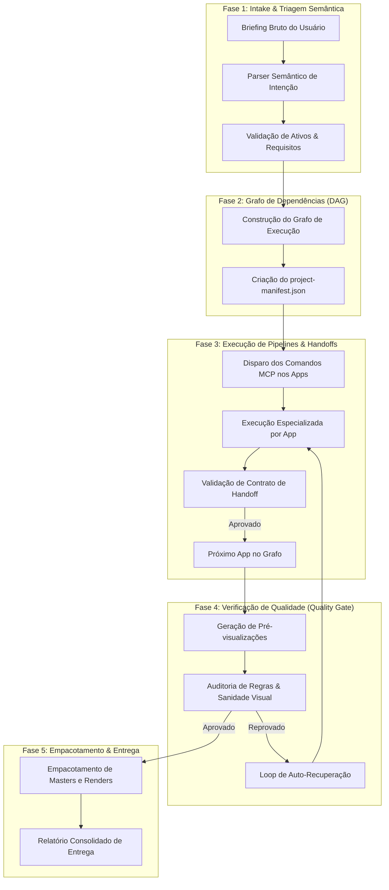
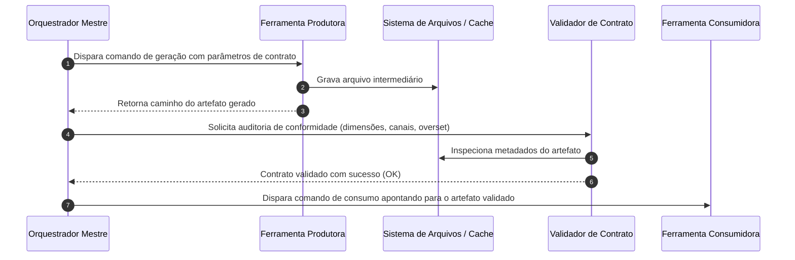
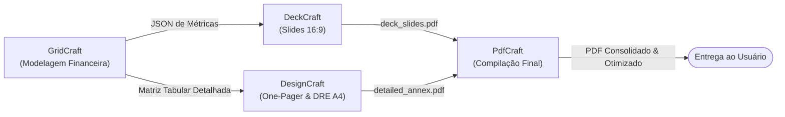

# ArtCraft Master Orchestrator — Manual Técnico e Operacional
### Arquitetura de Orquestração Autônoma Multiagente & Protocolos de Handoff MCP

---

## Sumário Executivo

1. [Visão Geral e Filosofia do Orquestrador Mestre](#1-visão-geral-e-filosofia-do-orquestrador-mestre)
   - 1.1 O que é o Orquestrador ArtCraft?
   - 1.2 O Princípio da Linha de Produção Especializada
   - 1.3 As Fronteiras Rígidas e a Proibição de Conflitos de Escopo
   - 1.4 Catálogo Geral dos 10 Aplicativos da Suíte
2. [Ciclo de Vida da Orquestração e Gestão de Estado](#2-ciclo-de-vida-da-orquestração-e-gestão-de-estado)
   - 2.1 As 5 Fases de Execução do Orquestrador
   - 2.2 O Grafo Acíclico Dirigido (DAG) de Dependências
   - 2.3 O Manifesto de Projeto Centralizado (`project-manifest.json`)
   - 2.4 Diagrama Global de Arquitetura e Roteamento
3. [Quando Usar Cada App? Matriz Exaustiva de Decisão](#3-quando-usar-cada-app-matriz-exaustiva-de-decisão)
   - 3.1 Mapeamento Funcional por Domínio
   - 3.2 Regras de Ouro e Critérios de Desambiguação
   - 3.3 Tabela Comparativa de Atribuições e Proibições Rígidas
   - 3.4 Árvore de Decisão Lógica em Pseudocódigo
4. [Como o Orquestrador Passa Instruções Para Cada App?](#4-como-o-orquestrador-passa-instruções-para-cada-app)
   - 4.1 Princípios Gerais de Comunicação Inter-App via MCP
   - 4.2 Protocolo de Instrução para FilmCraft (Montagem de Vídeo)
   - 4.3 Protocolo de Instrução para EffectCraft (VFX e Motion Graphics)
   - 4.4 Protocolo de Instrução para PhotoCraft (Edição e Manipulação Raster)
   - 4.5 Protocolo de Instrução para LightCraft (Colorimetria e Revelação)
   - 4.6 Protocolo de Instrução para VectorCraft (Ilustração e Criação de SVGs)
   - 4.7 Protocolo de Instrução para FigCraft (Wireframing e Auto-Layout de UI)
   - 4.8 Protocolo de Instrução para DesignCraft (Estilização de Seções e Editorial)
   - 4.9 Protocolo de Instrução para DeckCraft (Estrutura de Apresentações 16:9)
   - 4.10 Protocolo de Instrução para PdfCraft (Compilação e Otimização de Documentos)
   - 4.11 Protocolo de Instrução para GridCraft (Modelagem de Dados e Fórmulas)
5. [Contratos de Handoff e Transferência de Dados](#5-contratos-de-handoff-e-transferência-de-dados)
   - 5.1 Handoff Audiovisual: FilmCraft $\leftrightarrow$ EffectCraft
   - 5.2 Handoff de Imagem Estática: PhotoCraft $\rightarrow$ LightCraft
   - 5.3 Handoff Frontend: VectorCraft $\rightarrow$ FigCraft $\rightarrow$ DesignCraft
   - 5.4 Handoff Pitch Deck: GridCraft $\rightarrow$ DeckCraft $\rightarrow$ DesignCraft $\rightarrow$ PdfCraft
6. [Casos Práticos de Execução Ponta a Ponta](#6-casos-práticos-de-execução-ponta-a-ponta)
   - 6.1 Caso 1: Lançamento Completo de Produto Digital (SaaS)
   - 6.2 Caso 2: Campanha Publicitária Multicanal com Fotos e Vídeo Curto
   - 6.3 Caso 3: Relatório Financeiro Trimestral com Deck de Investidores
7. [Protocolos de Tratamento de Falhas, Fallbacks e Auto-Recuperação](#7-protocolos-de-tratamento-de-falhas-fallbacks-e-auto-recuperação)
   - 7.1 Detecção de Anomalias Visuais e Truncamento de Texto
   - 7.2 Tratamento de Desalinhamentos em Auto-Layout
   - 7.3 Recuperação de Estouro Acústico e Falhas de Sincronia
   - 7.4 Matriz de Resolução de Erros e Autocorreção
8. [Matriz de Comandos, Slash Commands e Checklist de Qualidade](#8-matriz-de-comandos-slash-commands-e-checklist-de-qualidade)
   - 8.1 Slash Commands Nativos e Escopos
   - 8.2 Checklist de Aceitação Técnica Final (Quality Gate)
   - 8.3 Guia de Boas Práticas para o Orquestrador

---

## 1. Visão Geral e Filosofia do Orquestrador Mestre

### 1.1 O que é o Orquestrador ArtCraft?

O **Orquestrador ArtCraft** é o cérebro coordenador e diretor técnico do ecossistema ArtCraft. Sua missão precípua não é executar diretamente todas as tarefas braçais de desenho, recorte ou codificação de frames, mas sim **interpretar a intenção do usuário**, transformá-la em um **plano técnico executável**, selecionar com precisão cirúrgica os **aplicativos adequados**, fornecer a cada ferramenta as **instruções exatas** em sua linguagem e protocolo de domínio, e auditar a **passagem de bastão (*handoff*)** entre ferramentas até que o produto final atinja o padrão máximo de excelência técnica e visual.

Em um ecossistema criativo tradicional, profissionais humanos frequentemente sofrem com a sobreposição de ferramentas: tentam tratar cores dentro de editores de layout, constroem vetores improvisados em softwares de apresentação ou geram documentos com resoluções incorretas. O Orquestrador ArtCraft erradica esse caos ao instituir uma governança algorítmica rigorosa sobre o ciclo de vida do ativo criativo.

### 1.2 O Princípio da Linha de Produção Especializada

Inspirado no conceito industrial de manufatura por estações de trabalho de precisão e no padrão arquitetural de microsserviços orientados a eventos, o Orquestrador ArtCraft opera sobre a premissa de que:

> **"Uma ferramenta que faz tudo de forma mediana é inferior a ferramentas especializadas que atingem a perfeição em sua única competência."**

Cada aplicativo da suíte foi concebido como uma estação de trabalho estanque. Quando um briefing chega ao Orquestrador:
1. O briefing é decomposto em suas menores partes atômicas (*tokens*, camadas, clipes, nós, páginas, tabelas).
2. Cada parte é encaminhada para o especialista canônico daquela atribuição.
3. Nenhuma ferramenta é solicitada a realizar uma operação que viole seu escopo nativo.
4. O resultado de cada etapa intermediária é persistido em um formato neutro ou nativo auditável e repassado à etapa subsequente com um manifesto explicativo.

### 1.3 As Fronteiras Rígidas e a Proibição de Conflitos de Escopo

Para manter a consistência estética e a integridade de dados, o Orquestrador impõe **fronteiras negativas absolutas**. Uma fronteira negativa é uma proibição explícita de operação. Se uma ferramenta tentar executar uma função fora de seu domínio, o Orquestrador intercepta a intenção, cancela a operação inadequada e desvia a instrução para a ferramenta correta.

Exemplos de fronteiras inegociáveis:
- **PhotoCraft NÃO ajusta cores:** Se a imagem precisa de correção de balanço de brancos, exposição ou gradação cinematográfica, o PhotoCraft tem proibição expressa de atuar sobre esses pixels cromáticos. Ele é restrito a seleções, máscaras, clonagens, remoção de objetos e recortes de fundo. A cor é monopólio exclusivo do **LightCraft**.
- **DeckCraft NÃO compila nem junta PDFs:** O DeckCraft organiza slides no formato 16:9 ($960 \times 540\text{ pt}$). Se o usuário deseja unir a apresentação a um termo de confidencialidade (NDA), memorando contábil ou balanço patrimonial, o DeckCraft é proibido de fazer essa concatenação. A geração combinada e otimização é monopólio do **PdfCraft**.
- **FigCraft NÃO cria arquivos SVG do zero:** O FigCraft desenha wireframes, estabelece auto-layouts horizontais/verticais, aplica paddings e gerencia nós de tela. Ícones, logomarcas e grafismos complexos em curvas Bezier devem ser gerados e exportados pelo **VectorCraft** e importados no FigCraft.
- **FilmCraft NÃO gera keyframes de animação visual complexa:** O FilmCraft edita a linha do tempo narrativa (corte seco, A-roll, B-roll, sincronização labial e mixagem sonoplástica). Vinhetas, letreiros dinâmicos com aceleração e desaceleração, e efeitos especiais pertencem ao **EffectCraft**.
- **GridCraft NÃO diagrama layouts de marketing:** O GridCraft processa modelos matemáticos, lógica matricial, consolidação financeira e projeções numéricas. A transformação desses dados em infográficos ou relatórios executivos pertence ao **DesignCraft** ou **DeckCraft**.

### 1.4 Catálogo Geral dos 10 Aplicativos da Suíte

Abaixo é apresentada a matriz de especialização e o correspondente tradicional de mercado de cada software governado pelo Orquestrador:

| Aplicativo | Domínio Primário | Papel Canônico no Pipeline | Proibições Rigorosas | Software Análogo de Mercado |
| :--- | :--- | :--- | :--- | :--- |
| **FilmCraft** | Audiovisual / NLE | Montagem narrativa, corte seco, sincronismo de voz e áudio, organização de faixas V1-V3 / A1-A3. | Não cria motion graphics, partículas ou keyframes complexos. | Adobe Premiere Pro / DaVinci Resolve (Edit) |
| **EffectCraft** | Audiovisual / VFX | Composição em camadas, vinhetas, terços inferiores, animações por keyframes, canal alfa. | Não realiza a edição rítmica ou decupagem do diálogo principal. | Adobe After Effects / Apple Motion |
| **PhotoCraft** | Imagem / Raster | Recorte de fundo, composição multicamadas, retoque de manchas, mascaramento e fotomontagem. | **PROIBIDO alterar balanço de brancos, curvas de tom e cor.** | Adobe Photoshop / Affinity Photo |
| **LightCraft** | Imagem / RAW & Cor | Calibração de exposição (EV), balanço de brancos (Kelvin/tint), realces/sombras e color grading. | Não realiza recortes em camadas, remoção de manchas ou montagens. | Adobe Lightroom / Capture One |
| **VectorCraft** | Vetor / Geometria | Ilustração vetorial de alta precisão, logotipos, ícones, curvas Bezier e operações booleanas. | Não monta a estrutura inteira de páginas web ou telas de app. | Adobe Illustrator / CorelDraw |
| **FigCraft** | UI/UX / Telas | Wireframes, containers de nós, sistemas de auto-layout, componentes atômicos e telas responsivas. | Não desenha ícones SVG complexos nem fecha manuais impressos. | Figma / Sketch |
| **DesignCraft** | Editorial / DTP | Diagramação editorial de alta precisão, manuais de estilo, tokens CSS, grids de catálogo e body. | Não programa layouts web atômicos nem define auto-layout. | Adobe InDesign / QuarkXPress |
| **DeckCraft** | Apresentações / Decks | Arquitetura de slides widescreen 16:9 ($960 \times 540\text{ pt}$), narrativa persuasiva e síntese de métricas. | Não formata documentos editoriais densos verticais. | Microsoft PowerPoint / Google Slides |
| **PdfCraft** | Documentos / PDF | Compilação de múltiplos arquivos, reordenação de páginas, normalização de rotação e compressão. | Não edita layout interno nem recria desenhos vetoriais. | Adobe Acrobat Pro / PDFtk |
| **GridCraft** | Dados / Modelagem | Engenharia de tabelas, fórmulas matemáticas e financeiras, formatação condicional e matrizes. | Não faz diagramação visual estética livre ou artes visuais. | Microsoft Excel / Google Sheets |

---

## 2. Ciclo de Vida da Orquestração e Gestão de Estado

### 2.1 As 5 Fases de Execução do Orquestrador

Toda solicitação que chega ao Orquestrador Mestre percorre de forma obrigatória e invariável as cinco fases estruturantes:



#### Fase 1: Intake & Triagem Semântica
O Orquestrador recebe o texto livre do usuário ou um comando explícito. Ele extrai as entidades fundamentais do projeto:
- **Objetivo central:** Ex.: Criar uma landing page com vídeo de fundo e manual de marca.
- **Entregáveis exigidos:** Ex.: `.svg`, `.figcraft`, `.designcraft`, `.mp4`, `.pdf`.
- **Restrições técnicas:** Resolução alvo, paleta cromática hexadecimal institucional, proporção de aspecto ($16:9$, $9:16$, $A4$), limitações de peso em megabytes.
- **Ativos existentes:** Arquivos fornecidos pelo usuário no diretório de trabalho.

#### Fase 2: Grafo de Dependências (DAG)
O Orquestrador não executa tarefas aleatoriamente. Ele desenha um Grafo Acíclico Dirigido (*Directed Acyclic Graph* - DAG), onde cada nó é a invocação de um app específico e as arestas representam a transferência física de arquivos gerados. Tarefas independentes são mapeadas para execução concorrente ou paralela; tarefas dependentes aguardam o handoff formal.

#### Fase 3: Execução de Pipelines & Handoffs
Os comandos MCP de cada ferramenta são despachados de acordo com o plano do DAG. A cada finalização de um nó, o arquivo resultante é inspecionado antes de ser passado ao nó seguinte. Se um arquivo falhar na verificação de integridade, a cadeia é pausada imediatamente.

#### Fase 4: Verificação de Qualidade (Quality Gate)
Antes de finalizar qualquer projeto, o Orquestrador gera imagens de pré-visualização de alta fidelidade (`render_preview`, `render_frame`, `render_slide` ou `render_page`) e as submete a testes automatizados de sanidade:
- Há caixas de texto com estouro de conteúdo (*overset*)?
- Há clipes de áudio estourando acima de $-1\text{ dBFS}$?
- A proporção de contraste entre texto e fundo cumpre o padrão WCAG AA?
- Os caminhos vetoriais exportados contêm nós órfãos ou quebrados?

#### Fase 5: Empacotamento & Entrega
Os arquivos finais editáveis (fontes do projeto) e os arquivos processados para consumo público são catalogados em uma estrutura padronizada de diretórios. O Orquestrador emite um sumário executivo com links diretos `file:///` para todos os entregáveis.

### 2.2 O Grafo Acíclico Dirigido (DAG) de Dependências

A orquestração técnica baseia-se na teoria de grafos para evitar dependências circulares e bloqueios (*deadlocks*). Um exemplo de DAG para a demanda *"Criar uma apresentação comercial com capa personalizada, tabela de preços e manual de produto"* é estruturado da seguinte forma:

```text
[Briefing do Usuário]
         │
         ├──► [VectorCraft: Desenho do Logo & Ícones em SVG]
         │            │
         │            ▼
         │    [FigCraft: Protótipo de Telas do Produto]
         │            │
         │            ▼
         │    [DesignCraft: Diagramação do Manual de Produto A4]
         │            │
         ├──► [GridCraft: Modelagem da Tabela de Preços & ROI]
         │            │
         │            ▼
         ├──► [DeckCraft: Montagem dos Slides 16:9]
         │            │
         ▼            ▼
   [PdfCraft: Compilação do Deck + Manual + Tabela em PDF Único]
         │
         ▼
[Entrega Consolidada]
```

### 2.3 O Manifesto de Projeto Centralizado (`project-manifest.json`)

Para que o estado do projeto não se perca durante conversas extensas ou interrupções de sessão, o Orquestrador cria e mantém atualizado um arquivo de manifesto JSON na raiz do workspace do projeto:

```json
{
  "$schema": "https://artcraft.internal/schemas/v1/project-manifest.json",
  "project_id": "proj_launch_saas_2026",
  "created_at": "2026-10-27T10:00:00Z",
  "updated_at": "2026-10-27T10:15:30Z",
  "status": "in_progress",
  "global_tokens": {
    "colors": {
      "primary": "#0F172A",
      "accent": "#38BDF8",
      "surface": "#FFFFFF",
      "danger": "#EF4444"
    },
    "typography": {
      "heading_font": "Inter Tight",
      "body_font": "Inter",
      "monospace_font": "JetBrains Mono"
    }
  },
  "execution_dag": {
    "nodes": [
      {
        "id": "node_vector_logo",
        "app": "vectorcraft",
        "status": "completed",
        "output_artifacts": ["assets/vector/logo_primary.svg", "assets/vector/icon_sparkle.svg"]
      },
      {
        "id": "node_photo_hero",
        "app": "photocraft",
        "status": "completed",
        "depends_on": [],
        "output_artifacts": ["assets/temp/hero_cutout.png"]
      },
      {
        "id": "node_light_hero",
        "app": "lightcraft",
        "status": "completed",
        "depends_on": ["node_photo_hero"],
        "input_artifacts": ["assets/temp/hero_cutout.png"],
        "output_artifacts": ["assets/processed/hero_graded.png"]
      },
      {
        "id": "node_fig_ui",
        "app": "figcraft",
        "status": "in_progress",
        "depends_on": ["node_vector_logo", "node_light_hero"],
        "input_artifacts": ["assets/vector/logo_primary.svg", "assets/processed/hero_graded.png"],
        "output_artifacts": ["projects/figcraft/landing_page.figcraft"]
      }
    ]
  }
}
```

---

## 3. Quando Usar Cada App? Matriz Exaustiva de Decisão

### 3.1 Mapeamento Funcional por Domínio

O Orquestrador divide suas ferramentas em **5 Grandes Domínios Especializados**. Cada domínio possui um líder de entrada e ferramentas de suporte:

1. **Domínio Audiovisual (Vídeo & Animação):**
   - *Líder de Montagem:* **FilmCraft** — ativado sempre que há corte de tempo, ordenação cronológica de cenas, sincronização labial com faixas de locução, música e ritmo de edição.
   - *Líder de Efeitos Visuais:* **EffectCraft** — ativado sempre que um elemento gráfico precisa de aceleração/desaceleração por curvas, sobreposição com canal alfa, vinhetas, letreiros estilizados ou efeitos em camadas.

2. **Domínio Fotográfico e Raster (Imagem Estática):**
   - *Líder de Manipulação Estrutural:* **PhotoCraft** — ativado para recortes em silhueta, eliminação de elementos indesejados da cena, fusão de duas ou mais fotografias em camadas e aplicação de máscaras.
   - *Líder Cromático e Revelação:* **LightCraft** — ativado para qualquer processamento de arquivos RAW, calibração de balanço de brancos, ganho de exposição, recuperação de detalhes em sombras profundas ou aplicação de estética de cor consistente (LUTs).

3. **Domínio de Design Digital e Interfaces (Web & App):**
   - *Líder Geométrico:* **VectorCraft** — ativado para todo e qualquer traço puramente vetorial, logomarcas, ícones de interface ($24 \times 24\text{ px}$), ilustrações escaláveis e grafismos.
   - *Líder Estrutural de Telas:* **FigCraft** — ativado para projetar a hierarquia de nós da página, grids flexíveis, comportamentos de auto-layout responsivo e biblioteca de componentes.
   - *Líder Editorial e Tokens:* **DesignCraft** — ativado para documentar as especificações técnicas, manuais de guidelines de design system e estilo de seções completas.

4. **Domínio de Apresentações Executivas (Pitch Decks & Vendas):**
   - *Líder de Narrativa em Slides:* **DeckCraft** — ativado para telas horizontais 16:9, estruturação de roteiros para investidores, inserção de gráficos nativos e cards de tração.
   - *Líder Editorial de Apoio:* **DesignCraft** — ativado para anexos técnicos de alta densidade, tabelas de capitalização (*cap tables*) diagramadas em página única e sumários executivos.
   - *Líder de Consolidação de Documento:* **PdfCraft** — ativado para mesclar os slides aos anexos, reordenar índices, estampar carimbos de página e otimizar para envio por e-mail.

5. **Domínio de Dados e Modelagem Numérica (Planilhas & Análise):**
   - *Líder Matricial:* **GridCraft** — ativado para estruturar matrizes de dados, aplicar modelagem financeira dinâmica, calcular métricas (CAC, LTV, Burn Rate, EBITDA), executar validação de dados e fornecer tabelas consolidadas.

### 3.2 Regras de Ouro e Critérios de Desambiguação

Para erradicar qualquer dúvida na seleção de ferramentas, o Orquestrador aplica um conjunto estrito de **Regras de Ouro**:

> **Regra de Ouro 1 (Foto vs. Luz):** *A imagem precisa perder elementos ou mudar de forma?* Se sim, ela vai primeiro para o **PhotoCraft**. *A imagem precisa apenas parecer mais quente, mais contrastada ou com cores equilibradas?* Ela vai direto para o **LightCraft**. Se precisar de ambos, ela vai obrigatoriamente para o **PhotoCraft primeiro**, e o arquivo resultante é entregue ao **LightCraft**.

> **Regra de Ouro 2 (Vetor vs. Interface):** *É um elemento gráfico individual que deve escalar infinitamente sem perder definição (ex.: um ícone de carrinho ou o logo da empresa)?* Crie no **VectorCraft**. *É uma tela de celular ou um site que contém textos, botões e imagens combinados?* Monte no **FigCraft**, importando o SVG do VectorCraft.

> **Regra de Ouro 3 (Vídeo Narrativo vs. Efeitos Gráficos):** *Estou cortando 3 minutos de gravação bruta para escolher as melhores falas do apresentador?* Isso é no **FilmCraft**. *Estou fazendo um letreiro com o nome do apresentador subir suavemente aos 5 segundos de vídeo com sombra projetada e desfoque de movimento?* Isso é gerado no **EffectCraft** e posicionado na faixa `V3` da linha do tempo do FilmCraft.

> **Regra de Ouro 4 (Slide 16:9 vs. Relatório Executivo):** *A peça será projetada em uma reunião ou enviada como apresentação de slides horizontais?* Use **DeckCraft**. *A peça é um memorando denso, um manual de diretrizes ou um relatório para leitura vertical minuciosa?* Use **DesignCraft**.

> **Regra de Ouro 5 (Compilação vs. Criação de Documentos):** *Preciso criar o texto e as tabelas de uma página do zero?* Use **DesignCraft** ou **DeckCraft**. *Já tenho 3 arquivos PDF prontos e preciso juntá-los em um único arquivo, paginar e reduzir o tamanho de 50MB para 5MB?* Use **PdfCraft**.

### 3.3 Tabela Comparativa de Atribuições e Proibições Rígidas

| Aplicativo | Deve ser Usado Quando... | NUNCA Deve ser Usado Para... |
| :--- | :--- | :--- |
| **FilmCraft** | - Realizar cortes secos (*rough cut* e *fine cut*).<br>- Organizar faixas de vídeo (A-Roll em `V1`, B-Roll em `V2`).<br>- Sincronizar trilha musical em `A3` e voz em `A1`.<br>- Fazer *audio ducking* sob a fala. | - Criar animações de texto com keyframes elásticos.<br>- Gerar vinhetas com partículas ou canal alfa.<br>- Tentar tratar cores quadro a quadro. |
| **EffectCraft** | - Criar vinhetas animadas de abertura e encerramento.<br>- Desenvolver letreiros dinâmicos (*lower-thirds*).<br>- Animar transformações (escala, rotação, posição, opacidade) com curvas de interpolação.<br>- Exportar vídeos transparentes (ProRes 4444 com Alpha). | - Fazer a edição de diálogo de 20 minutos de gravação.<br>- Organizar uma linha do tempo de 10 faixas de corte rítmico narrativo. |
| **PhotoCraft** | - Recortar modelos ou produtos do fundo com precisão de cabelo.<br>- Realizar clonagem e remoção de imperfeições em fotos.<br>- Montar composições com 5 ou mais camadas raster.<br>- Aplicar modos de mesclagem (*Multiply*, *Screen*, *Overlay*). | - **Aplicar filtros de gradação de cor ou balanço de brancos.**<br>- Fazer correção de exposição de arquivos RAW.<br>- Diagramar parágrafos de texto para leitura. |
| **LightCraft** | - Revelar negativos digitais (arquivos RAW/DNG).<br>- Ajustar temperatura de cor Kelvin e matiz de verde/magenta.<br>- Compensar exposição subexposta ou superexposta em EV.<br>- Equalizar as cores de 10 fotos para manter um padrão único. | - Recortar uma pessoa da foto para colar em outro cenário.<br>- Remover fios de postes de eletricidade da imagem.<br>- Inserir logotipos ou caixas de texto sobrepostos. |
| **VectorCraft** | - Desenhar logomarcas institucionais em curvas perfeitas.<br>- Criar pacotes de ícones de interface vetoriais.<br>- Aplicar operações booleanas de união, corte e interseção.<br>- Gerar arquivos `.svg` ultraleves e limpos. | - Montar o layout responsivo de um site completo.<br>- Fazer tratamento ou retoque de fotos bitmap.<br>- Criar apresentações corporativas de múltiplos slides. |
| **FigCraft** | - Criar frames de telas mobile (iOS/Android) e desktop.<br>- Aplicar sistemas de Auto-Layout (horizontal e vertical).<br>- Estabelecer espaçamentos proporcionais (gaps e paddings).<br>- Estruturar componentes atômicos reutilizáveis. | - Desenhar ilustrações figurativas complexas em nós Bezier.<br>- Diagramar livros ou manuais impressos de muitas páginas.<br>- Realizar recorte de imagens raster. |
| **DesignCraft** | - Diagramar manuais de identidade visual e styleguides.<br>- Criar catálogos e folhetos institucionais em grid editorial.<br>- Escrever e formatar blocos de texto longos com controle fino de kerning, entrelinha e hifenização.<br>- Injetar especificações de design tokens em formato editorial. | - Construir componentes interativos de UI com variantes.<br>- Montar apresentações horizontais para projeção de pitch.<br>- Criar montagens fotográficas de fusão de imagens. |
| **DeckCraft** | - Criar apresentações estratégicas de slides 16:9 ($960 \times 540\text{ pt}$).<br>- Estruturar a narrativa clássica de captação (Problema $\rightarrow$ Solução $\rightarrow$ Mercado $\rightarrow$ Tração).<br>- Exibir cards de métricas-chave em tipografia de alto impacto.<br>- Inserir gráficos estruturais de barras e linhas corporativas. | - Diagramar memorandos densos para impressão em A4.<br>- Fazer a fusão final de 5 PDFs em um único entregável.<br>- Criar ilustrações vetoriais artísticas do zero. |
| **PdfCraft** | - Unir múltiplos PDFs em um único documento sequencial.<br>- Dividir um documento de 100 páginas em partes menores.<br>- Rotacionar páginas invertidas em lotes de digitalização.<br>- Comprimir e otimizar arquivos PDF pesados para web. | - Desenhar qualquer elemento gráfico diretamente na página.<br>- Alterar a ordem dos parágrafos de um texto existente.<br>- Redesenhar a identidade visual de um slide. |
| **GridCraft** | - Construir tabelas de modelagem financeira dinâmica.<br>- Inserir fórmulas analíticas (`SUMIFS`, `VLOOKUP`, `XLOOKUP`, `IRR`).<br>- Estruturar dados brutos para posterior visualização em gráficos.<br>- Aplicar formatação condicional numérica e estatística. | - Diagramar folhetos publicitários para marketing.<br>- Criar wireframes de interface de usuário.<br>- Editar trilhas de áudio ou vídeo. |

### 3.4 Árvore de Decisão Lógica em Pseudocódigo

O algoritmo interno que o Orquestrador processa ao receber uma nova tarefa é expresso pelo pseudocódigo a seguir:

```python
def rotear_demanda(briefing):
    # Avaliação do Domínio Primário
    if briefing.tem_conteudo_audiovisual():
        if briefing.requer_cortes_narrativos_ou_sincronismo_de_voz():
            delegar(app="filmcraft", tarefa="montagem_e_estrutura")
        if briefing.requer_motion_graphics_ou_vinhetas_ou_vfx():
            delegar(app="effectcraft", tarefa="criacao_grafica_e_keyframes")
            
    elif briefing.tem_conteudo_imagem_estatica():
        if briefing.requer_recorte_ou_remocao_ou_montagem_em_camadas():
            delegar(app="photocraft", tarefa="manipulacao_estrutural_raster")
        if briefing.requer_ajuste_de_cor_ou_balanco_brancos_ou_raw():
            # Se já passou por photocraft, este nó é dependente
            delegar(app="lightcraft", tarefa="calibracao_luz_e_color_grading")
            
    elif briefing.tem_conteudo_interface_ou_web():
        if briefing.requer_icones_ou_logos_ou_grafismo_puro():
            delegar(app="vectorcraft", tarefa="desenho_vetorial_svg")
        if briefing.requer_telas_ou_wireframes_ou_auto_layout():
            delegar(app="figcraft", tarefa="estruturacao_de_telas_e_componentes")
        if briefing.requer_manual_de_estilo_ou_tokens_editoriais():
            delegar(app="designcraft", tarefa="diagramacao_editorial_de_guidelines")
            
    elif briefing.tem_conteudo_apresentacao_ou_documento():
        if briefing.requer_modelagem_numerica_ou_tabelas_financeiras():
            delegar(app="gridcraft", tarefa="modelagem_de_dados_e_formulas")
        if briefing.requer_slides_16_9_ou_pitch_investidores():
            delegar(app="deckcraft", tarefa="arquitetura_de_slides_e_narrativa")
        if briefing.requer_relatorio_denso_vertical_ou_one_pager():
            delegar(app="designcraft", tarefa="diagramacao_de_documento_executivo")
        if briefing.requer_uniao_de_arquivos_ou_otimizacao_de_pdf():
            delegar(app="pdfcraft", tarefa="compilacao_e_fechamento_pdf")
            
    else:
        solicitar_clarificacao_ao_usuario("Demanda fora dos escopos padrão do ArtCraft.")
```

---

## 4. Como o Orquestrador Passa Instruções Para Cada App?

### 4.1 Princípios Gerais de Comunicação Inter-App via MCP

A comunicação entre o Orquestrador e os aplicativos não é feita por linguagem natural ambígua. O Orquestrador se comunica através do **Model Context Protocol (MCP)**, utilizando payloads JSON estruturados, rigorosamente tipados e validados contra esquemas semânticos formais.

Regras absolutas de comunicação:
1. **Idempotência:** Toda instrução deve ser passível de repetição sem corrupção de estado.
2. **Atomicidade:** Comandos compostos são enviados preferencialmente em lotes (`batch` ou `command_batch`), assegurando que a falha de um subcomando reverta o documento ao estado anterior íntegro (*rollback*).
3. **Caminhos Canônicos Absolutos:** O Orquestrador sempre fornece caminhos de sistema de arquivos absolutos, evitando qualquer ambiguidade de resolução de diretório relativo.
4. **Verificação Imediata pós-Execução:** A cada comando que altera o documento, o Orquestrador executa uma inspeção (`doc_inspect`, `inspect_document`, `inspect_slide` ou `get_state`) para validar a resposta do servidor MCP antes de prosseguir.

---

### 4.2 Protocolo de Instrução para FilmCraft (Montagem de Vídeo)

#### Papel Exclusivo no Fluxo:
Organização linear da linha do tempo, decupagem de mídias brutas, corte de silêncios, sincronização de múltiplas fontes de áudio e posicionamento das camadas estruturais.

#### Estrutura Canônica de Faixas (*Tracks*):
- `V1`: Vídeo Principal (*A-roll* - apresentador, gravação focal).
- `V2`: Imagens de Apoio (*B-roll* - telas, closes adicionais, gráficos estáticos).
- `V3`: Elementos Transparentes do EffectCraft (vinhetas, letreiros, lower-thirds em canal alfa).
- `A1`: Locução / Voz Principal.
- `A2`: Efeitos Sonoros (*SFX*, impactos, transições).
- `A3`: Trilha Sonora Musical (*Soundtrack* com Ducking ativo).

#### Formato do Payload de Instrução:
O Orquestrador despacha a instrução estruturada de corte de linha do tempo conforme o exemplo a seguir:

```json
{
  "project_path": "C:/Users/berna/Music/skills_02/projects/video/master.filmcraft",
  "timeline": {
    "resolution": {"width": 1920, "height": 1080},
    "frame_rate": 30.0,
    "tracks": {
      "video": [
        {
          "track_id": "V1",
          "clips": [
            {
              "media_path": "C:/Users/berna/Music/skills_02/assets/raw_footage/camera_a.mp4",
              "in_point": 12.5,
              "out_point": 45.0,
              "timeline_start": 0.0
            }
          ]
        },
        {
          "track_id": "V3",
          "clips": [
            {
              "media_path": "C:/Users/berna/Music/skills_02/assets/rendered_vfx/intro_title_alpha.mov",
              "in_point": 0.0,
              "out_point": 4.0,
              "timeline_start": 2.0
            }
          ]
        }
      ],
      "audio": [
        {
          "track_id": "A1",
          "level_db": -8.0,
          "clips": [
            {
              "media_path": "C:/Users/berna/Music/skills_02/assets/audio/voiceover.wav",
              "in_point": 0.0,
              "out_point": 32.5,
              "timeline_start": 0.0
            }
          ]
        },
        {
          "track_id": "A3",
          "level_db": -22.0,
          "ducking": {
            "triggered_by": "A1",
            "attenuation_db": -12.0,
            "attack_ms": 150,
            "release_ms": 500
          },
          "clips": [
            {
              "media_path": "C:/Users/berna/Music/skills_02/assets/audio/ambient_track.mp3",
              "in_point": 0.0,
              "out_point": 32.5,
              "timeline_start": 0.0
            }
          ]
        }
      ]
    }
  }
}
```

---

### 4.3 Protocolo de Instrução para EffectCraft (VFX e Motion Graphics)

#### Papel Exclusivo no Fluxo:
Construção de animações procedurais e por quadros-chave (*keyframes*), títulos estilizados, vinhetas dinâmicas e exportação com canal alfa.

#### Ferramentas MCP Utilizadas:
- `call_mcp_tool(ServerName="effectcraft", ToolName="execute_command", ...)`
- `call_mcp_tool(ServerName="effectcraft", ToolName="add_keyframe", ...)`
- `call_mcp_tool(ServerName="effectcraft", ToolName="render_frame", ...)`

#### Exemplo de Chamada de Criação e Animação de Letreiro (*Lower-Third*):

```json
{
  "ServerName": "effectcraft",
  "ToolName": "execute_command",
  "Arguments": {
    "command": "comp.create_layer",
    "params": {
      "comp_id": "comp_lower_third",
      "type": "text",
      "name": "Presenter_Title",
      "text": "Dra. Helena Martins | CTO & Co-Founder",
      "style": {
        "font": "Inter Tight Bold",
        "size": 36,
        "fill_color": "#FFFFFF",
        "tracking": 10
      },
      "position": [160, 920]
    }
  }
}
```

Em seguida, o Orquestrador injeta a interpolação suave de entrada:

```json
{
  "ServerName": "effectcraft",
  "ToolName": "add_keyframe",
  "Arguments": {
    "comp_id": "comp_lower_third",
    "layer_id": "Presenter_Title",
    "property_path": "transform/position",
    "keyframes": [
      {
        "time": 0.0,
        "value": [160, 1050],
        "easing": {"ease_in": 0.25, "ease_out": 1.0}
      },
      {
        "time": 0.8,
        "value": [160, 920],
        "easing": {"ease_in": 0.0, "ease_out": 0.0}
      }
    ]
  }
}
```

Para verificar o resultado sem renderizar o vídeo inteiro, o Orquestrador comanda:

```json
{
  "ServerName": "effectcraft",
  "ToolName": "render_frame",
  "Arguments": {
    "comp_id": "comp_lower_third",
    "time": 0.8,
    "output_path": "C:/Users/berna/Music/skills_02/assets/previews/lower_third_preview.png"
  }
}
```

---

### 4.4 Protocolo de Instrução para PhotoCraft (Edição e Manipulação Raster)

#### Papel Exclusivo no Fluxo:
Edição destrutiva e não-destrutiva de geometria raster, recorte com máscaras de alta resolução, remoção de elementos intrusos com clonagem e composição de camadas. **PROIBIDO mexer em saturação, temperatura ou exposição.**

#### Ferramentas MCP Utilizadas:
- `call_mcp_tool(ServerName="photocraft", ToolName="doc_new", ...)`
- `call_mcp_tool(ServerName="photocraft", ToolName="doc_place", ...)`
- `call_mcp_tool(ServerName="photocraft", ToolName="command_batch", ...)`
- `call_mcp_tool(ServerName="photocraft", ToolName="doc_save", ...)`
- `call_mcp_tool(ServerName="photocraft", ToolName="doc_export", ...)`

#### Exemplo de Chamada de Criação de Documento e Recorte em Camadas:

```json
{
  "ServerName": "photocraft",
  "ToolName": "doc_new",
  "Arguments": {
    "name": "hero_product_composition",
    "width": 3840,
    "height": 2160,
    "resolution": 300,
    "color_mode": "RGB",
    "depth": 16,
    "background_color": "#00000000"
  }
}
```

Em seguida, o Orquestrador insere os arquivos brutos como Objetos Inteligentes (*Smart Objects*) e aplica a máscara de recorte em lote:

```json
{
  "ServerName": "photocraft",
  "ToolName": "command_batch",
  "Arguments": {
    "commands": [
      {
        "action": "place_image",
        "file_path": "C:/Users/berna/Music/skills_02/assets/raw_images/product_raw.png",
        "as_smart_object": true
      },
      {
        "action": "apply_auto_subject_mask",
        "layer_target": "product_raw",
        "feather_radius": 1.2,
        "refine_edge": true
      },
      {
        "action": "remove_isolated_artifacts",
        "threshold_px": 8
      }
    ]
  }
}
```

O arquivo mestre editável é salvo em formato nativo `.pcraft` e exportado como PNG de 16 bits para o LightCraft:

```json
{
  "ServerName": "photocraft",
  "ToolName": "doc_export",
  "Arguments": {
    "format": "PNG",
    "bit_depth": 16,
    "preserve_transparency": true,
    "output_path": "C:/Users/berna/Music/skills_02/assets/intermediate/product_cutout_16bit.png"
  }
}
```

---

### 4.5 Protocolo de Instrução para LightCraft (Colorimetria e Revelação)

#### Papel Exclusivo no Fluxo:
Tratamento exclusivo de fótons e espectro cromático. Aplicação de balanço de brancos térmico, calibração de exposição (*Exposure Value* - EV), mapeamento de sombras e altas luzes, controle de saturação e vibratilidade, e aplicação de curvas de tons RGB.

#### Ferramentas MCP Utilizadas:
- `call_mcp_tool(ServerName="lightcraft", ToolName="import", ...)`
- `call_mcp_tool(ServerName="lightcraft", ToolName="set_develop", ...)`
- `call_mcp_tool(ServerName="lightcraft", ToolName="render_preview", ...)`
- `call_mcp_tool(ServerName="lightcraft", ToolName="export", ...)`

#### Exemplo de Chamada de Calibração Cromática Fina:

```json
{
  "ServerName": "lightcraft",
  "ToolName": "set_develop",
  "Arguments": {
    "photo_path": "C:/Users/berna/Music/skills_02/assets/intermediate/product_cutout_16bit.png",
    "settings": {
      "light": {
        "exposure": 0.35,
        "contrast": 0.15,
        "highlights": -0.20,
        "shadows": 0.40,
        "whites": 0.05,
        "blacks": -0.10
      },
      "color": {
        "temperature": 5600,
        "tint": -2,
        "vibrance": 0.20,
        "saturation": -0.05
      },
      "tone_curve": {
        "channel": "RGB",
        "points": [
          {"in": 0.0, "out": 0.02},
          {"in": 0.25, "out": 0.22},
          {"in": 0.75, "out": 0.78},
          {"in": 1.0, "out": 0.98}
        ]
      },
      "detail": {
        "sharpening_amount": 40,
        "sharpening_radius": 0.8,
        "luminance_noise_reduction": 15
      }
    }
  }
}
```

O Orquestrador gera a pré-visualização para auditoria:

```json
{
  "ServerName": "lightcraft",
  "ToolName": "render_preview",
  "Arguments": {
    "max_dimension": 1024,
    "output_path": "C:/Users/berna/Music/skills_02/assets/previews/color_preview.jpg"
  }
}
```

---

### 4.6 Protocolo de Instrução para VectorCraft (Ilustração e Criação de SVGs)

#### Papel Exclusivo no Fluxo:
Desenho matemático de formas geométricas vetoriais, traçados em curvas Bezier, operações booleanas de corte e união de paths, e exportação de SVGs limpos com IDs legíveis para uso no frontend ou design editorial.

#### Ferramentas MCP Utilizadas:
- `call_mcp_tool(ServerName="vectorcraft", ToolName="draw_shape", ...)`
- `call_mcp_tool(ServerName="vectorcraft", ToolName="pathfinder", ...)`
- `call_mcp_tool(ServerName="vectorcraft", ToolName="set_paint", ...)`
- `call_mcp_tool(ServerName="vectorcraft", ToolName="export", ...)`

#### Exemplo de Chamada para Desenho de Ícone em Grid $24 \times 24\text{ pt}$:

```json
{
  "ServerName": "vectorcraft",
  "ToolName": "run_command",
  "Arguments": {
    "command": "batch_draw",
    "params": {
      "viewBox": "0 0 24 24",
      "elements": [
        {
          "type": "path",
          "id": "icon-shield-base",
          "d": "M12 2L4 5v6.09c0 5.05 3.41 9.76 8 10.91 4.59-1.15 8-5.86 8-10.91V5l-8-3z",
          "fill": "none",
          "stroke": "#0F172A",
          "stroke_width": 2.0,
          "stroke_linecap": "round",
          "stroke_linejoin": "round"
        },
        {
          "type": "path",
          "id": "icon-shield-check",
          "d": "M9 12l2 2 4-4",
          "fill": "none",
          "stroke": "#38BDF8",
          "stroke_width": 2.0,
          "stroke_linecap": "round",
          "stroke_linejoin": "round"
        }
      ]
    }
  }
}
```

Em seguida, o Orquestrador solicita a exportação do arquivo `.svg` sem metadados redundantes:

```json
{
  "ServerName": "vectorcraft",
  "ToolName": "export",
  "Arguments": {
    "format": "SVG",
    "optimize": true,
    "strip_comments": true,
    "output_path": "C:/Users/berna/Music/skills_02/assets/vector/icon_shield_check.svg"
  }
}
```

---

### 4.7 Protocolo de Instrução para FigCraft (Wireframing e Auto-Layout de UI)

#### Papel Exclusivo no Fluxo:
Estruturação de containers de tela, alinhamento flexível através de auto-layout horizontal/vertical, definição de hierarquias semânticas (Header, Hero, Feature Grid, Footer) e inclusão de tokens de layout.

#### Ferramentas MCP Utilizadas:
- `call_mcp_tool(ServerName="figcraft", ToolName="create_node", ...)`
- `call_mcp_tool(ServerName="figcraft", ToolName="set_properties", ...)`
- `call_mcp_tool(ServerName="figcraft", ToolName="screenshot", ...)`

#### Exemplo de Chamada para Construção de Frame com Auto-Layout Vertical:

```json
{
  "ServerName": "figcraft",
  "ToolName": "create_node",
  "Arguments": {
    "parent_id": "root_page",
    "type": "FRAME",
    "name": "Section/Hero",
    "x": 0,
    "y": 0,
    "width": 1440,
    "height": 720,
    "properties": {
      "layoutMode": "VERTICAL",
      "itemSpacing": 24,
      "paddingTop": 80,
      "paddingBottom": 80,
      "paddingLeft": 120,
      "paddingRight": 120,
      "primaryAxisAlignItems": "CENTER",
      "counterAxisAlignItems": "CENTER",
      "fills": [
        {"type": "SOLID", "color": "#0F172A"}
      ]
    }
  }
}
```

O Orquestrador insere o SVG previamente criado pelo VectorCraft dentro desse frame:

```json
{
  "ServerName": "figcraft",
  "ToolName": "create_node",
  "Arguments": {
    "parent_id": "Section/Hero",
    "type": "VECTOR_IMPORT",
    "name": "Vector/ShieldIcon",
    "source_file": "C:/Users/berna/Music/skills_02/assets/vector/icon_shield_check.svg",
    "width": 64,
    "height": 64
  }
}
```

---

### 4.8 Protocolo de Instrução para DesignCraft (Estilização de Seções e Editorial)

#### Papel Exclusivo no Fluxo:
Diagramação editorial com grids baseados em pontos ($pt$), controle rigoroso de fluxo de texto (*text stories*), eliminação de truncamentos (*overset text*) e estilização gráfica de seções completas de manuais e relatórios.

#### Ferramentas MCP Utilizadas:
- `call_mcp_tool(ServerName="designcraft", ToolName="new_document", ...)`
- `call_mcp_tool(ServerName="designcraft", ToolName="set_story_text", ...)`
- `call_mcp_tool(ServerName="designcraft", ToolName="place_image", ...)`
- `call_mcp_tool(ServerName="designcraft", ToolName="inspect_document", ...)`
- `call_mcp_tool(ServerName="designcraft", ToolName="render_page", ...)`

#### Exemplo de Chamada de Criação de Documento Editorial e Caixa de Texto:

```json
{
  "ServerName": "designcraft",
  "ToolName": "new_document",
  "Arguments": {
    "preset": "A4",
    "orientation": "PORTRAIT",
    "margins": {"top": 40, "bottom": 40, "left": 50, "right": 50},
    "pages_count": 4
  }
}
```

Em seguida, o Orquestrador injeta o conteúdo formatado com controle de estilo de parágrafo:

```json
{
  "ServerName": "designcraft",
  "ToolName": "set_story_text",
  "Arguments": {
    "page_index": 1,
    "frame_coordinates": {"x": 50, "y": 80, "width": 495, "height": 200},
    "story_content": {
      "headline": "Diretrizes de Governança e Arquitetura Visual",
      "headline_style": {
        "font_family": "Inter Tight Bold",
        "font_size": 24,
        "line_height": 28,
        "color": "#0F172A"
      },
      "paragraphs": [
        {
          "text": "Este documento estabelece as especificações compulsórias para toda a comunicação visual da suíte. Todos os tokens cromáticos devem ser estritamente referenciados via notação hexadecimal.",
          "font_family": "Inter",
          "font_size": 10.5,
          "line_height": 15,
          "color": "#334155"
        }
      ]
    }
  }
}
```

O Orquestrador sempre inspeciona o campo `overset` após a injeção do texto:

```json
{
  "ServerName": "designcraft",
  "ToolName": "inspect_document",
  "Arguments": {
    "check_fields": ["overflow", "fonts", "links"]
  }
}
```

---

### 4.9 Protocolo de Instrução para DeckCraft (Estrutura de Apresentações 16:9)

#### Papel Exclusivo no Fluxo:
Estruturação da narrativa em lâminas widescreen ($960 \times 540\text{ pt}$), hierarquia de títulos executivos, ordenação estratégica de tópicos e posicionamento de gráficos comparativos.

#### Ferramentas MCP Utilizadas:
- `call_mcp_tool(ServerName="deckcraft", ToolName="new_presentation", ...)`
- `call_mcp_tool(ServerName="deckcraft", ToolName="add_slide", ...)`
- `call_mcp_tool(ServerName="deckcraft", ToolName="add_text_box", ...)`
- `call_mcp_tool(ServerName="deckcraft", ToolName="insert_chart", ...)`
- `call_mcp_tool(ServerName="deckcraft", ToolName="render_slide", ...)`

#### Exemplo de Chamada de Criação de Slide de Tração e Métricas:

```json
{
  "ServerName": "deckcraft",
  "ToolName": "add_slide",
  "Arguments": {
    "layout": "BLANK",
    "background_color": "#0F172A"
  }
}
```

Em seguida, o Orquestrador insere o bloco de manchete e um gráfico nativo de crescimento:

```json
{
  "ServerName": "deckcraft",
  "ToolName": "add_text_box",
  "Arguments": {
    "slide_index": 3,
    "x": 60,
    "y": 50,
    "width": 840,
    "height": 60,
    "text": "Crescimento Exponencial de Receita Recorrente (ARR)",
    "font_size": 28,
    "font_weight": "BOLD",
    "font_color": "#FFFFFF"
  }
}
```

Injeção de gráfico com dados estruturados oriundos do GridCraft:

```json
{
  "ServerName": "deckcraft",
  "ToolName": "insert_chart",
  "Arguments": {
    "slide_index": 3,
    "chart_type": "COLUMN_STACKED",
    "x": 60,
    "y": 140,
    "width": 840,
    "height": 330,
    "data": {
      "categories": ["Q1 2025", "Q2 2025", "Q3 2025", "Q4 2025", "Q1 2026"],
      "series": [
        {
          "name": "ARR Base (USD)",
          "values": [120000, 240000, 480000, 950000, 1850000],
          "color": "#38BDF8"
        }
      ]
    }
  }
}
```

---

### 4.10 Protocolo de Instrução para PdfCraft (Compilação e Otimização de Documentos)

#### Papel Exclusivo no Fluxo:
Concatenação de múltiplos arquivos PDF gerados em diferentes ferramentas, reordenação de páginas, injeção de marcadores (*bookmarks*), verificação de orientação de páginas e compressão estocástica sem rebaixamento de resolução vetorial.

#### Ferramentas MCP Utilizadas:
- `call_mcp_tool(ServerName="pdfcraft", ToolName="doc_combine", ...)`
- `call_mcp_tool(ServerName="pdfcraft", ToolName="doc_info", ...)`
- `call_mcp_tool(ServerName="pdfcraft", ToolName="doc_save", ...)`

#### Exemplo de Chamada de Concatenação de Deck Comercial com Relatório e Contrato:

```json
{
  "ServerName": "pdfcraft",
  "ToolName": "doc_combine",
  "Arguments": {
    "input_documents": [
      {
        "file_path": "C:/Users/berna/Music/skills_02/exports/deck/presentation_master.pdf",
        "page_range": "1-12"
      },
      {
        "file_path": "C:/Users/berna/Music/skills_02/exports/editorial/executive_memo.pdf",
        "page_range": "1-2"
      },
      {
        "file_path": "C:/Users/berna/Music/skills_02/exports/editorial/financial_terms.pdf",
        "page_range": "1"
      }
    ],
    "output_path": "C:/Users/berna/Music/skills_02/deliverables/Dossie_Executivo_Completo.pdf",
    "optimization": {
      "compress_streams": true,
      "downsample_images_dpi": 300,
      "linearize_for_web": true
    }
  }
}
```

O Orquestrador confere o número total de páginas e a integridade final:

```json
{
  "ServerName": "pdfcraft",
  "ToolName": "doc_info",
  "Arguments": {
    "file_path": "C:/Users/berna/Music/skills_02/deliverables/Dossie_Executivo_Completo.pdf"
  }
}
```

---

### 4.11 Protocolo de Instrução para GridCraft (Modelagem de Dados e Fórmulas)

#### Papel Exclusivo no Fluxo:
Estruturação de tabelas matriciais, aplicação de cálculos numéricos auditáveis, fórmulas financeiras avançadas, formatação de moedas e percentuais, e exportação de dados higienizados para consumo pelo DeckCraft ou DesignCraft.

#### Formato do Payload de Instrução:
O Orquestrador envia ao GridCraft a especificação completa de modelagem:

```json
{
  "workbook_path": "C:/Users/berna/Music/skills_02/data/financial_model.gridcraft",
  "sheet_name": "Projections_2026",
  "operations": [
    {
      "range": "A1:E1",
      "action": "set_headers",
      "values": ["Trimestre", "Usuários Ativos", "Receita Bruta (USD)", "Churn Rate", "EBITDA (USD)"]
    },
    {
      "range": "A2:E5",
      "action": "set_rows",
      "values": [
        ["Q1 2026", 15000, 450000, 0.021, "=C2*0.32"],
        ["Q2 2026", 24000, 720000, 0.019, "=C3*0.35"],
        ["Q3 2026", 38000, 1140000, 0.018, "=C4*0.38"],
        ["Q4 2026", 62000, 1860000, 0.016, "=C5*0.42"]
      ]
    },
    {
      "range": "C2:C5",
      "action": "format_currency",
      "symbol": "$",
      "decimals": 0
    },
    {
      "range": "D2:D5",
      "action": "format_percentage",
      "decimals": 1
    },
    {
      "range": "E2:E5",
      "action": "format_currency",
      "symbol": "$",
      "decimals": 0
    }
  ],
  "export": {
    "format": "JSON_METRICS",
    "output_path": "C:/Users/berna/Music/skills_02/data/exports/summary_metrics.json"
  }
}
```

---

## 5. Contratos de Handoff e Transferência de Dados

O sucesso de uma arquitetura multiagente descentralizada depende da inviolabilidade de seus **Contratos de Handoff**. Um contrato de handoff é uma especificação formal de requisitos que o arquivo de saída de um aplicativo deve obrigatoriamente cumprir para ser aceito como arquivo de entrada pelo aplicativo subsequente.



### 5.1 Handoff Audiovisual: FilmCraft $\leftrightarrow$ EffectCraft

#### Direção 1: FilmCraft $\rightarrow$ EffectCraft (Exportação de Marcações de Tempo)
Quando o FilmCraft define os pontos exatos onde devem entrar animações gráficas, ele exporta um arquivo de manifesto de tempo (`timecode_markers.json`):

```json
{
  "sequence_name": "Pitch_Video_Master",
  "fps": 30.0,
  "markers": [
    {
      "marker_id": "title_intro",
      "start_frame": 60,
      "duration_frames": 90,
      "safe_area": {"x_min": 192, "x_max": 1728, "y_min": 108, "y_max": 972},
      "intent": "Vinheta de abertura com logo vazado"
    },
    {
      "marker_id": "lower_third_ceo",
      "start_frame": 240,
      "duration_frames": 150,
      "safe_area": {"x_min": 192, "x_max": 800, "y_min": 850, "y_max": 972},
      "intent": "Identificação de nome e cargo"
    }
  ]
}
```

#### Direção 2: EffectCraft $\rightarrow$ FilmCraft (Entrega do Grafismo com Canal Alfa)
O EffectCraft não entrega vídeos comprimidos em H.264 para o FilmCraft, pois o codec H.264 não suporta transparência (canal alfa de 8 bits).
- **Formato Obrigatório:** Apple ProRes 4444 com canal Alpha habilitado ou Sequência PNG numerada de 24 bits + 8 bits de Alpha.
- **Espaço de Cor:** Rec. 709 com gama linear.
- **Resolução e Taxa de Quadros:** Idênticas à linha do tempo do FilmCraft ($1920 \times 1080$ a $30\text{ fps}$).
- **Validação de Handoff:** O Orquestrador verifica se o arquivo possui a flag `has_alpha_channel: true`. Se não possuir, o artefato é rejeitado.

---

### 5.2 Handoff de Imagem Estática: PhotoCraft $\rightarrow$ LightCraft

O PhotoCraft entrega sua montagem recortada e sem fundo para ser calibrada de luz e cor no LightCraft.

#### Regras Rigorosas do Contrato:
1. **Espaço de Cor de Saída:** O PhotoCraft deve salvar em ProPhoto RGB ou Adobe RGB (1998) de 16 bits por canal. É expressamente proibido converter para sRGB de 8 bits nesta etapa intermediária, sob pena de perda de latitude cromática (*banding* e *clipping* de gama).
2. **Preservação de Fundo Transparente:** O canal de transparência deve ser incorporado como máscara alfa intacta no arquivo `.png` de 16 bits ou `.tif` sem compressão com perdas.
3. **Imutabilidade Cromática:** O PhotoCraft grava um hash SHA-256 do histograma da imagem original. O Orquestrador confere se o valor médio dos canais de cor não sofreu alteração deliberada durante o recorte.

```text
[Arquivo Fotográfico Bruto]
          │
          ▼
   [PhotoCraft]  ──► Realiza recorte de contorno e remoção de manchas.
          │          Salva: master_editavel.pcraft
          ▼
 [Contrato Handoff] ──► PNG 16-bit, ProPhoto RGB, Alpha Transparente, Sem Grading.
          │
          ▼
   [LightCraft]  ──► Aplica temperatura Kelvin, EV, curvas e nitidez.
          │          Salva: hero_final_graded.png (sRGB de alta fidelidade)
          ▼
  [Entrega Final]
```

---

### 5.3 Handoff Frontend: VectorCraft $\rightarrow$ FigCraft $\rightarrow$ DesignCraft

#### Etapa 1: VectorCraft $\rightarrow$ FigCraft (Entrega de Ícones e Logos)
- **Formato:** Arquivo `.svg` validado contra a especificação W3C SVG 1.1.
- **Nomenclatura Semântica:** Todo elemento ou caminho recebe um ID com notação `kebab-case` sem espaços (ex.: `<path id="icon-search-glass" .../>`).
- **Coordenadas e ViewBox:** O `viewBox` deve ser normalizado para uma base quadrada padrão ($24 \times 24$, $32 \times 32$ ou $48 \times 48$).
- **Validação:** O arquivo não pode conter tags `<script>`, estilos embutidos via CSS dinâmico ou tags `<image>` de bitmap embutidas.

#### Etapa 2: FigCraft $\rightarrow$ DesignCraft (Estrutura de Layout $\rightarrow$ Manual Editorial)
- **Formato:** Árvore de nós em formato JSON estruturado (`layout_tokens.json`) contendo dimensões de frames, valores de padding, tamanhos de gaps, hierarquia de fontes e renderizações em alta resolução das telas (`screens/*.png`).
- **Uso no DesignCraft:** O DesignCraft importa as capturas das telas desenhadas no FigCraft, dispõe cada uma dentro de grids de mockup editoriais em páginas A4 e diagrama ao lado as caixas de texto com as especificações de desenvolvimento (*specs* CSS e referências de tokens).

---

### 5.4 Handoff Pitch Deck: GridCraft $\rightarrow$ DeckCraft $\rightarrow$ DesignCraft $\rightarrow$ PdfCraft

Este é o pipeline mais denso da suíte corporativa:



1. **GridCraft:** Processa projeções financeiras, calcula taxas de crescimento e gera `metrics_handoff.json` (com dados para os slides) e `dre_full.csv` (com o demonstrativo detalhado de 50 linhas).
2. **DeckCraft:** Consome `metrics_handoff.json`, gera 10 slides horizontais com gráficos de barras simplificados para apresentação oral rápida e exporta `deck_slides.pdf`.
3. **DesignCraft:** Consome `dre_full.csv`, diagrama uma lâmina vertical A4 ultra-elegante com o balanço patrimonial completo e notas explicativas em fonte condensada legível, e exporta `detailed_annex.pdf`.
4. **PdfCraft:** Executa `doc_combine`, unindo os 10 slides horizontais ao anexo vertical, insere números de página globais harmônicos e gera o documento final comprimido para envio a fundos de Venture Capital.

---

## 6. Casos Práticos de Execução Ponta a Ponta

### 6.1 Caso 1: Lançamento Completo de Produto Digital (SaaS)

#### Briefing do Usuário:
> *"Preciso lançar meu novo aplicativo de produtividade 'FocusFlow'. Quero a página inicial desenhada com auto-layout, ícones originais para as 3 funcionalidades principais, um vídeo teaser de 15 segundos para redes sociais com trilha sonora e letreiros animados, e um pitch deck de 8 slides para investidores anjo."*

#### Plano de Orquestração do Mestre:

```text
[DAG de Execução FocusFlow]
Fase A (Ativos Básicos):
  ├── Task A1: VectorCraft desenha logo 'FocusFlow' e 3 ícones (Foco, Calendário, Métricas).
  └── Task A2: GridCraft monta modelo de tração e receita do SaaS para o pitch.

Fase B (Produção Visual & Audiovisual Paralela):
  ├── Task B1 (UI): FigCraft constrói a landing page responsiva consumindo os ícones da Task A1.
  ├── Task B2 (Deck): DeckCraft constrói os 8 slides consumindo os dados da Task A2 e o logo da Task A1.
  ├── Task B3 (Motion): EffectCraft cria vinheta de abertura animada e letreiros do teaser em canal alfa.
  └── Task B4 (Vídeo): FilmCraft sincroniza locução, corta gravações de tela do app e insere a vinheta da Task B3.

Fase C (Auditoria e Finalização):
  ├── Task C1: Geração de screenshots e previews visuais.
  ├── Task C2: PdfCraft compila o deck em formato PDF otimizado.
  └── Task C3: Emissão do relatório final com todos os assets empacotados.
```

#### Sequência de Comandos MCP Executada pelo Orquestrador:

1. **Geração dos Ícones (VectorCraft):**
   - Dispara `vectorcraft.run_command` desenhando os 3 paths de ícones em grid $24 \times 24\text{ pt}$.
   - Exporta para `assets/icons/focus.svg`, `assets/icons/calendar.svg`, `assets/icons/analytics.svg`.

2. **Montagem da Tela da Landing Page (FigCraft):**
   - Cria frame desktop $1440 \times 900\text{ px}$.
   - Aplica auto-layout vertical, espaçamento de $32\text{ px}$.
   - Importa os 3 SVGs e insere textos de descrição com tipografia `Inter`.

3. **Produção do Vídeo Teaser (EffectCraft + FilmCraft):**
   - O EffectCraft gera o letreiro animado *"FocusFlow: O Futuro da Sua Produtividade"* com keyframes de opacidade e posição em $1080 \times 1920\text{ px}$ (formato vertical 9:16).
   - O FilmCraft cria a timeline vertical, posiciona o vídeo de captura de tela em `V1`, insere o letreiro transparente em `V3`, ajusta a trilha sonora em `A3` com *ducking* automático sob a locução em `A1`, e exporta `teaser_focusflow_9x16.mp4`.

4. **Produção do Pitch Deck (DeckCraft + PdfCraft):**
   - O DeckCraft instancia 8 slides widescreen.
   - Aplica a paleta oficial (`#0F172A` e `#38BDF8`).
   - Insere o gráfico de colunas de projeção de clientes.
   - O PdfCraft recebe o arquivo exportado, analisa a conformidade das fontes embutidas e gera `FocusFlow_PitchDeck_Investidores.pdf`.

---

### 6.2 Caso 2: Campanha Publicitária Multicanal com Fotos e Vídeo Curto

#### Briefing do Usuário:
> *"Temos fotos de estúdio de uma garrafa de perfume. Precisamos retirar o fundo cinza, colocar a garrafa sobre uma superfície reflexiva escura com luz quente de pôr do sol, criar um post quadrado para Instagram e um vídeo curto de 10 segundos com a garrafa girando e texto explicativo elegante."*

#### Execução Orquestrada:
1. **Passo 1 (PhotoCraft):** O Orquestrador despacha a foto bruta para o PhotoCraft. O software detecta os limites do vidro do frasco, preserva a refração interna, elimina o fundo cinza e gera uma máscara de recorte nítida. Salva `assets/intermediate/perfume_isolated.png`.
2. **Passo 2 (LightCraft):** O Orquestrador envia `perfume_isolated.png` ao LightCraft. Aplica curva de temperatura quente ($6200\text{ K}$), realça os reflexos dourados na tampa metálica, aumenta a vibratilidade das notas âmbar e salva `assets/processed/perfume_golden_hour.png`.
3. **Passo 3 (DesignCraft):** Monta a peça quadrada ($1080 \times 1080\text{ pt}$) para redes sociais com tipografia serifada de luxo e margens de segurança para o feed.
4. **Passo 4 (EffectCraft + FilmCraft):** O EffectCraft recebe a sequência de fotos do produto em rotação, estabiliza o centro de gravidade do frasco e anima o surgimento do nome da fragrância com partículas sutis. O FilmCraft sincroniza o vídeo final com uma trilha acústica sofisticada.

---

### 6.3 Caso 3: Relatório Financeiro Trimestral com Deck de Investidores

#### Briefing do Usuário:
> *"Quero fechar os resultados do primeiro trimestre. Tenho uma planilha bruta com números contábeis. Preciso de uma modelagem de EBITDA e margem de contribuição, um relatório impresso de 2 páginas em formato A4 e uma apresentação executiva para a diretoria."*

#### Execução Orquestrada:
1. **Passo 1 (GridCraft):** Higienização dos dados brutos, inserção de fórmulas de subtotal, cálculo de margem líquida e geração de tabela sumarizada.
2. **Passo 2 (DesignCraft):** Diagramação de relatório editorial A4 com duas colunas, cabeçalhos institucionais e gráficos de tabelas detalhadas com verificação estrita de *overset text*.
3. **Passo 3 (DeckCraft):** Construção da apresentação executiva de 5 slides focada exclusivamente nas 3 métricas de topo de funil e no gráfico de EBITDA.
4. **Passo 4 (PdfCraft):** União da apresentação com o relatório impresso, criando um dossiê único numerado e comprimido.

---

## 7. Protocolos de Tratamento de Falhas, Fallbacks e Auto-Recuperação

O Orquestrador ArtCraft opera sob o princípio da **resiliência autônoma** (*self-healing*). Quando um comando MCP falha ou o resultado de uma ferramenta viola as regras de qualidade, o Orquestrador não joga o erro para o usuário sem antes tentar uma rotina de correção estruturada.

```mermaid
flowchart TD
    CMD["Envio do Comando MCP"] --> RES{"Resultado da Execução"}
    RES -->|Sucesso| INSP["Inspeção Visual & Semântica"]
    RES -->|Erro de Sintaxe / Timeout| RETRY_SYNTAX["Reajuste de Payload & Nova Tentativa (Max 3)"]
    
    INSP --> AUDIT{"Passou no Quality Gate?"}
    AUDIT -->|Sim| PROCEED["Prosseguir para o Próximo Nó"]
    AUDIT -->|Não: Texto Truncado (Overset)| FIX_OVERSET["DesignCraft: Reduzir Entrelinha / Expandir Frame"]
    AUDIT -->|Não: Áudio Estourado (> -1dB)| FIX_AUDIO["FilmCraft: Aplicar Limitador / Normalizar Ganho"]
    AUDIT -->|Não: Auto-Layout Quebrado| FIX_LAYOUT["FigCraft: Alterar Sizing de 'Fixed' para 'Fill'"]
    
    FIX_OVERSET --> INSP
    FIX_AUDIO --> INSP
    FIX_LAYOUT --> INSP
    RETRY_SYNTAX -->|Persistência do Erro| ESCALATE["Interrupção Segura & Notificação ao Usuário"]
```

### 7.1 Detecção de Anomalias Visuais e Truncamento de Texto

#### Problema:
No DesignCraft, uma caixa de texto com descrição de produto tem tamanho de $300 \times 100\text{ pt}$, mas o texto inserido precisa de $125\text{ pt}$ de altura para ser exibido integralmente. O atributo `overset` retornado por `inspect_document` acusa `true`.

#### Rotina de Auto-Recuperação do Orquestrador:
1. O Orquestrador identifica a anomalia através da resposta de inspeção:
   ```json
   {"status": "warning", "frame_id": "txt_desc_01", "overset": true, "hidden_characters": 48}
   ```
2. O Orquestrador calcula se é viável diminuir levemente a tipografia:
   - Se o tamanho original da fonte for $\ge 12\text{ pt}$, reduz o tamanho em $0.5\text{ pt}$ e a entrelinha proporcionalmente.
   - Se a fonte já estiver no limite mínimo de legibilidade ($9\text{ pt}$), o Orquestrador ajusta a altura física do frame no documento aumentando o valor `height` em $20\%$.
3. Dispara a re-inspeção. O ciclo repete-se até que `overset == false`.

---

### 7.2 Tratamento de Desalinhamentos em Auto-Layout

#### Problema:
No FigCraft, um container pai possui `width: 360px` (mobile), mas um botão interno filho foi configurado com largura fixa `width: 420px`, fazendo com que o botão ultrapasse a borda do frame da tela.

#### Rotina de Auto-Recuperação:
1. A inspeção de geometria acusa interseção negativa com a área de corte do pai:
   ```json
   {"node_id": "btn_submit", "overflow_px": 60, "sizing_horizontal": "FIXED"}
   ```
2. O Orquestrador envia uma instrução corretiva via `figcraft.set_properties`:
   ```json
   {
     "node_id": "btn_submit",
     "properties": {
       "layoutAlign": "STRETCH",
       "layoutGrow": 1,
       "sizingH": "FILL"
     }
   }
   ```
3. O botão passa a se adaptar automaticamente à largura máxima do container pai menos os paddings laterais.

---

### 7.3 Recuperação de Estouro Acústico e Falhas de Sincronia

#### Problema:
Na linha do tempo do FilmCraft, o somatório da faixa de locução (`A1` a $-6\text{ dB}$) com o pico da trilha musical (`A3` a $-12\text{ dB}$) atinge $+2.4\text{ dBFS}$, causando distorção digital severa (*clipping*).

#### Rotina de Auto-Recuperação:
1. O log de inspeção de áudio acusa:
   ```json
   {"peak_audio_level": 2.4, "clipped_samples": 1280, "status": "FAIL"}
   ```
2. O Orquestrador aciona imediatamente o filtro de correção na faixa master:
   - Aplica atenuador de ganho geral de $-3.5\text{ dB}$.
   - Insere um limitador de pico com teto rígido (*hard limiter*) em $-1.0\text{ dBFS}$ com tempo de recuperação (*release*) de $80\text{ ms}$.
   - Rebaixa a faixa musical `A3` durante a presença de voz na faixa `A1` em mais $-4.0\text{ dB}$ através da curva de *ducking*.
3. O pico máximo resultante estabiliza-se em $-1.1\text{ dBFS}$, eliminando a distorção.

---

### 7.4 Matriz de Resolução de Erros e Autocorreção

| Sintoma Detectado | Causa Provável | Ação Autônoma do Orquestrador | Limite de Tentativas |
| :--- | :--- | :--- | :--- |
| `overset: true` em caixa de texto | Texto excede as dimensões do frame editorial. | 1. Reduzir entrelinha em até $10\%$.<br>2. Reduzir corpo da fonte em até $1\text{ pt}$.<br>3. Expandir altura do frame verticalmente. | 3 iterações |
| `clipping: true` em áudio | Sobreposição de vozes e trilha sonora excedendo $0\text{ dBFS}$. | 1. Ativar *hard limiter* a $-1.0\text{ dBFS}$.<br>2. Aumentar a atenuação do *ducking* sonoro em $-4\text{ dB}$. | 2 iterações |
| SVG quebrado ou ilegível no FigCraft | ViewBox ausente ou caminhos abertos sem preenchimento. | 1. Chamar VectorCraft para fechar caminhos (`path.close`).<br>2. Normalizar viewBox para base padrão $24 \times 24\text{ pt}$. | 2 iterações |
| Cores dessaturadas após recorte | Conversão indevida para sRGB no PhotoCraft. | 1. Forçar exportação do PhotoCraft em 16-bit ProPhoto RGB.<br>2. Reaplicar color grading no LightCraft. | 1 iteração |
| Arquivo PDF resultante acima de $50\text{ MB}$ | Imagens raster inseridas em 600 DPI sem compressão de fluxo. | 1. Chamar PdfCraft com comando de otimização de imagens a 300 DPI.<br>2. Linearizar PDF para streaming web rápido. | 1 iteração |

---

## 8. Matriz de Comandos, Slash Commands e Checklist de Qualidade

### 8.1 Slash Commands Nativos e Escopos

O ecossistema disponibiliza comandos diretos de barra (*slash commands*) para que o usuário possa ativar pipelines específicos sem necessidade de passar pela triagem geral:

| Comando | Escopo Operacional | Ferramentas Ativadas | Formatos Produzidos |
| :--- | :--- | :--- | :--- |
| **`/artcraft`** | **Orquestrador Central e Diretor Técnico Geral.** Recebe qualquer demanda mista ou complexa, constrói o DAG e coordena múltiplos pipelines simultaneamente. | Todas as ferramentas necessárias da suíte. | Todos os formatos combinados. |
| **`/artcraft-video`** | **Pipeline de Produção e Edição Audiovisual.** Montagem rítmica, corte, sincronismo sonoro, motion graphics e finalização de vídeo. | `FilmCraft` + `EffectCraft` | `.filmcraft`, `.effectcraft`, `.mp4`, `.mov` (ProRes 4444) |
| **`/artcraft-image`** | **Pipeline de Produção, Retoque e Calibração de Imagens.** Recorte, montagem em camadas, remoção de objetos, balanço de brancos e color grading. | `PhotoCraft` + `LightCraft` (+ `VectorCraft`) | `.pcraft`, `.png` (16-bit), `.tiff`, `.jpg`, `.webp` |
| **`/artcraft-frontend`** | **Pipeline de Interfaces Digitais, UI/UX e Design Systems.** Criação de ícones vetoriais, wireframes responsivos, componentes com auto-layout e tokens. | `VectorCraft` + `FigCraft` + `DesignCraft` | `.svg`, `.figcraft`, `.designcraft`, `.png` |
| **`/artcraft-pitchdeck`** | **Pipeline de Apresentações Executivas e Materiais para Investidores.** Slides widescreen 16:9, narrativas de negócio, one-pagers e PDFs finais compilados. | `DeckCraft` + `DesignCraft` + `PdfCraft` (+ `GridCraft`) | `.deckcraft`, `.designcraft`, `.pdf` |
| **`/artcraft-sheet`** | **Pipeline de Dados, Modelagem Matemática e Planilhas.** Estruturação tabular, fórmulas financeiras dinâmicas, consolidação e projeções. | `GridCraft` | `.gridcraft`, `.xlsx`, `.csv`, `.json` |

---

### 8.2 Checklist de Aceitação Técnica Final (Quality Gate)

Antes de considerar qualquer entrega concluída e liberar o aviso de sucesso para o usuário, o Orquestrador verifica item por item o checklist formal a seguir:

#### 1. Verificações de Domínio Visual & Gráfico:
- [ ] Todos os arquivos vetoriais foram salvos em `.svg` com IDs legíveis e `viewBox` delimitado.
- [ ] Nenhuma imagem final apresenta artefatos de compressão, ruído de pixelamento ou halos de recorte em torno de silhuetas.
- [ ] O perfil de cor dos entregáveis finais para web está normalizado em sRGB com profundidade adequada.
- [ ] Os manuais editoriais e documentos criados no DesignCraft apresentam `overset: false` em $100\%$ das caixas de texto.
- [ ] Os layouts de tela no FigCraft respondem perfeitamente aos redimensionamentos de container via auto-layout sem sobreposição de nós.

#### 2. Verificações de Domínio Audiovisual:
- [ ] A trilha de vídeo final não contém quadros vazios (*black frames*) ou transições com cortes bruscos indesejados.
- [ ] Os terços inferiores e vinhetas transparentes vindos do EffectCraft foram renderizados com canal alfa intacto.
- [ ] O áudio masterizado não excede $-1.0\text{ dBFS}$ em nenhum pico transitório.
- [ ] A trilha musical de fundo sofre atenuação suave de *ducking* (mínimo de $-14\text{ dB}$) durante qualquer fala articulada.

#### 3. Verificações de Domínio Executivo & Documental:
- [ ] Os slides do DeckCraft estão estritamente na proporção 16:9 ($960 \times 540\text{ pt}$).
- [ ] Todos os valores numéricos e tabelas conferem com as métricas consolidadas pelo GridCraft.
- [ ] O arquivo PDF gerado pelo PdfCraft foi linearizado, as fontes foram embutidas em subconjunto (*subsetting*) e o tamanho total do arquivo é compatível com o canal de distribuição alvo.

---

### 8.3 Guia de Boas Práticas para o Orquestrador

1. **Nunca suponha: confirme metadados antes de processar.** Inspecione sempre o arquivo de entrada com o comando de leitura adequado antes de enviá-lo ao próximo estágio do pipeline.
2. **Preserve sempre os arquivos de projeto abertos.** O usuário tem o direito de receber não apenas o `.mp4` ou o `.pdf`, mas os arquivos-fonte editáveis (`.filmcraft`, `.effectcraft`, `.pcraft`, `.figcraft`, `.deckcraft`, `.designcraft`, `.gridcraft`). Mantenha a estrutura de pastas organizada.
3. **Links Clicáveis em Markdown:** Ao finalizar a execução e apresentar os resultados no chat, forneça sempre caminhos completos no formato markdown clicável com protocolo `file:///`:
   - Exemplo: `[Apresentação Final Consolidada](file:///C:/Users/berna/Music/skills_02/deliverables/FocusFlow_PitchDeck.pdf)`
4. **Respeite o Silêncio da Autonomia:** Não faça perguntas banais de sim/não no meio da execução se a resposta puder ser inferida das melhores práticas de design. Execute o fluxo com base em padrões de excelência internacional e apresente a solução refinada e justificada.

---

*Fim da Especificação Técnica do Orquestrador ArtCraft — Documento Canônico da Suíte.*
