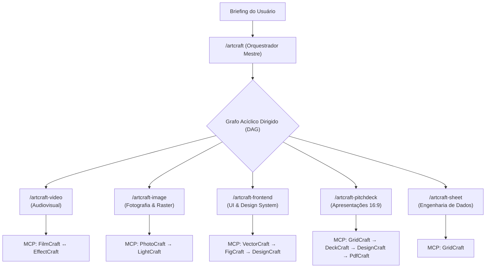

# 🎨 ArtCraft Multi-Agent Suite & MCP Ecosystem
### Orquestrador Criativo e Executivo Autônomo para Google Antigravity

[](https://antigravity.google)
[](https://modelcontextprotocol.io)
[](LICENSE)
[](https://getartcraft.com)

A **ArtCraft Suite** é uma arquitetura multiagente de nível industrial desenvolvida para o ecossistema **Google Antigravity** e **Gemini CLI**. Ela transforma o assistente em um orquestrador mestre e em equipes especializadas de ponta, capazes de manipular diretamente **10 aplicativos profissionais** através do protocolo **MCP (Model Context Protocol)** em modo headless e bidirecional.

---

## 🏛️ Arquitetura da Suíte



---

## 📦 Matriz de Especialização (Skills & Apps MCP)

| Skill Antigravity | Apps Conectados via MCP | Escopo e Responsabilidade Soberana |
| :--- | :--- | :--- |
| **`/artcraft`** | *Todos os 10 apps* | Decomposição de briefings em DAG, manifesto centralizado (`project-manifest.json`), roteamento entre skills e validação de checkpoints. |
| **`/artcraft-video`** | **FilmCraft** & **EffectCraft** | Edição rítmica, montagem de timeline, mixagem sonora, motion graphics, lower-thirds e vinhetas com keyframes. |
| **`/artcraft-image`** | **PhotoCraft** & **LightCraft** | Manipulação raster em camadas, máscaras, smart objects, revelação RAW, curvas tonais e color grading cinematográfico. |
| **`/artcraft-frontend`** | **VectorCraft**, **FigCraft** & **DesignCraft** | Ícones SVG de precisão, frames de telas, auto-layout responsivo e styleguides editoriais com tokens CSS. |
| **`/artcraft-pitchdeck`** | **DeckCraft**, **DesignCraft** & **PdfCraft** | Decks de captação (16:9), narrativa de slides, tabelas financeiras, diagramação e compilação do PDF final. |
| **`/artcraft-sheet`** | **GridCraft** | Modelagem financeira matricial, projeções de fluxo de caixa (DCF), análise de cohort, precificação e fórmulas. |

---

## 🚀 Como Baixar e Instalar do GitHub

Qualquer desenvolvedor ou designer pode clonar e utilizar esta suíte instantaneamente com qualquer um dos métodos abaixo:

### Método 1: Instalador Automático de 1 Comando (Recomendado)

#### No Windows (PowerShell):
Se você já clonou o repositório:
```powershell
powershell -ExecutionPolicy Bypass -File .\install.ps1
```
Ou baixe e instale diretamente via terminal:
```powershell
irm https://raw.githubusercontent.com/SEU_USUARIO/SEU_REPOSITORIO/main/install.ps1 | iex
```

#### No macOS / Linux (Terminal):
```bash
chmod +x ./install.sh && ./install.sh
```
*O que o instalador faz automaticamente:*
1. Copia todas as 6 skills para a pasta global de configurações do Antigravity (`~/.gemini/config/skills`).
2. Detecta os aplicativos ArtCraft instalados no seu computador.
3. Atualiza seu `~/.gemini/config/mcp_config.json` preservando outros servidores existentes (como Supabase, SQLite, etc.) e configurando as pastas de leitura e escrita do seu usuário.

---

### Método 2: Modo Workspace Direto (Zero Instalação)
Se você não deseja instalar globalmente na máquina:
1. Faça o clone do repositório:
   ```bash
   git clone https://github.com/SEU_USUARIO/SEU_REPOSITORIO.git
   ```
2. Abra a pasta no **Antigravity IDE** ou inicie sua sessão nessa pasta.
3. O Antigravity detecta automaticamente a pasta `.agents/skills` e ativa todas as 6 skills e regras imediatamente para este projeto!

---

### Método 3: Instalação Manual

Se preferir copiar manualmente:
1. Copie as pastas dentro de `skills/` para:
   - **Windows**: `C:\Users\<SEU_USUARIO>\.gemini\config\skills\`
   - **macOS/Linux**: `~/.gemini/config/skills/`
2. Abra seu arquivo de configuração MCP (`~/.gemini/config/mcp_config.json`) e adicione as definições encontradas no arquivo [`mcp_config.json`](mcp_config.json) deste repositório.

---

## 🕹️ Como Utilizar o MCP de Cada App

### 1. Pelo Chat do Antigravity (Linguagem Natural)
Você pode simplesmente pedir para o agente executar ações diretamente nos aplicativos. O Antigravity selecionará as ferramentas MCP sob demanda:

- **DeckCraft (Apresentações)**:
  > *"DeckCraft: crie uma nova apresentação com o tema Harbor, adicione 3 slides sobre o produto X e renderize o preview."*
- **VectorCraft (Vetores e SVGs)**:
  > *"VectorCraft: desenhe um ícone moderno de foguete em SVG com traço de 2px e paleta azul royal."*
- **PhotoCraft (Manipulação de Fotos)**:
  > *"PhotoCraft: abra a foto de produto, remova o fundo com máscara de precisão e salve em .pcraft."*
- **LightCraft (Revelação e Cores)**:
  > *"LightCraft: ajuste a exposição da foto em +0.5 EV, aumente o contraste e aplique color grading quente."*
- **PdfCraft (Documentos)**:
  > *"PdfCraft: junte o pitch-deck.pdf e o termo-de-adesao.pdf em um único documento otimizado."*
- **FigCraft (UI & Telas)**:
  > *"FigCraft: monte um frame mobile (390x844) com layout atômico para a tela de checkout."*
- **DesignCraft (Editorial)**:
  > *"DesignCraft: crie a diagramação do manual de marca com grid de 3 colunas e exporte a página 1."*
- **FilmCraft (Vídeo)**:
  > *"FilmCraft: corte os clipes de vídeo nos segundos [1.2, 4.5, 8.0] e normalize o áudio em -14 LUFS."*
- **EffectCraft (Motion Graphics)**:
  > *"EffectCraft: crie uma vinheta com lower-third animado e exporte em ProRes com canal alfa."*
- **GridCraft (Planilhas e Dados)**:
  > *"GridCraft: construa a modelagem financeira com projeção de crescimento de 15% ao mês e exporte em .xlsx."*

---

### 2. Pelo Terminal (Executáveis CLI Diretos)
Para usar as ferramentas da linha de comando diretamente no PowerShell:
```powershell
. .\enable-cli.ps1
```
Isso disponibiliza instantaneamente todos os binários no seu PATH:
```powershell
deckcraft-cli info apresentacao.deckcraft
vectorcraft-cli convert logo.ai logo.svg --outline-text
pdfcraft-cli combine a.pdf b.pdf --out final.pdf
gridcraft-cli eval "SUM(A1:A50)" --in financas.xlsx
lightcraft-cli render foto.dng -o foto.jpg --size 1920
```

---

## 🔍 Inspecionando Servidores MCP no Antigravity

Para verificar o status das ferramentas MCP conectadas:
1. No Antigravity, clique no menu de opções **...** (canto superior direito) > **MCP Servers**.
2. Você verá a lista de todos os servidores ArtCraft ativos (`deckcraft`, `vectorcraft`, `pdfcraft`, etc.) e a listagem de ferramentas disponíveis.

---

## 📂 Estrutura do Repositório

```text
├── .agents/
│   ├── rules/
│   │   └── AGENTS.md                 # Regras rígidas de governança e fronteiras operacionais
│   └── skills/                       # Auto-descoberta para quem clona o repositório
│       ├── artcraft/
│       ├── artcraft-frontend/
│       ├── artcraft-image/
│       ├── artcraft-pitchdeck/
│       ├── artcraft-sheet/
│       └── artcraft-video/
├── skills/                           # Cópia raiz para empacotamento e distribuição
├── mcp_config.json                   # Configuração MCP padrão (Windows)
├── mcp_config.template.json          # Template portátil (Windows / macOS / Linux)
├── plugin.json                       # Manifesto de Plugin Antigravity
├── install.ps1                       # Instalador automático Windows
├── install.sh                        # Instalador automático macOS/Linux
├── uninstall.ps1                     # Desinstalador seguro
├── enable-cli.ps1                    # Script para carregar CLIs no PATH do terminal
├── LICENSE                           # Licença MIT
└── README.md                         # Documentação completa
```

---

## 🤝 Contribuindo

Pull requests são muito bem-vindos! Se você estendeu regras, adicionou presets ou aprimorou integrações de handoff, sinta-se à vontade para abrir uma issue ou enviar seu PR.

## 📄 Licença

Distribuído sob a licença **MIT**. Consulte o arquivo [LICENSE](LICENSE) para obter mais informações.
