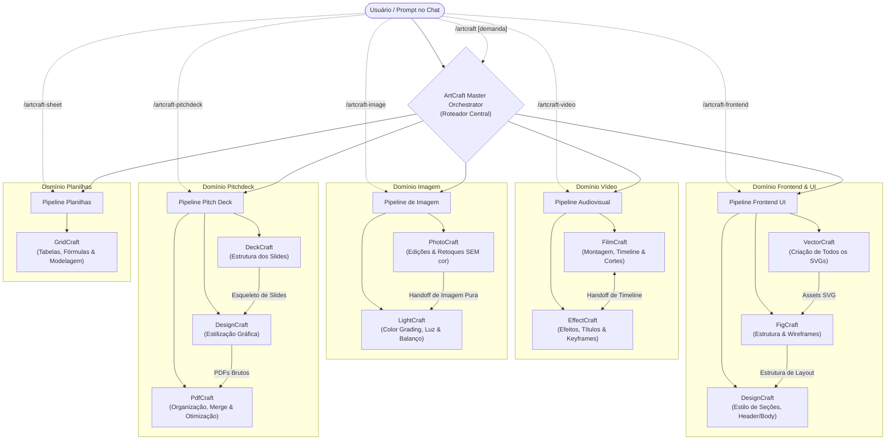

# ArtCraft Agent Orchestrator — Estrutura e Arquitetura Conceitual

Documento de concepção inicial para o orquestrador multiagente da suíte **ArtCraft**, definindo a integração de ferramentas, divisão de papéis, matriz de comandos nativos e protocolos de transição (*handoff*) entre agentes especialistas.

---

## 1. Visão Geral e Proposta

O objetivo do orquestrador é coordenar de forma autônoma e colaborativa as ferramentas da suíte ArtCraft para execução de projetos criativos, técnicos e executivos. Cada ferramenta opera dentro de fronteiras operacionais estritas para evitar conflito de atribuições e redundância de processamento.

### Mapeamento Base de Ferramentas por Domínio:
- **Vídeo:** `FilmCraft` (montagem de vídeo) + `EffectCraft` (efeitos visuais e animações).
- **Imagem:** `PhotoCraft` (edições e retoques sem alteração de cor) + `LightCraft` (colorimetria e luz).
- **Frontend / UI:** `FigCraft` (estrutura do site) + `DesignCraft` (estilização de corpo/seções) + `VectorCraft` (geração de todos os SVGs).
- **Pitchdeck:** `DeckCraft` (estrutura de slides) + `DesignCraft` (estilização gráfica) + `PdfCraft` (organização e compilação do PDF).
- **Sheet (Planilhas):** `GridCraft` (dados tabulares, modelagem e fórmulas).

---

## 2. Diagrama de Arquitetura do Orquestrador



---

## 3. Matriz de Comandos e Divisão Rígida de Papéis

Cada tarefa conta com um **Slash Command** dedicado ativado diretamente no chat (`/<comando>`), com escopos definidos e restrições expressas:

| Comando | Domínio | Ferramenta | Papel Exclusivo no Fluxo | Proibições / Fronteiras Rígidas |
| :--- | :--- | :--- | :--- | :--- |
| **`/artcraft-video`** | Vídeo & Motion | **FilmCraft** | **Montagem e Estrutura:** corte seco (*rough* e *fine cut*), sincronismo de áudio e locução, distribuição de faixas (A-Roll em V1, B-Roll em V2, locução em A1, trilha em A3). | Não cria vinhetas complexas ou keyframes manuais de VFX. |
| | | **EffectCraft** | **Efeitos e Gráficos:** motion graphics, *lower-thirds*, legendas dinâmicas, animação por keyframes, transições estilizadas, máscaras e efeitos visuais. | Não faz a montagem linear da narrativa principal. |
| **`/artcraft-image`** | Imagem & Foto | **PhotoCraft** | **Edição e Manipulação:** remoção de fundo e manchas, recorte de máscaras, composição em múltiplas camadas, texturas, clonagem e fotomontagens. | **PROIBIDO alterar colorimetria, balanço de brancos ou gradação de cor.** |
| | | **LightCraft** | **Tratamento de Cor e Luz:** controle de exposição (EV), realce de sombras/altas luzes, balanço de brancos (Kelvin/tint), curvas de tom RGB, presets e color grading. | Não realiza recortes em camadas ou remoção de objetos complexos. |
| **`/artcraft-frontend`** | Web & Interfaces | **FigCraft** | **Estrutura do Site:** grid responsivo, marcação de frames (containers), hierarquia de nós DOM, auto-layout horizontal/vertical, gaps e padding. | Não desenha ícones SVG complexos nem fecha manuais de estilo editorial. |
| | | **DesignCraft** | **Estilo do Body e Seções:** definição visual de headers, footers, seções, tipografia editorial, especificações de design tokens e CSS. | Não define o auto-layout atômico dos nós. |
| | | **VectorCraft** | **Assets Vetoriais:** criação e desenho de **todos os SVGs** (ícones, logos, grafismos vetoriais e ilustrações Bezier). | Não monta a estrutura completa da página web. |
| **`/artcraft-pitchdeck`** | Apresentações | **DeckCraft** | **Estrutura dos Slides:** arquitetura da apresentação 16:9, ordenação de slides, títulos, disposição dos blocos de texto, gráficos estruturais e métricas. | Não formata documentos editoriais densos. |
| | | **DesignCraft** | **Estilização Visual:** polimento estético corporativo, paleta visual executiva, estilização de tabelas e diagramação de one-pagers/anexos. | Não define a ordenação primária dos slides. |
| | | **PdfCraft** | **Organização e Fechamento:** união de páginas (*merge*), split, conferência de rotação/orientação, numeração final, compressão e geração do PDF entregável. | Não edita o conteúdo visual interno dos slides. |
| **`/artcraft-sheet`** | Dados & Tabelas | **GridCraft** | **Estrutura e Dados:** tabelas de dados, modelagem financeira, aplicação de fórmulas (matemáticas/estatísticas), formatação condicional e exportação tabular. | Não realiza diagramação editorial. |
| **`/artcraft`** | **Orquestrador Central** | Todos os acima | Analisa briefings complexos ou multimídia, decompõe em subtarefas e orquestra a passagem de bastão (*handoff*) entre os pipelines. | — |

---

## 4. Estrutura de Arquivos e Pastas do Orquestrador

A estrutura segue o padrão do sistema de Customizações/Skills do Antigravity, permitindo que cada pasta sob `skills/` seja convertida nativamente em um comando executável:

```text
skills/
├── artcraft/                           # Comando: /artcraft (Orquestrador Mestre)
│   ├── SKILL.md                        # Lógica de triagem, roteamento e checkpoints
│   └── references/
│       ├── handoffs.md                 # Contratos de transferência de arquivos entre ferramentas
│       └── quality-checklist.md        # Critérios de aceitação para entrega final
│
├── artcraft-video/                     # Comando: /artcraft-video
│   ├── SKILL.md                        # Pipeline detalhado FilmCraft -> EffectCraft
│   └── references/
│       └── video-specs.md              # Resoluções (16:9, 9:16), FPS e faixas de áudio
│
├── artcraft-image/                     # Comando: /artcraft-image
│   ├── SKILL.md                        # Pipeline estrito PhotoCraft (edição) -> LightCraft (cor)
│   └── references/
│       └── color-grading-rules.md      # Parâmetros numéricos de luz e temperatura
│
├── artcraft-frontend/                  # Comando: /artcraft-frontend
│   ├── SKILL.md                        # Pipeline VectorCraft (SVG) + FigCraft (estrutura) + DesignCraft (estilo)
│   └── references/
│       └── web-layout-tokens.md        # Dimensões de tela, breakpoints e tokens
│
├── artcraft-pitchdeck/                 # Comando: /artcraft-pitchdeck
│   ├── SKILL.md                        # Pipeline DeckCraft (estrutura) -> DesignCraft (estilo) -> PdfCraft (organização)
│   └── references/
│       └── deck-structures.md          # Modelos de decks (Seed, Series A, Vendas)
│
└── artcraft-sheet/                     # Comando: /artcraft-sheet
    ├── SKILL.md                        # Pipeline de planilhas e modelagem com GridCraft
    └── references/
        └── formulas-and-formats.md     # Biblioteca de fórmulas e formatação financeira
```

---

## 5. Ciclo de Vida e Protocolos de Execução (Handoff)

Qualquer solicitação processada pelo orquestrador passa por quatro etapas obrigatórias:

### Etapa 1: Briefing & Triagem
- O orquestrador identifica o comando acionado ou decompõe o briefing multimídia.
- Validação de pré-requisitos essenciais: proporções de aspecto, formatos de exportação, identidade visual e restrições técnicas.

### Etapa 2: Execução Sequencial com Passagem de Bastão (*Handoff*)
- **Pipeline de Imagem:**
  1. *PhotoCraft* recebe o arquivo bruto, realiza recorte, retoque de pele/manchas e fotomontagem em camadas;
  2. Salva o arquivo mestre (`.pcraft`) e gera um arquivo intermediário não-comprimido;
  3. *LightCraft* abre esse exportado e aplica calibração de exposição, balanço de brancos e curvas de cor;
  4. Exportação final em alta resolução.
- **Pipeline de Frontend:**
  1. *VectorCraft* desenha e exporta todos os assets vetoriais em `.svg`;
  2. *FigCraft* recebe os SVGs, cria a estrutura dos frames semânticos, define o auto-layout e posicionamento;
  3. *DesignCraft* recebe o layout estruturado, injeta as folhas de estilo para body/seções, headers, footers e documentação técnica.
- **Pipeline de Pitchdeck:**
  1. *DeckCraft* constrói a narrativa e estrutura os slides 16:9;
  2. *DesignCraft* aplica o estilo visual, paleta executiva e formata gráficos e tabelas;
  3. *PdfCraft* compila, reordena páginas, anexa memorandos externos e otimiza o PDF final.
- **Pipeline de Vídeo:**
  1. *FilmCraft* faz a montagem seca, corte de silêncios e ordenação das faixas principais;
  2. *EffectCraft* cria os grafismos animados (títulos, terços inferiores, efeitos) com canal alfa e sobrepõe na trilha gráfica;
  3. Masterização final de áudio com *ducking* sonoro e renderização.
- **Pipeline de Planilhas:**
  1. *GridCraft* estrutura o esquema tabular, define tipos de dados, injeta fórmulas matemáticas/financeiras e aplica formatação condicional.

### Etapa 3: Inspeção e Pré-Visualização
- A cada fase crítica, uma imagem de pré-visualização (`render_preview`, `render_frame` ou `render_slide`) é gerada e verificada antes de avançar para a próxima ferramenta.

### Etapa 4: Entrega Consolidada
- Apresentação dos caminhos dos arquivos de projeto (editáveis) e dos arquivos finais renderizados com links clicáveis para acesso imediato.
